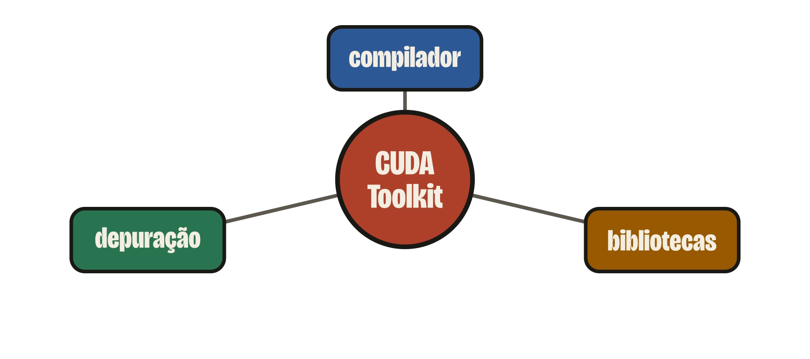
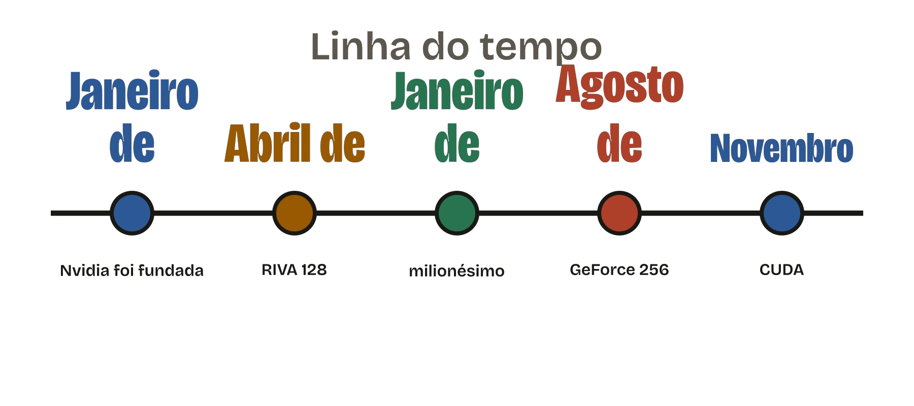

# A Nvidia foi a primeira empresa a valer US$ 5 trilhões

_2026-11-27 · filme_

A Nvidia chegou a US$ 5 trilhões de valor de mercado ao conectar GPUs, CUDA e uma base de desenvolvedores formada no próprio ambiente. Ao longo da leitura, você vai entender como uma plataforma de computação paralela transformou o hardware gráfico em infraestrutura para treinar e operar grandes modelos de IA. Também vai aprender a diferença entre valor de mercado e receita, a interpretar as marcas intradiárias de 2023 a 2025 e a reconhecer os limites do acesso gratuito às ferramentas. O percurso termina com um roteiro de estudo e prática apoiado nas páginas oficiais da Nvidia.

## O contexto

_Marca intradiária da Nvidia: US$ 5 trilhões de valor de mercado em 29 de outubro de 2025._

Em 29 de outubro de 2025, a Nvidia atingiu a marca intradiária de US$ 5 trilhões de valor de mercado e se tornou a primeira empresa a alcançar esse patamar. O valor registra a apreciação das ações da companhia no mercado, não a receita obtida com vendas. Essa distinção é importante para entender o tamanho do feito sem confundir valor de mercado, faturamento, lucro ou dinheiro em caixa.

A trajetória começa com a presença da família GeForce entre gamers, passa pela apresentação do CUDA em novembro de 2006 e alcança a infraestrutura usada no desenvolvimento e na operação de grandes modelos de IA. Hardware, software e profissionais passaram a funcionar como partes de uma mesma oferta.

A explicação central é que disponibilizar ferramentas de programação pode ampliar o número de pessoas capazes de usar um hardware. Quando esses profissionais entram no mercado, a familiaridade com o ambiente influencia o desenvolvimento de projetos e a contratação. A corrida da IA generativa aumentou a procura por GPUs e encontrou a Nvidia com GPUs, CUDA, bibliotecas e uma base grande de desenvolvedores.

Fonte: <https://www.sec.gov/Archives/edgar/data/1045810/000104581026000021/nvda-20260125.htm>

## Por que isso importa

Um modelo de IA depende de operações computacionais para ser treinado e utilizado. Quando essas operações podem ser organizadas em paralelo, um GPU pode executar muitas delas ao mesmo tempo. O CUDA trouxe uma forma de escrever aplicações em C para explorar esse processamento paralelo em problemas matemáticos intensivos.

A escolha de uma plataforma de IA envolve mais do que comprar um componente. O desenvolvedor precisa de ferramentas para escrever e compilar programas, de bibliotecas para apoiar o trabalho e de recursos para localizar erros. A empresa também precisa encontrar profissionais familiarizados com esse ambiente. Essas necessidades ligam hardware, software e contratação.

Para quem estuda ou trabalha com IA, entender essa ligação ajuda a avaliar uma solução com mais profundidade. A pergunta deixa de ser apenas qual GPU comprar e passa a incluir quais ferramentas estão disponíveis, como o software é programado e que experiência a equipe já possui. O ecossistema pode reduzir barreiras de entrada para quem começa, mas também pode criar dependência para quem já investiu nele.

Fonte: <https://www.sec.gov/Archives/edgar/data/1045810/000104581026000021/nvda-20260125.htm>

## A base criada entre gamers: 1993 a 1999

A linha do tempo corporativa da Nvidia registra a fundação da empresa em janeiro de 1993. Em abril de 1997, a companhia lançou o RIVA 128. Em janeiro de 1998, já embarcava o milionésimo. Esses marcos mostram a evolução inicial da empresa antes de a família GeForce ampliar sua presença entre gamers.

Em agosto de 1999, a Nvidia lançou o GeForce 256, o primeiro GPU da empresa. GPU significa unidade de processamento gráfico, um hardware voltado originalmente ao processamento de gráficos e capaz de executar muitas operações em paralelo. O GeForce 256 ocupa um ponto importante da história da empresa por ter inaugurado essa linha dentro de seu portfólio.

A presença entre gamers deu visibilidade à marca e criou uma base de usuários de hardware gráfico. A infraestrutura de IA veio depois, sustentada por software e pela ampliação do uso dos GPUs além dos jogos. Por isso, a história da Nvidia no setor de IA começa com uma vantagem prática: já existia familiaridade com a plataforma e com o hardware que a sustentava.

Fonte: <https://www.nvidia.com/en-us/about-nvidia/corporate-timeline/>

## CUDA e a virada para a computação paralela

A plataforma permitiu que programadores escrevessem aplicações em C para GPUs e usassem processamento paralelo em problemas matemáticos intensivos. O CUDA ampliou o acesso à computação por GPU ao oferecer um ambiente de programação para esse tipo de trabalho.

Na computação paralela, partes independentes de um problema podem avançar ao mesmo tempo. Um GPU reúne grande capacidade de execução paralela, e o CUDA fornece o caminho de software para organizar esse trabalho. Engenheiros e cientistas passaram a resolver no PC problemas que antes eram proibitivos em custo, segundo o relatório da empresa.

Essa mudança aumentou o leque de aplicações possíveis para o hardware Nvidia. Pesquisadores passaram a treinar modelos de IA usando a tecnologia da empresa. O hardware continuou sendo vendido, enquanto o software criava novas formas de utilização e reunia usuários ao redor da plataforma. O CUDA foi a ponte entre o GPU conhecido do público e a computação intensiva usada em pesquisa e IA.

Fonte: <https://www.sec.gov/Archives/edgar/data/1045810/000104581007000008/fy2007annualreportonform10-k.htm>

## O que há dentro do CUDA Toolkit

_CUDA Toolkit com compilador, bibliotecas e depuração._

O CUDA Toolkit reúne compilador, bibliotecas e ferramentas de depuração. O compilador transforma o código escrito pelo programador em uma forma que pode ser executada pelo sistema. As bibliotecas oferecem funcionalidades já implementadas para apoiar o desenvolvimento. A depuração é o processo de localizar e corrigir erros no programa.

Essas peças mostram por que uma plataforma de computação precisa de mais do que um chip. O desenvolvedor precisa escrever o programa, prepará-lo para execução, aproveitar funcionalidades disponíveis e verificar se ele funciona como esperado. O Toolkit organiza esse trabalho em um único conjunto de ferramentas.

O programa de desenvolvedores da Nvidia oferece acesso gratuito a ferramentas como o CUDA Toolkit. O alcance da gratuidade está no acesso a essas ferramentas de desenvolvimento. O hardware, a infraestrutura e a operação de modelos continuam sendo partes separadas da decisão técnica e econômica.

Fonte: <https://developer.nvidia.com/cuda-toolkit>

## Ferramentas gratuitas e a formação de um ecossistema

O relatório 10-K de 2009 informa que mais de 25 mil desenvolvedores usavam CUDA naquele ano. O mesmo documento registra que mais de 100 universidades ensinavam programação paralela com a plataforma. Os dois números mostram dimensões diferentes da adoção: o uso profissional e a presença no ensino.

O acesso gratuito ao CUDA Toolkit reduziu uma barreira para quem queria começar a programar para GPUs. Ao mesmo tempo, o ensino nas universidades colocou a plataforma no caminho de estudantes e pesquisadores. Essas pessoas aprendiam a trabalhar com compilador, bibliotecas e depuração dentro do ambiente Nvidia.

Quando esses profissionais entraram no mercado, levaram essa familiaridade para as equipes. A contratação passou a refletir o conhecimento disponível e aumentou a demanda por hardware compatível com o ambiente já utilizado. Uma base maior de desenvolvedores e GPUs instaladas fortaleceu o ecossistema e aumentou o valor da plataforma. O mecanismo é ciclo: ferramentas formam usuários, usuários influenciam projetos e projetos sustentam a procura pelo hardware.

Fonte: <https://www.sec.gov/Archives/edgar/data/1045810/000104581009000013/fy2009form10k.htm>

## A IA generativa elevou a demanda por GPUs

A explosão da IA generativa aumentou a demanda por GPUs. Google, Microsoft, Meta, Amazon e OpenAI passaram a comprar bilhões em GPUs para desenvolver e operar grandes modelos. O trabalho de treinamento e operação exigia capacidade computacional em escala, e a procura deixou de estar concentrada apenas no uso gráfico tradicional.

A Nvidia já reunia GPUs, CUDA, bibliotecas e uma base grande de desenvolvedores. Essa combinação reduziu a distância entre a demanda por capacidade de IA e um ambiente capaz de atendê-la. As empresas encontravam hardware e software da Nvidia, além de profissionais habituados ao ecossistema.

A escala de data center tornou essa ligação mais visível. Quem precisava treinar modelos gigantes encontrava capacidade pronta nessa infraestrutura. A escolha do fornecedor aparecia tanto no desenvolvimento dos modelos quanto na montagem das equipes. A Nvidia ampliou seu papel além dos gamers e ocupou uma posição central na operação de IA.

Fonte: <https://www.cnbc.com/2024/06/05/nvidia-briefly-passes-3-trillion-market-cap-on-back-of-ai-boom.html>

## Os números

Os indicadores dessa história têm duas funções diferentes. Os números de desenvolvedores e universidades medem a adoção do CUDA em 2009. As marcas de valor de mercado registram a valorização intradiária da Nvidia entre 2023 e 2025. Cada valor precisa ser lido com sua data, unidade e contexto.

As marcas de mercado são momentos dentro do pregão. Elas não representam necessariamente o fechamento do dia, a receita da empresa ou o valor levantado em uma captação. A sequência mostra a velocidade da valorização no período, mas não isola o efeito de um único produto ou decisão.

- Mais de 25 mil desenvolvedores usavam CUDA em 2009. O número indica adoção da plataforma naquele ano e não mede o tamanho atual da comunidade.
- Mais de 100 universidades ensinavam programação paralela com CUDA em 2009. O dado mostra a presença da plataforma no ensino superior naquele momento.
- Em 30/05/2023, a Nvidia atingiu a primeira marca intradiária de US$ 1 trilhão de valor de mercado. O valor corresponde à apreciação das ações na sessão, não à receita anual.
- Em 23/02/2024, atingiu a marca intradiária de US$ 2 trilhões. O valor representa uma nova referência de mercado dentro do pregão.
- Em 05/06/2024, atingiu a marca intradiária de US$ 3 trilhões. A marca acompanhou a valorização associada à demanda por IA.
- Em 29/10/2025, atingiu a marca intradiária de US$ 5 trilhões e se tornou a primeira empresa a alcançar esse patamar. O número é valor de mercado, não faturamento ou lucro.

Fonte: <https://www.cnbc.com/2025/10/29/nvidia-on-track-to-hit-historic-5-trillion-valuation-amid-ai-rally.html>

## Como funciona na prática

Imagine que uma equipe de pesquisa precisa tratar um problema matemático intensivo e decidir se um GPU pode ajudar. O primeiro passo é identificar quais partes do problema podem ser executadas em paralelo. Depois, a equipe escreve uma aplicação em C e usa o CUDA Toolkit para compilar o programa.

Durante o desenvolvimento, a equipe pode aproveitar bibliotecas disponíveis e usar as ferramentas de depuração para localizar erros. O trabalho não termina quando o programa compila. É preciso verificar se ele produz o resultado esperado e se a organização do processamento paralelo está correta.

Quando a aplicação passa a operar em uma estrutura maior, entram as GPUs, a infraestrutura de data center e os profissionais responsáveis pela operação. Uma equipe habituada ao CUDA já conhece parte desse caminho. Esse exemplo mostra como hardware, ferramentas e conhecimento se conectam no uso prático da plataforma, sem atribuir ao CUDA, isoladamente, todo o resultado de um projeto de IA.

Fonte: <https://docs.nvidia.com/cuda/cuda-c-programming-guide/index.html>

## Linha do tempo

_Linha do tempo da Nvidia e do CUDA, de 1993 a 2006._

A linha do tempo reúne os marcos da empresa e da plataforma. As datas mostram que a infraestrutura de IA foi construída em etapas, com o hardware gráfico precedendo o ambiente de programação e a adoção em larga escala.

- Janeiro de 1993: a Nvidia foi fundada.
- Abril de 1997: a empresa lançou o RIVA 128.
- Janeiro de 1998: a Nvidia já embarcava o milionésimo RIVA 128.
- Agosto de 1999: foi lançado o GeForce 256, o primeiro GPU da empresa.
- Novembro de 2006: a Nvidia apresentou o CUDA, permitindo escrever aplicações em C para GPUs.
- 2009: mais de 25 mil desenvolvedores usavam CUDA e mais de 100 universidades ensinavam programação paralela com a plataforma.
- 30/05/2023: primeira marca intradiária de US$ 1 trilhão de valor de mercado.
- 23/02/2024: marca intradiária de US$ 2 trilhões de valor de mercado.
- 05/06/2024: marca intradiária de US$ 3 trilhões de valor de mercado.
- 29/10/2025: marca intradiária de US$ 5 trilhões de valor de mercado.

Fonte: <https://www.nvidia.com/en-us/about-nvidia/corporate-timeline/>

## Quem ganha e quem perde

A Nvidia ganhou uma posição que combina venda de hardware e valor de plataforma. O software ampliou os usos possíveis do hardware e criou familiaridade entre os profissionais que desenvolvem e operam aplicações.

Desenvolvedores e pesquisadores ganharam ferramentas para usar processamento paralelo em problemas matemáticos intensivos. Estudantes tiveram contato com o ambiente em universidades. Empresas de IA encontraram hardware, bibliotecas e profissionais familiarizados com a plataforma, o que reduziu a distância entre a ideia de um projeto e sua implementação.

Quem compra essa infraestrutura também assume uma dependência. A escolha do CUDA pode influenciar a formação das equipes, as bibliotecas utilizadas e a continuidade dos projetos. Para uma empresa que já opera nesse ambiente, a familiaridade é uma vantagem. Para um novo fornecedor ou uma equipe formada em outra plataforma, essa mesma concentração de conhecimento pode representar uma barreira adicional. Os dados apresentados mostram a força do ecossistema, mas não permitem afirmar que todos os participantes tenham o mesmo resultado.

Fonte: <https://www.sec.gov/Archives/edgar/data/1045810/000104581026000021/nvda-20260125.htm>

## O que ainda não se sabe

As marcas de US$ 1 trilhão, US$ 2 trilhões, US$ 3 trilhões e US$ 5 trilhões são intradiárias. Para interpretá-las, é necessário separar o que o número registra daquilo que ele não demonstra. A mesma disciplina vale para os indicadores de adoção do CUDA e para o acesso gratuito às ferramentas.

- Uma marca intradiária mostra o valor alcançado dentro do pregão. Ela não garante que a ação tenha fechado nesse patamar.
- Valor de mercado não é receita, lucro ou dinheiro disponível em caixa. Os US$ 5 trilhões não significam que a Nvidia faturou esse valor.
- Os números de 2009 descrevem a adoção do CUDA naquele ano. Eles não medem a comunidade atual nem o número de profissionais exclusivos da plataforma.
- O acesso gratuito ao CUDA Toolkit se refere às ferramentas de desenvolvimento. Ele não torna gratuitos o hardware, a infraestrutura ou a operação de modelos.
- A sequência de valorização não separa o efeito do CUDA da explosão da IA generativa, das compras de GPUs e de outros fatores de mercado.
- A familiaridade de profissionais com o CUDA pode influenciar a contratação e o desenvolvimento. Ela não prova que todos os profissionais formados no ambiente saibam trabalhar apenas com a plataforma da Nvidia.
- Uma marca histórica de valor de mercado não garante que o mesmo ritmo de valorização continue no futuro.

Fonte: <https://www.cnbc.com/2025/10/29/nvidia-on-track-to-hit-historic-5-trillion-valuation-amid-ai-rally.html>

## O que você pode fazer

O caminho de estudo começa pelo conceito de processamento paralelo e continua pelas ferramentas oficiais. A sequência abaixo liga a explicação da plataforma a ações concretas, sem depender de comandos que não fazem parte deste conteúdo.

1. Revise a linha do tempo oficial da Nvidia para localizar o lançamento do GeForce 256, a apresentação do CUDA e os marcos de adoção. O resultado esperado é uma visão ordenada da evolução da empresa.
2. Leia a documentação de programação CUDA para entender como aplicações em C usam GPUs. O resultado esperado é compreender a relação entre o programa e o processamento paralelo.
3. Acesse o programa de desenvolvedores da Nvidia para identificar as ferramentas disponíveis. O resultado esperado é reconhecer o CUDA Toolkit e o acesso gratuito oferecido pelo programa.
4. Obtenha o CUDA Toolkit pela página oficial e siga as instruções apresentadas nela. O resultado esperado é ter acesso ao compilador, às bibliotecas e às ferramentas de depuração.
5. Escolha um problema matemático intensivo do seu trabalho e identifique quais partes podem ser executadas em paralelo. O resultado esperado é uma lista clara das operações candidatas ao processamento por GPU.
6. Escreva uma aplicação em C, compile-a com o Toolkit e use a depuração para corrigir eventuais erros. O resultado esperado é um programa que execute no ambiente CUDA e produza o resultado pretendido.
7. Ao avaliar uma solução de IA, relacione GPUs, CUDA, bibliotecas, experiência da equipe e infraestrutura de operação. O resultado esperado é uma análise que considere hardware e ecossistema juntos.

Fonte: <https://developer.nvidia.com/developer-program>

## Glossário

Os termos abaixo aparecem ao longo da apostila e ajudam a separar os componentes técnicos dos indicadores de mercado.

- GPU: unidade de processamento gráfico, hardware capaz de executar muitas operações em paralelo.
- Hardware: parte física do sistema, como GPUs e componentes de infraestrutura.
- Software: programas e ferramentas que instruem o hardware e organizam seu uso.
- CUDA: plataforma da Nvidia que permite escrever aplicações em C para GPUs e explorar processamento paralelo.
- CUDA Toolkit: conjunto que reúne compilador, bibliotecas e ferramentas de depuração para desenvolvimento CUDA.
- Compilador: ferramenta que transforma o código do programador em uma forma executável pelo sistema.
- Biblioteca: conjunto de funcionalidades implementadas que pode ser reutilizado no desenvolvimento de programas.
- Depuração: processo de localizar e corrigir erros em um programa.
- Processamento paralelo: execução de partes independentes de um trabalho ao mesmo tempo.
- Desenvolvedor: profissional que escreve, testa e mantém programas.
- Modelo de IA: sistema treinado para realizar tarefas como gerar conteúdo ou apoiar decisões.
- IA generativa: tipo de IA voltado à criação de conteúdo, como texto, imagens ou código.
- Data center: instalação que reúne infraestrutura computacional para processar e armazenar dados em escala.
- Ecossistema: conjunto de hardware, software, ferramentas, profissionais e usuários que se conectam ao redor de uma plataforma.
- Valor de mercado: valor atribuído a uma empresa com base em suas ações negociadas no mercado.
- Marca intradiária: valor alcançado durante uma sessão de negociação, antes do fechamento.
- Receita: valor obtido com a venda de produtos ou serviços, distinto do valor de mercado.

Fonte: <https://docs.nvidia.com/cuda/cuda-c-programming-guide/index.html>

## Para onde ir depois

O próximo passo depende do seu objetivo. Para entender a história, use a linha do tempo corporativa. Para começar a programar, priorize a documentação CUDA e o CUDA Toolkit. Para acompanhar a empresa, consulte os relatórios oficiais e leia os números com suas datas e unidades.

A prática recomendada é escolher um problema paralelizável, escrever uma aplicação em C e percorrer o ciclo de compilação e depuração. Esse exercício conecta o conceito de processamento paralelo ao uso real das ferramentas e prepara o estudo de projetos maiores.

- Página oficial da GeForce: https://www.nvidia.com/en-us/geforce/
- Linha do tempo corporativa da Nvidia: https://www.nvidia.com/en-us/about-nvidia/corporate-timeline/
- CUDA Toolkit: https://developer.nvidia.com/cuda-toolkit
- Programa de Desenvolvedores NVIDIA: https://developer.nvidia.com/developer-program
- Documentação de programação CUDA: https://docs.nvidia.com/cuda/cuda-c-programming-guide/index.html
- Treinamento NVIDIA: https://www.nvidia.com/en-us/training/
- Ensino superior e pesquisa NVIDIA: https://www.nvidia.com/en-us/industries/higher-education-research/
- NVIDIA 10-K 2009, desenvolvedores e universidades: https://www.sec.gov/Archives/edgar/data/1045810/000104581009000013/fy2009form10k.htm
- Relatório anual NVIDIA 2025: https://s201.q4cdn.com/141608511/files/doc_financials/2025/annual/NVIDIA-2025-Annual-Report.pdf

Fonte: <https://www.nvidia.com/en-us/training/>
