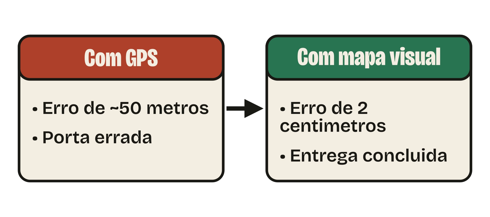
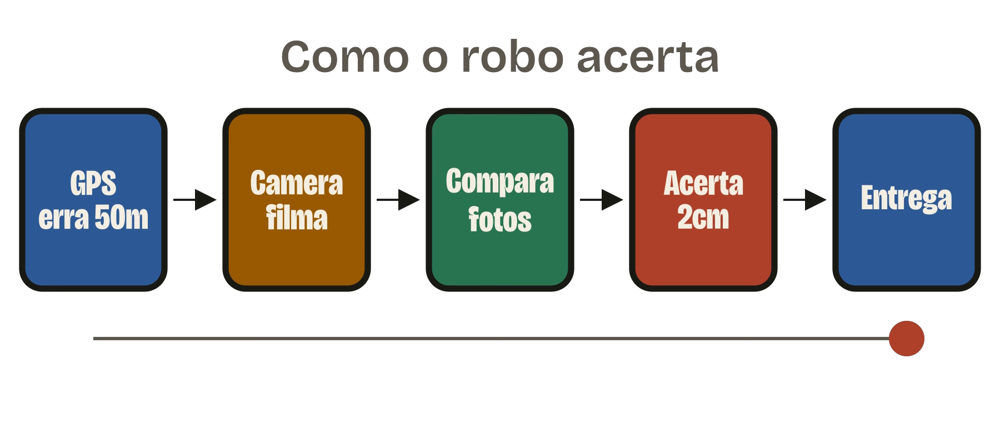
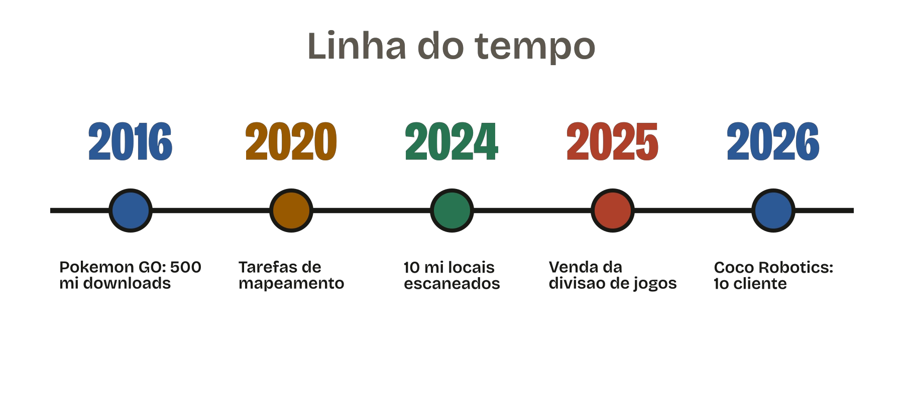

# Coco Robotics é o primeiro cliente do mapa do Pokémon GO

_2026-11-27 · filme_

Em 2016, o Pokémon GO teve 500 milhões de downloads em 60 dias e transformou cada celular em uma câmera andando pela cidade. Dez anos depois, essas fotos viraram um mapa de 30 bilhões de imagens que guia robôs de entrega com precisão de 2 centímetros. A empresa que ficou com o mapa foi a Niantic Spatial, após a venda da divisão de jogos em 2025. O primeiro cliente, em 2026, é a Coco Robotics, com robôs nos Estados Unidos e na Europa. O caso mostra como dados coletados de graça, em troca de um item de jogo, podem virar infraestrutura comercial de navegação. Aqui você entende como o mapa foi feito, por que o GPS falha, quem ganha, quem perde e o que conferir antes de escanear o mundo.

## O contexto

O Pokémon GO foi lançado em 2016 e teve 500 milhões de downloads em 60 dias. Para a Niantic, cada celular era uma câmera andando pela cidade, registrando ruas, praças e pontos de interesse enquanto as pessoas caçavam Pikachu.

Dez anos depois, essas imagens viraram um mapa de 30 bilhões de fotos e mais de 1 milhão de pontos. Esse mapa guia robôs de entrega com precisão de 2 centímetros, onde o GPS costuma errar cerca de 50 metros.

O caso não é só tecnologia. Ele mostra como dados coletados de graça, em troca de um item de jogo, podem virar infraestrutura comercial. Quem achava que estava jogando acabou treinando um robô.

## Como o Pokémon GO virou um scanner de mundo

Em 2020, o jogo ganhou tarefas de mapeamento. Você filmava um Pokéstop de vários ângulos, com a localização exata gravada junto, e ganhava um item dentro do jogo como recompensa.

As imagens se concentravam nos ginásios e Pokéstops, além dos lugares que o jogo incentivava você a visitar. Ou seja, o mapa ficou mais denso justamente onde havia mais jogadores e mais pontos de interesse.

Cada celular virou um sensor. Milhões de pessoas, sem saber, registravam a cidade de vários ângulos, em diferentes horários e condições de luz, criando um acervo de imagens do mundo real.

## O Large Geospatial Model

Em 2024, a Niantic abriu os números: 10 milhões de locais escaneados e cerca de 1 milhão de escaneamentos novos por semana.

Para transformar isso em mapa, a empresa treinou mais de 50 milhões de redes neurais que somam 150 trilhões de parâmetros. O projeto foi batizado de Large Geospatial Model.

A comparação com o ChatGPT ajuda a entender: o ChatGPT aprendeu lendo texto. O modelo da Niantic aprende o mundo físico olhando as suas fotos. Em vez de prever a próxima palavra, ele prevê a próxima posição no espaço.

Fonte: <https://www.nianticspatial.com/blog/largegeospatialmodel>

## A escala atual do mapa

Hoje, o mapa tem 30 bilhões de imagens e mais de 1 milhão de pontos. Cada ponto foi fotografado milhares de vezes, de dia, de noite, no sol e na chuva.

Essa repetição é o que dá precisão. Um ponto visto de vários ângulos e em várias condições de luz vira uma referência estável, que o sistema reconhece mesmo quando o ambiente muda.

O volume também cobre mudanças ao longo do tempo: obras, estações do ano e iluminação diferente. O robô não depende de uma foto perfeita, mas de um conjunto grande de vistas do mesmo lugar.

## Por que o GPS falha e como o robô acerta a 2 centímetros

_GPS erra 50 metros; o mapa visual acerta a 2 centimetros._

O problema dos robôs de entrega é o GPS. Entre prédios altos, o pontinho azul do mapa costuma escorregar uns 50 metros. Para um robô, isso é a diferença entre a porta certa e a rua errada.

O sistema da Niantic Spatial compara o que a câmera do robô vê com as fotos dos jogadores. Ao reconhecer o lugar, ele acerta a posição a 2 centímetros.

A margem que sobra, de 50 metros para 2 centímetros, é o que faz a entrega funcionar em calçadas cheias de prédios e obstáculos.

Fonte: <https://www.nianticspatial.com/blog/coco-robotics>

## O primeiro cliente: Coco Robotics

Em 2026, chegou o primeiro cliente: a Coco Robotics, que opera robôs de entrega nos Estados Unidos e na Europa. Os robôs usam o mapa da Niantic Spatial para se localizar com precisão de 2 centímetros.

O CEO da Niantic Spatial resumiu a ideia: fazer o Pikachu correr de forma realista e fazer o robô andar na calçada são o mesmo problema. Em ambos os casos, é preciso entender o espaço físico com precisão.

A Coco Robotics pode ser conhecida em cocodelivery.com. A parceria com a Niantic Spatial está documentada no blog da empresa.

Fonte: <https://www.nianticspatial.com/blog/coco-robotics>

## Como funciona na prática

_Do erro do GPS a entrega: como o robo se localiza._

Imagine um robô de entrega parado em uma calçada entre dois prédios altos. O GPS indica uma posição que pode estar 50 metros errada.

O robô liga a câmera e filma o que está à frente: fachadas, portas, placas, postes. O sistema compara essa imagem com as fotos dos jogadores que passaram pelo mesmo lugar.

Ao reconhecer o local, o robô sabe exatamente onde está, com erro de 2 centímetros. A partir daí, segue até a porta certa e conclui a entrega.

## Linha do tempo

_De 2016 a 2026: do jogo ao mapa comercial._

- 2016: lançamento do Pokémon GO, com 500 milhões de downloads em 60 dias.
- 2020: o jogo ganha tarefas de mapeamento; jogadores filmam Pokéstops de vários ângulos.
- 2024: a Niantic abre os números: 10 milhões de locais escaneados e cerca de 1 milhão de escaneamentos novos por semana.
- 2025: a Niantic vende a divisão de jogos por 3,5 bilhões de dólares; o Pokémon GO sai; o mapa fica com a Niantic Spatial.
- Dezembro de 2025: a Niantic Spatial fecha parceria com uma empresa cujo software é usado em drones militares.
- 2026: a Coco Robotics se torna o primeiro cliente, com robôs nos Estados Unidos e na Europa.

## Quem ganha e quem perde

A Niantic Spatial ganhou um ativo valioso: um mapa do mundo físico construído com fotos de milhões de pessoas. A Coco Robotics ganhou navegação precisa para seus robôs de entrega.

Os jogadores, por outro lado, deram as imagens de graça. Ninguém recebeu um centavo. O pagamento por escanear o mundo foi um item dentro do jogo, não dinheiro.

O resultado é uma transferência de valor: dados coletados em contexto de lazer viram infraestrutura comercial, com lucro para quem detém o mapa, não para quem o construiu.

## O que ainda não se sabe e onde está o risco

- A parceria de dezembro de 2025 com a empresa de software militar: a Niantic Spatial afirma que os dados do Pokémon GO não fazem parte desse acordo. Isso é uma declaração da empresa, não uma auditoria independente.
- A empresa diz que só escaneou quem ativou o recurso de mapeamento. Vale conferir nos termos de uso se o seu caso se encaixa nessa condição.
- Os termos de uso dão à Niantic uma licença mundial, perpétua e gratuita sobre as suas imagens. Isso significa que a empresa pode usar, modificar e compartilhar essas fotos sem pagar nada.
- Um professor de ética da Universidade de Delft criticou a prática: quem achava que estava jogando foi enganado. Essa é uma opinião acadêmica, não uma decisão judicial.
- O pagamento por escanear o mundo foi um item dentro do jogo. Durante anos, quem achava que estava treinando pokémons estava, na prática, treinando um robô.
- Antes de confiar, confira: os termos de uso do app, se a função de escaneamento está ativada na sua conta e que dados estão sendo coletados.

## O que você pode fazer

1. Leia os termos de uso antes de escanear o mundo com qualquer aplicativo.
2. Verifique se a função de escaneamento está ativada na sua conta e desative se não quiser contribuir com novos dados.
3. Considere que fotos dadas em um jogo podem virar infraestrutura comercial anos depois.
4. Se você usa robôs de entrega, compare a precisão de 2 centímetros do mapa visual com os 50 metros de erro do GPS para o seu trajeto.

## Glossário

- GPS: sistema de posicionamento por satélite; entre prédios altos, costuma errar cerca de 50 metros.
- Pokéstop: ponto de interesse no Pokémon GO onde jogadores coletam itens e, a partir de 2020, filmam o local.
- Ginásio: local de batalha no jogo, também usado como ponto de referência para escaneamento.
- Licença perpétua e gratuita: autorização que permite à empresa usar suas imagens para sempre, sem pagar.
- Rede neural: modelo de aprendizado de máquina usado para reconhecer padrões em imagens.
- Parâmetro: valor ajustável dentro de um modelo de IA; o projeto soma 150 trilhões deles.
- Large Geospatial Model: nome do projeto da Niantic Spatial que transforma fotos em mapa do mundo físico.
- Niantic Spatial: empresa que ficou com o mapa após a venda da divisão de jogos em 2025.

## Para onde ir depois

- Leia a parceria entre Niantic Spatial e Coco Robotics no blog oficial: https://www.nianticspatial.com/blog/coco-robotics
- Conheça a Coco Robotics: https://www.cocodelivery.com/
- Entenda o Large Geospatial Model na documentação da Niantic Spatial: https://www.nianticspatial.com/blog/largegeospatialmodel
- Antes de escanear qualquer lugar, leia os termos de uso do aplicativo que você usa.

## Além do vídeo

- O nome do apresentador do vídeo (Ozzy) e o convite para seguir o canal, que fazem parte da apresentação e não do assunto.
