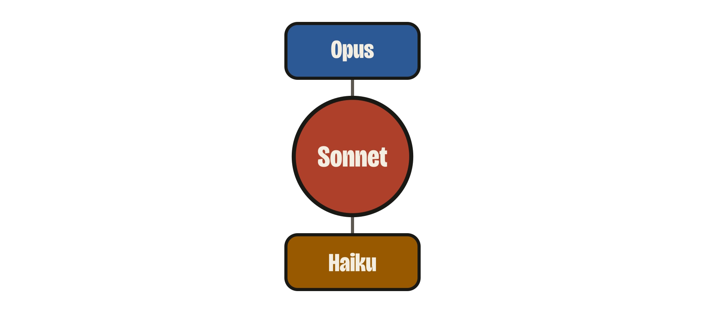
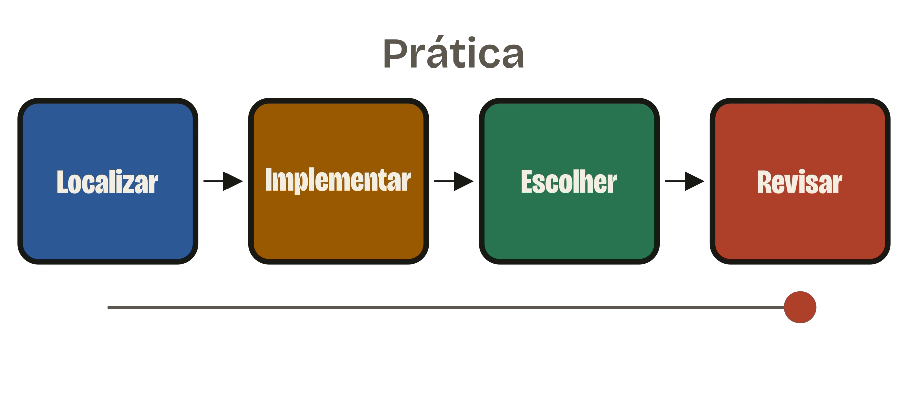
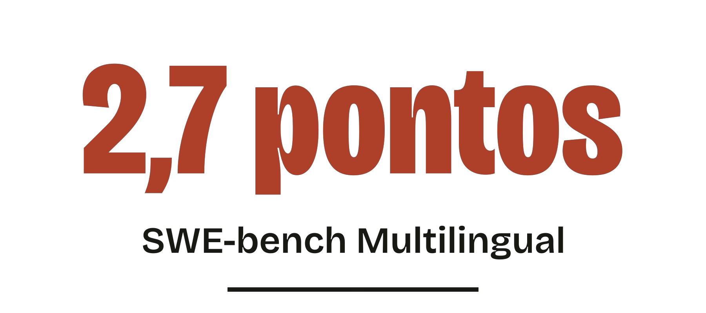

# Opus de conselheiro dá ao Sonnet mais desempenho por tarefa

_2026-11-27 · filme_

Distribua o trabalho entre Sonnet, Opus e Haiku para reservar o modelo mais caro às decisões difíceis. Você vai entender o papel de cada modelo, configurar o conselheiro dentro ou na abertura da sessão e acompanhar o consumo. A apostila também explica o resultado divulgado pela Anthropic, com sua comparação e seus limites, para orientar a escolha no seu projeto. Ao final, você terá uma sequência prática para executar com Sonnet, consultar Opus nos pontos críticos e usar Haiku nas tarefas leves dos subagentes.

## O contexto

Um projeto de software reúne tarefas com exigências diferentes. Planejar uma mudança, escrever código, rodar comandos, procurar um arquivo e revisar uma decisão pedem esforços distintos. Quando um único modelo caro assume todas essas etapas, o consumo acompanha o volume inteiro de trabalho, inclusive as atividades simples e repetitivas.

A estratégia do conselheiro parte dessa diferença. Ela mantém um modelo na execução e coloca outro nas decisões difíceis. O Haiku pode assumir tarefas pequenas de subagentes. O objetivo é direcionar o modelo mais caro aos momentos que pedem mais julgamento e acompanhar o consumo da sessão.

Fonte: <https://claude.com/blog/the-advisor-strategy>

## A estratégia do conselheiro



_Sonnet executa, Opus orienta e Haiku pode cuidar das tarefas leves dos subagentes._

A Anthropic divulgou uma estratégia oficial para o Claude Code que combina modelos da família Claude por função. O Sonnet continua como modelo principal e assume a execução. O Opus atua como conselheiro nos pontos críticos. O Haiku pode cuidar de tarefas pequenas delegadas a subagentes.

A característica central é a separação entre executar e orientar. O Sonnet escreve o código, roda comandos e trabalha na implementação. O Opus devolve orientação ao Sonnet antes de escolher um caminho, diante de um erro persistente e antes de concluir. As ferramentas continuam sob o controle da execução do Sonnet.

Essa divisão evita concentrar no modelo mais caro o trabalho inteiro do projeto. O conselheiro entra onde a decisão exige mais profundidade, enquanto a rotina fica com o modelo principal.

Fonte: <https://claude.com/blog/the-advisor-strategy>

## Sonnet assume a execução

O Sonnet é o executor da estratégia. Ele escreve o código, roda os comandos e resolve as tarefas recorrentes da implementação. Essa é a parte constante do trabalho, que inclui produzir a solução depois que o caminho foi escolhido.

Selecionar Sonnet como modelo principal define quem segura essa execução. O Opus fica disponível para aconselhar, e o Haiku pode receber as tarefas leves dos subagentes. A escolha do modelo principal deve refletir o papel de execução que ele vai cumprir nesta estratégia.

```
/model sonnet
```

Fonte: <https://code.claude.com/docs/en/model-config>

## Opus orienta nos pontos críticos

O Opus atua como conselheiro do Sonnet. A consulta acontece antes de escolher um caminho, quando um erro persiste e antes de concluir o trabalho. Esses momentos reúnem planejamento, destravamento e revisão, atividades em que o julgamento pesa mais na condução da tarefa.

O Opus devolve orientação sem assumir as ferramentas. Quem escreve, executa comandos e mantém a implementação em andamento é o Sonnet. A contribuição do conselheiro é ajudá-lo a decidir o que fazer nos pontos difíceis.

Na prática, o modelo mais caro participa da sequência sem tomar conta de todas as etapas. Sua atenção fica concentrada nas decisões que podem mudar o rumo do projeto ou bloquear a conclusão.

Fonte: <https://code.claude.com/docs/en/advisor>

## Ative o conselheiro durante a sessão

Com a sessão do Claude Code aberta, o comando desta seção ativa o Opus como conselheiro. Essa forma serve para acrescentar a orientação ao trabalho que já está em andamento, mantendo o Sonnet na execução.

A ativação muda o papel do Opus na dupla. Ele passa a aconselhar o modelo principal nos momentos indicados pela estratégia, sem receber a responsabilidade de operar as ferramentas.

```
/advisor opus
```

Fonte: <https://code.claude.com/docs/en/advisor>

## Abra a sessão com o conselheiro

O conselheiro também pode ser ativado no momento da abertura do Claude Code. O comando desta seção inicia a sessão com Opus nessa função, para que a orientação já esteja disponível quando a execução começar.

As duas formas de ativação atendem a momentos diferentes. Uma acrescenta o conselheiro dentro de uma sessão aberta; a outra define essa condição na abertura. Em ambas, o Sonnet permanece responsável pela execução e o Opus pela orientação.

```
claude --advisor opus
```

Fonte: <https://code.claude.com/docs/en/advisor>

## Haiku nas tarefas leves dos subagentes

O Haiku representa um terceiro papel opcional. Ele pode cuidar das tarefas pequenas de subagentes, como localizar arquivos e ler páginas da internet. São atividades de apoio que não precisam ocupar o conselheiro.

A configuração desta seção direciona o modelo do subagente para Haiku. Quando esse papel é usado, a busca e a leitura ficam com o modelo leve, enquanto o Opus mantém a atenção disponível para os bloqueios que realmente travam o projeto.

```
model: haiku
```

Fonte: <https://code.claude.com/docs/en/sub-agents>

## Como funciona na prática



_Haiku localiza, Sonnet implementa e Opus orienta a escolha e a revisão._

Imagine que um projeto precise localizar arquivos, implementar uma mudança e escolher o caminho de uma solução. Um subagente com Haiku pode cuidar da localização. O Sonnet trabalha na implementação e consulta o Opus antes da escolha importante.

Se um erro persistir durante a implementação, o Sonnet continua responsável pelos comandos e consulta o Opus para receber orientação. Antes de concluir, a dupla passa pelo momento de revisão previsto pela estratégia. O Opus contribui com julgamento e o Sonnet mantém a execução.

O Haiku é opcional. Quando não houver tarefas pequenas delegadas a subagentes, a estratégia pode funcionar com Sonnet na execução e Opus como conselheiro. A essência está em separar a produção constante das decisões críticas.

Fonte: <https://claude.com/product/claude-code>

## Os números e o que eles significam



_A combinação superou o Sonnet sozinho em 2,7 pontos percentuais._

Nos testes divulgados pela Anthropic, a combinação de Sonnet 4.6 com Opus 4.6 de conselheiro superou o Sonnet sozinho no SWE-bench Multilingual e apresentou menor custo por tarefa. O resultado sustenta a ideia de dividir funções em vez de concentrar todo o trabalho em um único modelo.

A comparação tem limites claros. Ela cobre o Sonnet 4.6 com Opus 4.6 de conselheiro contra o Sonnet sozinho, no teste indicado. O resultado deve ser lido dentro desse recorte.

- Desempenho: +2,7 pontos percentuais no SWE-bench Multilingual. O valor representa a diferença absoluta de desempenho da combinação em relação ao Sonnet sozinho nesse teste.
- Custo: 11,9% menos custo por tarefa na mesma comparação. O percentual indica uma redução relativa no custo por tarefa, com referência no Sonnet sozinho.
- Referência de comparação: Sonnet sozinho. O teste divulgado não compara a dupla com Opus executando todas as etapas.
- Modelos citados: Sonnet 4.6 e Opus 4.6. A conclusão permanece vinculada a essas versões e ao benchmark indicado.

Fonte: <https://claude.com/blog/the-advisor-strategy>

## Quem ganha e quem perde com essa divisão

A estratégia favorece projetos que misturam rotina e decisões difíceis. Nesse tipo de trabalho, o Sonnet segura a produção constante e o Opus concentra julgamento no planejamento, nos erros persistentes e na revisão. O Haiku pode aliviar as tarefas auxiliares dos subagentes.

A prática que perde é concentrar no modelo mais caro o trabalho inteiro do projeto. Quando o Opus também assume atividades simples e repetitivas, o consumo acompanha uma quantidade de trabalho que poderia ficar com outros modelos.

O ganho aparece na distribuição das etapas. Cada modelo recebe uma função compatível com seu papel, e o consumo passa a acompanhar a dificuldade de cada parte da tarefa. O resultado do teste da Anthropic reforça essa lógica, mantendo a comparação restrita ao cenário divulgado.

Fonte: <https://claude.com/blog/the-advisor-strategy>

## Requisitos do conselheiro

O conselheiro é apresentado como um recurso experimental. Sua adoção deve considerar essa condição e a compatibilidade do ambiente usado para acessar o Claude Code.

O recurso exige Anthropic API, Claude Platform on AWS ou Claude Models on Google Cloud, na modalidade administrada pela Anthropic. Essas são as plataformas indicadas para ativar a estratégia.

- Ambiente: use uma das opções suportadas, Anthropic API, Claude Platform on AWS ou Claude Models on Google Cloud (Anthropic managed).
- Status do recurso: trate o conselheiro como experimental e acompanhe a documentação oficial ao definir um fluxo de trabalho fixo.
- Papel do Opus: conte com orientação nos pontos críticos e mantenha o Sonnet responsável pelas ferramentas e pela implementação.
- Papel do Haiku: use o modelo leve nos subagentes apenas para as tarefas auxiliares que você decidir delegar.

Fonte: <https://code.claude.com/docs/en/advisor>

## O que ainda não se sabe

O resultado divulgado estabelece uma comparação específica: Sonnet 4.6 com Opus 4.6 de conselheiro contra Sonnet sozinho no SWE-bench Multilingual. A leitura correta mantém desempenho e custo dentro desse recorte.

A economia de 11,9% pertence ao teste por tarefa. O consumo de uma sessão real deve ser acompanhado para observar o efeito da escolha no seu trabalho. O comando de consumo ajuda nessa observação, enquanto o benchmark representa o resultado de desempenho divulgado pela Anthropic.

- Resultado de desempenho: associe os +2,7 pontos percentuais ao SWE-bench Multilingual e à comparação com Sonnet sozinho.
- Resultado de custo: associe os 11,9% de redução ao custo por tarefa na mesma comparação.
- Uso da sessão: observe o consumo com a ferramenta indicada na documentação de custos para acompanhar a sua execução.
- Revisão do trabalho: use o momento de consulta ao Opus antes de concluir como parte da estratégia de orientação.

Fonte: <https://claude.com/blog/the-advisor-strategy>

## O que você pode fazer

A configuração segue a mesma divisão explicada ao longo da apostila. Comece pelo modelo principal, acrescente o conselheiro e distribua as tarefas auxiliares quando fizer sentido. Depois, acompanhe o consumo para observar o efeito da distribuição.

1. Selecione Sonnet como modelo principal. O resultado esperado é que a escrita de código, os comandos e as tarefas recorrentes da implementação fiquem com o modelo de execução.
2. Ative Opus como conselheiro durante a sessão ou na abertura do Claude Code. O resultado esperado é que o Sonnet tenha orientação nos pontos críticos e continue operando as ferramentas.
3. Se usar subagentes, configure Haiku nas tarefas pequenas. O resultado esperado é direcionar buscas por arquivos e leituras de páginas ao modelo leve, mantendo o conselheiro disponível.
4. Consulte Opus antes de escolher um caminho, diante de um erro persistente e antes de concluir. O resultado esperado é receber orientação nesses momentos, com o Sonnet na execução.
5. Abra o consumo da sessão e acompanhe o efeito da escolha. O resultado esperado é ter uma visão do uso para observar como a distribuição de modelos afeta a sua rotina.

Fonte: <https://claude.com/blog/the-advisor-strategy>

## Acompanhe o consumo da sessão

O comando desta seção abre o consumo da sessão. Ele permite observar o uso enquanto você aplica a estratégia e verificar como a escolha dos modelos aparece na sua rotina de trabalho.

Consumo e desempenho são aspectos diferentes. O consumo mostra o uso da sessão; o resultado de desempenho divulgado pela Anthropic vem da comparação no SWE-bench Multilingual. Acompanhar o primeiro ajuda a observar o efeito prático da distribuição, enquanto o segundo sustenta a avaliação divulgada da combinação.

```
/usage
```

Fonte: <https://code.claude.com/docs/en/costs>

## Glossário

- Claude Code: ambiente da Anthropic em que os comandos desta apostila selecionam modelos, ativam o conselheiro e mostram o consumo da sessão.
- Modelo principal: modelo responsável pela execução das tarefas. Na estratégia do conselheiro, esse papel fica com o Sonnet.
- Conselheiro: Opus atuando na orientação do Sonnet antes de escolher um caminho, diante de um erro persistente e antes de concluir.
- Subagente: agente auxiliar que recebe uma tarefa delegada, como localizar arquivos ou ler páginas.
- Experimental: condição de um recurso que deve ser adotado considerando sua possibilidade de mudança e acompanhamento da documentação oficial.
- Ponto percentual: diferença absoluta entre duas porcentagens. O ganho de 2,7 pontos percentuais não equivale a dizer que o desempenho cresceu 2,7%.
- Benchmark: avaliação usada para comparar desempenho. O SWE-bench Multilingual é o teste citado no resultado divulgado pela Anthropic.
- SWE-bench Multilingual: nome do benchmark em que Sonnet 4.6 com Opus 4.6 de conselheiro obteve +2,7 pontos percentuais em relação ao Sonnet sozinho.
- Custo por tarefa: gasto associado à realização de uma tarefa. No resultado divulgado, ele foi 11,9% menor na combinação do que no Sonnet sozinho.
- Anthropic API: uma das opções suportadas para usar o conselheiro.
- Claude Platform on AWS: uma das opções suportadas para usar o conselheiro.
- Claude Models on Google Cloud (Anthropic managed): modalidade administrada pela Anthropic no Google Cloud, citada entre as opções suportadas.

Fonte: <https://claude.com/product/claude-code>

## Para onde ir depois

Pratique a estratégia em uma tarefa de implementação. Mantenha o Sonnet na execução, consulte o Opus nos três momentos previstos e observe o consumo da sessão. Se a tarefa incluir buscas por arquivos ou leituras de páginas, experimente delegar esse apoio a um subagente com Haiku.

- Pratique a sequência Sonnet executando e Opus orientando nos pontos críticos, usando os comandos apresentados nesta apostila.
- Observe o consumo da sessão com /usage para acompanhar o efeito da sua escolha.
- Leia o anúncio oficial da estratégia em https://claude.com/blog/the-advisor-strategy para retomar a comparação divulgada pela Anthropic.
- Consulte a documentação do conselheiro em https://code.claude.com/docs/en/advisor para revisar a ativação e as condições do recurso experimental.
- Consulte a documentação de subagentes em https://code.claude.com/docs/en/sub-agents antes de direcionar tarefas pequenas ao Haiku.

Fonte: <https://claude.com/blog/the-advisor-strategy>
