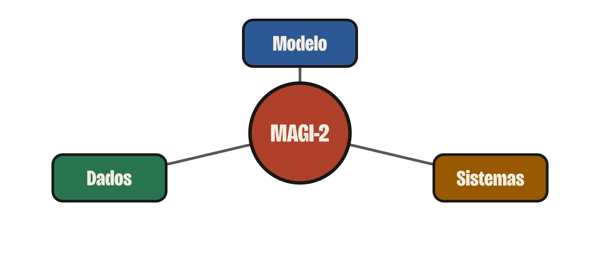
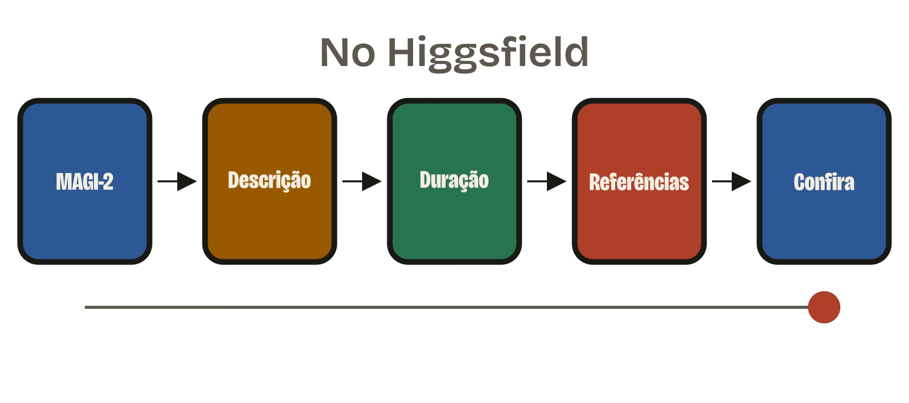

# Vídeo igual ao Seedance 2.5, mas 10x mais barato

_2026-11-27 · filme_

MAGI-2, da Sand.ai, é uma opção de geração de vídeo e áudio em 1080p com tarifa quase dez vezes menor que a do Seedance 2.5 na comparação por referência de vídeo da API do Higgsfield. Ao ler esta apostila, você vai entender o recorte desse preço, interpretar os números de treinamento e conhecer o resultado da avaliação cega entre os modelos. Também terá um roteiro prático para testar duração, resolução e referências antes de gerar.

## O contexto

A Sand.ai lançou o MAGI-2 em 24 de novembro de 2026. O modelo gera vídeo e áudio em 1080p, com durações de 4 a 30 segundos, e está disponível no Higgsfield. O VidMuse também oferece o modelo e é indicado pela Sand.ai como parceiro oficial.

O anúncio coloca o MAGI-2 ao lado do Seedance 2.5 em uma comparação de custo para a API do Higgsfield. O recorte é específico: 30 segundos, resolução 1080p e referência de vídeo. Nessa configuração, a tarifa do MAGI-2 é quase dez vezes menor. A comparação de qualidade tem resultado separado, com vantagem do Seedance 2.5 na avaliação cega do Higgsfield.

Fonte: <https://sand.ai/blog/magi-2/>

## Por que o custo por geração importa

Quando a cobrança é por segundo, a duração deixa de ser apenas uma escolha criativa e passa a afetar diretamente o total. Na comparação de 30 segundos, cada modelo tem uma tarifa por segundo que, multiplicada por 30, produz o custo exibido. Uma nova geração com o mesmo formato repete esse cálculo.

Para quem testa descrições, referências e durações, cada tentativa consome parte do orçamento. A tarifa menor do MAGI-2 permite reservar mais desse orçamento para outras cenas. O preço responde à pergunta sobre custo; a avaliação cega responde à comparação entre as saídas dos modelos.

Fonte: <https://open.higgsfield.ai/models/bytedance/seedance-2.5/reference-to-video/playground>

## O que o MAGI-2 oferece

O MAGI-2 gera vídeo e áudio em 1080p por até 30 segundos. A faixa de duração anunciada começa em 4 segundos. Essa combinação reúne imagem em full HD, som e um intervalo de tempo que pode ser ajustado ao tipo de teste.

No Higgsfield, o fluxo descrito permite selecionar o modelo, descrever a cena, escolher a duração e acrescentar referências de imagem, vídeo ou áudio. Uma referência de vídeo é um vídeo fornecido como entrada para orientar a geração. É justamente essa condição que aparece na comparação de preço com o Seedance 2.5.

Para o usuário, a utilidade do modelo está em combinar controle por referências com geração de vídeo e áudio. Antes de produzir, vale conferir se a duração escolhida e o tipo de referência correspondem ao resultado que se quer testar.

Fonte: <https://higgsfield.ai/magi-2-intro>

## O treinamento em escala

_Escalagem de modelo, sistemas e dados como base do MAGI-2._

A Sand.ai aponta a escalagem de modelo, sistemas e dados como base do resultado do MAGI-2. Parâmetros são valores ajustáveis aprendidos durante o treinamento; o total descreve o tamanho do modelo, enquanto os ativos indicam a parcela acionada no processamento.

O treinamento usou 4 trilhões de tokens, distribuídos em aproximadamente 1 bilhão de amostras. Tokens são unidades usadas para contar dados de treinamento, e amostras são exemplos apresentados nesse processo. Os dois números mostram a escala dos dados utilizados.

Esses indicadores ajudam a entender a dimensão técnica do MAGI-2. A leitura da qualidade produzida continua separada: o tamanho do modelo e o volume de treinamento não substituem a comparação direta das saídas.

Fonte: <https://sand.ai/blog/magi-2/>

## A avaliação cega de qualidade

Na avaliação cega do Higgsfield, datada de 24 de novembro de 2026, o Seedance 2.5 venceu 61% das comparações diretas com o MAGI-2. Em uma avaliação cega, quem compara recebe os resultados sem a identidade do modelo, o que mantém o foco na saída apresentada.

Os percentuais representam a participação de cada modelo nas comparações diretas daquela avaliação. Eles aproximam os dois resultados e apontam vantagem do Seedance 2.5 no confronto. Para outra cena, a referência continua sendo a saída produzida e o objetivo do projeto.

Fonte: <https://higgsfield.ai/magi-2-intro>

## Os números do custo

A cobrança comparada é por segundo de vídeo gerado.

Assim, o Seedance custa quase dez vezes o MAGI-2 nessa configuração.

- US$ 23,574: custo de 30 segundos com o Seedance 2.5, obtido pela tarifa por segundo multiplicada pela duração.
- US$ 2,40: custo de 30 segundos com o MAGI-2 no mesmo formato.
- 30 segundos, 1080p e referência de vídeo: condições usadas na comparação de preço.

Fonte: <https://open.higgsfield.ai/models/sand/magi-2/reference-to-video/playground>

## O que muda para você

Imagine que você quer testar um vídeo de 30 segundos em 1080p usando outro vídeo como referência. Com o MAGI-2, cada tentativa desse formato custa US$ 2,40 na API do Higgsfield. Com o Seedance 2.5, o mesmo formato custa US$ 23,574. A diferença aparece a cada nova geração.

Com o mesmo orçamento, a tarifa do MAGI-2 deixa mais espaço para explorar outras cenas e ajustes. Ao mesmo tempo, o Seedance 2.5 venceu 61% das comparações diretas na avaliação cega do Higgsfield. A escolha combina o custo de cada teste com a saída que atende ao projeto.

Fonte: <https://higgsfield.ai/magi-2-intro>

## Como funciona na prática

_Etapas no Higgsfield: MAGI-2, descrição, duração, referências e confira antes de gerar._

Imagine que o objetivo é gerar 30 segundos em 1080p com referência de vídeo. O caminho começa no Higgsfield, com a seleção do MAGI-2. Depois vêm a descrição da cena, a escolha da duração e a inclusão das referências de imagem, vídeo ou áudio. Para repetir a condição de preço comparada, o teste precisa usar referência de vídeo.

Antes de gerar, confira duração, resolução e referências. O resultado esperado é uma tentativa dentro do formato anunciado. Para julgar a escolha, compare o custo e a saída com o Seedance 2.5 no mesmo formato. A avaliação cega oferece um contexto adicional, e a cena concreta mostra qual resultado atende melhor ao objetivo.

Fonte: <https://higgsfield.ai/magi-2-intro>

## Linha do tempo

- 24/11/2026: a Sand.ai lançou o MAGI-2.

Fonte: <https://sand.ai/blog/magi-2/>

## Quem ganha e quem perde

O MAGI-2 tem vantagem de custo para quem realiza vários testes de vídeo com referência.

O Seedance 2.5 tem vantagem de resultado na avaliação cega do Higgsfield, com 61% das comparações diretas. Essa vantagem é específica daquele confronto. A decisão entre os modelos depende da importância atribuída ao orçamento e à saída produzida para cada cena.

Fonte: <https://higgsfield.ai/magi-2-intro>

## O que ainda não se sabe

- Recorte do preço: US$ 23,574 e US$ 2,40 correspondem a 30 segundos em 1080p com referência de vídeo na API do Higgsfield.
- Efeito da duração: a cobrança é por segundo; mudar a duração altera o total gerado.
- Tipo de referência: o fluxo aceita imagem, vídeo ou áudio; para reproduzir a comparação de preço, use referência de vídeo.
- Revisão humana: compare duração, resolução, referências, custo e saída antes de escolher o modelo para uma produção.
- Acesso oficial: o Higgsfield oferece o MAGI-2, e o VidMuse é indicado pela Sand.ai como parceiro oficial.

Fonte: <https://higgsfield.ai/magi-2-intro>

## O que você pode fazer

1. Abra o Higgsfield e selecione o MAGI-2; o resultado esperado é acessar o fluxo de geração do modelo.
2. Descreva a cena que deseja gerar; o resultado esperado é registrar o conteúdo do vídeo.
3. Escolha uma duração entre 4 e 30 segundos; o resultado esperado é manter a geração dentro da faixa anunciada.
4. Confirme que a resolução será 1080p; o resultado esperado é enquadrar o vídeo no formato comparado.
5. Acrescente referências de imagem, vídeo ou áudio; para repetir a comparação de preço, inclua um vídeo. O resultado esperado é definir as entradas usadas na geração.
6. Revise duração, resolução e referências antes de gerar; o resultado esperado é manter as condições do teste bem definidas.
7. Gere a cena e compare custo e saída com o Seedance 2.5 no mesmo formato; o resultado esperado é uma decisão baseada no orçamento e no vídeo produzido.

Fonte: <https://higgsfield.ai/magi-2-intro>

## Glossário

- API: interface de serviço usada para acionar o modelo; a comparação de preço é da API do Higgsfield.
- Referência de vídeo: vídeo fornecido como entrada para orientar a geração.
- Referência de imagem: imagem fornecida como entrada para orientar a geração.
- Referência de áudio: áudio fornecido como entrada para orientar a geração.
- 1080p: resolução full HD usada pelo MAGI-2 e pela comparação de preço.
- Parâmetro: valor ajustável aprendido no treinamento; o MAGI-2 tem 480 bilhões no total.
- Token: unidade usada para contar dados de treinamento; foram 4 trilhões no MAGI-2.
- Amostra: exemplo usado no treinamento; o MAGI-2 teve aproximadamente 1 bilhão.
- Avaliação cega: comparação em que quem avalia não recebe a identidade do modelo.
- Geração: produção de uma saída de vídeo pelo modelo, cobrada por segundo nas condições comparadas.

## Para onde ir depois

- Pratique uma geração de 30 segundos em 1080p com referência de vídeo e registre duração, resolução, referências e custo.
- Repita o mesmo formato com o Seedance 2.5 para comparar as saídas nas mesmas condições.
- Teste outra duração entre 4 e 30 segundos para observar como a tarifa por segundo altera o total.
- Use o anúncio técnico da Sand.ai como referência para os números de treinamento do MAGI-2.
- Se optar pelo VidMuse, use a página oficial do MAGI-2 indicada pela Sand.ai.

Fonte: <https://sand.ai/>
