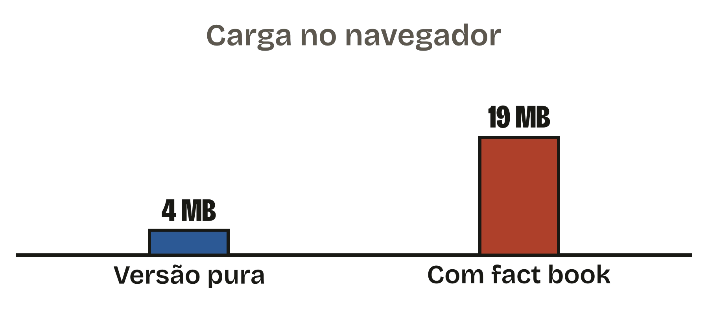
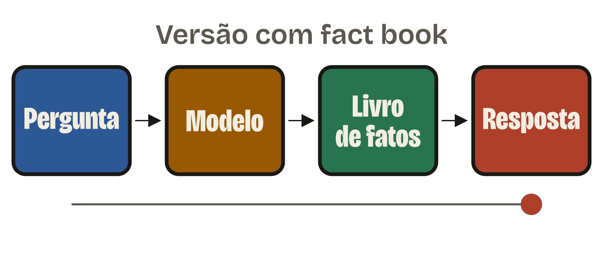

# ChatGPT for SNES roda em cartucho de 1.5 MB no Super FX

_2026-11-28 · filme_

ChatGPT for SNES é um experimento da BX Foundry que coloca um modelo de linguagem de cerca de 2,2 milhões de parâmetros para conversar como chat dentro de um cartucho de Super Nintendo, no chip Super FX 2. Esta apostila explica como o modelo gera as respostas, a diferença entre a build pura e a build com fact book, o que cada uma exige para rodar no navegador ou em um console real e por que o projeto é uma demonstração, não um assistente útil. Depois de ler, você saberá testar as duas versões no navegador, escolher o arquivo certo para um flash cart com Super FX e MSU-1 e avaliar o que as respostas do modelo valem.

## O contexto

ChatGPT for SNES é um experimento não oficial: um programa de chat no estilo do ChatGPT feito para o Super Nintendo. O modelo de linguagem roda no chip Super FX 2 do cartucho e escreve cada resposta uma palavra por vez. O projeto foi desenhado como experimento e codificado por agentes de IA. A versão descrita aqui é a 0.7, de 2 de novembro de 2026.

A ideia importa por causa da escala. Os modelos por trás do ChatGPT são enormes; o modelo deste cartucho é, segundo a página do projeto, milhões de vezes menor. Rodar uma conversa em um hardware tão limitado mostra que a interface de chat, digitar e receber uma resposta em texto, não depende de uma máquina gigante. O que muda com a escala é a qualidade do que sai.

O projeto não tem relação com a OpenAI nem com a Nintendo: a página declara que não é feito nem endossado por nenhuma das duas, e que Super NES é marca registrada da Nintendo. A conexão com a OpenAI é só o treinamento: as conversas usadas para treinar o modelo foram escritas pelo gpt-oss-120b, um modelo de pesos abertos da empresa.

Fonte: <https://github.com/BXFoundry/ChatGPT-for-SNES>

## O modelo e o chip: como a resposta é gerada

Um modelo de linguagem é um programa que, dado um texto, calcula qual palavra tem mais chance de vir a seguir, e repete isso até formar a resposta. Os parâmetros são os números internos que guardam o que ele aprendeu no treinamento. Este modelo tem cerca de 2,2 milhões deles. O conjunto de treino foram conversas escritas pelo gpt-oss-120b, e é daí que o modelo aprende a imitar o estilo de um chat.

Quem executa esse cálculo é o Super FX 2, chip que equipa o cartucho e que foi desenhado pela Argonaut Software, hoje Argonaut Games. Na build principal, toda palavra escrita vem do modelo. A resposta não aparece pronta: ela surge palavra por palavra, como um fluxo de texto, e é isso que dá a sensação de conversa.

O vocabulário é pequeno: o modelo conhece cerca de 8 mil palavras. Isso explica boa parte do comportamento que você verá, porque tudo o que ele sabe dizer sai desse repertório e do que aprendeu nas conversas de treino.

Fonte: <https://github.com/BXFoundry/ChatGPT-for-SNES>

## As duas builds: pura e com fact book

_Carga na primeira visita: cerca de 4 MB na versão pura e 19 MB com fact book._

O projeto tem duas versões. Na versão pura, cada palavra vem do modelo, e a carga no navegador é de cerca de 4 MB. Na versão com fact book, o modelo pode consultar um livro de fatos construído a partir da Simple English Wikipedia e também usar uma calculadora. Essa versão carrega cerca de 19 MB.

O fact book guarda as frases de abertura de 150 mil artigos da Simple English Wikipedia. Esses dados ficam no arquivo de dados MSU-1 do cartucho. O princípio é parecido com o do ChatGPT quando pesquisa na web: o próprio modelo decide quando vale consultar o livro e então imprime o que ele diz.

Atenção ao recorte: o livro tem só a abertura de cada artigo, não o texto completo. E consultar o livro não torna o resultado confiável. A página do projeto avisa que o fact book também pode carregar erros.

Fonte: <https://github.com/BXFoundry/ChatGPT-for-SNES>

## Usando no navegador

No navegador, o jogo roda no emulador Snes9x. Você não precisa de console nem de cartucho para testar. Na primeira visita a página carrega cerca de 4 MB (19 MB na versão com fact book).

Na tela de título, pressione Start, que no teclado é Enter. Depois digite no teclado e use Enter para enviar. Backspace apaga; Page Up e Page Down rolam o texto. Cada letra demora um pouco para aparecer porque a página move o cursor no teclado virtual do próprio jogo para digitar por você.

Em telas de toque, toque na caixa abaixo da imagem para começar e digite. O botão Send envia e o botão B apaga. Há também o modo de controle: ele simula a entrada do controle do console, e nele as teclas são o controle: setas, X = A, Z = B, A = Y e Enter = Start. Os botões «Switch to control pad mode» e «Switch to typing mode» alternam entre os dois modos.

Fonte: <https://github.com/BXFoundry/ChatGPT-for-SNES>

## Rodando em um Super Nintendo real

Para rodar fora do navegador, baixe a ROM v0.7: um zip de 1,5 MB com um único arquivo .sfc. É preciso um cartão flash (flash cart) com suporte ao Super FX, como o FXPak Pro ou um sd2snes com firmware atualizado. Nas opções do chip, deixe Chip Options › SuperFX speed em Normal.

A build com fact book é maior: o zip tem 17 MB e traz dois arquivos, o .sfc e o .msu. Ela exige que o flash cart também tenha suporte ao MSU-1. Os dois arquivos devem ficar na mesma pasta, com os nomes originais; se um nome mudar, o jogo pode não encontrar os dados do fact book.

A página mostra o projeto rodando em um Super Nintendo com TV de tubo (CRT), a partir de um sd2snes, e uma conversa na mesma TV.

Fonte: <https://github.com/BXFoundry/ChatGPT-for-SNES>

## Os números

- 2,2 milhões de parâmetros: o tamanho aproximado do modelo. É milhões de vezes menor que os modelos por trás do ChatGPT; o número diz que ele é pequeno, não mede a qualidade das respostas.
- Cerca de 8 mil palavras: o vocabulário que o modelo conhece. É um limite do que ele consegue dizer.
- Cerca de 4 MB: carga na primeira visita à versão pura no navegador.
- Cerca de 19 MB: carga na primeira visita à versão com fact book no navegador.
- 1,5 MB: tamanho do zip da ROM v0.7 (um arquivo .sfc) para usar em flash cart com Super FX.
- 17 MB: tamanho do zip da build com fact book (arquivos .sfc e .msu). Não é comparável com os 19 MB da carga no navegador, que medem outra coisa.
- 150 mil: quantidade de artigos da Simple English Wikipedia cujas frases de abertura formam o fact book.
- 0.7: a versão do projeto, de 2 de novembro de 2026.

Fonte: <https://github.com/BXFoundry/ChatGPT-for-SNES>

## Como funciona na prática

_A pergunta chega ao modelo, que pode consultar o livro de fatos e escreve a resposta._

Imagine que você abre a versão com fact book no navegador, aperta Enter na tela de título e digita uma pergunta sobre algum assunto. O modelo recebe o texto e começa a escrever a resposta palavra por palavra. Em algum ponto ele pode decidir consultar o livro de fatos, como o ChatGPT faria ao pesquisar na web, e então imprime o que o livro diz sobre o tema. Se a pergunta envolver uma conta, a calculadora também está à disposição dessa build.

Na versão pura, a mesma pergunta é respondida só com o que o modelo aprendeu no treino, sem livro e sem calculadora. Comparar as duas respostas para a mesma pergunta é a forma mais direta de ver o que o fact book muda. Lembre que as duas podem errar, e que o modelo pode errar com confiança.

Fonte: <https://github.com/BXFoundry/ChatGPT-for-SNES>

## Limites e cuidados

O projeto não é um assistente útil. A própria página avisa que o modelo erra, às vezes com confiança, e que o fact book também pode carregar erros. Trate o que sai como demonstração, não como informação para decidir algo.

- Não confie nas respostas como fato: o modelo conhece cerca de 8 mil palavras e pode inventar respostas que soam plausíveis.
- O fact book não elimina o erro: ele pode conter erros também.
- Não compare os 4 MB e 19 MB do navegador com os 1,5 MB e 17 MB dos zips: são medidas de coisas diferentes.
- Para usar em console, confira se o flash cart tem suporte ao Super FX; no sd2snes, o firmware precisa estar atualizado.
- Para a build com fact book, confira também o suporte ao MSU-1 e mantenha o .sfc e o .msu na mesma pasta, com os nomes originais.
- Deixe Chip Options › SuperFX speed em Normal.
- No navegador, a digitação é lenta de propósito: a página move o cursor no teclado do jogo, então cada letra leva um instante.
- O projeto é não oficial: não é feito nem endossado pela OpenAI nem pela Nintendo.

Fonte: <https://github.com/BXFoundry/ChatGPT-for-SNES>

## O que você pode fazer

1. Abra a página do projeto ChatGPT for SNES, da BX Foundry, e escolha a versão: Pure (cerca de 4 MB) ou com fact book (cerca de 19 MB). Resultado esperado: o emulador carrega e mostra a tela de título.
2. Pressione Enter, que faz o papel de Start, na tela de título. Resultado esperado: o jogo passa para a tela de chat.
3. Digite uma pergunta no teclado e pressione Enter para enviar. Resultado esperado: as letras aparecem devagar na tela e depois a resposta surge palavra por palavra.
4. Use Backspace para corrigir e Page Up e Page Down para rolar o texto. Resultado esperado: o texto some ou rola conforme a tecla.
5. Repita a mesma pergunta na outra versão. Resultado esperado: você vê na prática o que o fact book acrescenta e que ambas podem errar.
6. Se tiver um flash cart com Super FX (FXPak Pro ou sd2snes com firmware atualizado), baixe a ROM v0.7 (zip de 1,5 MB com um arquivo .sfc) e deixe Chip Options › SuperFX speed em Normal. Resultado esperado: o jogo abre no console.
7. Para a build com fact book, baixe o zip de 17 MB e ponha o .sfc e o .msu na mesma pasta, com os nomes originais, em um flash cart com suporte ao MSU-1. Resultado esperado: o jogo abre com o fact book disponível.

Fonte: <https://github.com/BXFoundry/ChatGPT-for-SNES>

## Glossário

- Parâmetro: número interno de um modelo de IA que guarda o que ele aprendeu no treinamento.
- Modelo de linguagem: programa que gera texto escolhendo, passo a passo, a próxima palavra.
- Token: pedaço de texto, como uma palavra ou parte dela, que o modelo escreve de cada vez.
- Super FX: chip colocado em cartuchos de Super Nintendo para dar mais poder de cálculo ao jogo; o Super FX 2 executa o modelo neste projeto.
- MSU-1: recurso que permite ao cartucho usar um arquivo de dados grande; aqui guarda o fact book.
- Fact book: livro de fatos com as frases de abertura de 150 mil artigos da Simple English Wikipedia, que o modelo pode consultar.
- Simple English Wikipedia: versão da Wikipedia em inglês simplificado.
- Flash cart: cartucho que roda arquivos de jogo gravados em um cartão de memória; exemplos: FXPak Pro e sd2snes.
- ROM: arquivo com o conteúdo de um cartucho; neste projeto, o arquivo .sfc.
- Emulador: programa que imita um console no computador; o Snes9x roda o projeto no navegador.
- Pesos abertos (open-weight): modelo cujos parâmetros são publicados; o gpt-oss-120b, da OpenAI, é um deles.

## Para onde ir depois

Teste as duas versões com as mesmas perguntas e anote onde cada uma acerta e onde erra. Se tiver um flash cart, rode a ROM v0.7 no console e compare com o navegador.

Outro projeto do mesmo tipo é o Séance, que roda um pequeno modelo de linguagem de IA em um NES de verdade.

- Experimente as duas builds no navegador com as mesmas perguntas.
- Se tiver um FXPak Pro ou sd2snes com firmware atualizado, rode a ROM v0.7 em um Super Nintendo.
- Conheça o Séance, que roda um pequeno modelo de linguagem em um NES real.

Fonte: <https://github.com/BXFoundry/ChatGPT-for-SNES>

## Além do vídeo

- O projeto Séance, que roda um pequeno modelo de linguagem de IA em um NES de verdade, citado na página como leitura para quem gostou.
- As fotos da página mostrando o projeto em um Super Nintendo com TV de tubo (CRT), a partir de um sd2snes.
- A calculadora que a build com fact book também oferece ao modelo.
- O modo de controle, que simula a entrada do controle do console, e os botões de toque (Send, B apaga).
- O aviso de que o projeto não é feito nem endossado pela OpenAI nem pela Nintendo, e de que Super NES é marca registrada da Nintendo.
