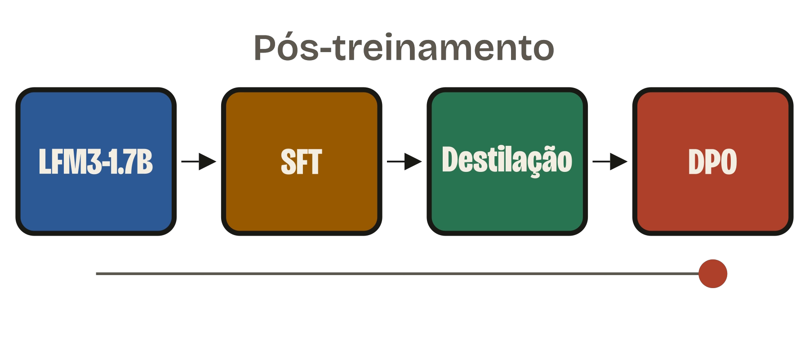
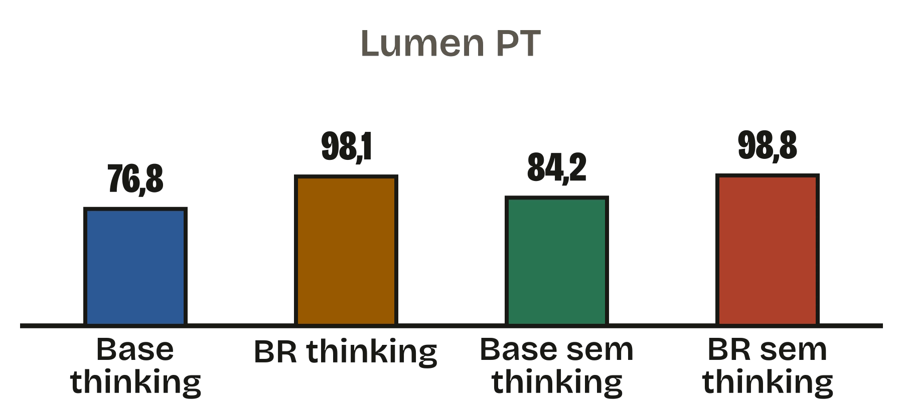
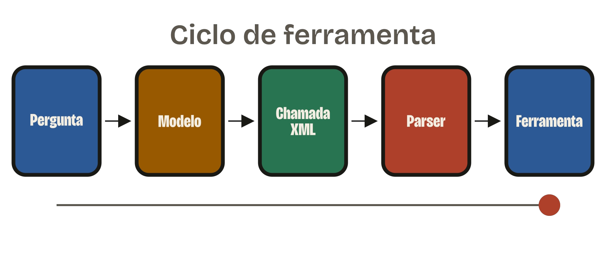

# LFM3-1.7B-BR: tool-calling em edge sem API paga

_2026-11-28 · filme_

O LFM3-1.7B-BR é um pós-treinamento independente do Liquid LFM3-1.7B para agentes em português brasileiro que usam ferramentas, trabalham sobre contexto fornecido e seguem instruções. Ele preserva a arquitetura e os componentes do modelo base, altera apenas os pesos e oferece modos com e sem thinking. Esta apostila explica os ganhos em segurança, formato, instruções e cultura brasileira, além dos limites em conversação, inglês, conhecimento e entradas longas. Ao final, você saberá escolher o modo adequado, executar o modelo localmente com vLLM ou Transformers, enviar ferramentas no formato OpenAI e validar os resultados.

## O fato: um pós-treinamento brasileiro para agentes locais

O LFM3-1.7B-BR foi disponibilizado em 26 de novembro de 2026 como um pós-treinamento do LiquidAI/LFM3-1.7B. O alvo é o português brasileiro em agentes que chamam ferramentas, executam tarefas sobre contexto fornecido e seguem instruções. O projeto é independente da comunidade e não é um lançamento oficial da Liquid AI.

A adaptação preserva a arquitetura, a configuração, o tokenizador, o chat template, o generation config e o código de modelagem da base. Somente model.safetensors foi modificado. O BR é, portanto, uma especialização comportamental do LFM3-1.7B, apoiada nos mesmos componentes de infraestrutura do modelo original.

O uso indicado inclui RAG, extração para JSON, resumo, classificação e reescrita. A execução local dispensa uma API paga de inferência, e a página do modelo não lista provedor de inferência. Os modos com thinking e sem thinking atendem a necessidades diferentes de raciocínio, formato e latência.

Fonte: <https://huggingface.co/fabriciocarraro/LFM3-1.7B-BR>

## O contexto: o que o LFM3-1.7B já oferece

O LFM3-1.7B é um modelo de texto pós-treinado para agentes locais e aplicações especializadas. Ele tem 1,73 bilhão de parâmetros e arquitetura híbrida com 24 camadas: 13 convoluções curtas com gate, 5 camadas de atenção por janela deslizante e 6 camadas de atenção global. Essa combinação processa sequências sem depender apenas de atenção tradicional em todas as camadas.

A janela de contexto declarada é de 262.144 tokens, incluindo entrada e saída no modelo base. No pós-treinamento brasileiro, as sequências de treinamento chegaram a 16.384 tokens. A revisão da base registrada pelo projeto BR é ac2586a34f1a1c03329dbdcdefabd8b6478ddaa7.

A Liquid AI oferece variantes do modelo base para BF16, FP8, NVFP4, GGUF, MLX, ONNX e OpenVINO. A variante de 4 bits ocupa cerca de 1 GB de memória. No teste de edge divulgado pela Liquid AI, com Q4_0 GGUF no llama.cpp, contexto de 32.768 tokens, batch 1, 100 tokens de saída e offload de GPU, o LFM3-1.7B apresentou pré-preenchimento pelo menos 2,5 vezes mais rápido e decodificação pelo menos 1,8 vezes mais rápida que todos os modelos comparados nos três dispositivos testados, com o menor uso de memória. Esses resultados descrevem o modelo base e não são medições do BR.

A própria documentação da base recomenda retrieval ou busca para tarefas intensivas em conhecimento. Ela também não recomenda o LFM3-1.7B para programação agêntica ou raciocínio complexo em várias etapas devido ao tamanho do modelo. O BR herda essa escala de parâmetros e concentra o ajuste em comportamento agêntico, português e formato.

Fonte: <https://huggingface.co/LiquidAI/LFM3-1.7B>

## Como o pós-treinamento foi feito



_Parte do LFM3-1.7B, passa por SFT com 68 mil exemplos, destilação on-policy e DPO._

O projeto não refez o pós-treinamento da Liquid AI. Ele partiu do LFM3-1.7B com um SFT restrito de 68 mil exemplos, cobrindo formato de saída, uso de ferramentas, recusas agênticas paired com tarefas benignas parecidas, cultura, tarefas sobre contexto e replay de inglês. O replay de inglês ajuda a preservar capacidade existente enquanto o ajuste prioriza o português brasileiro.

Depois vieram destilação on-policy, com o modelo base atuando como professor para preservar a qualidade da conversa, e DPO sobre respostas do próprio modelo julgadas com rubricas por prompt. O treinamento também incluiu três rodadas de GRPO com recompensas verificáveis para instruções, decisões de agente, matemática, chamadas de ferramenta, não chamar ferramentas irrelevantes e excesso de recusa. Cada rodada foi seguida por uma destilação curta do modelo base para reparar conversação, com uma destilação ampla de reparo no final.

Sempre que existiu um verificador, os alvos de treinamento foram as respostas do próprio modelo. O Gemma 4 26B-A4B escreveu recusas, respostas de referência e cenários de agente. Os checkpoints foram escolhidos em conjuntos de desenvolvimento separados dos testes.

A descontaminação verificou exemplos de treinamento e prompts de professor contra os testes do Observatório, o banco do ENEM, os originais em inglês dos testes traduzidos e os conjuntos de desenvolvimento, usando n-grams e embeddings bge-m3. Nada foi coletado da web depois de 7 de novembro de 2026. Todos os dados de treinamento também foram comparados com as questões do ENEM 2026, sem correspondência encontrada.

Fonte: <https://huggingface.co/fabriciocarraro/LFM3-1.7B-BR>

## Thinking e modo sem thinking: duas formas de responder

O thinking é o modo padrão do chat template. Nesse modo, o modelo pode produzir um rastro de raciocínio antes da resposta final. O modo sem thinking é selecionado pelo template e ajuda a reduzir a latência quando a aplicação precisa responder rápido. A escolha não altera os pesos: ela muda a forma como o histórico e a geração são preparados.

No LFM3, o raciocínio dos turnos anteriores à última mensagem do usuário é removido do histórico, a menos que preserve_thinking=True seja usado. Essa regra reduz a quantidade de raciocínio antigo reenviado ao modelo. Em conversas com ferramentas, é importante preservar o conteúdo e o raciocínio do turno atual de uso de ferramenta, além de continuar enviando os schemas das ferramentas nos pedidos seguintes.

O BR melhora o comportamento sem thinking em prompts de poucos exemplos e múltiplos turnos. A base escrevia a tag de fechamento de thinking no meio da resposta e às vezes envolvia JSON em chamadas de ferramenta inventadas. Apesar da melhora, o raciocínio do BR continua majoritariamente em inglês, enquanto as respostas finais são quase sempre em português.

Fonte: <https://huggingface.co/fabriciocarraro/LFM3-1.7B-BR#how-to-run>

## Segurança agêntica: recusa explícita e excesso de recusa



_Lumen PT: BR 98,1 e base 76,8 com thinking; BR 98,8 e base 84,2 sem thinking._

A segurança agêntica avalia como um modelo reage a tarefas que podem causar dano. Uma resposta segura pode ser uma recusa explícita, mas a inação também pode elevar uma pontuação sem comunicar claramente a decisão. O BR foi ajustado para recusar explicitamente cenários prejudiciais e distinguir esses casos de tarefas benignas com aparência semelhante.

No Lumen PT, a pontuação do BR passou de 76,8 para 98,1 com thinking e de 84,2 para 98,8 sem thinking, comparada ao modelo base. Em cenários prejudiciais do Lumen, o BR recusou explicitamente 97,1% das tentativas com thinking e 98,7% sem thinking. Ele executou uma ação prejudicial em 1,9% e 1,2% das tentativas, respectivamente.

A base recusou 46,3% em ambos os modos, e parte de sua pontuação de segurança veio da inação, incluindo 34,0% sem thinking. O Gemma 4 E2B recusou 80,1% com thinking e 75,7% sem thinking. A vantagem do BR nesse recorte vem acompanhada de uma armadilha: sem thinking, ele recusou 16,0% de tarefas benignas no conjunto de desenvolvimento, contra 0,2% da base. Com thinking, a recusa de tarefas benignas foi de 6,7%.

A taxa de sucesso em tarefas benignas do BR ficou igual à da base porque as recusas substituíram a inação. Isso mostra por que uma nota alta de segurança não dispensa testes separados para recusa excessiva. O HarmBench ainda não foi executado.

Fonte: <https://huggingface.co/fabriciocarraro/LFM3-1.7B-BR#safety>

## Formato e instruções: onde o ganho ficou mais visível

Structured Output mede a capacidade de produzir respostas no formato estruturado solicitado. Sem thinking, o BR passou de 86,8 para 95,8 em relação à base. Com thinking, os resultados ficaram próximos: 98,6 no BR e 98,4 na base. O modo sem thinking é especialmente relevante para pipelines que precisam consumir JSON ou seguir um esquema fixo com rapidez.

O ASSIN 2 RTE mostra um salto de 1,3 para 91,3 sem thinking. O valor baixo da base teve origem quase inteira no formato: ao remover a tag de thinking escrita no meio da resposta, a base chegou a 87,3. O BR reduziu esse vazamento e também passou a envolver menos respostas JSON em chamadas de ferramenta inventadas. O resultado ensina que um defeito de formatação pode distorcer uma medida de compreensão textual.

O seguimento de instruções em inglês também melhorou sem thinking. O IFEval passou de 71,44 para 83,96, um ganho de cerca de 12,5 pontos, e o IFBench passou de 30,33 para 36,25, cerca de 5,9 pontos. Com thinking, o IFEval ficou em 95,19 contra 94,96 da base, enquanto o IFBench ficou em 73,92 contra 76,17. O modo precisa ser escolhido pela tarefa, pois os ganhos não são uniformes.

Fonte: <https://huggingface.co/fabriciocarraro/LFM3-1.7B-BR#results>

## Os números: leitura por tarefa e por modo

As tabelas em português avaliam um modo por vez. Os resultados vêm do harness público Observatório Maritaca, com partes geradas no vLLM e partes usando os resultados oficiais da campanha para testes sem julgamento. Uma pontuação deve ser lida junto com a tarefa, o modo e as condições de avaliação. Pontos de diferença não medem qualidade universal nem garantem o mesmo resultado na aplicação de quem lê.

- 1,73 bilhão de parâmetros e 262.144 tokens de contexto: definem a escala do modelo e sua janela declarada. O pós-treinamento brasileiro usou sequências de até 16.384 tokens.
- Lumen PT com thinking: 98,1 no BR contra 76,8 na base.
- Lumen PT sem thinking: 98,8 no BR contra 84,2 na base.
- Structured Output: 98,6 contra 98,4 com thinking e 95,8 contra 86,8 sem thinking. O ganho relevante sem thinking foi de 9,0 pontos.
- ASSIN 2 RTE: 91,3 contra 87,2 com thinking e 91,3 contra 1,3 sem thinking. Removendo a tag de thinking da resposta da base no prompt de poucos exemplos, a base chega a 87,3.
- CAPITU: instruções passaram de 96,0 para 97,5 e conversas de 94,0 para 98,0 com thinking. Sem thinking, instruções ficaram em 72,5 contra 73,0 e conversas em 72,0 contra 63,0.
- MATH-PT: 85,1 contra 85,4 com thinking e 83,1 contra 84,6 sem thinking. O BR não apresentou ganho sobre a base nesse recorte de matemática.
- BRoverbs: 58,5 contra 40,8 com thinking e 40,2 contra 22,0 sem thinking. Os ganhos foram de 17,7 e 18,2 pontos em cultura brasileira.
- ENEM 2026: 85,6 contra 84,7 com thinking e 65,8 contra 63,1 sem thinking. Foram 111 questões de texto com gabarito provisório e intervalo de confiança de 95% de aproximadamente ±8 pontos.
- Prosa-PT: 41,9 contra 45,4 com thinking e 33,9 contra 35,1 sem thinking. A perda com thinking foi de 3,4 pontos e aponta para conversação aberta como limite do ajuste.
- IFEval: 95,19 contra 94,96 com thinking e 83,96 contra 71,44 sem thinking. O ganho sem thinking foi de aproximadamente 12,5 pontos em instruções em inglês.
- IFBench: 73,92 contra 76,17 com thinking e 36,25 contra 30,33 sem thinking. O resultado melhora sem thinking e piora com thinking em relação à base.
- BFCL V4 sem busca na web: 54,79 contra 53,61 com thinking e 43,30 contra 42,24 sem thinking. BFCL irrelevance piorou com thinking, de 85,02 para 81,93, e melhorou sem thinking, de 79,22 para 82,38.
- τ³-bench em quatro domínios: 57,35 contra 62,83 com thinking e 46,46 contra 51,66 sem thinking. O BR ficou cerca de 5 pontos abaixo da base e teve mais encaminhamentos para um agente humano.
- RULER 128K: 69,40 contra 70,27 com thinking e 71,80 contra 74,00 sem thinking. O BR ficou abaixo da base nos dois modos nesse teste de contexto longo.

Fonte: <https://huggingface.co/fabriciocarraro/LFM3-1.7B-BR#results>

## Como funciona na prática: do pedido à ferramenta



_O modelo gera tool_call ; o parser qwen3_coder converte em tool_calls para a aplicação._

Imagine que um agente precise responder à pergunta “Vai chover em Recife hoje?”. O modelo não consulta a previsão sozinho. A aplicação descreve a ferramenta consultar_clima em um schema no formato OpenAI, informa a pergunta e recebe uma chamada de ferramenta. O parser identifica essa chamada e a disponibiliza para o programa.

O template do LFM3 escreve chamadas em XML dentro de <tool_call>. No vLLM, o parser qwen3_coder converte essa estrutura para o campo tool_calls. A aplicação então executa a ferramenta, recebe o resultado e o devolve ao modelo como uma mensagem de ferramenta. A resposta final ao usuário vem depois desse ciclo.

No histórico, a chamada do assistente precisa ser registrada como tool_calls, e o resultado precisa entrar como mensagem tool. Os schemas das ferramentas devem continuar presentes nos pedidos seguintes. Os argumentos de function.arguments precisam ser um mapeamento Python; se vierem como uma string JSON, é necessário decodificá-la com json.loads() antes de aplicar o chat template.

Para catálogos grandes, o template herdado oferece deferred tools. Com defer_loading=True, a definição da ferramenta pode ficar fora do prompt até o harness encontrá-la e devolvê-la como tool_reference. O harness implementa a busca e mantém a lista completa de ferramentas em cada pedido.

- Envie a pergunta e o schema da ferramenta no formato OpenAI. O resultado esperado é uma chamada identificável pelo parser.
- Execute a ferramenta na aplicação, usando os argumentos retornados. O modelo não realiza a consulta externa.
- Acrescente a chamada e o resultado ao histórico. O turno fica completo para a próxima geração.
- Envie os schemas novamente e peça a resposta final. O modelo passa a usar o resultado da ferramenta no contexto.

Fonte: <https://huggingface.co/LiquidAI/LFM3-1.7B>

## Como rodar com vLLM

A receita oficial do BR usa vLLM 0.34.0 ou mais recente e pesos BF16, variante indicada pelo modelo base para inferência em GPU. O servidor recebe o nome do repositório, precisão bfloat16, contexto de 262.144 tokens e dois parsers. O parser qwen3 interpreta o raciocínio, e qwen3_coder interpreta as chamadas de ferramenta.

Esses parsers são necessários porque o template do LFM3 escreve chamadas no formato qwen3_coder e o vLLM não possui um parser específico para LFM3. O projeto usou essa combinação em todas as avaliações. A opção de escolha automática de ferramentas fica habilitada no comando.

O generation_config.json herdado da base define temperatura 0,1, top_k 50 e repetition_penalty 1.1 para uso geral. Para matemática, a Liquid AI recomenda temperatura 1.0, top_p 0,95 e top_k 20.

1. Instale o vLLM com o comando abaixo. O resultado esperado é o pacote disponível no ambiente Python usado para executar o modelo.
2. Inicie o servidor com o segundo comando. O resultado esperado é o modelo carregado e um endpoint compatível com OpenAI em http://localhost:8000/v1.
3. Confira se precisão, contexto e parsers correspondem à receita. O servidor deve permanecer ativo enquanto o cliente fizer requisições locais.

```
pip install vllm

vllm serve fabriciocarraro/LFM3-1.7B-BR \
  --dtype bfloat16 --max-model-len 262144 \
  --reasoning-parser qwen3 \
  --enable-auto-tool-choice --tool-call-parser qwen3_coder
```

Fonte: <https://huggingface.co/fabriciocarraro/LFM3-1.7B-BR#how-to-run>

## Cliente OpenAI local e modo sem thinking

Depois de subir o vLLM, o cliente pode usar a interface da biblioteca OpenAI. O endereço base aponta para o servidor local, e api_key recebe EMPTY porque não há uma chamada para um provedor externo. O modelo solicitado é fabriciocarraro/LFM3-1.7B-BR.

O campo extra_body envia chat_template_kwargs com enable_thinking=False. Isso seleciona o modo sem thinking para aquele pedido. O exemplo pede um resumo em uma frase e imprime o conteúdo da resposta. O comentário no código registra que True é o modo padrão.

```
from openai import OpenAI
client = OpenAI(base_url= "http://localhost:8000/v1" , api_key= "EMPTY" )
resp = client.chat.completions.create(
    model= "fabriciocarraro/LFM3-1.7B-BR" ,
    messages=[{ "role" : "user" , "content" : "Resuma em uma frase: ..." }],
    extra_body={ "chat_template_kwargs" : { "enable_thinking" : False }},
    # True (default) = thinking mode
)
print (resp.choices[ 0 ].message.content)
```

Fonte: <https://huggingface.co/fabriciocarraro/LFM3-1.7B-BR#how-to-run>

## Execução com Transformers

O projeto também fornece um caminho com Transformers usando o código remoto da Liquid AI. O tokenizador e o modelo são carregados de fabriciocarraro/LFM3-1.7B-BR com trust_remote_code=True, e os pesos usam dtype bfloat16.

O exemplo monta a mensagem, aplica o chat template com enable_thinking=False e gera até 256 tokens novos. A pergunta do exemplo é “Qual é a capital de Pernambuco?”. A decodificação usa skip_special_tokens=True para não exibir tokens especiais na saída impressa.

```
from transformers import AutoModelForCausalLM, AutoTokenizer
repo = "fabriciocarraro/LFM3-1.7B-BR"
tok = AutoTokenizer.from_pretrained(repo, trust_remote_code= True )
model = AutoModelForCausalLM.from_pretrained(repo, dtype= "bfloat16" , trust_remote_code= True )
msgs = [{ "role" : "user" , "content" : "Qual é a capital de Pernambuco?" }]
inputs = tok.apply_chat_template(msgs, add_generation_prompt= True , enable_thinking= False , return_tensors= "pt" , return_dict= True )
out = model.generate(**inputs, max_new_tokens= 256 )
print (tok.decode(out[ 0 ][inputs[ "input_ids" ].shape[ 1 ]:], skip_special_tokens= True ))
```

Fonte: <https://huggingface.co/fabriciocarraro/LFM3-1.7B-BR#how-to-run>

## Exemplo completo: chamada de ferramenta para consultar o clima

Este exemplo define uma ferramenta chamada consultar_clima. O schema informa que ela recebe uma cidade e descreve sua finalidade como consulta à previsão do tempo de uma cidade brasileira. A pergunta usa Recife, e o modo sem thinking é selecionado no template.

O código imprime a chamada gerada pelo modelo. O bloco comentado no final mostra a estrutura esperada com a função consultar_clima e o parâmetro cidade preenchido com Recife. A execução da consulta e o envio do resultado para o modelo são responsabilidades da aplicação.

No vLLM, o parser qwen3_coder entrega essa chamada em tool_calls. O programa deve validar os argumentos, executar a ferramenta e registrar o retorno no histórico antes de pedir a resposta final.

```
tools = [{ "type" : "function" , "function" : { "name" : "consultar_clima" , "description" : "Consulta a previsão do tempo de uma cidade brasileira" , "parameters" : { "type" : "object" , "properties" : { "cidade" : { "type" : "string" }}, "required" : [ "cidade" ]}, }}]
msgs = [{ "role" : "user" , "content" : "Vai chover em Recife hoje?" }]
inputs = tok.apply_chat_template(msgs, tools=tools, add_generation_prompt= True , enable_thinking= False , return_tensors= "pt" , return_dict= True )
out = model.generate(**inputs, max_new_tokens= 256 )
print (tok.decode(out[ 0 ][inputs[ "input_ids" ].shape[ 1 ]:], skip_special_tokens= True ))
# <tool_call>
# <function=consultar_clima>
# <parameter=cidade>
# Recife
# </parameter>
# </function>
# </tool_call>
```

Fonte: <https://huggingface.co/fabriciocarraro/LFM3-1.7B-BR#how-to-run>

## Linha do tempo

As datas ajudam a separar o corte de coleta de dados, a criação do repositório e a avaliação de questões posteriores ao treinamento. Elas não indicam, por si só, uma data de lançamento comercial.

- 7 de novembro de 2026: corte de coleta de dados. Nada foi coletado da web depois dessa data, e os dados de treinamento foram verificados contra as questões do ENEM 2026.
- 26 de novembro de 2026: criação do repositório LFM3-1.7B-BR. Os metadados registram o horário de criação e uma atualização posterior no mesmo dia.
- ENEM 2026: as 111 questões de texto usadas na avaliação são posteriores ao corte de 7 de novembro e foram corrigidas com gabarito provisório. Com essa quantidade de questões, o intervalo de confiança de 95% é de aproximadamente ±8 pontos.

Fonte: <https://huggingface.co/fabriciocarraro/LFM3-1.7B-BR>

## Quem ganha e quem perde

O BR ganha espaço em agentes em português que precisam chamar ferramentas, seguir um formato e trabalhar com contexto fornecido. Os ganhos mais claros aparecem em Lumen PT, Structured Output sem thinking, ASSIN 2 sem thinking, BRoverbs e seguimento de instruções em inglês sem thinking. Para pipelines locais de extração, classificação, resumo e reescrita, o modelo oferece uma opção especializada sem depender de API paga.

As perdas aparecem em conversação aberta, agentes em inglês, conhecimento sem retrieval e contexto longo sem thinking. No Prosa-PT com thinking, o BR ficou 3,4 pontos abaixo da base. No τ³-bench, ficou cerca de 5 pontos abaixo e encaminhou mais tarefas para um agente humano. Em entradas longas sem thinking, houve mais respostas que atingiram o limite de contexto.

A comparação com outros modelos também varia por tarefa. O BR teve a maior pontuação em Lumen PT entre os modelos das tabelas nos dois modos. O Gemma 4 E2B ficou à frente no Prosa-PT, com 47,2 contra 41,9 no modo com thinking e 43,1 contra 33,9 no modo sem thinking. Em BRoverbs com thinking, o Gemma 4 E2B marcou 70,1 contra 58,5 do BR; sem thinking, marcou 58,8 contra 40,2. A escolha depende do trabalho que o agente precisa executar.

Fonte: <https://huggingface.co/fabriciocarraro/LFM3-1.7B-BR#results>

## O que ainda não se sabe e o que conferir

A avaliação usa execução única por teste e um único julgador local. Parte dos resultados foi julgada por DeepSeek-V4.1-Flash-1017 com os prompts e as regras originais do harness. Esse julgador é mais rigoroso que o GPT-4.1 usado na campanha oficial do Observatório, portanto os resultados não são diretamente comparáveis com os publicados pela campanha.

BFCL e τ³-bench usaram substitutos locais para componentes pagos, então os números não são comparáveis com os publicados pela Liquid AI. Alguns testes, incluindo MATH-PT, BFCL e Prosa-PT, não foram totalmente cegos porque defeitos observados em modelos intermediários levaram à criação de novos conjuntos de desenvolvimento. No Prosa-PT sem thinking, a média do BR usou 980 de 981 conversas, com saída limitada a 64 mil tokens.

A licença é a LFM Open License v1.0. O BR é uma obra derivada do LFM3-1.7B, e somente model.safetensors foi modificado. Os dados de treinamento não são redistribuídos no repositório. O uso comercial é licenciado apenas para entidades com receita anual inferior a US$ 10 milhões.

- HarmBench: o teste ainda não foi executado. Lumen PT cobre cenários prejudiciais de agentes, e uma pontuação nesse harness não substitui uma avaliação de segurança específica da aplicação.
- Vazamento de tag sem thinking: nenhum caso ocorreu nos testes rápidos com 50 prompts, mas 3,8% das amostras apresentaram vazamento com temperatura 0,7 em prompts de múltipla escolha. Verifique a saída antes de consumi-la em um parser.
- Entradas longas sem thinking: 75 de 487 respostas no LongBench v2 atingiram o limite de 262 mil tokens, contra 23 da base. Use thinking ou limite max_tokens para entradas longas.
- Excesso de recusa: sem thinking, 16,0% das tarefas benignas no conjunto de desenvolvimento foram recusadas, contra 0,2% da base. Com thinking, a taxa foi de 6,7%. Teste tarefas benignas parecidas com casos prejudiciais.
- Conhecimento: o modelo continua sendo de 1,7B, e modelos maiores conhecem mais fatos. Use retrieval para tarefas intensivas em conhecimento.
- Licença comercial: antes de implantar, confira se a receita anual da entidade atende ao limite de US$ 10 milhões estabelecido pela licença.

Fonte: <https://huggingface.co/fabriciocarraro/LFM3-1.7B-BR#limitations>

## O que você pode fazer

Comece por uma tarefa que combine ferramentas e contexto fornecido. Isso permite observar formato, escolha de ferramenta e seguimento de instruções sem depender de conhecimento que o modelo precisa memorizar. Depois de validar o caso local, amplie para conversas com várias ferramentas e entradas mais longas.

1. Escolha uma tarefa como resumir um documento, extrair JSON, classificar um texto ou consultar uma ferramenta. O resultado esperado é um caso de uso alinhado ao escopo do modelo.
2. Prepare o contexto e o schema da ferramenta no formato OpenAI. O resultado esperado é um pedido com dados suficientes e uma descrição clara dos argumentos aceitos.
3. Instale e suba o vLLM 0.34.0 ou mais recente com os comandos desta apostila. O resultado esperado é um endpoint local compatível com OpenAI.
4. Execute primeiro com thinking e depois com enable_thinking=False na mesma tarefa. Registre qualidade e latência no seu ambiente para escolher o modo adequado.
5. Verifique se o JSON está no formato pedido, se a ferramenta correta foi chamada, se ferramentas irrelevantes foram evitadas e se tarefas benignas não recebem recusa excessiva. Essas dimensões aparecem no Structured Output, no BFCL irrelevance e na avaliação de excesso de recusa.
6. Para conhecimento intensivo, acrescente retrieval. Para entradas longas sem thinking, defina um limite de saída. Antes do uso comercial, valide o enquadramento na licença.

Fonte: <https://huggingface.co/fabriciocarraro/LFM3-1.7B-BR>

## Glossário

Os termos abaixo aparecem na execução e na interpretação dos resultados. Eles ajudam a ligar o comportamento do modelo às peças que a aplicação precisa implementar.

- Agente: sistema que usa um modelo para decidir ações, chamar ferramentas e continuar uma tarefa com os resultados.
- Tool calling: capacidade de gerar uma chamada estruturada para uma função disponível na aplicação.
- Structured Output: saída organizada em um formato definido, como JSON, para consumo direto por outro sistema.
- RAG: padrão que recupera informações relevantes e as fornece ao modelo como contexto antes da geração.
- Retrieval: etapa de busca e seleção de documentos ou trechos usados para responder a uma pergunta.
- Thinking: modo em que o modelo pode gerar um rastro de raciocínio antes da resposta final.
- Modo sem thinking: configuração do chat template que omite o rastro de raciocínio e pode reduzir a latência.
- Chat template: regra que transforma mensagens, ferramentas e resultados no formato esperado pelo modelo.
- Parser: componente que identifica e converte a saída do modelo em uma estrutura utilizável pela aplicação.
- vLLM: servidor de inferência usado para carregar o modelo e expor uma interface compatível com OpenAI.
- BF16 ou bfloat16: formato de pesos numéricos usado na receita de inferência do BR.
- Token: unidade de texto processada pelo modelo, usada para medir contexto, treinamento e geração.
- Janela de contexto: quantidade máxima de tokens que o modelo considera em uma entrada, incluindo a saída na variante base.
- SFT: supervised fine-tuning, treinamento supervisionado com exemplos de entrada e resposta desejada.
- Destilação: treinamento em que outro modelo atua como professor para orientar as respostas do modelo ajustado.
- DPO: método de ajuste por preferência direta que usa comparações entre respostas.
- GRPO: método de treinamento por reforço com recompensas verificáveis e otimização baseada em grupos de respostas.
- Lumen PT: benchmark de segurança agêntica em português usado nas tabelas do projeto.
- τ³-bench: benchmark de agentes em quatro domínios, usado aqui para medir o recorte em inglês.
- Edge: execução de inferência em dispositivos locais, como computadores e telefones, em vez de depender de um serviço remoto.

Fonte: <https://huggingface.co/fabriciocarraro/LFM3-1.7B-BR>

## Para onde ir depois

O próximo passo é executar o exemplo de consultar_clima e completar o ciclo: receber a chamada, executar a ferramenta, devolver o resultado e gerar a resposta final. Depois, adapte o schema para uma ferramenta da sua aplicação e teste uma tarefa de extração para JSON sobre um contexto fornecido.

Compare os dois modos no mesmo caso e mantenha um registro local de qualidade e latência. Para ampliar a execução, consulte a documentação oficial do vLLM 0.34.0 e a ficha do LiquidAI/LFM3-1.7B, que descreve outros runtimes, variantes de inferência e parâmetros de amostragem.

- Pratique o fluxo completo de tool calling com consultar_clima, incluindo a mensagem de resultado da ferramenta.
- Troque o schema por uma ferramenta própria e confirme se os argumentos retornados correspondem ao que ela espera.
- Teste extração para JSON, resumo, classificação e reescrita usando contexto fornecido.
- Leia a documentação do vLLM 0.34.0 e a documentação do modelo base antes de mudar runtime, precisão ou parâmetros de amostragem.

Fonte: <https://docs.vllm.ai/en/v0.34.0/>

## Além do vídeo

- A família LFM3 inclui modelos base, de texto, visão, áudio, omni e decisão. O LFM3-1.7B-BR modifica apenas os pesos da variante de texto LFM3-1.7B.
- O treinamento original do LFM3-1.7B usou 22T tokens em duas etapas de pré-treinamento. A etapa final de mid-training reuniu 3,5T tokens, e o SFT da Liquid AI usou 1,75T tokens. Esses valores descrevem o treinamento original, não o pós-treinamento brasileiro.
- O LFM3-1.7B base usa um vocabulário de 128.000 tokens.
- O repositório Qualcomm AI Hub Models oferece arquivos pré-exportados do LFM3-1.7B base em q4_0 para GENIEX_LLAMACPP e exportação personalizada para pesos de fine-tune. As medições publicadas ali são do modelo base em dispositivos Qualcomm, não do LFM3-1.7B-BR.
