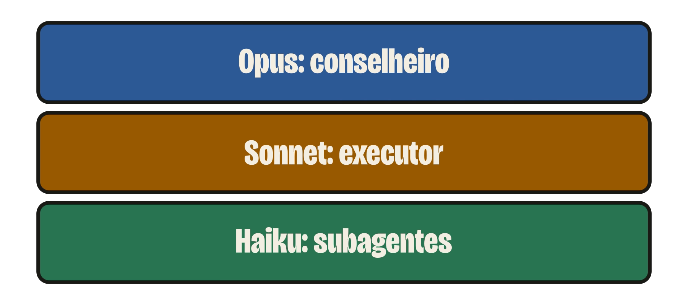
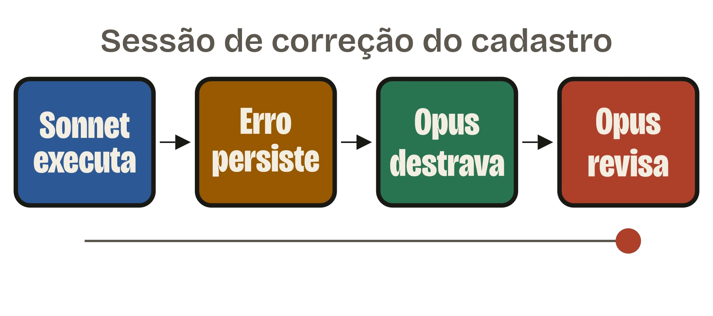

# Sonnet executa e Opus revisa o trabalho no final

_2026-11-28 · filme_

Esta apostila explica a estratégia do conselheiro, uma forma oficial que a Anthropic publicou para usar três modelos do Claude sem gastar o Claude Opus em todas as etapas. Você vai entender o papel de cada modelo: o Sonnet executa, o Opus entra como conselheiro nas partes difíceis e o Haiku cuida das tarefas pequenas dos subagentes. Também vai ver o que dizem os testes da Anthropic e os limites do recurso, que ainda é experimental. No fim, você sabe ligar o conselheiro no Claude Code com o comando /advisor opus e reconhecer quando ele vale a pena.

## O fato



_Três modelos divididos por função: o Opus aconselha, o Sonnet executa e o Haiku cuida dos_

A Anthropic publicou uma forma oficial de reduzir o gasto com o modelo mais caro da família Claude. A técnica se chama estratégia do conselheiro, em inglês Advisor Strategy, e parte de uma ideia direta: em vez de usar o Opus em todas as etapas, o trabalho é dividido entre os três modelos da família.

O artigo oficial sobre a estratégia está no site da Anthropic, com o título The advisor strategy. No Claude Code, o recurso aparece com o comando /advisor, e a documentação dele fica no endereço code.claude.com, em Advisor.

Fonte: <https://claude.com/resources/articles/the-advisor-strategy>

## Por que isso importa

Modelos mais capazes costumam ser mais caros por tarefa, e o uso de um modelo dentro da sua conta tem limites. Quando o modelo mais forte escreve cada linha de código, roda cada comando e faz cada busca, o limite pode acabar antes de chegar ao trabalho que realmente exige raciocínio profundo.

A lógica da estratégia é separar o trabalho mecânico do trabalho difícil. Escrever código a partir de um plano e rodar comandos são tarefas que um modelo intermediário faz bem. Montar o plano de um problema novo e destravar um erro que persiste pedem mais capacidade de análise, e é nesses pontos que o modelo mais caro passa a valer o custo.

## O Sonnet executa o trabalho

O Sonnet é o executor. Ele escreve o código, roda os comandos e faz o trabalho do dia a dia. Na configuração da estratégia, ele é o modelo principal da sessão, então a maior parte das ações sai dele.

Como a execução ocupa a maior parte de uma sessão, é nela que a escolha do modelo pesa mais na conta. Colocar um modelo mais barato nessa etapa reduz o gasto justamente onde ele é maior, sem tirar do Opus a responsabilidade pelas decisões difíceis.

## O Opus entra como conselheiro

O Opus vira o conselheiro. Ele não executa a sessão inteira e entra em três momentos: para montar o plano, para destravar um erro que não some de jeito nenhum e para revisar o trabalho no final.

Como o Opus não escreve o restante da sessão, ele é chamado poucas vezes, e cada chamada tem um objetivo claro. O modelo mais caro fica reservado para as decisões em que a capacidade de análise muda o resultado.

## O Haiku cuida das tarefas pequenas

O Haiku fica com as tarefas pequenas dos subagentes, como procurar arquivos e ler páginas da internet. Subagente é um processo auxiliar que o modelo principal dispara para uma tarefa isolada e que devolve o resultado para a sessão principal.

Buscar e ler costumam gerar muito texto e pouca decisão. Por isso, um modelo menor basta para essa camada, e o Sonnet e o Opus ficam livres para o trabalho que depende de julgamento.

## O que os testes da Anthropic mostraram

Segundo a própria Anthropic, nos testes dela o Sonnet com o Opus como conselheiro foi melhor do que o Sonnet sozinho. A mesma combinação também custou menos por tarefa. O detalhe dos testes está no artigo The advisor strategy.

O resultado vale para o pareamento testado, Sonnet com Opus de conselheiro. Ele não se estende automaticamente a outros modelos ou combinações, e a comparação de custo precisa ser lida no artigo para saber contra qual configuração ela foi feita.

Fonte: <https://claude.com/resources/articles/the-advisor-strategy>

## O comando que liga o conselheiro

No Claude Code, a função é ligada com o comando /advisor, seguido do modelo que vai atuar como conselheiro. Com o Sonnet como modelo principal, o comando /advisor opus liga o Opus nesse papel.

A configuração fica salva para as próximas sessões, então o comando não precisa ser repetido a cada uso. Os pareamentos de modelos aceitos estão descritos na documentação oficial do Advisor no Claude Code.

```
/advisor opus
```

Fonte: <https://code.claude.com/docs/en/advisor>

## O que muda para você



_O Sonnet executa a sessão, e o Opus entra quando o erro persiste e na revisão final._

Imagine uma sessão para corrigir um sistema de cadastro. O Sonnet lê os arquivos, edita o código e roda os comandos para ver o que acontece. Quando um erro aparece e não some nas primeiras tentativas, o Opus entra como conselheiro para analisar o problema e ajudar a destravar o caminho.

Ao final, o Opus faz a revisão do que o Sonnet produziu. O resto da sessão segue com o Sonnet, e o modelo mais caro atua somente nos momentos em que ele entra.

## O que fazer hoje

1. Abra o Claude Code com o Sonnet como modelo principal. Resultado esperado: a sessão trabalha com o Sonnet na execução, como escrever código e rodar comandos.
2. Rode /advisor opus na sessão. Resultado esperado: o Opus fica ligado como conselheiro, e a configuração fica salva para as próximas sessões.
3. Use a sessão normalmente para o trabalho do dia a dia. Resultado esperado: o Sonnet executa, e o Opus só entra nas partes difíceis, como o plano, um erro persistente ou a revisão final.
4. Leia a documentação oficial do Advisor no Claude Code, em https://code.claude.com/docs/en/advisor. Resultado esperado: você confirma quais pareamentos de modelos estão disponíveis antes de depender deles no seu fluxo de trabalho.

## O que conferir

- O recurso ainda é experimental. Antes de depender dele em um fluxo de trabalho, confirme o estado atual na documentação oficial.
- O recurso não roda no Amazon Bedrock, no Google Cloud Agent Platform nem no Microsoft Foundry. Se a sua equipe usa uma dessas plataformas, a estratégia não se aplica diretamente.
- Os resultados de desempenho e de custo são da Anthropic e valem para o pareamento testado. Não os transfira para outros modelos ou combinações sem medir na sua própria tarefa.
- O ganho depende de a tarefa ter partes difíceis de verdade. Em tarefas simples, chamar o Opus acrescenta pouco, porque quase não existe trecho que exija a análise dele.
- A revisão do Opus ajuda, mas o resultado final continua sob responsabilidade de quem aceita o código. A conferência humana segue necessária antes de publicar ou integrar qualquer mudança.

## Glossário

- Estratégia do conselheiro (Advisor Strategy): divisão de funções em que um modelo mais caro atua só como conselheiro, em momentos específicos, enquanto um modelo mais barato executa a maior parte do trabalho.
- Executor: modelo que escreve o código, roda os comandos e faz o trabalho do dia a dia. Na estratégia, é o Sonnet.
- Conselheiro: modelo chamado nas partes difíceis, para montar o plano, destravar um erro persistente ou revisar o trabalho. Na estratégia, é o Opus.
- Subagente: processo auxiliar que o modelo principal dispara para uma tarefa isolada, como buscar arquivos, e que devolve o resultado para a sessão.
- Custo por tarefa: quanto se gasta para concluir uma tarefa completa, e não o preço de uma única resposta.
- Limite de uso: quantidade de trabalho que a sua conta consegue fazer dentro de um período antes de atingir o teto.
- Pareamento de modelos: combinação de qual modelo executa e qual modelo atua como conselheiro.
- Claude Code: ferramenta de linha de comando da Anthropic para programar com o Claude.

## Para onde ir depois

- Leia o artigo oficial The advisor strategy em https://claude.com/resources/articles/the-advisor-strategy para ver o detalhe dos testes e da comparação de custo.
- Abra a documentação do Advisor no Claude Code em https://code.claude.com/docs/en/advisor para ver o comando e os pareamentos de modelos.
- Se você integra o modelo por código, a documentação da Advisor tool na API está em https://platform.claude.com/docs/en/agents-and-tools/tool-use/advisor-tool.
- Pratique a divisão com uma tarefa real: deixe o Sonnet executar e chame o Opus somente quando o plano, um erro persistente ou a revisão final exigirem.
