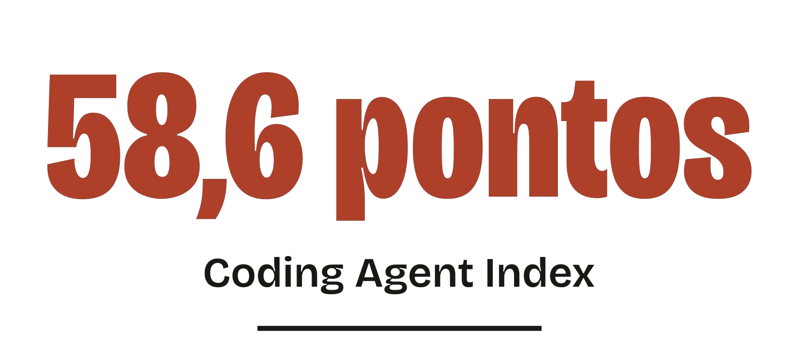
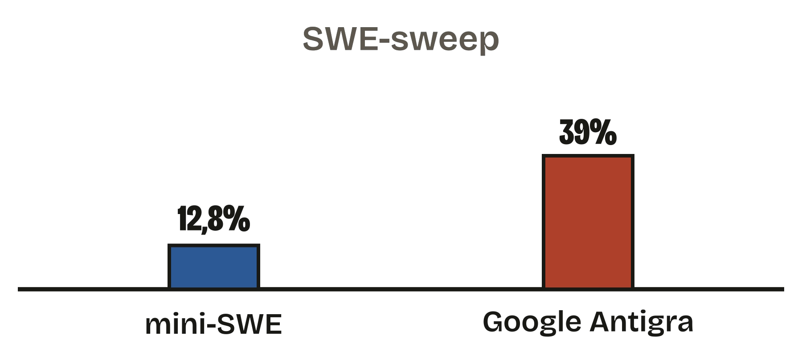
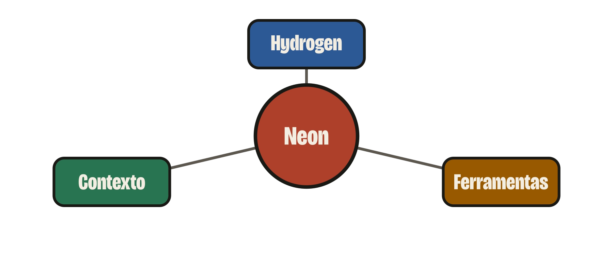

# Neon lidera o Coding Agent Index com 58,6 pontos

_2026-11-25 · noticia_

O Google lançou o Gemini 4 Neon em 18 de novembro de 2026, um modelo com inteligência de fronteira para engenharia de software, trabalho de conhecimento e fluxos científicos. Ele ficou em primeiro lugar geral no Coding Agent Index da Artificial Analysis, com 58,6 pontos. No SWE-sweep, o mesmo modelo mais que triplica o resultado ao trocar o ambiente de execução, de 12,8% no mini-SWE para 39,0% no Google Antigravity. O modelo custa US$ 3 por milhão de tokens de entrada e US$ 15 de saída, com janela de 1 milhão de tokens, e pode ser testado no Google AI Studio e no Antigravity nos planos pagos Pro e Ultra.

## O que é o Gemini 4 Neon

O Google apresentou o Gemini 4 Neon em 18 de novembro de 2026. Segundo o anúncio oficial, o modelo traz inteligência de fronteira com conclusão rápida de tarefas de ponta a ponta em engenharia de software, trabalho de conhecimento e fluxos científicos. Ele também ranqueia #2 no Vals Index, com 70,9%, e chega a #1 no Legal Research Bench e no Tax Agent Bench.

Fonte: <https://blog.google/innovation-and-ai/models-and-research/gemini-models/introducing-gemini-4-neon/>

## Primeiro lugar no Coding Agent Index

_O Neon ficou em primeiro lugar geral no Coding Agent Index, com 58,6 pontos._

A Artificial Analysis deu 58,6 pontos ao Neon no índice de agentes de código. É o primeiro lugar geral no ranking, segundo o próprio anúncio do Google.

- Nota: 58,6 pontos
- Posição: #1 geral
- Fonte do ranking: artificialanalysis.ai

Fonte: <https://artificialanalysis.ai/agents/coding-agents#coding-agents-index>

## SWE-Sweep: o harness muda o resultado

_O mesmo modelo foi de 12,8% no mini-SWE para 39,0% no Google Antigravity._

No SWE-sweep, o mesmo modelo mais que triplica o resultado quando muda o ambiente de execução. A diferença mostra quanto o harness pesa na hora de avaliar um agente.

- mini-SWE: 12,8%
- Google Antigravity: 39,0%

Fonte: <https://blog.google/innovation-and-ai/models-and-research/gemini-models/introducing-gemini-4-neon/>

## Orquestração e sessões longas

_O Neon orquestra subagentes Hydrogen em fluxos longos com ferramentas e contexto._

No Google Antigravity, o Neon pode atuar como orquestrador e distribuir o trabalho entre vários subagentes Hydrogen rodando ao mesmo tempo. Isso foi pensado para fluxos longos e cheios de ferramentas.

- Evita reler os mesmos arquivos
- Informa o andamento da tarefa
- Lida com a compactação de contexto em sessões longas

Fonte: <https://blog.google/innovation-and-ai/models-and-research/gemini-models/introducing-gemini-4-neon/>

## Terminal-Bench e FrontierCode

São dois testes de agentes de código. Servem de referência para comparar modelos, mas o resultado no seu próprio projeto pode ser diferente.

- Terminal-Bench 4.1: 65,2%
- FrontierCode 2.0 (nível high): 46,2%

Fonte: <https://www.tbench.ai/>

## Preço e onde testar

O Neon custa US$ 3 por milhão de tokens de entrada e US$ 15 de saída, com janela de contexto de 1 milhão de tokens.

- Teste no Google AI Studio (aistudio.google.com)
- No Google Antigravity (antigravity.google), o Neon só está nos planos pagos Pro e Ultra
- Acesso pela API do Gemini no AI Studio

Fonte: <https://aistudio.google.com/prompts/new_chat?model=gemini-4-neon>

## Links oficiais

Referências para consulta.

- Anúncio oficial: https://blog.google/innovation-and-ai/models-and-research/gemini-models/introducing-gemini-4-neon/
- Google AI Studio: https://aistudio.google.com/prompts/new_chat?model=gemini-4-neon
- Google Antigravity: https://antigravity.google/
- Artificial Analysis, Coding Agent Index: https://artificialanalysis.ai/agents/coding-agents#coding-agents-index
- Model card: https://storage.googleapis.com/deepmind-media/Model-Cards/Gemini-4-Neon-Model-Card.pdf
- Terminal-Bench: https://www.tbench.ai/
- FrontierCode 2.0: https://cognition.com/blog/frontier-code-2.0

## Além do vídeo

- Preço de entrada em cache: US$ 0,15 por milhão de tokens, um desconto de 95% sobre a entrada padrão.
- No Zapier AutomationBench, o Neon fica em #1 (56,3%); no Andon Labs Vending-Bench 2, em #1 (US$ 16.843).
- Terminal-Bench Science 70,5%, RiemannBench 84,0% e HLE-Diamond 71,3% em raciocínio científico e matemático.
- Quatro níveis de pensamento; no nível high, o custo por tarefa é 32% menor que o do Carbon.
- No Agent Arena Index, o Neon estreia em #2 global com 1336 pontos, em mais de 4.200 sessões reais de agentes.
