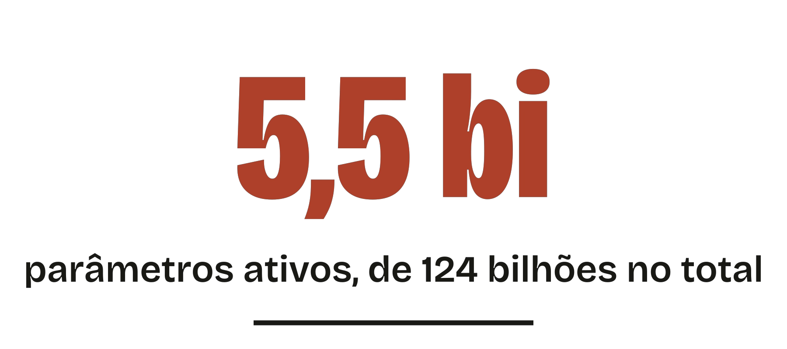
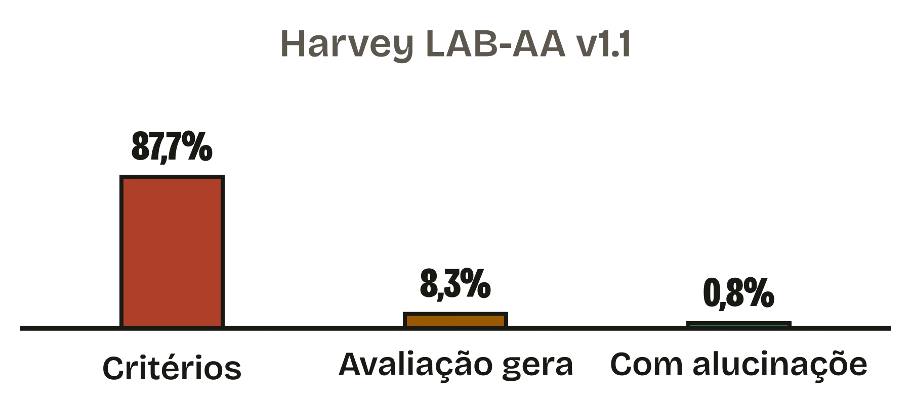
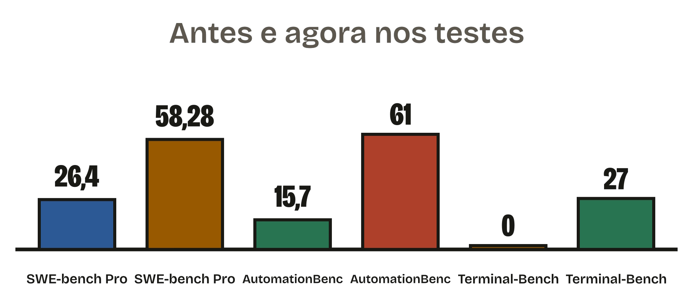

# Ling-3.2-air vai de 26,40 a 58,28 no SWE-bench Pro

_2026-11-26 · noticia_

A Ant Group abriu o Ling-3.2-air, um modelo multimodal leve que lê texto, imagem e vídeo e tem os pesos liberados sob licença MIT. Esta apostila explica o que mudou nele: a nota em programação foi de 26,40 para 58,28 no SWE-bench Pro, e a de automação de escritório foi de 15,7% para 61%. Você vai entender o que cada número mede, por que o tamanho do modelo engana (124 bilhões de parâmetros, só 5,5 bilhões ativos) e onde ele ainda falha, como no exame jurídico da Harvey, em que a nota cai para 0,8%. No fim, você sabe onde baixar o modelo e o que testar primeiro.

## O fato

A Ant Group lançou e abriu o código do Ling-3.2-air, um modelo multimodal leve. Multimodal quer dizer que ele aceita mais de um tipo de entrada: texto, imagem e vídeo. A notícia foi publicada em 24 de novembro de 2026.

O modelo mantém a arquitetura do Ling-3.0-flash-VL, com 124 bilhões de parâmetros no total e 5,5 bilhões de parâmetros ativados. Os pesos já estão abertos sob licença MIT, ou seja, qualquer pessoa pode baixá-los.

A melhoria mais citada na nova versão é a capacidade de executar tarefas como agente. Em programação, a nota no SWE-bench Pro subiu de 26,40 para 58,28. O modelo também mostra um limite claro: em tarefas profissionais complexas, como o exame jurídico da Harvey, a confiabilidade ainda é baixa.

## Por que isso importa

Até pouco tempo, modelos capazes de programar e de operar ferramentas costumavam ser grandes e fechados. O Ling-3.2-air chama atenção porque junta três coisas: um salto grande nas notas de programação e de agente, um custo de execução menor por ser um modelo leve e pesos abertos que você mesmo pode baixar e testar.

Um agente, nesse contexto, é um modelo que não só responde perguntas: ele executa tarefas em etapas, como rodar comandos num terminal ou cumprir uma rotina de escritório. Por isso os testes de agente importam para quem quer automatizar trabalho, e não só conversar com uma IA.

O outro lado também faz parte da notícia. A nota jurídica mostra que um modelo pode ir muito bem em programação e ainda falhar em trabalho que exige precisão em cada detalhe. Ler os dois lados evita tanto o exagero quanto o descarte.

## Grande por fora, leve por dentro: o tamanho do modelo

_Apenas 5,5 bilhões dos 124 bilhões de parâmetros ficam ativos por token._

Parâmetros são os valores numéricos que o modelo ajusta durante o treino. Eles guardam o que ele aprendeu. O Ling-3.2-air tem 124 bilhões de parâmetros no total, mas apenas 5,5 bilhões ficam ativos para processar cada token, que é cada pedaço de texto que o modelo lê ou escreve.

Na prática, isso quer dizer que a cada trecho só uma fração pequena do modelo trabalha. É por isso que ele é descrito como leve, apesar do número total alto. A comparação útil é com o tamanho total: 5,5 bilhões é uma parte pequena de 124 bilhões.

Um cuidado de leitura: o tamanho total e o tamanho ativo são números diferentes e não devem ser trocados um pelo outro. Quando alguém diz que o modelo tem 5,5 bilhões, está falando só da parte ativa por token.

## O salto em agente: terminal e escritório

A melhoria mais notável da nova versão está na execução de tarefas como agente. No AutomationBench-AA, teste de automação de escritório divulgado oficialmente, a pontuação subiu de 15,7% para 61%. É quase quatro vezes o valor anterior.

No Terminal-Bench 4.0, que reúne tarefas complexas de terminal, a taxa de aprovação saiu de 0% para 27%. Taxa de aprovação é a parcela das tarefas que o modelo conseguiu concluir de forma aceita pelo teste. Sair de 0% para 27% significa que o modelo passou a concluir uma parte das tarefas que antes não concluía nenhuma.

Um número como 27% também mostra o que ainda falta: a maior parte das tarefas de terminal não é aprovada. O ganho é real, mas o resultado não permite concluir que o modelo resolve sozinho o trabalho de terminal.

## O salto em programação: SWE-bench Pro

No SWE-bench Pro, a nota subiu de 26,40 para 58,28. Esse teste mede se a IA resolve problemas reais de código, e a nova nota é mais que o dobro da anterior.

Para quem programa, esse é o número que mais interessa. Ele indica que vale a pena testar o modelo em tarefas de código. Ele não garante o mesmo desempenho no seu projeto, porque cada base de código tem suas particularidades.

## O limite: tarefas jurídicas

_No exame jurídico, a nota cai de 87,7% para 8,3% e depois para 0,8%._

No exame jurídico Harvey LAB-AA v1.1, o modelo atingiu 87,7% dos critérios de avaliação individuais, mas só 8,3% da avaliação geral. Quando entraram verificações de alucinações factuais significativas, a nota caiu para 0,8%.

Alucinação é quando o modelo afirma como fato algo que inventou. Em trabalho jurídico, um fato inventado pesa muito, e por isso a nota despenca quando essas verificações entram na conta.

A diferença entre 87,7% e 8,3% mostra que acertar critérios isolados não basta: a avaliação geral é muito mais exigente. A conclusão prática é que, em tarefas profissionais complexas, a confiabilidade do Ling-3.2-air ainda é limitada.

## Pesos abertos com licença MIT

Os pesos são o arquivo com tudo o que o modelo aprendeu. Ao abri-los, a Ant Group permite que qualquer pessoa baixe o modelo e o rode por conta própria. A licença é a MIT, que é a licença do código aberto citada no anúncio.

O modelo está no Hugging Face, na página oficial da inclusionAI. É por lá que você baixa os pesos e acompanha a documentação do modelo.

Fonte: <https://huggingface.co/inclusionAI/Ling-3.2-air>

## Os números

_Notas antes e agora no SWE-bench Pro, AutomationBench-AA e Terminal-Bench 4.0._

- SWE-bench Pro: de 26,40 para 58,28. É a nota em programação, em problemas reais de código. Mais que dobrou.
- AutomationBench-AA: de 15,7% para 61%. É a pontuação em automação de escritório, quase quatro vezes a anterior.
- Terminal-Bench 4.0: de 0% para 27%. É a taxa de aprovação em tarefas complexas de terminal. Mostra um avanço, mas a maior parte das tarefas ainda não é aprovada.
- GDP.pdf: de 8,4% para 16%. É a taxa de aprovação geral nesse teste. Dobrou, mas continua baixa.
- 124 bilhões de parâmetros no total e 5,5 bilhões ativos por token. O total é o tamanho do modelo; o ativo é a parte que trabalha a cada trecho.
- Harvey LAB-AA v1.1: 87,7% dos critérios individuais, 8,3% na avaliação geral e 0,8% com verificações de alucinações factuais significativas. Mostra que o desempenho jurídico ainda é frágil.

## O que muda para você

Se você programa, passa a existir um modelo aberto com nota alta em problemas reais de código, que você pode baixar e testar sem depender de um serviço fechado.

Se você pensa em automação de tarefas de escritório, o resultado no AutomationBench-AA indica que vale experimentar o modelo nesse tipo de rotina.

Imagine que você precisa de ajuda com um contrato. O resultado do exame jurídico da Harvey sugere cuidado: o modelo acerta muitos critérios isolados, mas a nota geral é baixa e cai ainda mais quando se contam fatos inventados. Nesse caso, qualquer resposta dele precisa de revisão humana antes de ser usada.

## O que fazer hoje

1. Abra a página oficial do modelo no Hugging Face, em huggingface.co/inclusionAI/Ling-3.2-air. Resultado esperado: você vê a página do Ling-3.2-air publicada pela inclusionAI.
2. Confira nessa página a licença do modelo. Resultado esperado: a licença indicada é a MIT.
3. Baixe os pesos do Ling-3.2-air. Resultado esperado: você tem o modelo em mãos para rodar por conta própria.
4. Teste o modelo em uma tarefa de programação sua. Resultado esperado: você vê com seus próprios exemplos se o ganho de nota se reflete no seu tipo de código.
5. Evite usar o modelo, sem revisão humana, em trabalho jurídico. Resultado esperado: nenhuma resposta jurídica dele segue adiante sem checagem.

Fonte: <https://huggingface.co/inclusionAI/Ling-3.2-air>

## O que conferir

- Nota de teste não é garantia no seu caso. Os números vêm de testes específicos, e o resultado no seu projeto pode ser diferente.
- Compare sempre antes e depois no mesmo teste. Cada número do material vale para um teste e uma versão; não some nem misture notas de testes diferentes.
- Distinga tamanho total de tamanho ativo. São 124 bilhões de parâmetros no total e 5,5 bilhões ativos por token.
- Taxas baixas continuam baixas. 27% no Terminal-Bench 4.0 e 16% no GDP.pdf são avanços, mas a maior parte das tarefas não passa.
- Em tarefas jurídicas, a nota geral foi de 8,3% e, com verificações de alucinações factuais significativas, 0,8%. Toda saída nessa área precisa de revisão humana.
- Baixe o modelo só pela página oficial da inclusionAI no Hugging Face.

## Glossário

- Multimodal: modelo que aceita mais de um tipo de entrada, como texto, imagem e vídeo.
- Parâmetros: valores numéricos ajustados no treino, que guardam o que o modelo aprendeu.
- Parâmetros ativos: a parte dos parâmetros que trabalha a cada token. No Ling-3.2-air são 5,5 bilhões, de um total de 124 bilhões.
- Token: pedaço de texto que o modelo lê ou escreve de cada vez.
- Pesos: o arquivo com tudo o que o modelo aprendeu. Com os pesos abertos, qualquer pessoa pode baixar o modelo.
- Licença MIT: licença de código aberto sob a qual os pesos do Ling-3.2-air foram liberados.
- Agente: modelo que executa tarefas em etapas, como comandos de terminal ou rotinas de escritório, em vez de só responder perguntas.
- SWE-bench Pro: teste que mede se a IA resolve problemas reais de código.
- Terminal-Bench 4.0: teste de tarefas complexas de terminal.
- AutomationBench-AA: teste de automação de escritório.
- Taxa de aprovação: parcela das tarefas de um teste que o modelo conclui de forma aceita.
- Alucinação: quando o modelo afirma como fato algo que inventou.

## Para onde ir depois

O próximo passo é abrir a página oficial do Ling-3.2-air no Hugging Face e baixar o modelo. Depois, escolha uma tarefa real de programação sua e compare o resultado com o que você esperava.

Para praticar, repita o teste com tarefas de dificuldades diferentes e anote onde o modelo acerta e onde falha. Assim você forma a sua própria régua, em vez de depender só das notas de benchmark.

Fonte: <https://huggingface.co/inclusionAI/Ling-3.2-air>

## Além do vídeo

- A taxa de aprovação geral no GDP.pdf subiu de 8,4% para 16%.
- O Ling-3.2-air mantém a arquitetura do Ling-3.0-flash-VL.
- O Ling-3.2-flash foi lançado no início do mesmo mês, e o Ling-3.2-air é comparado a ele em tamanho.
- O exame jurídico usado foi o Harvey LAB-AA v1.1.
- O modelo aceita entrada de vídeo, além de texto e imagem.
