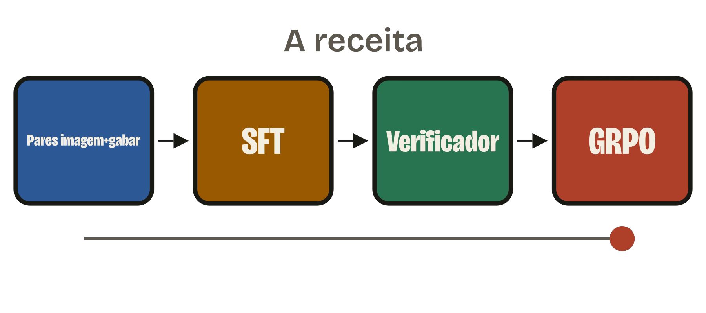
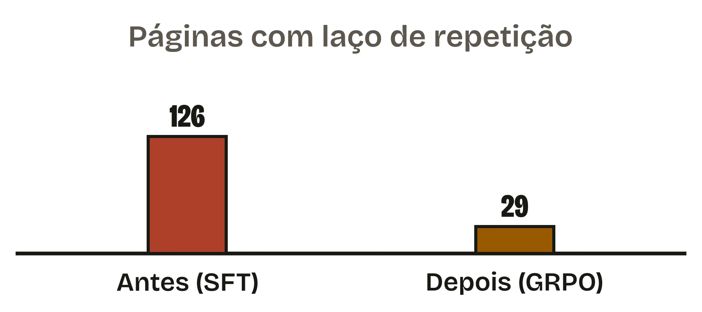
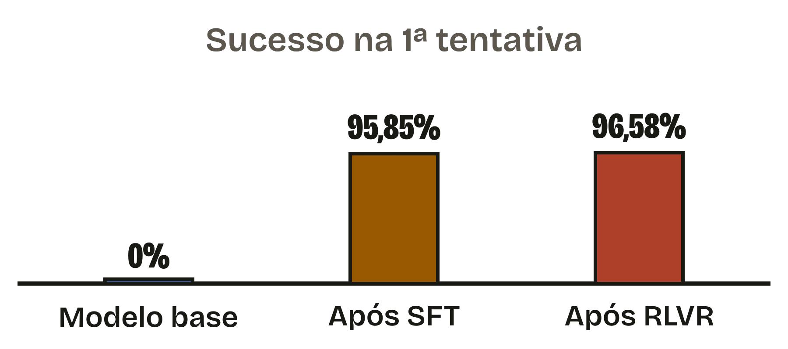

# Receita com NeMo e GRPO leva sucesso de 0% a 96,58%

_2026-11-26 · noticia_

A NVIDIA publicou uma receita aberta para adaptar o Nemotron 3.5 Parse, modelo que transforma imagens de páginas em dados estruturados, aos documentos de quem o usa. No exemplo de um formulário odontológico sintético, a taxa estimada de sucesso na primeira tentativa foi de 0,00% no modelo base para 95,85% após o ajuste supervisionado e 96,58% após o aprendizado por reforço. Esta apostila explica as duas etapas, o que cada número mede e o que você precisa levar (imagens com gabarito e um verificador). Ela também cobre os dados abertos e os ganhos de velocidade anunciados junto. Ao final, você saberá avaliar se a receita serve ao seu tipo de documento e por onde começar.

## O fato

Em 26 de novembro de 2026, a NVIDIA publicou no blog que mantém no Hugging Face o texto "Building on Nemotron 3.5 Parse: Open Data, Fine-Tuning, and Faster Inference". O anúncio traz três coisas novas em cima do Nemotron 3.5 Parse, lançado antes: conjuntos de dados sintéticos de treino, uma receita de fine-tuning (ajuste fino) e um speculator DFlash2 para inferência mais rápida.

O Nemotron 3.5 Parse é um modelo compacto de documentos: recebe a imagem de uma página e devolve dados estruturados, que servem de entrada para sistemas de RAG (busca com geração de texto) e para agentes. A receita de fine-tuning é o centro desta apostila. Ela leva o desenvolvedor da geração de pares de dados ao ajuste supervisionado com NeMo Automodel e, depois, ao aprendizado por reforço com NeMo RL (algoritmo GRPO), usando o vLLM para gerar as respostas candidatas.

O exemplo trabalhado é um formulário odontológico sintético. Nele, a taxa estimada de sucesso na primeira tentativa foi de 0,00% no modelo base para 96,58% ao fim da receita.

Fonte: <https://huggingface.co/blog/nvidia/building-on-nemotron-35-parse-open-data-fine-tunin>

## Por que isso importa

Um modelo de documentos pronto costuma ser treinado para documentos em geral. O seu documento pode ter um layout próprio, uma tabela que só faz sentido para o seu negócio ou um gráfico com convenções específicas. No formulário odontológico da receita, o modelo base lia os números impressos dos dentes, mas errava justamente a tabela de procedimentos que interessava. Esse é o tipo de lacuna que o ajuste fino fecha.

O texto da NVIDIA dá um motivo concreto para o cuidado com tabelas: a estrutura carrega o significado, e uma linha ou coluna deslocada pode mudar por completo a interpretação dos dados. Por isso a receita não treina o modelo só para copiar texto. Ela o treina para acertar a estrutura e para terminar a resposta sem travar.

A ideia por trás da receita vale para além deste modelo. Primeiro se ensina a capacidade com exemplos de resposta correta. Depois se melhora a consistência deixando o modelo tentar várias vezes e recompensando as tentativas que passam em uma checagem automática.

Fonte: <https://huggingface.co/blog/nvidia/building-on-nemotron-35-parse-open-data-fine-tunin>

## O que o Parse 3.5 produz

O Parse extrai o conteúdo de páginas em ordem de leitura, atribui classes de conteúdo (títulos, parágrafos, tabelas, gráficos) e devolve caixas delimitadoras (bounding boxes) que indicam onde cada conteúdo está. Tabelas e gráficos viram registros estruturados, que aplicações de processamento de documentos podem usar. O cartão do modelo cita varreduras, PDFs renderizados, slides, formulários e relatórios, com exportação em Markdown, HTML ou JSON estruturado.

A versão 3.5 amplia a leitura de gráficos e tabelas em casos difíceis. Um exemplo do anúncio: gráficos de barras sem valores numéricos marcados. O modelo estima os valores olhando os eixos e a altura de cada barra. Na demonstração do anúncio, ele recuperou 18, 27, 39 e 54 a partir da geometria de um gráfico.

Segundo a NVIDIA, esses avanços vêm em grande parte de dados sintéticos: renderizam-se variações de gráficos e tabelas com o gabarito conhecido, e o modelo é treinado para fazer o caminho inverso, da imagem de volta ao gabarito.

Fonte: <https://huggingface.co/nvidia/Nemotron-3.5-Parse>

## A receita: SFT e depois GRPO



_A receita parte de pares de imagem e gabarito, faz SFT e depois GRPO com um verificador._

A receita tem duas fases, as mesmas usadas para treinar o Parse 3.5. A primeira é o SFT (supervised fine-tuning, ajuste supervisionado). O modelo vê a página e a resposta estruturada correta e aprende a reproduzi-la. No treino do Parse 3.5, essa fase cobriu texto, layout, tabelas, gráficos e documentos multilíngues, e deu ao modelo a capacidade geral de ler uma página e representá-la.

A segunda fase é o RLVR (reinforcement learning with verifiable rewards, aprendizado por reforço com recompensas verificáveis), com o algoritmo GRPO (Group Relative Policy Optimization). O modelo gera várias respostas para a mesma página, e uma checagem automática atribui a cada uma uma recompensa. Uma extração de gráfico, por exemplo, ganha recompensa melhor se recupera as séries e os valores corretos, produz uma estrutura utilizável e termina sem repetir o mesmo conteúdo.

Uma página difícil pode ter mais de uma representação válida. As checagens deixam o modelo livre para achar uma resposta correta sem exigir uma sequência exata de tokens, e ao mesmo tempo desencorajam laços de repetição e saídas inacabadas. Na prática: o SFT ensina a capacidade, e o RLVR melhora a consistência.

No ferramental, o SFT roda no NeMo Automodel, o GRPO roda no NeMo RL, e o vLLM gera as respostas candidatas que o GRPO avalia. A receita está no repositório NVIDIA-NeMo/Nemotron.

Fonte: <https://github.com/NVIDIA-NeMo/Nemotron/blob/main/docs/nemotron/parse/index.md>

## O exemplo do formulário odontológico

O caso trabalhado é um formulário dentário sintético com um odontograma: um gráfico que mostra os dentes, os procedimentos planejados e as superfícies afetadas de cada dente. Antes da adaptação, o Parse lia os números impressos dos dentes, mas perdia a tabela de procedimentos que importava.

O SFT ensinou o modelo a associar cada dente marcado a um procedimento e à sua posição no dente. No exemplo gravado da receita, depois do SFT as seis linhas do gráfico batiam com o gabarito. O RLVR então reforçou a precisão e a conclusão consistente das respostas.

Imagine que você tenha um formulário próprio, com uma tabela que o modelo base ignora. O caminho é o mesmo do exemplo: reunir imagens com a resposta correta, ensinar a associação com SFT e depois usar um verificador para premiar as respostas completas e corretas. O formulário dentário é só o caso que a NVIDIA escolheu para mostrar o método.

Fonte: <https://huggingface.co/blog/nvidia/building-on-nemotron-35-parse-open-data-fine-tunin>

## Menos laços de repetição e mais nota geral



_Páginas marcadas com laço de repetição caíram de 126 para 29 do SFT para o GRPO._

Um defeito comum em modelos que geram texto longo é travar e repetir o mesmo trecho sem parar. A NVIDIA comparou SFT e GRPO em condições controladas, com as mesmas configurações de avaliação. Nessa comparação, as páginas marcadas por uma checagem de repetição caíram de 126 para 29, cerca de 77% a menos. As saídas que bateram o limite de 9.000 tokens caíram de 185 para 35.

A nota geral subiu de 66,24 para 71,38, com ganho de 5,18 pontos em tabelas e 4,15 em gráficos. Esses números vêm de checkpoints de desenvolvimento, separados do modelo final lançado. Eles mostram o efeito do GRPO sobre o SFT, não o desempenho do modelo publicado.

Fonte: <https://huggingface.co/blog/nvidia/building-on-nemotron-35-parse-open-data-fine-tunin>

## Os números



_Sucesso na primeira tentativa no formulário odontológico: 0%, 95,85% e 96,58%._

Cada número abaixo vem do anúncio da NVIDIA e só vale no recorte indicado.

- 0,00% para 95,85% para 96,58%: taxa estimada de sucesso na primeira tentativa (pass@1 amostrado) no formulário odontológico, para o modelo base, depois do SFT e depois do RLVR. A avaliação usou 256 formulários separados para teste, gerados pelo mesmo gerador sintético, com oito amostras por página. Sucesso exige conclusão natural, conteúdo exato do gráfico e texto da página normalizado sem erros. Não dá para concluir que o mesmo índice vale para documentos reais.
- 126 para 29 páginas com laço de repetição: comparação controlada entre SFT e GRPO, com avaliação equivalente, em checkpoints de desenvolvimento. Equivale a cerca de 77% menos.
- 185 para 35 saídas no limite de 9.000 tokens: mesma comparação. Mostra que o GRPO reduz respostas que não terminam.
- 66,24 para 71,38 na nota geral: mesma comparação. Tabelas ganharam 5,18 pontos e gráficos 4,15. A nota geral é a da avaliação da NVIDIA, e não substitui um teste nos seus documentos.
- 9,98 milhões, 1 milhão e 7,9 milhões de exemplos: tamanho dos três conjuntos de dados abertos (gráficos, tabelas e OCR multilíngue).
- 7,62 vezes com concorrência 1 e 1,52 vez com concorrência 512: ganho de vazão do DFlash2 sobre o Parse 3.5 sem decodificação especulativa, em uma H200 com BF16 e as mesmas 2.078 páginas.
- 13,48 páginas por segundo sem especulação e 20,44 com DFlash2, contra 2,98 do Parse 2.0, com concorrência 512. Isso dá 4,53 e 6,86 vezes a vazão do Parse 2.0. O Parse 2.0 teve uma medição por ponto, e o Parse 3.5 mostra a mediana de três medições.
- 2,18 e 2,46 pontos no ParseBench: ganho dos modos de passagem dupla e tripla sobre a passagem única, na avaliação de referência publicada. O cartão do modelo registra 75,20 no modo triplo, a maior nota geral entre os sistemas da comparação da NVIDIA.

Fonte: <https://huggingface.co/blog/nvidia/building-on-nemotron-35-parse-open-data-fine-tunin>

## Dados abertos para treinar

Junto com a receita, a NVIDIA abriu três conjuntos usados no treino do Parse 3.5. O Synthetic Charts V1 tem 9,98 milhões de exemplos de gráficos renderizados com anotações estruturadas, para aprender categorias, séries e valores numéricos. O Synthetic Tables V1 tem 1 milhão de exemplos de tabelas HTML renderizadas, com alvos que preservam linhas, colunas, cabeçalhos e relações entre células. O OCR Synthetic Multilingual v2 tem 7,9 milhões de exemplos de páginas sintéticas com alvos no formato do Parse, em fontes e layouts variados, para OCR multilíngue e leitura estruturada de páginas.

Cada conjunto inclui imagens, anotações, documentação da geração e o formato de treino. A orientação da NVIDIA é usar esses pares para ajustar modelos de documentos ou criar variações para um tipo de documento ou idioma específico. O anúncio cita que a comunidade já estendeu o Parse para tailandês, persa/farsi e árabe.

Fonte: <https://huggingface.co/blog/nvidia/building-on-nemotron-35-parse-open-data-fine-tunin>

## O verificador: o que você precisa levar

Para adaptar a receita ao seu caso, você fornece dois ingredientes. O primeiro são pares de imagem e gabarito: a página e a resposta estruturada correta. O segundo é um verificador, um conjunto de checagens que decide se uma extração está correta. É ele que dá a recompensa no GRPO.

A receita já inclui componentes de recompensa para documentos, que cobrem fidelidade do texto, caixas delimitadoras, tabelas, fatos de gráficos e conclusão. A NVIDIA orienta combinar os componentes que servem à sua tarefa, acrescentar checagens de esquema (o formato dos dados) e usar verificações de conclusão e de repetição para desencorajar laços e saídas inacabadas.

Um bom verificador é a parte decisiva. Se a checagem aceita respostas erradas, o modelo aprende a produzi-las. Se for rígida demais com respostas válidas, ela pune formas corretas de representar a mesma página.

Fonte: <https://github.com/NVIDIA-NeMo/Nemotron/tree/main/src/nemotron/recipes/parse/document_rewards>

## Inferência mais rápida e passagens extras

Um parser precisa gerar bastante texto e estrutura para cada página, então a velocidade de decodificação pesa. O Parse 3.5 mudou a arquitetura em relação ao 2.0: entrada dinâmica retangular NaViT no lugar do canvas fixo de 2048 × 1664, tokens visuais comprimidos como prefixo causal no lugar da atenção cruzada entre codificador e decodificador, e atenção por consulta agrupada GQA-8 (16 cabeças de consulta e 8 de chave/valor), que reduz a memória do cache de atenção. Já existe uma cabeça de predição de múltiplos tokens (MTP) que dá um token de antecipação.

O speculator DFlash2 vai além: um pequeno modelo rascunho propõe até 32 tokens à frente, e o Parse verifica as propostas em conjunto. Na configuração medida de 32 tokens, em média cerca de 14 tokens do rascunho são aceitos, o que dá cerca de 15 tokens de progresso por passo de verificação, contando o token do modelo alvo. O cartão do modelo descreve o drafter opcional com 89,3 milhões de parâmetros, para um modelo de 0,631 bilhão.

Com a velocidade ganha, sobra espaço para reprocessar regiões difíceis. Na passagem única, a página inteira é lida uma vez. Na dupla, indicada para tabelas densas e detalhes pequenos de gráficos, o modelo recorta as tabelas e gráficos que encontrou, relê esses recortes com mais detalhe e incorpora o resultado à página. Na tripla, uma segunda passada do modelo em modo de detecção confere se todas as caixas foram achadas e se nenhum texto escapou, e os gráficos e tabelas encontrados são reextraídos numa terceira etapa. Vários recortes podem exigir várias requisições, então a precisão extra custa vazão.

Fonte: <https://huggingface.co/blog/nvidia/building-on-nemotron-35-parse-open-data-fine-tunin>

## O que muda para você

Se você trabalha com documentos que seguem um padrão (formulários, relatórios, laudos, fichas), a receita mostra um caminho para ensinar o Parse ao seu padrão em vez de aceitar o desempenho genérico. O exemplo do formulário dentário foi de 0% de acerto na primeira tentativa a 96,58% depois do SFT e do RLVR.

Exemplo: imagine uma empresa que recebe todo mês o mesmo tipo de ficha com uma tabela de itens. Se o modelo base ignora essa tabela, a empresa pode reunir imagens dessas fichas com a tabela correta anotada, rodar o SFT e depois montar um verificador que premie a tabela exata. O caminho é o mesmo do exemplo da NVIDIA, mas o resultado só se conhece medindo nos seus documentos.

Se você só quer usar o modelo como está, o ganho de velocidade com DFlash2 e os modos de passagem dupla e tripla já são opções de configuração para trocar vazão por precisão.

Fonte: <https://huggingface.co/blog/nvidia/building-on-nemotron-35-parse-open-data-fine-tunin>

## O que fazer hoje

1. Abra a página da receita de fine-tuning do Parse no repositório NVIDIA-NeMo/Nemotron e leia o fluxo completo: geração de pares, SFT no NeMo Automodel e GRPO no NeMo RL. Você saberá quais etapas e ferramentas precisa preparar.
2. Separe imagens de páginas do seu tipo de documento e escreva, para cada uma, a resposta estruturada correta. O resultado esperado é um conjunto de pares imagem e gabarito, o primeiro ingrediente da receita.
3. Defina o seu verificador a partir dos componentes de recompensa de documentos (texto, caixas, tabelas, dados de gráfico e conclusão), somando checagens de esquema e de repetição se fizer sentido. O resultado esperado é uma checagem que diga, para cada extração, se está correta.
4. Baixe o modelo para conhecer o ponto de partida, com o comando do bloco de código desta seção. O resultado esperado é a pasta ./parse35 com o Nemotron 3.5 Parse e os arquivos do drafter DFlash2.
5. Rode o SFT e depois o GRPO seguindo a receita, comparando o modelo base, o modelo após SFT e o modelo após GRPO nos mesmos documentos separados para teste. O resultado esperado é uma tabela como a do exemplo da NVIDIA, com a taxa de sucesso da primeira tentativa em cada etapa.

```
hf download nvidia/Nemotron-3.5-Parse --local-dir ./parse35
```

Fonte: <https://huggingface.co/nvidia/Nemotron-3.5-Parse>

## O que conferir

- O resultado de 96,58% vem de formulários sintéticos, separados para teste mas gerados pelo mesmo gerador do treino. Antes de confiar em números parecidos, meça nos seus documentos reais.
- O pass@1 do anúncio é uma estimativa por amostragem (oito amostras por página, 256 formulários), e o sucesso exige conclusão natural, conteúdo exato do gráfico e texto normalizado sem erros. Defina o seu próprio critério de sucesso com a mesma clareza.
- A comparação de 126 para 29 páginas com repetição e a nota de 66,24 para 71,38 usam checkpoints de desenvolvimento, que a NVIDIA separa do modelo final lançado.
- Os ganhos de velocidade valem para uma H200 em BF16 com 2.078 páginas, e a vantagem do DFlash2 varia com a concorrência: 7,62 vezes com concorrência 1 e 1,52 vez com 512. Em outro hardware ou carga, meça de novo.
- As passagens dupla e tripla melhoram a extração (2,18 e 2,46 pontos no ParseBench sobre a passagem única) ao custo de vazão, porque cada recorte pode virar uma requisição.
- Um verificador frouxo ensina o modelo a acertar o teste errado. Revise por amostragem, com uma pessoa, as extrações que o verificador aprovou.
- Confirme os requisitos e os termos de uso na página do modelo antes de levar para produção.

Fonte: <https://huggingface.co/nvidia/Nemotron-3.5-Parse>

## Glossário

- Parse: modelo que recebe a imagem de uma página e devolve texto, tabelas, dados de gráficos, ordem de leitura, classes e caixas delimitadoras.
- SFT (ajuste fino supervisionado): treino com exemplos de entrada e resposta correta, para o modelo aprender a reproduzir a resposta.
- RLVR (aprendizado por reforço com recompensas verificáveis): treino em que o modelo gera respostas e uma checagem automática dá recompensa às corretas.
- GRPO (Group Relative Policy Optimization): algoritmo de aprendizado por reforço usado na fase de RLVR.
- Verificador: conjunto de checagens que determina se uma extração está correta.
- pass@1 amostrado: taxa estimada de sucesso na primeira tentativa, calculada a partir de várias amostras por página.
- Bounding box (caixa delimitadora): retângulo que marca onde um conteúdo está na página.
- RAG: técnica em que um modelo de linguagem consulta documentos para responder, em vez de depender só do que aprendeu no treino.
- DFlash2: speculator que usa um modelo rascunho pequeno para propor até 32 tokens à frente, que o Parse verifica juntos para gerar mais rápido.
- Decodificação especulativa: técnica que propõe vários tokens de uma vez e confere todos em um único passo.
- Odontograma: gráfico que mostra os dentes, os procedimentos planejados e as superfícies afetadas.
- ParseBench: avaliação usada pela NVIDIA para comparar a qualidade geral do Parse e de outros sistemas.
- Concorrência: quantidade de requisições processadas ao mesmo tempo.

## Para onde ir depois

O próximo passo é abrir a receita e os componentes de recompensa e escolher, no seu caso, o que o verificador precisa checar. Pratique primeiro com um documento só: monte alguns pares de imagem e gabarito, rode o modelo base e veja onde ele erra.

Depois, compare as três etapas (base, SFT e GRPO) nos mesmos documentos de teste e registre a taxa de sucesso da primeira tentativa em cada uma. Se o seu caso envolve outro idioma ou outro tipo de documento, os conjuntos sintéticos abertos de gráficos, tabelas e OCR multilíngue são ponto de partida para criar variações.

- Receita de fine-tuning do Parse: https://github.com/NVIDIA-NeMo/Nemotron/blob/main/docs/nemotron/parse/index.md
- Componentes de recompensa para documentos: https://github.com/NVIDIA-NeMo/Nemotron/tree/main/src/nemotron/recipes/parse/document_rewards
- Repositório NVIDIA-NeMo/Nemotron: https://github.com/NVIDIA-NeMo/Nemotron
- Modelo Nemotron 3.5 Parse: https://huggingface.co/nvidia/Nemotron-3.5-Parse
- Blog da NVIDIA no Hugging Face: https://huggingface.co/blog/nvidia/building-on-nemotron-35-parse-open-data-fine-tunin

Fonte: <https://github.com/NVIDIA-NeMo/Nemotron>

## Além do vídeo

- O Parse 3.5 aceita pedidos por tokens de controle: caixas, classes e formato do texto (Markdown ou simples) podem ser ligados ou desligados, e há prompts próprios para detecção de layout e para texto apenas.
- A saída pode ser exportada em HTML, JSON hierárquico, Markdown, CSV, JSON ou LaTeX na etapa de pós-processamento, sem mudar o prompt.
- O modelo consome imagens de página, então um PDF precisa ser renderizado página a página antes do uso.
- O cartão do modelo cita avaliação em 163 entradas de idioma e escrita, em 26 grupos de escrita, além de 10 idiomas indianos.
- Há duas formas de rodar o modelo: com Transformers e com vLLM, este último com suporte nativo ao DFlash2 por meio de uma configuração de decodificação especulativa.
- Na tabela de modos de passagem do cartão do modelo, a vazão com DFlash2 vai de 18,57 páginas por segundo na passagem única a 14,60 na dupla e 13,49 na tripla.
- O cartão do modelo oferece acesso pela API do NVIDIA Build e implantação na Baseten.
- O repositório NVIDIA-NeMo/Nemotron traz também um plugin para o Claude Code chamado nemotron-customize, que monta pipelines guiados a partir do catálogo de etapas, e usa licença Apache 2.0.
- O anúncio agradece a contribuição de pessoas da equipe na integração com o vLLM, na validação independente de desempenho e na reprodutibilidade da receita.
