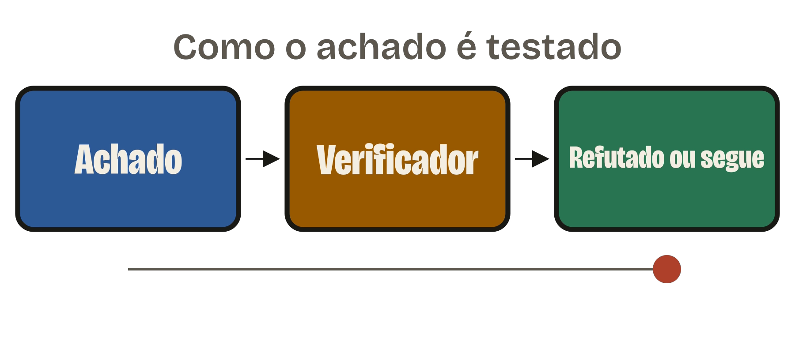
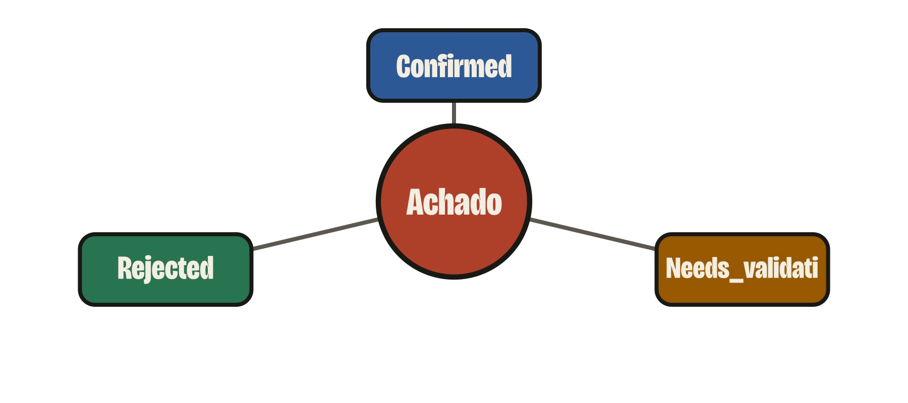

# Skill da Cloudflare chega quase a 37 mil estrelas no mês

_2026-11-26 · noticia_

Esta apostila explica a Security Audit Skill, uma skill da Cloudflare que ensina o Claude Code a procurar falhas de segurança no seu código. Você vai entender o que é uma skill, como a auditoria passa por seis fases e por que um segundo agente tenta derrubar cada achado antes de ele entrar no relatório. Também vai saber instalar a skill com o comando oficial, pedir uma auditoria e conferir os requisitos e limites antes de confiar nos resultados.

## O fato

A Security Audit Skill, criada pela Cloudflare, passa de 78 mil estrelas no GitHub. Estrela é a forma como os usuários do GitHub marcam um projeto que consideram útil, e essa contagem é uma medida de interesse da comunidade, não de qualidade comprovada. Os números citados são do GitHub em 24/11.

A skill serve para quem programa com o Claude e quer uma revisão de segurança do próprio código. Ela transforma o agente de programação em um auditor: ele mapeia o projeto, procura brechas, testa cada suspeita e escreve o relatório. O repositório oficial está em github.com/cloudflare/security-audit-skill, e é de lá que vêm todas as informações desta apostila.

Fonte: <https://github.com/cloudflare/security-audit-skill>

## Por que isso importa

Revisar segurança à mão é lento, e a maioria dos times faz isso só antes de um lançamento, quando o custo de corrigir já é alto. Ferramentas automáticas costumam resolver parte do problema, mas geram muitos alertas, e cada alerta precisa ser lido e descartado por uma pessoa. Quanto mais alertas falsos, mais o time deixa de olhar para eles.

Um agente de programação como o Claude consegue ler o código inteiro, seguir o caminho de uma entrada de dados até o ponto onde ela é usada e explicar o que encontrou. Isso dá profundidade à análise. O risco é o agente se convencer de uma falha que não existe. A Security Audit Skill foi desenhada justamente para reduzir esse risco, com um processo em que uma parte do trabalho verifica a outra.

Fonte: <https://github.com/cloudflare/security-audit-skill>

## O que é uma skill

Uma skill é um conjunto de instruções em arquivos de texto que o agente lê antes de executar uma tarefa. Ela não é um programa separado nem um plugin que muda o Claude. Pense nela como um procedimento escrito: diz ao agente quais etapas seguir, em que ordem, que critérios usar e como registrar o resultado.

Quando você pede uma auditoria, o Claude identifica que o pedido combina com a skill e passa a seguir as instruções dela. Por isso a mesma skill pode produzir resultados parecidos em projetos diferentes: o método é o mesmo, muda apenas o código analisado.

Fonte: <https://github.com/cloudflare/security-audit-skill>

## Como a auditoria funciona: as seis fases

A skill roda uma auditoria em seis fases. Na primeira, o reconhecimento, o agente mapeia a arquitetura do projeto, as fronteiras de confiança e as superfícies de entrada, como formulários, APIs e arquivos lidos. O resultado vai para os arquivos architecture.md e coverage-ledger.json, que registram o que foi visto e o que ainda falta.

Na segunda fase, a caça, cada caçador isolado recebe uma unidade do mapa e verifica as classes de falha dela. Revisores de cobertura procuram lacunas, ou seja, áreas que ninguém examinou. Na terceira fase, a validação de candidatos, cada suspeita única vai para um verificador novo, que tenta provar que o achado está errado.

Na quarta fase, os achados válidos são gravados no arquivo findings.json e conferidos por um validador contra o report-schema.json. Na quinta, agentes novos verificam as afirmações finais contra o código-fonte. Na sexta, o relatório é gerado a partir desses registros verificados, em arquivos como REPORT.md, FINDINGS-DETAIL.md e NEEDS-VALIDATION.md.

Fonte: <https://github.com/cloudflare/security-audit-skill>

## O segundo agente que tenta derrubar o achado



_Um verificador novo tenta refutar o achado; se não conseguir, a suspeita segue adiante._

O ponto central da skill é que o agente que encontra uma falha nunca é o mesmo que a confirma. Um verificador novo começa sem o raciocínio do caçador e tem a tarefa oposta: tentar provar que a suspeita está errada. Se ele conseguir, o candidato vira um registro rejeitado. Se não conseguir, a suspeita segue adiante.

Esse desenho existe para combater o excesso de confiança. Um agente que procura falhas tende a ver falhas em qualquer lugar. Um segundo agente, sem o mesmo viés e com a missão de refutar, pega boa parte dos alarmes falsos antes de chegarem a uma pessoa.

Fonte: <https://github.com/cloudflare/security-audit-skill>

## Os três veredictos



_Todo achado termina em um de três veredictos: confirmed, needs_validation ou rejected._

Todo achado termina em um de três veredictos. Confirmed significa que a falha tem um rastro completo até o código-fonte e um resultado observado e limitado. Needs_validation significa que existe uma suspeita baseada no código, mas falta um fato exato que ainda não foi resolvido. Nesse caso o achado não recebe gravidade. Rejected significa que o candidato foi refutado.

A distinção importa porque evita dois erros. Um deles é tratar uma suspeita não comprovada como falha certa. O outro é descartar algo que apenas não foi confirmado ainda. O veredicto intermediário guarda o que falta provar.

Fonte: <https://github.com/cloudflare/security-audit-skill>

## Os números

Os dados a seguir vêm do repositório oficial e do anúncio de 24/11. Leia cada um com o seu sentido, porque nenhum deles, sozinho, mede a qualidade da skill em todos os projetos.

- 78 mil estrelas no GitHub: indicam interesse e adoção pela comunidade. Não dizem quantas falhas reais a skill encontra em um projeto específico.
- 6 fases: a ordem completa da auditoria, do reconhecimento até o relatório final.
- 3 veredictos: confirmed, needs_validation e rejected. Cada um tem um critério próprio, descrito no item anterior.
- Cerca de metade: nos testes da própria Cloudflare, uma única execução encontrou aproximadamente metade das vulnerabilidades que várias execuções somadas encontraram. Por isso a skill foi pensada para ser rodada mais de uma vez no mesmo repositório. Esse dado vale para os testes deles, e não garante o mesmo resultado no seu projeto.

Fonte: <https://github.com/cloudflare/security-audit-skill>

## O que muda para você

Imagine um time pequeno com uma API interna que recebe arquivos enviados por usuários. Antes de um lançamento, o desenvolvedor pede ao Claude uma auditoria de segurança do diretório src. Na fase de reconhecimento, o agente mapeia os pontos onde os arquivos entram e como são lidos. Na caça, um caçador procura caminhos em que um nome de arquivo malformado pode escapar da pasta prevista.

Suponha que o caçador levante essa suspeita. O verificador novo lê o código e percebe que o nome passa por uma função de normalização antes de ser usado. Se a normalização cobre o caso, o candidato é rejeitado e não entra no relatório. Se a verificação não se sustenta e o fato exato continua sem prova, o achado fica como needs_validation, com a pergunta que falta registrada. O desenvolvedor recebe um relatório em que cada item passou por essa checagem, e não uma lista de suspeitas soltas.

Fonte: <https://github.com/cloudflare/security-audit-skill>

## Comando de instalação

A skill é instalada com a ferramenta Skills CLI, do site skills.sh. O comando abaixo instala apenas a skill security-audit a partir do repositório oficial da Cloudflare. Use-o no diretório do projeto ou onde você costuma configurar seus agentes. Para instalar no nível do usuário, use a variação com a opção --global, descrita logo abaixo do comando principal no repositório.

```
npx skills add https://github.com/cloudflare/security-audit-skill --skill security-audit
```

Fonte: <https://github.com/cloudflare/security-audit-skill>

## O que fazer hoje

1. Abra o terminal na pasta do seu projeto. Resultado esperado: o terminal mostra o caminho do projeto no prompt.
2. Rode o comando de instalação mostrado na seção anterior. Resultado esperado: o Skills CLI conclui a instalação da skill security-audit sem erro.
3. Se precisar escolher o agente ou usar o modo não interativo, rode npx skills --help para ver as opções. Resultado esperado: a lista de opções do Skills CLI aparece no terminal.
4. Abra o Claude Code na pasta do projeto e peça a auditoria, como mostrado na seção seguinte. Resultado esperado: o agente anuncia que está usando a skill e começa pelo reconhecimento.
5. Leia o relatório gerado antes de corrigir qualquer coisa. Confira primeiro os itens confirmed, porque são os que têm rastro completo até o código.

Fonte: <https://github.com/cloudflare/security-audit-skill>

## Como pedir a auditoria

A skill é ativada sozinha quando o seu pedido combina com os gatilhos dela, como auditoria de segurança, procurar vulnerabilidades ou teste de invasão no código. Os pedidos a seguir são exemplos citados no repositório oficial. Pedidos de auditoria completa do código entram no modo completo. Perguntas sobre segurança e trabalho focado em uma vulnerabilidade entram no modo de orientação, salvo se você pedir arquivos de relatório.

No modo completo, se você não escolher uma pasta de saída, a skill usa o caminho ~/security-audit-skill/<nome-do-repositorio>/run-<N>. A escrita dentro do próprio repositório acontece apenas se você escolher explicitamente uma pasta que o controle de versão ignora.

- security audit this codebase
- find security vulnerabilities in ./src
- do a security review, output to ~/audits/my-project

Fonte: <https://github.com/cloudflare/security-audit-skill>

## O que conferir

Antes de confiar nos resultados, confira os requisitos. A skill precisa de um agente de programação com modelo que suporte uso de ferramentas e subagentes em paralelo. Os validadores de achados e de cobertura são arquivos em Node.js sem dependências externas, então o Node.js precisa estar instalado para rodá-los.

O requisito mais importante é o sandbox. Builds, testes, navegadores e fuzzers do alvo rodam código que pode ser malicioso ou perigoso. Por isso o sandbox do sistema operacional precisa desligar a rede externa, usar um ambiente limpo com lista de permissões, impor limites de recursos e permitir escrita apenas em caminhos de trabalho designados. Sem esses controles, a skill mantém o achado como needs_validation e não executa o código do alvo.

Por fim, lembre que a skill indica onde há indícios e como verificá-los, mas não substitui a revisão de uma pessoa. Um achado confirmed tem rastro no código, e ainda assim cabe à equipe decidir a correção e a prioridade. Achados needs_validation exigem uma verificação humana, porque o fato que falta ainda não foi provado.

- Confirme que o agente suporta uso de ferramentas e subagentes em paralelo.
- Confirme que o Node.js está instalado antes de rodar os validadores.
- Confirme que há um sandbox com as proteções descritas antes de executar código do alvo.
- Trate needs_validation como pendência humana, e não como falha confirmada.
- Não use a pasta de saída dentro do repositório sem conferir se o controle de versão a ignora.

Fonte: <https://github.com/cloudflare/security-audit-skill>

## Glossário

- Skill: conjunto de instruções em arquivos de texto que ensina um agente a executar uma tarefa de um jeito definido.
- Agente de programação: programa de IA que lê, altera e analisa código em um projeto, como o Claude Code.
- Falha de segurança (vulnerabilidade): erro no código que permite a alguém fazer algo que o sistema não deveria permitir.
- Achado: suspeita de falha registrada durante a auditoria.
- Falso positivo: alerta de falha que, ao ser verificado, não se sustenta.
- Fronteira de confiança: ponto em que dados ou controle passam de uma parte menos confiável para outra mais sensível.
- Sandbox: ambiente isolado que limita o que um programa pode acessar, como rede, arquivos e recursos.
- Estrela (GitHub): marcação que um usuário faz em um repositório para indicar interesse ou aprovação.
- Repositório: pasta de código versionada, geralmente hospedada no GitHub.
- Subagente: agente auxiliar que executa uma parte da tarefa, separado do agente principal.

## Para onde ir depois

- Leia o SKILL.md e os arquivos de fase no repositório oficial para entender as instruções que o agente recebe.
- Leia o texto Build your own vulnerability harness, citado no repositório, para ver como a skill deu origem ao sistema interno da Cloudflare.
- Se tiver dúvidas sobre a ferramenta ou quiser comparar notas sobre segurança com IA, o contato indicado no repositório é security-ai-research@cloudflare.com.
- Antes da próxima versão do seu projeto, rode a auditoria em uma branch separada e compare o relatório com a sua revisão habitual.

Fonte: <https://github.com/cloudflare/security-audit-skill>

## Além do vídeo

- Os outros nove repositórios do ranking de 24/11: Line Art Animation, Claude Animated Shorts, Instagram Agent Skill, FFmpeg Skill, Agent Browser, Claude SEO, Claude BugHunter, HyperFrames e T3 Code.
