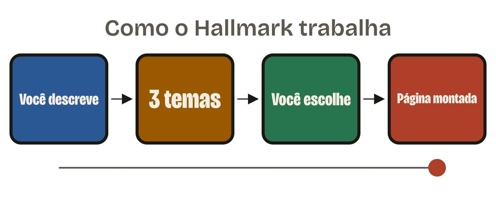
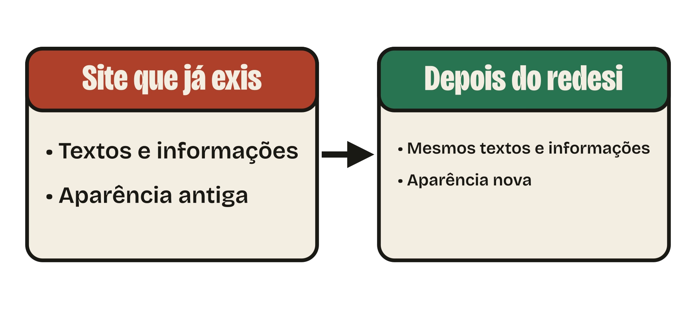
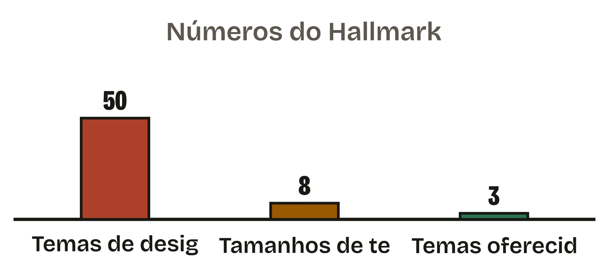

# Together AI lança Hallmark, estilo grátis para Claude Code

_2026-11-26 · noticia_

O Hallmark é um estilo gratuito da Together AI que ensina agentes de código, como o Claude Code, a criar sites sem a cara genérica de IA. Ele já passou de 50 mil estrelas no GitHub. Esta apostila explica o que ele traz, como funciona do pedido até a revisão final e como instalar com o comando oficial. Ao terminar, você saberá instalar o Hallmark, descrever o site que quer, escolher um tema e usá-lo também para refazer um site que já existe.

## O fato

A Together AI lançou o Hallmark, um estilo gratuito para agentes de código. Ele ensina a IA a fugir do visual genérico que costuma denunciar um site feito por máquina e a entregar páginas com aparência de trabalho de agência.

O projeto já passou de 50 mil estrelas no GitHub. O código está no repositório oficial e há um site oficial do projeto. Funciona no Claude Code, no Codex e no Cursor.

Fonte: <https://github.com/Nutlope/hallmark>

## Por que isso importa

Quando você pede um site a uma IA de código sem orientação visual, o resultado tende a sair parecido com o de todo mundo. Os mesmos vícios de layout aparecem de projeto em projeto, e quem visita percebe que a página saiu de uma máquina.

O Hallmark ataca esse problema de duas formas. Dá à IA um repertório de design pronto, com identidade visual definida, e lista o que deve ser evitado. Assim o agente deixa de escolher o caminho mais comum e passa a seguir uma direção de design.

Para quem não é designer, isso muda o ponto de partida. Um profissional cobra milhares de reais por um site desse nível. Com o Hallmark você começa de graça, dentro da ferramenta de código que já usa.

## A estrela no GitHub

Estrela no GitHub é um marcador de favorito: quem gosta de um projeto dá uma estrela para guardá-lo e mostrar apoio. Passar de 50 mil estrelas indica que o Hallmark chamou muita atenção.

O número mostra interesse, não qualidade comprovada. Ele não diz como o projeto se sai no seu caso. Para isso, o melhor é testar.

Fonte: <https://github.com/Nutlope/hallmark>

## A lista do que denuncia site de IA

O Hallmark vem com uma lista do que entrega que um site foi feito por IA. Entram nela o título com uma palavra colorida, a etiqueta em cima de cada seção e o cadastro de e-mail no fim de toda página.

Com essa lista, o agente sabe o que evitar antes de montar a página. Você não precisa apontar esses vícios um por um a cada pedido.

Fonte: <https://github.com/Nutlope/hallmark>

## Os 50 temas de design

O Hallmark traz 50 temas de design prontos. Cada tema tem fonte, cor e textura próprias, então o site ganha identidade em vez de sair genérico.

Na prática, um tema funciona como uma direção visual completa. Ele define a tipografia, a paleta e o acabamento, e o agente aplica tudo de forma coerente na página.

Fonte: <https://www.usehallmark.com>

## Como o Hallmark trabalha



_Fluxo do Hallmark: você descreve o site, recebe três temas, escolhe um e a página é montad_

O fluxo começa com você descrevendo o site que quer. O Hallmark responde oferecendo três temas que combinam com o seu projeto, e você escolhe um deles.

Depois da escolha, a página é montada pensando no que o visitante veio fazer. Exemplo: numa página de agendamento, o botão de agendar fica onde precisa ficar, sem se perder entre outros elementos.

Fonte: <https://github.com/Nutlope/hallmark>

## Teste em oito telas e revisão por outra IA

Este é o diferencial do Hallmark. Ele abre a página num navegador de verdade e testa o próprio trabalho em oito tamanhos de tela, do celular a um monitor gigante. Isso pega problemas de layout que só aparecem em certos tamanhos.

Antes de entregar, o Hallmark chama uma segunda IA que nunca viu o projeto para revisar tudo do zero. Como ela não acompanhou a construção, não carrega o viés de quem fez o trabalho e enxerga a página como um visitante novo.

Fonte: <https://github.com/Nutlope/hallmark>

## Refazer o design de um site que já existe



_No redesign, o conteúdo do site continua o mesmo e só a aparência muda._

Quem já tem um site no ar não precisa começar do zero. O Hallmark refaz o design e mantém todo o conteúdo, ou seja, os textos e as informações continuam os mesmos, e muda a aparência.

Fonte: <https://github.com/Nutlope/hallmark>

## Os números



_Comparação entre 50 temas de design, 8 tamanhos de tela testados e 3 temas oferecidos._

- Mais de 50 mil estrelas no GitHub: é a contagem de pessoas que marcaram o projeto como favorito. Mostra atenção e interesse, mas não mede a qualidade do resultado no seu site.
- 50 temas de design: cada um com fonte, cor e textura próprias. É a quantidade de direções visuais prontas para escolher.
- 3 temas oferecidos: depois que você descreve o site, o Hallmark apresenta três que combinam com o projeto, e você escolhe um.
- 8 tamanhos de tela: é quantas telas o Hallmark usa para testar a página, do celular ao monitor gigante.

Fonte: <https://github.com/Nutlope/hallmark>

## O que muda para você

Você deixa de depender do visual padrão que a IA entrega e passa a escolher uma identidade. Em vez de aceitar o primeiro layout, escolhe entre três temas pensados para o seu tipo de site.

Exemplo: imagine que você precisa de uma página para um serviço com agendamento. Você descreve o serviço, escolhe um dos três temas e recebe uma página em que o botão de agendar está no lugar certo, já testada em celular e em monitor grande e revisada por uma segunda IA.

## Comando de instalação

Este é o comando de instalação indicado para o Hallmark.

```
npx skills add nutlope/hallmark -g
```

Fonte: <https://github.com/Nutlope/hallmark>

## O que fazer hoje

1. Abra o repositório oficial em github.com/Nutlope/hallmark e leia a descrição do projeto. Resultado: você confirma que está no endereço oficial.
2. Rode o comando de instalação npx skills add nutlope/hallmark -g no terminal. Resultado: o Hallmark fica instalado para uso no seu agente de código.
3. Abra o Claude Code, o Codex ou o Cursor e descreva o site que você quer. Resultado: o Hallmark oferece três temas que combinam com o seu projeto.
4. Escolha um dos três temas. Resultado: a página é montada com a fonte, a cor e a textura do tema.
5. Se já tem um site, peça o redesign. Resultado: o design muda e o conteúdo continua o mesmo.

Fonte: <https://github.com/Nutlope/hallmark>

## O que conferir

- Use o endereço oficial do projeto, github.com/Nutlope/hallmark, e o site www.usehallmark.com. Desconfie de páginas que se apresentem como oficiais em outro domínio.
- Copie o comando de instalação exatamente como está, sem alterar nada.
- As 50 mil estrelas medem interesse. Veja o resultado no seu próprio site antes de publicar.
- Mesmo com teste automático e revisão por outra IA, olhe a página você mesmo antes de colocá-la no ar.
- Ao refazer o design de um site existente, confira se todo o conteúdo continua no lugar.

## Glossário

- Hallmark: estilo gratuito da Together AI que ensina agentes de código a criar sites sem a cara genérica de IA.
- Agente de código: IA que escreve e altera código a partir de pedidos em linguagem comum, como o Claude Code, o Codex e o Cursor.
- Tema de design: conjunto pronto de fonte, cor e textura que dá identidade visual a um site.
- Estrela no GitHub: marcador de favorito que os usuários dão a um projeto.
- Repositório: página no GitHub onde fica o código do projeto.
- Redesign: refazer a aparência de um site mantendo o conteúdo.

## Para onde ir depois

- Visite o site oficial www.usehallmark.com para ver o projeto.
- Leia o repositório github.com/Nutlope/hallmark para entender o que o Hallmark oferece.
- Pratique criando uma página simples e comparando os três temas oferecidos.
- Se você tem um site, teste o redesign e compare o antes e o depois.

Fonte: <https://www.usehallmark.com>
