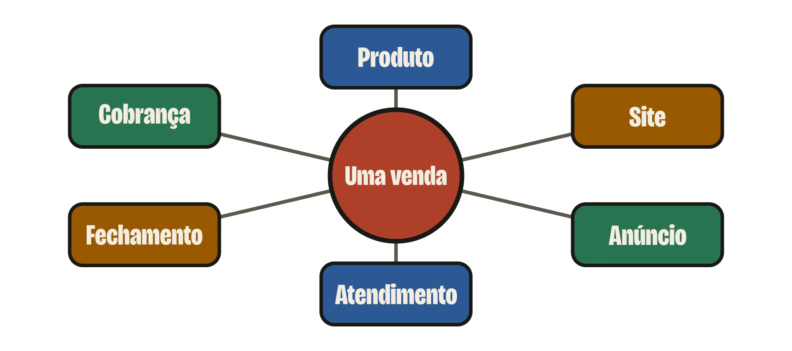
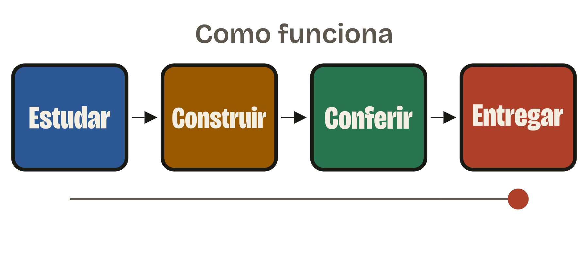

# 7 repos grátis cobrem a venda, do produto à cobrança

_2026-11-27 · noticia_

Sete projetos de código aberto cobrem o caminho de uma venda num negócio pequeno: produto, site, anúncio, atendimento, funil, cobrança e distribuição de tarefas entre assistentes de IA. Esta apostila explica o que cada um faz, qual teste fazer primeiro, onde aparece o custo e em que ordem montar. Depois de ler, você sabe preparar o computador, testar cada ferramenta e decidir quais valem a sua tarde.

## Como usar esta lista



_Os sete projetos cobrem o caminho de uma venda, do produto à cobrança._

Os sete projetos têm o código publicado, e qualquer pessoa pode baixar e usar. Cada um fica num repositório, a pasta do projeto guardada no GitHub, o site onde programadores guardam e compartilham código. Dá para ver e baixar sem ter conta.

Juntos, eles cobrem o caminho de uma venda. Um cria o produto, outro o site, outro o anúncio, outro atende, outro fecha a venda, outro cobra, e o último distribui tarefas entre assistentes de IA. A configuração leva cerca de uma tarde por ferramenta.

Os programas são grátis, mas quase todos pedem uma chave de API paga ou têm uma parte paga. Cada seção abaixo diz onde o custo aparece. Por isso a ordem de instalação importa mais do que a quantidade.

- Comece pelo Odoo e pelo Invoice Ninja, que ficam no meio do caminho, onde o dinheiro entra. Com os dois você sabe quem está para comprar e quem ainda não pagou.
- Depois instale o Chatwoot. Quem fala com você no chat vira contato que você leva para o funil do Odoo.
- Deixe o Open Lovable e o HyperFrames para quando for anunciar, porque site e anúncio só valem quando já existem funil e cobrança para receber quem chega.
- Deixe o Paperclip por último, quando as outras ferramentas já estiverem instaladas e em uso.
- O Craft Anything fica à parte: serve para criar produto novo, não para tocar a operação do dia a dia.

## Antes de começar: o que você vai precisar

Uma chave de API de IA. API é o jeito de um programa usar o Claude ou o GPT por fora do site. A chave é uma senha longa, gerada no painel do serviço (no caso da Anthropic, em console.anthropic.com). Ela deixa o programa usar a IA e cobra por uso. Copie e guarde, porque ela costuma aparecer uma vez só.

O terminal é a janela onde se digitam comandos. No Windows, aperte a tecla Windows, digite PowerShell e aperte Enter. No Mac, aperte Cmd + Espaço, digite Terminal e aperte Enter. Cada comando deste guia é digitado lá, seguido de Enter.

Node.js (nodejs.org) faz o computador rodar programas escritos em JavaScript, a linguagem de vários desses projetos. Baixe a versão marcada LTS e instale aceitando as opções padrão. Para conferir, digite no terminal o comando abaixo. Se aparecer um número como v22.11.0, deu certo.

```
node -v
```

Fonte: <https://nodejs.org>

## Antes de começar: instalar o Claude Code

O Claude Code é o assistente de programação da Anthropic que trabalha dentro do seu computador. Três das ferramentas dependem dele: Craft Anything, HyperFrames e, como assistente, o Paperclip. Com o Node.js instalado, digite no terminal o comando abaixo.

Para abrir, entre numa pasta pelo terminal e digite claude. Na primeira vez, ele pede para entrar na sua conta do Claude, e isso exige plano pago ou chave de API. Funcionou quando aparece uma caixa para você escrever.

```
npm install -g @anthropic-ai/claude-code
```

## Craft Anything



_O Craft Anything trabalha em quatro etapas: estudar, construir, conferir e entregar._

O Craft Anything estuda um site, app ou jogo e monta a sua versão. Você indica o alvo e diz o que quer, por exemplo recriar um site. O Claude Code estuda o que aparece na tela e constrói uma versão nova do zero, sem copiar o código original. Depois o programa compara o resultado com o original e refina o que ainda não bate.

O projeto trabalha em quatro etapas: estudar, construir, conferir e entregar. Há dois modos. No modo Clean room (o padrão), nada de dentro do original é lido: nem código, nem arquivos, nem o código-fonte da página. Ele trabalha só com o que você vê, como capturas de tela, texto visível, cores e fontes. No modo Deep, todas as ferramentas são usadas, para uso privado.

Escolha esta ferramenta só quando quiser criar um produto novo. É a mais crua das sete: o passo a passo de uso está em inglês, no texto abaixo da lista de arquivos do projeto. O projeto está em alfa (versão de teste, ainda com falhas). Use em algo que você tem direito de recriar, nunca para clonar produto de concorrente e vender como seu. Se você está começando, deixe para o fim.

- Precisa do Claude Code instalado antes.
- No GitHub, abra a seção Releases, no lado direito da página do projeto.
- No Windows, baixe o arquivo que termina em .exe. No Mac, baixe o que termina em .dmg.
- A licença do projeto é MIT ou Apache-2.0, à sua escolha.

Fonte: <https://github.com/storytold/craft-anything>

## Open Lovable

O Open Lovable lê uma página da internet e escreve uma cópia funcionando no seu computador. Você adapta essa cópia e a transforma na sua landing page, a página única que apresenta uma oferta. O código gerado é um app em React.

Ele pede três chaves, e os três serviços cobram por uso depois de uma cota inicial. A primeira é a do Firecrawl (firecrawl.dev), o serviço que lê a página. A segunda é a de uma IA: Anthropic, OpenAI, Gemini ou Groq. A terceira é a da E2B (e2b.dev), um serviço que roda o site gerado num computador alugado. Nos três, crie a conta e procure a área de API Keys.

O arquivo de variáveis do projeto traz uma linha para cada chave. O modelo do repositório mostra a variável FIRECRAWL_API_KEY como obrigatória, uma chave de IA e a escolha do ambiente onde o site roda (Vercel, que é o padrão, ou E2B). Confira o modelo no repositório antes de colar as chaves. Esta ferramenta é uma boa escolha quando você já tem funil e cobrança e precisa de uma página para receber quem chega.

- Em github.com/firecrawl/open-lovable, clique no botão verde Code, depois em Download ZIP, e descompacte.
- Dentro da pasta, faça uma cópia do arquivo .env.example e renomeie a cópia para .env. No Windows, ligue antes Exibir > Extensões de nomes de arquivos, senão ele vira .env.txt sem você ver. No Mac, aperte Cmd + Shift + . para ver arquivos que começam com ponto.
- Abra o .env no Bloco de Notas (no Mac, no TextEdit) e cole cada chave depois do = da linha com o nome dela.
- Abra o terminal dentro da pasta. No Windows, clique com o botão direito num espaço vazio da pasta e escolha Abrir no Terminal. No Mac, clique com o botão direito na pasta no Finder e escolha Serviços > Novo Terminal na Pasta. Digite npm install e espere terminar.
- Digite npm run dev. Funcionou quando você abre no navegador o endereço que aparecer no terminal (normalmente http://localhost:3000) e vê a tela do Open Lovable.

```
npm install
```

Fonte: <https://github.com/firecrawl/open-lovable>

## HyperFrames

O HyperFrames, feito pela HeyGen, transforma um pedido seu em anúncio de vídeo. Você descreve o anúncio ao Claude Code, ele monta o vídeo e o HyperFrames gera um arquivo MP4. Por baixo, é um framework de código aberto que transforma HTML, CSS, JavaScript e mídia em vídeo.

O uso com o Claude Code já custa o plano do Claude Code. O projeto também tem o aplicativo HyperFrames Studio, com plano gratuito. O plano Pro custa US$ 25 por mês e dá 25.000 créditos por mês. Escolha esta ferramenta quando for anunciar e quiser um vídeo curto do seu produto sem editar à mão.

O primeiro passo é instalar o FFmpeg, o programa que junta as imagens num vídeo. No Windows, digite winget install ffmpeg no terminal. No Mac, siga as instruções de ffmpeg.org.

- Crie uma pasta nova, por exemplo anuncio, e abra o terminal dentro dela.
- Digite o comando abaixo e espere terminar.
- Nessa mesma pasta, digite claude e escreva o pedido na caixa que aparecer, por exemplo: "faz um anúncio de 15 segundos do meu produto, com o logo no fim".
- Funcionou quando aparece na pasta um arquivo terminado em .mp4.

```
npx skills add heygen-com/hyperframes
```

Fonte: <https://github.com/heygen-com/hyperframes>

## Chatwoot

O Chatwoot é a central de atendimento. Ele junta chat do site, e-mail e WhatsApp numa caixa só, onde você e a sua equipe respondem. Em vez de abrir três lugares para ver quem escreveu, você olha um.

Para testar sem instalar nada, use a versão em nuvem em chatwoot.com. Funcionou quando você entra no painel e vê a caixa de entrada. Instalar no seu próprio servidor (um computador alugado que fica ligado 24 horas) usa Docker, um programa que roda outros programas prontos, e segue o guia do repositório. É trabalho de quem já mexe com isso.

A IA que responde sozinha, chamada Captain, é do plano empresarial pago. O resto da central não tem esse custo. Sem o Captain, o Chatwoot organiza as conversas, mas quem responde é você, então atendimento 24 horas depende da parte paga.

Fonte: <https://github.com/chatwoot/chatwoot>

## Odoo

O Odoo é o funil de vendas e o contrato. Os contatos entram numa lista por etapa (o funil), o orçamento sai num clique e o cliente assina online. É a peça que mostra quem está para comprar.

Teste na versão online, em odoo.com. No painel, clique em Apps, procure CRM (o funil) e ative. Funcionou quando o CRM aparece entre os seus aplicativos.

No Odoo online, um aplicativo sozinho é grátis. Ao ativar o segundo, como o de Vendas para o orçamento, passa a ser pago. Confira os valores na página de preços antes. O código, para instalar no seu servidor, está no repositório.

Fonte: <https://github.com/odoo/odoo>

## Invoice Ninja

O Invoice Ninja cuida da fatura e da cobrança. Orçamento, fatura, cobrança automática todo mês e despesas ficam num lugar só. O cliente paga com cartão ou PayPal pelo link que recebe.

Teste na versão online, em invoiceninja.com. Funcionou quando você cria uma fatura de teste e abre o link de pagamento. Com o Odoo e o Invoice Ninja funcionando, você sabe quem ainda não pagou.

A licença é a Elastic 2.0. Ela deixa usar no seu negócio, mas proíbe cobrar de outras pessoas pelo acesso ao Invoice Ninja. Se a ideia for revender o acesso, esta ferramenta não serve.

Fonte: <https://github.com/invoiceninja/invoiceninja>

## Paperclip

O Paperclip distribui o trabalho entre assistentes de IA. Você dá um objetivo, ele divide em tarefas, entrega cada uma a um assistente diferente e mostra tudo num painel, com o limite de gasto em IA de cada tarefa.

Ele não tem IA própria. Distribui as tarefas para assistentes que você já tem, como o Claude Code, então o custo é o deles. A licença é MIT, que permite usar e modificar à vontade. Deixe para o fim, quando as outras ferramentas já estiverem em uso.

- No terminal, digite o comando abaixo. O --yes aceita as opções padrão sem perguntar.
- Abra no navegador o endereço que aparecer no fim.
- Funcionou quando o painel do Paperclip abre. A partir dali, o próprio painel guia a criação do primeiro objetivo.

```
npx paperclipai@latest onboard --yes
```

Fonte: <https://github.com/paperclipai/paperclip>

## Cuidados

- Nenhuma dessas ferramentas toca um negócio sem gente. O Paperclip divide o trabalho, mas alguém aprova, confere e decide. O ganho real é uma pessoa fazer o trabalho de várias.
- Atendimento 24 horas depende da parte paga: o Captain, do Chatwoot, é do plano empresarial.
- No Odoo online, o segundo aplicativo ativado já é pago. Confira a página de preços antes de ativar o de Vendas.
- A licença do Invoice Ninja (Elastic 2.0) permite uso no seu negócio e proíbe cobrar terceiros pelo acesso.
- O Craft Anything está em alfa. Use só em algo que você tem direito de recriar.
- O Open Lovable depende de três serviços que cobram por uso depois da cota inicial: Firecrawl, uma IA e E2B.
- A chave de API costuma aparecer uma vez só. Copie e guarde.
- Sete ferramentas são sete coisas para manter atualizadas. Se você não for usar uma delas nos próximos 30 dias, não instale agora.

## Glossário

- Código aberto: programa com o código publicado, que qualquer pessoa pode baixar e usar.
- Repositório: a pasta do projeto guardada no GitHub.
- GitHub: site onde programadores guardam e compartilham código.
- API: jeito de um programa usar o Claude ou o GPT por fora do site.
- Chave de API: senha longa gerada no painel do serviço, que deixa o programa usar a IA e cobra por uso.
- Terminal: janela onde se digitam comandos.
- Node.js: programa que faz o computador rodar programas escritos em JavaScript.
- Claude Code: assistente de programação da Anthropic que trabalha dentro do seu computador.
- Alfa: versão de teste, ainda com falhas.
- Landing page: página única que apresenta uma oferta.
- FFmpeg: programa que junta as imagens num vídeo.
- Funil: lista de contatos organizada por etapa da venda.
- Servidor: computador alugado que fica ligado 24 horas.
- Docker: programa que roda outros programas prontos.
- Licença MIT: permite usar e modificar à vontade.

## Para onde ir depois

- Hoje, crie a conta de teste no Odoo online, ative o CRM e cadastre um contato no funil.
- Na mesma tarde ou na seguinte, crie uma fatura de teste no Invoice Ninja e abra o link de pagamento.
- Depois, teste a versão em nuvem do Chatwoot e veja a caixa de entrada.
- Só ao planejar um anúncio, instale o Open Lovable e o HyperFrames.
- Instale o Paperclip por último, quando as outras ferramentas já estiverem em uso.

## Além do vídeo

- O Craft Anything tem os modos Clean room e Deep, e a licença é MIT ou Apache-2.0.
- O HyperFrames Studio tem plano gratuito e o plano Pro custa US$ 25 por mês, com 25.000 créditos mensais.
- O HyperFrames funciona também com Codex, Cursor e Gemini CLI, além do Claude Code.
- O Open Lovable aceita Vercel (padrão) ou E2B como ambiente para rodar o site gerado.
- O passo a passo detalhado de instalação do FFmpeg no Mac fica em ffmpeg.org.
