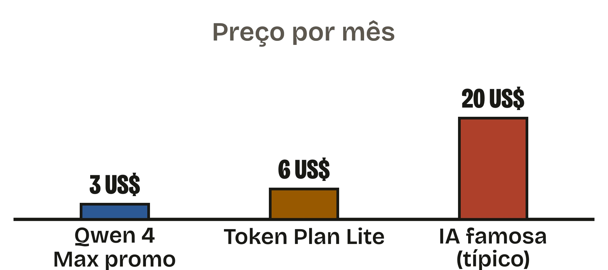
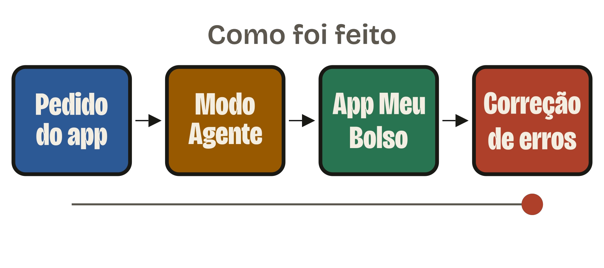
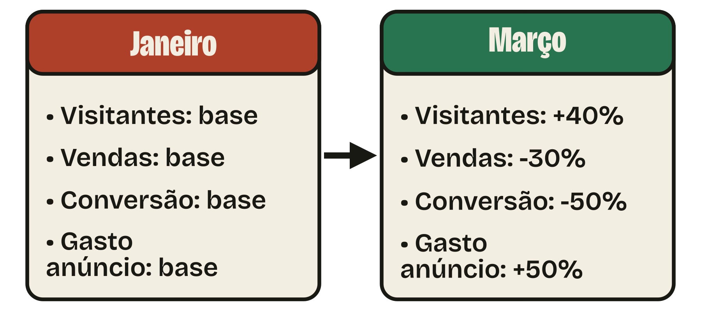

# Acabou o problema de pagar 20 dólares por IA que trava

_2026-11-27 · noticia_

A Alibaba lançou o Qwen 4 Max, modelo de IA com acesso pelo navegador e por API, com promoção de US$ 3 por mês para novos usuários contra US$ 20 das ferramentas mais famosas. Em vez de confiar em benchmark, o modelo foi testado em três desafios reais: um app financeiro, um cronograma de projetos e a análise de uma loja virtual em queda. A apostila mostra os resultados, os números, os cuidados com preço e segurança, e o que fazer para começar hoje.

## O fato

_Preço mensal: promoção do Qwen 4 Max, Token Plan Lite e ferramentas famosas._

A Alibaba lançou o Qwen 4 Max, um novo modelo de inteligência artificial que promete competir com as ferramentas mais conhecidas do mercado nas tarefas mais difíceis, por um preço bem menor: US$ 3 por mês na promoção para novos usuários, contra US$ 20 por mês das ferramentas famosas.

O modelo pode ser acessado pelo site oficial qwen.ai e pelo chat em chat.qwen.ai. Para quem quer usar o modelo dentro de aplicativos, editores de código ou automações próprias, existe o Token Plan da Alibaba Cloud, com preços a partir de US$ 6 por mês no plano Lite e promoção de US$ 3 por mês para novos usuários até 30 de novembro de 2026 (horário UTC+8).

A Alibaba desenvolve os próprios modelos de inteligência artificial e também opera a Alibaba Cloud, uma infraestrutura grande de computação em nuvem. Por isso participa de várias etapas da tecnologia, da infraestrutura até o chat que aparece na tela.

Se quiser ver todos os benchmarks e resultados, você pode entrar no site da Alibaba.

Fonte: <https://qwen.ai/>

## Por que isso importa

Ir bem em benchmark, a prova padronizada que mede raciocínio lógico, programação e capacidade de seguir instruções, não garante que o modelo funcione na vida real. Uma IA pode acertar questões difíceis de matemática e, dois minutos depois, inventar um número que não existe numa planilha. Ou escrever um código bonito que não funciona.

Por isso, em vez de olhar só para tabelas de benchmark, o teste feito foi na prática: três desafios reais — código, lógica e análise de negócio — para ver se o modelo entrega o que promete por US$ 3 por mês.

A concorrência entre empresas chinesas e americanas no mercado de IA está acelerando. Mais empresas disputando a preferência de quem usa IA pode significar mais alternativas, preços mais competitivos e pressão maior para as ferramentas continuarem melhorando.

Fonte: <https://qwen.ai/>

## Primeiro desafio: o app financeiro Meu Bolso

_Do pedido ao aplicativo Meu Bolso, com correção de erros._

O desafio foi criar do zero um aplicativo de controle financeiro pessoal num único arquivo de HTML, CSS e JavaScript, com lançamento de receitas e despesas por categoria, saldo atualizando na hora, gráficos e dados que não sumissem ao atualizar a página com F5.

O Qwen 4 Max, usado no modo Agente do Qwen Chat, gerou o aplicativo Meu Bolso.

O ponto importante é que nenhum modelo acerta 100% de primeira em todos os projetos. O que faz diferença é identificar o erro e corrigir sem quebrar o resto. E ninguém deve colocar no ar, para um banco ou para usuários reais, um arquivo gerado por IA sem revisar a segurança.

Fonte: <https://chat.qwen.ai>

## Segundo desafio: cronograma que não fecha

O problema: organizar uma semana com cinco projetos, limite de seis horas de trabalho por dia, prazos específicos, tarefas que dependem umas das outras e reuniões obrigatórias com horário fixo. A ordem ao modelo foi montar o cronograma e, se a conta não fechasse, avisar em vez de inventar um horário impossível.

O Qwen 4 Max fez a conferência antes de montar a tabela e concluiu que o pedido era matematicamente inviável: a semana tem 30 horas de janela (das 9h às 16h, descontando o almoço), as reuniões obrigatórias consomem 3 horas e os projetos exigem 30 horas. Em vez de inventar número, ele disse que não fechava e propôs alternativas, como fazer hora extra.

Depois o cenário foi complicado: um dos projetos atrasou 2 horas e apareceu uma reunião de emergência de 1 hora e meia. O modelo percebeu que faltavam mais 6 horas e meia para entregar tudo e que, mesmo ignorando os outros projetos, não daria tempo de concluir os projetos A e C nos prazos originais. Em vez de inventar solução, montou um plano alternativo que concluía quatro dos cinco projetos, deixando claro que o projeto A atrasaria e o projeto D não seria executado.

Na auditoria dos cálculos, o modelo encontrou dois erros na resposta anterior: nos horários de conclusão das tarefas e na forma de calcular o atraso. Confirmou que as contas principais estavam corretas e justificou por que aquele era o melhor cronograma possível para a situação.

Fonte: <https://chat.qwen.ai>

## Terceiro desafio: loja virtual com faturamento caindo

_Indicadores da loja virtual de janeiro a março._

O cenário: loja virtual pequena com faturamento caindo três meses seguidos enquanto o gasto com anúncio continuava. Os dados entregues foram visitantes, pedidos, faturamento total e investimento em publicidade. O pedido ao modelo foi calcular os indicadores principais, descobrir o que mudou, sugerir três ações práticas e separar o que os números realmente mostram das hipóteses.

De janeiro a março, o número de visitantes aumentou 40%, mas as vendas caíram 30%. A taxa de conversão caiu pela metade e o gasto com anúncios aumentou 50%. O modelo identificou que tinha mais gente entrando no site, mas menos gente comprando.

Em vez de afirmar que o problema era a publicidade ou que o site estava com defeito, o modelo separou o que os números comprovam das possíveis causas que ainda precisam ser investigadas: problema de checkout, qualidade do tráfego e erro na medição dos visitantes. Deixou claro que não tinha como confirmar qual hipótese era verdadeira.

O modelo também apontou que, com os dados fornecidos, não dá para saber se a loja está tendo prejuízo, porque faltam informações sobre o custo dos produtos e a margem de lucro.

Quando pediu para explicar o mesmo problema a um dono de loja que nunca estudou marketing, o modelo usou linguagem simples: a loja encheu, mas a fila do caixa diminuiu; você está pagando mais caro por cada venda; e indicou a ordem do que verificar. Uma IA boa não é a que fala difícil, é a que explica um problema complexo de um jeito que ajuda a tomar decisão.

Fonte: <https://chat.qwen.ai>

## Os números

Os valores abaixo saem dos testes e da oferta. Cada um vem com o que ele significa e com o que não dá para concluir dele.

- US$ 3 por mês: preço promocional do Qwen 4 Max para novos usuários no Token Plan da Alibaba Cloud. Não é uso ilimitado e não é o preço regular.
- US$ 6 por mês: preço regular do Token Plan Lite, a partir do qual o plano começa oficialmente.
- US$ 20 por mês: preço típico das ferramentas de IA mais famosas, usado como comparação.
- O cálculo fechou certo.
- 40%: aumento de visitantes da loja virtual de janeiro a março.
- 30%: queda nas vendas no mesmo período.
- 50%: aumento no gasto com anúncios no mesmo período.
- 30 horas: janela de trabalho da semana no desafio de cronograma, das 9h às 16h descontando o almoço.
- 30 horas: total de horas exigidas pelos cinco projetos.
- 3 horas: tempo consumido pelas reuniões obrigatórias.
- 6 horas e meia: horas que faltavam após os imprevistos.
- 4 de 5: projetos concluídos no plano alternativo.
- 3 meses: período em que o faturamento da loja caiu.
- 30 de novembro de 2026: data limite da promoção de US$ 3, às 23h59min59s, horário UTC+8, válida apenas para contas que nunca compraram Token Plan Individual.

Fonte: <https://docs.qwencloud.com/token-plan/personal/token-plan-personal-overview>

## O que muda para você

O que muda é ter mais uma opção de IA por um preço muito menor, com acesso pelo navegador sem configurar nada, ou por API para quem desenvolve. Mas preço baixo não basta: uma ferramenta mais barata só representa economia de verdade se entregar o que você precisa com qualidade e confiança.

O teste da loja virtual mostra o padrão que vale para qualquer análise de negócio: separar o que os números comprovam das hipóteses. A loja tinha mais visitantes e menos vendas; a taxa de conversão caiu pela metade; o gasto com anúncio subiu. A causa pode ser checkout, qualidade do tráfego ou erro de medição, e os dados fornecidos não confirmam qual. Faltam custo dos produtos e margem de lucro para saber se há prejuízo.

## O que fazer hoje

1. Abra o Qwen Chat em chat.qwen.ai, selecione o Qwen 4 Max e comece a conversar pelo navegador, sem configurar API.
2. Para usar o modelo dentro de aplicativos, editores de código ou automações próprias, acesse o Token Plan da Alibaba Cloud em qwencloud.com/pricing/token-plan e confira as opções a partir de US$ 3 por mês.
3. Antes de publicar qualquer código gerado pela IA, revise a segurança. A interface pode funcionar e ainda assim ter falhas.
4. Em análises de negócio, exija que a IA separe o que os números comprovam das hipóteses, e confira as contas antes de confiar.
5. Teste a ferramenta na prática com seus próprios problemas, em vez de confiar só em anúncios e benchmarks.

Fonte: <https://chat.qwen.ai>

## O que conferir

- O preço de US$ 3 por mês é promocional para novos usuários e não significa uso ilimitado. Confira os limites, os modelos incluídos em cada plano e as condições de cada um.
- O Token Plan oficial começa em US$ 6 por mês (Lite). A promoção de US$ 3 vale até 23h59min59s de 30 de novembro de 2026 (UTC+8) e apenas para contas que nunca compraram Token Plan Individual.
- Um bom resultado em benchmark não garante que o modelo vai funcionar na vida real. Teste com seus próprios casos.
- Código gerado por IA não deve ir para produção sem revisão de segurança.
- Em análise de negócio, a IA não pode inventar explicação. Separe o que os números mostram das hipóteses e confirme antes de agir.
- Os testes feitos não colocam todos os modelos lado a lado. Para cravar um vencedor, é preciso comparar os mesmos desafios nos mesmos modelos.

Fonte: <https://docs.qwencloud.com/token-plan/personal/token-plan-personal-overview>

## Glossário

- Benchmark: prova padronizada que mede raciocínio lógico, programação e capacidade de seguir instruções. Ir bem nele não garante funcionar na vida real.
- Token Plan: plano da Alibaba Cloud que dá acesso ao modelo por API, para usar dentro de aplicativos, editores de código ou automações.
- API: forma de conectar um modelo de IA a outra ferramenta ou aplicativo.
- Modo Agente: modo do Qwen Chat em que o modelo executa tarefas mais complexas, como gerar um aplicativo completo.
- Taxa de conversão: proporção de visitantes que viram clientes. Cair pela metade significa que metade menos de quem entrou comprou.
- Custo por aquisição: quanto custa trazer um cliente. No teste, o gasto com anúncio subiu enquanto as vendas caíram, então cada venda ficou mais cara.
- UTC+8: fuso horário usado no prazo da promoção. 23h59min59s de 30 de novembro de 2026 nesse fuso.
- Alibaba Cloud: infraestrutura de computação em nuvem da Alibaba, que opera junto com os modelos da empresa.
- F5: tecla que atualiza a página do navegador. O teste verificou se os dados sobreviviam a ela.
- HTML, CSS e JavaScript: as três tecnologias básicas de uma página web. O app foi gerado num único arquivo com as três.

## Para onde ir depois

- Experimente o Qwen 4 Max no navegador em chat.qwen.ai.
- Se você desenvolve, confira o Token Plan e os preços em qwencloud.com/pricing/token-plan e na documentação em docs.qwencloud.com/token-plan/personal/token-plan-personal-overview.
- Site oficial do Qwen: qwen.ai. QwenCloud: qwencloud.com. Alibaba Cloud: alibabacloud.com. Repositório oficial no GitHub: github.com/QwenLM.
- Teste com seus próprios desafios e compare lado a lado com outros modelos antes de decidir qual usar.
- Pratique pedir justificativa, conferir as contas e revisar código antes de confiar em qualquer IA.

Fonte: <https://qwen.ai/>

## Além do vídeo

- O vídeo é patrocinado pela Alibaba Cloud, mas os desafios e os testes foram preparados pelo autor do vídeo.
- O app gerado teve verificação automática de erros feita pelo próprio modelo antes da entrega.
- No app Meu Bolso é possível gerenciar categorias criando novas.
- No teste do app, a despesa inicial de 50 centavos foi corrigida para 50 reais antes do cálculo final.
- Chamadas de engajamento do vídeo: curtir, inscrever-se, ativar o sininho e tornar-se membro do canal.
- Pergunta final do vídeo sobre quem liderará a IA nos próximos anos, com pedido para comentar China ou Estados Unidos.
