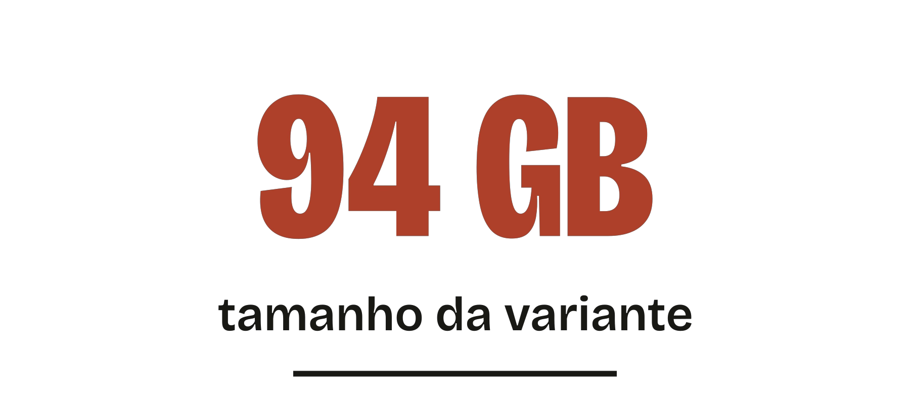
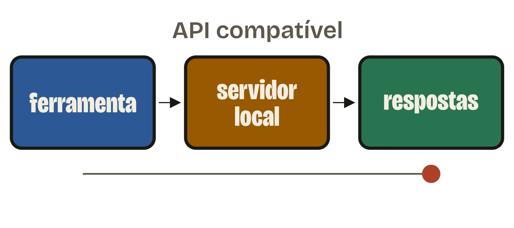

# Acabou o problema de pagar API na nuvem com Strata

_2026-11-27 · noticia_

Aprenda como o Strata executa modelos de IA no próprio computador e como escolher uma instalação de acordo com sua memória e sua placa de vídeo. Você vai entender a diferença entre o tamanho total do modelo, a parte usada em cada token e a memória necessária para mantê-lo funcionando. A apostila explica o resultado apresentado com um modelo de 94 GB, separa esse caso da experiência em uma RTX 3060 Ti e apresenta as outras opções documentadas pelo projeto. Ao terminar, você saberá instalar o aplicativo ou a versão de terminal e encontrar as instruções para conectar suas ferramentas à API local.

## O fato

O Strata é um projeto gratuito e de código aberto para executar IA no próprio computador. O repositório oficial apresenta aplicativos para Windows, Linux e Mac, uma opção de uso pelo terminal e APIs compatíveis com os formatos da OpenAI e da Anthropic. O uso não exige conta.

A demonstração que chama atenção reúne um modelo de 94 GB, 125 bilhões de parâmetros e uma RTX 5080 com 16 GB de memória de vídeo. Nessa configuração, a geração apresentada supera 60 tokens por segundo. O computador também tem 128 GB de RAM, um componente essencial para entender como o modelo cabe.

O projeto permite conversar, trabalhar com código e usar imagens quando a opção escolhida oferece essa entrada. Para quem já utiliza agentes ou ferramentas de programação, a API local permite incorporar o modelo ao ambiente de trabalho.

Fonte: <https://github.com/Niko1221/Strata>

## Por que isso importa

Executar IA localmente coloca o processamento no computador de quem usa. Em uma integração com API na nuvem, as solicitações seguem para o servidor configurado. Com um servidor local, a ferramenta pode enviar essas solicitações ao modelo que está rodando na própria máquina.

O desafio é acomodar o modelo e executar seus cálculos com os recursos disponíveis. A GPU tem memória própria, chamada VRAM. A RAM é a memória principal do computador. Um arquivo maior que a VRAM exige uma estratégia para distribuir os dados e o trabalho.

Parâmetros são os valores aprendidos pelo modelo durante o treinamento. A quantidade deles ajuda a descrever seu tamanho, mas não determina sozinha a qualidade de uma resposta. A arquitetura, a versão escolhida e a tarefa também fazem parte da avaliação.

Fonte: <https://github.com/Niko1221/Strata>

## O motor e o caminho dos dados

O motor de inferência é o programa que executa o modelo depois do treinamento. Ele organiza os cálculos, administra a memória e produz a resposta. Um mesmo modelo pode enfrentar limites diferentes conforme a maneira como esse motor utiliza o computador.

Na divisão por camadas descrita para motores de uso geral, parte do modelo fica na GPU e o excedente vai para a RAM. Quando a geração depende do processamento dessa parte pelo CPU e da movimentação de dados pelo PCI Express, a placa pode precisar esperar. Essa espera ajuda a entender por que uma GPU rápida nem sempre entrega respostas rápidas.

A proposta apresentada para o Strata é usar um motor com kernels especializados. Kernel, nesse contexto, é uma rotina de cálculo preparada para a placa de vídeo. O trabalho direcionado a uma arquitetura permite organizar a execução de acordo com suas características.

O catálogo documentado pelo projeto inclui diferentes modelos e variantes. Por isso, a descrição da implementação voltada ao Qwen3.8-Flash-Next deve permanecer ligada a esse caso, sem virar uma afirmação de que todas as opções usam exatamente o mesmo caminho.

Fonte: <https://github.com/Niko1221/Strata>

## Como os especialistas permitem dividir o trabalho

O mecanismo apresentado para o Qwen3.8-Flash-Next utiliza especialistas, módulos internos que participam de partes do processamento. Um componente chamado roteador escolhe quais deles serão ativados para gerar cada token.

Na configuração descrita, o modelo tem 24.500 especialistas e ativa 10 por token. Isso distingue o tamanho total do modelo da parcela de especialistas acionada a cada etapa. Token é um pedaço de texto processado pelo modelo; pode corresponder a uma palavra, parte dela ou outro elemento.

Na demonstração com a RTX 5080, a VRAM recebe a estrutura do modelo, os mecanismos de atenção, o roteador e o contexto. Os especialistas ficam na RAM. Essa distribuição explica a presença dos 128 GB de memória principal na máquina usada.

Ativar poucos especialistas por token não dispensa espaço para armazenar os demais. O modelo continua dependendo da memória do computador, mesmo quando apenas uma parte participa do cálculo naquele momento.

Fonte: <https://github.com/Niko1221/Strata>

## Quantização e contexto

Quantização é uma forma de representar os valores do modelo usando menos bits. Ela reduz o espaço necessário para esses valores, mas muda sua representação numérica. Por isso, escolher uma variante quantizada envolve considerar tanto memória quanto qualidade nas tarefas desejadas.

O caso de 94 GB usa uma variante próxima de 4 bits da Unsloth, identificada no catálogo como UD-IQ4_XS. O resultado dessa experiência pertence a essa escolha e à máquina apresentada. Outras variantes têm necessidades e comportamentos próprios.

Contexto é o conteúdo que o modelo considera durante a tarefa, como a solicitação e o texto fornecido. O limite apresentado chega a 256 mil tokens. Uma janela extensa permite reunir mais conteúdo, mas sua capacidade nominal não garante que todas as instruções serão seguidas corretamente.

Os exercícios descritos envolvem texto extenso, instruções com várias etapas, lógica e geração de código. Esses usos ajudam a avaliar se o modelo conserva condições ao longo da resposta. A capacidade de contexto e a precisão numérica, isoladamente, não demonstram ausência de alucinações.

Fonte: <https://github.com/Niko1221/Strata>

## As opções de Qwen3.8-Flash-Next

O catálogo recomenda começar pelas variantes da ISTA-DASLab e depois considerar Unsloth e outros fornecedores quando houver um modelo compatível com o computador. Esses nomes identificam opções de distribuição e quantização do modelo.

As variantes não devem ser tratadas como equivalentes em consumo de memória ou velocidade. O próprio catálogo descreve Gyro-S e Gyro-M como opções que usam menos memória, mas são mais lentas. Para programação, há uma opção Coder identificada como IQ1_M.

- ISTA-DASLab: Q2_0, IQ2_XS, IQ3_XXS e IQ3_S; a opção Coder é IQ1_M.
- Unsloth: UD-IQ4_XS, UD-Q4_K_XL, UD-Q5_K_XL, UD-Q6_K_XL e Q8_0.
- Gyro · agentionai: Gyro-S e Gyro-M, descritos como alternativas de menor uso de memória e menor velocidade.
- O catálogo também relaciona Swift 1.5, NVFP4 e OrcaRouter como outras opções.

Fonte: <https://github.com/Niko1221/Strata>

## Tencent Hy4-Flash e Qwen3.6-35B-A3B

Os pacotes de Tencent Hy4-Flash usam nomes que indicam a quantidade de RAM para a qual foram preparados. Isso torna a memória principal um critério direto de escolha. A combinação com a memória da placa também precisa corresponder ao pacote.

O Qwen3.6-35B-A3B aparece com variantes documentadas da Unsloth. Essa é uma família diferente do Qwen3.8-Flash-Next; os resultados da demonstração de 94 GB não devem ser transferidos para ela.

- Tencent Hy4-Flash SQ-64: preparado para 64 GiB de RAM e placa com 8, 12 ou 16 GiB.
- Tencent Hy4-Flash SQ-96: preparado para 96 GiB de RAM e placa com 8 ou 12 GiB.
- Tencent Hy4-Flash SQ-128: preparado para 128 GiB de RAM e placa com 8 ou 12 GiB.
- Qwen3.6-35B-A3B: as variantes documentadas da Unsloth são UD-Q4_K_XL, UD-Q6_K_XL e Q8_0.

Fonte: <https://github.com/Niko1221/Strata>

## Inkling 2 Mini

Inkling 2 Mini tem pacotes do Strata e variantes da Unsloth. Os pacotes SQ-20, SQ-15 e SQ-10 foram preparados para placas com capacidades diferentes. O tamanho do arquivo e a memória de vídeo indicada são informações distintas.

O projeto informa que uma placa com 4 GiB é suficiente para começar com Inkling 2 Mini. Isso não transforma todos os pacotes em escolhas equivalentes para essa capacidade. As indicações específicas de cada pacote continuam orientando a seleção.

- Strata SQ-20: 19,35 GB, preparado para placa de 24 GiB.
- Strata SQ-15: 14,35 GB, preparado para placa de 16 GiB.
- Strata SQ-10: 10,47 GB, preparado para placa de 12 GiB.
- Unsloth UD-Q8_K_XL: 22,87 GB; UD-Q4_K_XL: 17,63 GB; UD-Q4_K_M: 16,61 GB.
- Unsloth UD-IQ4_XS: 15,73 GB; UD-Q3_K_XL: 13,63 GB; UD-IQ3_XXS: 11,66 GB.
- Unsloth UD-Q2_K_XL: 9,14 GB; UD-IQ2_XXS: 8,49 GB; UD-IQ1_M: 8,02 GB; UD-IQ1_S: 7,76 GB.

Fonte: <https://github.com/Niko1221/Strata>

## Os números



_94 GB é o tamanho da variante usada na demonstração principal._

Cada número responde a uma pergunta diferente: tamanho do arquivo, capacidade de memória, quantidade de parâmetros ou velocidade de geração. Misturá-los leva a expectativas erradas sobre o que uma máquina consegue executar.

- 94 GB é o tamanho da variante usada na demonstração principal. Essa experiência informa uma necessidade superior a 80 GB de memória e usa um computador com 128 GB de RAM.
- 16 GB é a VRAM da RTX 5080 apresentada. A execução depende também da RAM, portanto esse valor não representa toda a memória usada pelo modelo.
- Mais de 60 tokens por segundo é a velocidade relatada nessa configuração. Tokens não correspondem diretamente a palavras, e o resultado não é uma promessa para outras placas.
- 125 bilhões é a quantidade de parâmetros do modelo apresentado. A comparação com modelos de 8 bilhões descreve uma diferença de tamanho, sem estabelecer uma proporção equivalente de qualidade.
- 24.500 é o total de especialistas descrito, enquanto 10 é a quantidade ativada por token. Esses valores não representam a porcentagem de todo o trabalho computacional.
- 256 mil tokens é a capacidade de contexto apresentada. Ela descreve quanto conteúdo pode entrar no contexto, sem garantir correção de todas as respostas.
- 8 GB é a VRAM da RTX 3060 Ti usada na outra experiência. Nela foi escolhido um modelo menor; o resultado não corresponde à execução da variante de 94 GB.

Fonte: <https://github.com/Niko1221/Strata>

## O hardware documentado

A compatibilidade envolve a família da placa, o sistema operacional e a variante do modelo. O projeto relaciona hardware de diferentes fabricantes, mas algumas opções têm condições explícitas, como uso em Linux ou suporte experimental.

GB e GiB são unidades diferentes de capacidade. As indicações abaixo preservam as unidades utilizadas pelo projeto. Ao escolher um pacote, observe a memória principal e a memória gráfica separadamente.

- NVIDIA GeForce RTX 20 / 30 / 40 / 50 series estão relacionadas entre as famílias suportadas.
- AMD Radeon RX 7700 / 7800 / 7900, RX 9060 / 9070 e AI PRO R9700 estão relacionadas entre as opções suportadas.
- AMD Radeon RX 6800 / 6900 têm suporte identificado como experimental.
- Intel Arc tem suporte indicado para Linux.
- Apple Silicon tem suporte indicado para M1 ou mais recente.
- AMD Ryzen AI Max · Strix Halo também aparece na relação de hardware.
- NVIDIA DGX Spark tem suporte indicado para Linux.

Fonte: <https://github.com/Niko1221/Strata>

## O que muda para você



_A ferramenta envia solicitações ao servidor local do Strata, que devolve as respostas._

Uma API é a interface pela qual um programa faz solicitações a outro. A compatibilidade com os formatos da OpenAI e da Anthropic permite que ferramentas preparadas para essas interfaces se comuniquem com o servidor local do Strata.

Exemplo: você utiliza uma ferramenta de programação e quer que suas solicitações sejam processadas no próprio computador. Com o modelo iniciado, configura a conexão dessa ferramenta com o servidor local. O Strata recebe os pedidos e devolve as respostas pelo formato de API compatível.

O endpoint padrão informado é 127.0.0.1:8080. O endereço 127.0.0.1 aponta para a própria máquina, enquanto 8080 identifica a porta do serviço. Endereço do servidor e chave de API são configurações distintas; as instruções de conexão de cada ferramenta orientam o preenchimento.

A execução local elimina a cobrança de uma API na nuvem pelos tokens processados nesse servidor. O computador continua oferecendo memória e processamento para a tarefa. A localização do modelo também não descreve, sozinha, o comportamento de todos os outros componentes de um agente.

Fonte: <https://github.com/Niko1221/Strata/blob/main/docs/INSTALL.md>

## O que fazer hoje pelo aplicativo

O aplicativo de desktop reúne conversa, arquivos e visualização de código em uma janela. Há um instalador para cada sistema. Na primeira abertura, o aplicativo baixa o motor correspondente à placa de vídeo.

1. Abra https://github.com/Niko1221/Strata/releases/latest e escolha o instalador do seu sistema. O resultado esperado é baixar o pacote correspondente a Windows, Linux ou Mac.
2. Instale o aplicativo e abra o Strata. Na primeira execução, aguarde o download do motor para sua placa; essa é a etapa que prepara a execução no hardware.
3. Escolha um modelo no aplicativo, considerando RAM, VRAM e as indicações do pacote. O resultado esperado é iniciar o modelo selecionado.
4. Comece uma conversa na interface. Uma resposta na janela permite observar o funcionamento inicial do modelo escolhido.

Fonte: <https://github.com/Niko1221/Strata/releases/latest>

## Instalar pelo Windows PowerShell

A instalação pelo terminal oferece outro caminho para preparar o Strata. O comando abaixo baixa e executa o script de instalação publicado pelo projeto. Por executar um script, seu endereço faz parte do que precisa ser observado antes da execução.

1. Abra o Windows PowerShell e execute o comando abaixo. O resultado esperado é executar o instalador do Strata.
2. Depois da instalação, abra um novo terminal, conforme a orientação do projeto. Use essa nova sessão para iniciar o modelo na etapa de lançamento.

```
irm -TimeoutSec 120 https://github.com/Niko1221/Strata/releases/latest/download/install.ps1 | iex
```

Fonte: <https://github.com/Niko1221/Strata>

## Instalar pelo terminal no Linux ou Mac

No Linux e no Mac, o comando publicado salva o instalador como install.sh e depois o executa. Os parâmetros de tempo fazem parte da linha oficial e devem ser preservados ao copiar.

1. Abra o terminal do Linux ou do Mac e execute a linha abaixo. O resultado esperado é baixar o script e iniciar a instalação.
2. Ao concluir a instalação, siga para o lançamento pelo terminal. Essa etapa abre as orientações de escolha e início do modelo.

```
curl -fsSL --connect-timeout 15 --max-time 120 https://github.com/Niko1221/Strata/releases/latest/download/install.sh -o install.sh && sh install.sh
```

Fonte: <https://github.com/Niko1221/Strata>

## Baixar e iniciar o modelo pelo terminal

O lançador conduz a escolha, o download e o início de um modelo. A interface de terminal também apresenta atividade do modelo, velocidade, memória e solicitações recentes. Essas informações ajudam a acompanhar a execução na sua máquina.

1. No terminal com o Strata instalado, execute o comando abaixo. O resultado esperado é abrir o fluxo de lançamento.
2. Siga as perguntas apresentadas para escolher e baixar um modelo compatível com o computador. O resultado esperado é obter a variante selecionada.
3. Conclua as orientações de início do modelo. A atividade exibida pelo terminal permite acompanhar o serviço em execução.

```
strata launch
```

Fonte: <https://github.com/Niko1221/Strata>

## O que conferir

A experiência com uma placa de menor capacidade mostra a importância de escolher outra variante. Na RTX 3060 Ti de 8 GB, foi utilizado um modelo menor, com ajuda do CPU e da RAM. Esse caso ensina uma estratégia de adaptação, sem reproduzir a configuração principal.

A geração de código e o uso de ferramentas exigem atenção ao conteúdo produzido. Um modelo pode responder com fluência e ainda perder uma condição ou propor uma solução incorreta. A execução local não elimina essa possibilidade.

- Relacione cada resultado ao modelo e ao hardware usados. A velocidade da RTX 5080 não determina a velocidade da RTX 3060 Ti.
- Observe RAM e VRAM antes de selecionar o pacote. A variante de 94 GB depende de memória principal suficiente.
- Mantenha o caráter experimental do suporte a AMD Radeon RX 6800 / 6900 ao considerar essa opção.
- Trate respostas e código como conteúdo sujeito a revisão humana. Capacidade de contexto e quantidade de parâmetros não garantem correção.
- Entenda custo zero por token como ausência da cobrança por tokens de uma API na nuvem nessa execução local.
- O repositório apresenta licença MIT para o Strata. Essa indicação identifica a licença do projeto, sem estabelecer a licença de cada modelo distribuído separadamente.

Fonte: <https://github.com/Niko1221/Strata>

## Glossário

- Inferência: execução de um modelo já treinado para produzir respostas.
- Motor de inferência: programa que organiza os cálculos e a memória usados na execução do modelo.
- GPU: processador gráfico usado para realizar cálculos do modelo.
- CPU: processador principal do computador.
- VRAM: memória da placa de vídeo.
- RAM: memória principal do computador.
- Parâmetros: valores aprendidos pelo modelo durante o treinamento.
- Token: unidade de texto processada pelo modelo, que pode ser uma palavra, parte dela ou outro elemento.
- Especialistas: módulos internos dos quais uma parte é selecionada para participar de cada etapa de geração.
- Roteador: componente que escolhe os especialistas ativados.
- Quantização: representação dos valores do modelo com menos bits para reduzir seu tamanho.
- Contexto: conteúdo que o modelo considera ao executar a tarefa.
- Alucinação: resposta que apresenta informação incorreta ou inventada como se fosse correta.
- Kernel: rotina de cálculo preparada para determinado hardware.
- PCI Express: conexão usada na comunicação entre componentes, incluindo a placa de vídeo.
- API: interface usada para um programa solicitar trabalho a outro.
- Endpoint: endereço de acesso a um serviço.
- Localhost: referência à própria máquina.
- GB e GiB: unidades diferentes usadas para expressar capacidade de armazenamento ou memória.

Fonte: <https://github.com/Niko1221/Strata>

## Para onde ir depois

Depois de iniciar o modelo, o próximo passo é conectá-lo à ferramenta em que você pretende trabalhar. O Strata apresenta instruções para Claude Code, Codex CLI, OpenCode, oh-my-pi, pi.dev, Hermes Agent e OpenClaw, entre outras integrações pelas APIs compatíveis.

O comando abaixo mostra as orientações de configuração para a ferramenta escolhida. Use essas instruções para preparar a conexão com o servidor local e praticar o uso do modelo no seu fluxo de trabalho.

- Execute o comando abaixo no terminal para visualizar as instruções de conexão da sua ferramenta.
- Siga a configuração apresentada para a ferramenta escolhida. O resultado esperado é direcionar suas solicitações ao serviço local do Strata.
- Pratique os usos descritos para o projeto, como conversa, trabalho com código ou imagens quando a opção escolhida oferecer essa entrada.

```
strata connect
```

Fonte: <https://github.com/Niko1221/Strata>

## Além do vídeo

- O projeto também relaciona instalação a partir do código-fonte e uso com Docker.
- O repositório mantém áreas de solução de problemas, benchmarks da comunidade e registro de bugs.
