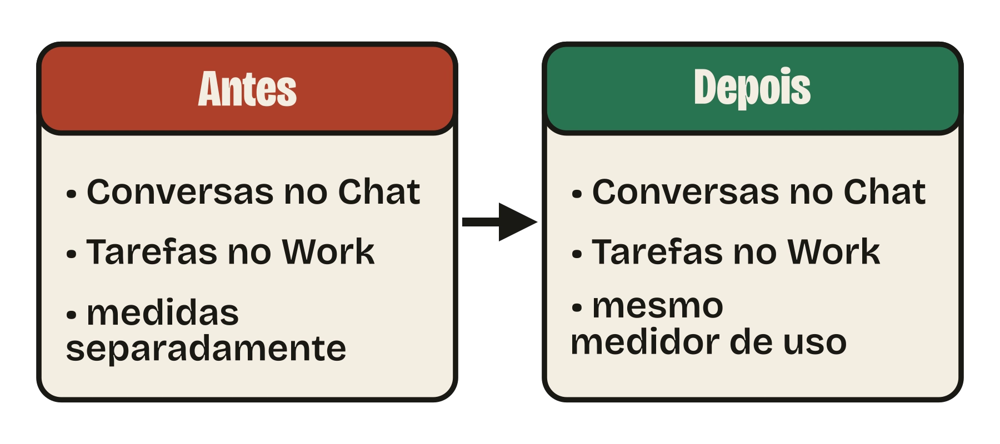
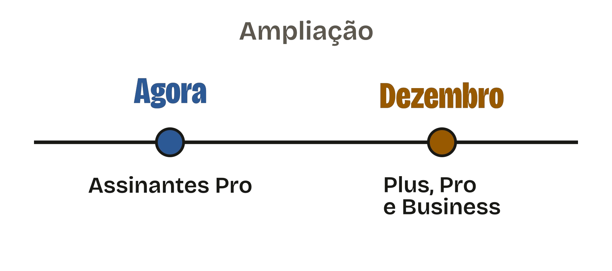
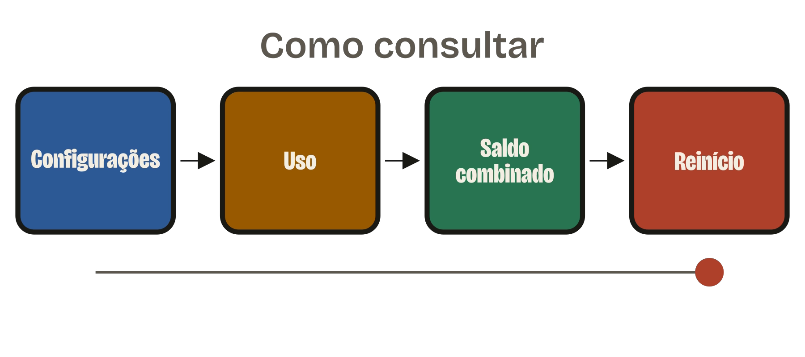

# Chat e Work dividem cota no ChatGPT; Instant fica fora

_2026-11-27 · noticia_

A OpenAI começou a liberar, para um pequeno grupo de assinantes Pro, uma experiência unificada em que Chat e Work passam a compartilhar o mesmo medidor de uso no ChatGPT, medido em tokens. As conversas com o modelo Instant ficam fora dessa franquia compartilhada. A ampliação aos planos Plus, Pro e Business está prevista para dezembro. Quem lê aprende como o novo medidor funciona, o que acontece depois do limite, como acompanhar o saldo e quais cuidados tomar.

## O fato

_Conversas no Chat e tarefas no Work passam a compartilhar o mesmo medidor de uso._

A OpenAI começou a liberar, para um pequeno grupo de assinantes do plano Pro, uma experiência unificada em que Chat e Work passam a compartilhar o mesmo medidor de uso dentro do ChatGPT. A cobertura foi publicada pela TechCrunch em 25 de novembro de 2026, com base em post no X do líder de produto Thibault "Tibo" Sottiaux e em declarações de um porta-voz da empresa.

Antes dessa mudança, conversas no Chat e tarefas no Work eram medidas separadamente. Agora os dois modos consomem a mesma franquia, medida em tokens, as unidades de informação que um modelo processa e gera. O saldo combinado e o horário de reinício aparecem em Configurações, na seção de uso.

A liberação segue um anúncio anterior feito por email aos usuários.

Fonte: <https://techcrunch.com/2026/11/25/openai-says-heavy-chatgpt-users-may-hit-limits-sooner-as-it-merges-chat-and-work>

## Por que isso importa

A unificação responde a dois movimentos ao mesmo tempo: custos de infraestrutura crescentes e demanda maior por modelos cada vez mais capazes, que pressionam os recursos de computação das empresas de IA. Juntar conversa e trabalho em uma única interface também simplifica o uso, permitindo circular entre chats e tarefas mais complexas sem trocar de abas.

O receio dos assinantes é perder acesso aos modelos avançados de raciocínio: se Chat e Work passam a dividir a mesma franquia, tarefas de trabalho podem consumir parte do saldo que antes era usado só para conversa. A OpenAI diz que a maioria dos usuários não deve precisar esperar reinícios com mais frequência, mas reconhece que uma pequena parcela dos mais intensos pode atingir o limite mais cedo.

O movimento não é isolado: a Anthropic também unificou Claude e Cowork em uma única interface em setembro.

Fonte: <https://techcrunch.com/2026/11/25/openai-says-heavy-chatgpt-users-may-hit-limits-sooner-as-it-merges-chat-and-work>

## Um medidor único para Chat e Work

Sob o novo sistema, Chat e Work compartilham um único medidor de uso em todo o ChatGPT. A franquia é medida em tokens, e o quanto você consome depende do modelo escolhido e da tarefa pedida: modelos mais avançados e tarefas mais complexas tendem a usar mais da franquia.

Quem alterna entre uma conversa e uma tarefa de trabalho acompanha um único saldo em Configurações, na seção de uso. O painel mostra o consumo combinado e o horário de reinício. Segundo a página de suporte da OpenAI, a mesma franquia compartilhada valerá para ChatGPT e Codex, e a mudança leva as capacidades agênticas do Work para a experiência principal do ChatGPT.

Fonte: <https://help.openai.com/en/articles/20001625-understanding-chatgpt-and-codex-usage-limits>

## Instant fica fora do medidor

As conversas com o modelo Instant não entram na franquia compartilhada de Chat e Work. Elas não reduzem o saldo e permanecem disponíveis mesmo depois que a franquia compartilhada termina.

Essa exceção mantém o Instant acessível, mas não amplia a cota compartilhada. É uma saída após o limite, não um aumento de franquia.

Fonte: <https://help.openai.com/en/articles/20001625-understanding-chatgpt-and-codex-usage-limits>

## O que acontece depois do limite

Se a franquia compartilhada acabar no meio de uma tarefa, você pode manter a conversa e seguir usando o ChatGPT com o Instant. Para continuar usando os recursos elegíveis, as opções são: aguardar a renovação, melhorar o plano ou comprar créditos.

Fonte: <https://help.openai.com/en/articles/20001625-understanding-chatgpt-and-codex-usage-limits>

## Quem recebe agora e quem recebe em dezembro

_A mudança começa com um grupo reduzido de Pro e prevê ampliação em dezembro._

A mudança começou com um grupo reduzido de assinantes Pro, para a OpenAI aprender com o retorno antes de ampliar. A previsão é levar os limites compartilhados aos planos Plus, Pro e Business em dezembro.

Quem ainda não recebeu a novidade pode acompanhar a liberação. A ampliação muda o planejamento de quem usa o serviço todos os dias.

Fonte: <https://help.openai.com/en/articles/20001625-understanding-chatgpt-and-codex-usage-limits>

## Os números

- Tokens: unidades de informação que um modelo processa e gera; é como a franquia compartilhada é medida.
- Pequena parcela dos usuários mais intensos: grupo que pode atingir o limite mais cedo, segundo a OpenAI.
- Modelos avançados e tarefas complexas: tendem a consumir mais tokens.
- Dezembro: mês previsto para ampliar os limites compartilhados aos planos Plus, Pro e Business.
- Setembro: mês em que a Anthropic unificou Claude e Cowork, movimento paralelo do setor.

Fonte: <https://help.openai.com/en/articles/20001625-understanding-chatgpt-and-codex-usage-limits>

## O que muda para você

Se você usa o ChatGPT intensamente, juntar Chat e Work significa acompanhar de perto o consumo dos modelos de raciocínio avançados, porque tarefas de trabalho agora descontam do mesmo saldo. A maioria dos usuários não deve precisar esperar reinícios com mais frequência.

Exemplo: você pode reservar as tarefas mais pesadas para o momento em que o saldo estiver cheio e usar o Instant para conversas rápidas após o limite, mantendo o serviço acessível enquanto aguarda a renovação.

A OpenAI afirma que continuará trabalhando para melhorar a eficiência, para que assinantes aproveitem mais os planos.

Fonte: <https://techcrunch.com/2026/11/25/openai-says-heavy-chatgpt-users-may-hit-limits-sooner-as-it-merges-chat-and-work>

## O que fazer hoje

_Em Configurações e Uso, veja o saldo combinado e o horário de reinício._

1. Abra Configurações e localize a seção de uso para ver o saldo combinado de Chat e Work e o horário de reinício.
2. Separe o uso dos modelos avançados das conversas com Instant, para não descontar a franquia compartilhada em tarefas leves.
3. Se a franquia acabar, mantenha a conversa no Instant ou aguarde a renovação.
4. Se precisar continuar com recursos elegíveis, avalie melhorar o plano ou comprar créditos.
5. Acompanhe a liberação dos limites compartilhados para o seu plano em dezembro.

Fonte: <https://help.openai.com/en/articles/20001625-understanding-chatgpt-and-codex-usage-limits>

## O que conferir

- A OpenAI afirma que a maioria dos usuários não deve enfrentar reinícios mais frequentes; isso é expectativa da empresa, não garantia.
- A afirmação de que uma pequena parcela dos mais intensos pode atingir o limite mais cedo não quantifica quantos usuários nem em quais planos além do Pro inicial.
- A exceção do Instant mantém o modelo disponível, mas não amplia a cota compartilhada de Chat e Work.
- A ampliação para Plus, Pro e Business está prevista para dezembro, mas a liberação pode variar por conta e região.
- O plano Pro foi o primeiro a receber a mudança; usuários de outros planos ainda não a têm.
- A OpenAI diz estar se preparando com cuidado para a transição; isso é compromisso declarado, não garantia de ausência de interrupções.

Fonte: <https://help.openai.com/en/articles/20001625-understanding-chatgpt-and-codex-usage-limits>

## Glossário

- Chat: modo conversacional do ChatGPT.
- Work: modo voltado a tarefas e trabalho dentro do ChatGPT.
- Instant: modelo do ChatGPT cujas conversas ficam fora da franquia compartilhada.
- Tokens: unidades de informação que um modelo processa e gera; medida do uso.
- Franquia compartilhada: saldo único de uso consumido por Chat e Work juntos.
- Codex: ferramenta da OpenAI que, segundo a página de suporte, também compartilhará a mesma franquia a partir de dezembro.
- Pro, Plus, Business: planos de assinatura do ChatGPT mencionados na ampliação de dezembro.

Fonte: <https://help.openai.com/en/articles/20001625-understanding-chatgpt-and-codex-usage-limits>

## Para onde ir depois

- Verificar em Configurações → Uso o saldo combinado e o horário de reinício.
- Testar o Instant após esgotar a franquia para confirmar a exceção.
- Acompanhar a página de suporte da OpenAI para detalhes da ampliação de dezembro.
- Revisar quais tarefas consomem mais tokens e priorizar os modelos avançados para elas.

Fonte: <https://help.openai.com/en/articles/20001625-understanding-chatgpt-and-codex-usage-limits>

## Além do vídeo

- A cobertura da TechCrunch foi publicada em 25 de novembro de 2026, por Jagmeet Singh.
