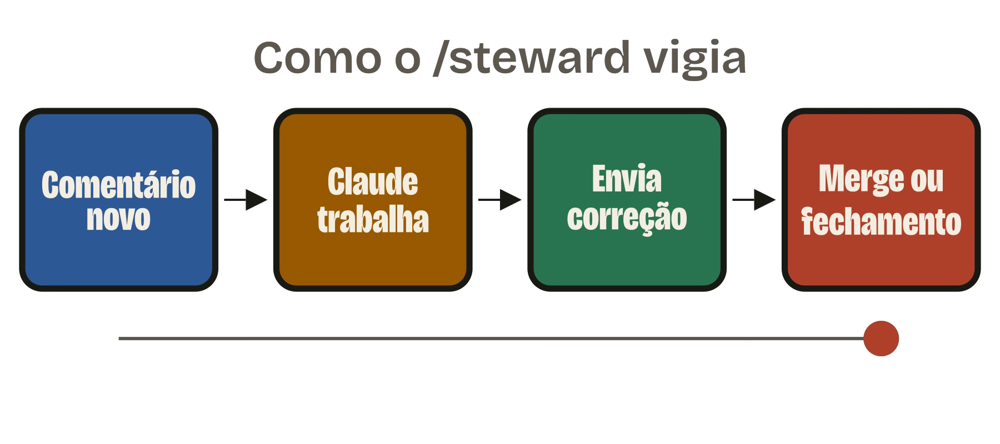

# Com /ship, o Claude abre o pull request no GitHub por você

_2026-11-27 · noticia_

A Anthropic lançou para o Claude Code dois comandos novos, /ship e /steward, que cobrem o caminho do commit até o merge. Depois de ler esta apostila, você vai saber o que cada comando faz, quais são os requisitos de versão, como o /code-review entra no fluxo e como o arquivo .claude/approvals.yml define regras de aprovação no plano de equipe. Você também terá uma lista do que conferir antes de usar e dos próximos passos.

## O fato

A Anthropic lançou para o Claude Code dois comandos novos: /ship e /steward. Juntos com o /code-review, eles levam o seu trabalho do commit até o merge no GitHub. A novidade está descrita na documentação oficial do Claude Code, na página Claude Ship.

Os requisitos são Claude Code 2.1.330 ou mais novo e GitHub CLI 2.63 ou mais novo. Sem essas versões, os comandos não estão garantidos.

Fonte: <https://code.claude.com/docs/en/claude-ship>

## Por que isso importa

Depois de terminar uma alteração, o caminho até o código entrar na base costuma ser manual: agrupar os commits, abrir o pull request, esperar a revisão e responder cada comentário. Cada etapa traz pequenas esperas e trabalho repetitivo.

Um pull request é o pedido para que as suas mudanças de uma branch sejam incorporadas à branch principal do projeto. O merge é o momento em que essa incorporação acontece. O Claude Code agora acompanha esse trajeto inteiro, com um comando para cada etapa.

A decisão de fazer o merge continua com você. Os comandos tiram o serviço repetitivo, não a responsabilidade pelo que entra no código.

Fonte: <https://code.claude.com/docs/en/ship-command>

## /ship: a porta de entrada

O /ship faz o commit do seu trabalho, envia a branch, abre o pull request no GitHub e roda o /code-review. O resultado é um pull request que já nasce com a revisão feita, em vez de esperar por alguém para olhar o código.

Exemplo: imagine que você terminou uma correção numa branch local. Em vez de executar cada passo à mão, você digita /ship e o Claude cuida da sequência até o pull request aberto.

```
/ship
```

Fonte: <https://code.claude.com/docs/en/ship-command>

## /code-review: a revisão

O /code-review revisa as mudanças e traz os problemas achados. Ele lê as alterações junto com o código ao redor, o que ajuda a apontar problemas que só aparecem no contexto.

Você pode rodá-lo sozinho, sem abrir pull request, ou deixar que o /ship o chame. A documentação da revisão local está em code.claude.com/docs/en/code-review-local. Note a grafia: o comando leva hífen, /code-review.

```
/code-review
```

Fonte: <https://code.claude.com/docs/en/code-review-local>

## /steward: a vigília do pull request



_O /steward trata comentários e testes vermelhos do pull request até o merge ou o fechament_

Depois da revisão, o /steward vigia o seu pull request aberto por até 7 dias, até o merge ou o fechamento. Ele fica ativo na sua sessão.

Quando chega um comentário novo, ele trabalha nele e envia a correção. Quando o teste automático fica vermelho, isto é, falha, ele tenta arrumar também.

O prazo de 7 dias é um limite: se o pull request seguir aberto depois disso, a vigília termina. A decisão de fazer o merge continua sendo sua.

```
/steward
```

Fonte: <https://code.claude.com/docs/en/ship-command>

## Claude Approvals no plano de equipe

No plano de equipe, existem agentes de revisão e de acompanhamento que a organização liga nas configurações. Esse recurso vale para os planos Team e Enterprise.

Você também ganha o Claude Approvals, um arquivo de regras em .claude/approvals.yml. Nele você define quantas pessoas precisam aprovar cada tipo de mudança e onde o Claude pode postar uma aprovação. Na prática, parte das aprovações deixa de depender de você.

Quem escreve essas regras decide quanto do processo fica automático. Por isso, trate o arquivo como uma decisão da equipe, não como um detalhe de configuração.

```
.claude/approvals.yml
```

Fonte: <https://code.claude.com/docs/en/approvals>

## Os números

- Claude Code 2.1.330: versão mínima do Claude Code. Versões mais antigas não atendem ao requisito.
- GitHub CLI 2.63: versão mínima da ferramenta de linha de comando do GitHub. Versões mais antigas não atendem ao requisito.
- 7 dias: tempo máximo que o /steward vigia um pull request aberto, se o merge ou o fechamento não acontecer antes.
- 3 comandos: /ship, /code-review e /steward, um para cada etapa do caminho.

Fonte: <https://code.claude.com/docs/en/ship-command>

## O que muda para você

O trabalho repetitivo de abrir pull request, pedir revisão e acompanhar comentários passa para o Claude. Seu foco fica na decisão: o que entra e quando.

Exemplo: imagine que você abre um pull request numa sexta e um colega comenta na segunda. Com o /steward ativo na sua sessão, o comentário pode ser tratado e a correção enviada sem você refazer o ciclo à mão.

Em equipes com plano Team ou Enterprise, o arquivo de aprovações move a conversa para a regra: quantas aprovações cada tipo de mudança exige e onde o Claude pode aprovar.

## O que fazer hoje

1. Confira a versão do Claude Code instalada. O resultado esperado é 2.1.330 ou mais nova; se for mais antiga, atualize.
2. Confira a versão do GitHub CLI, disponível em https://cli.github.com. O resultado esperado é 2.63 ou mais nova.
3. Numa branch com uma alteração pronta, digite /ship. O resultado esperado é o commit feito, a branch enviada, o pull request aberto no GitHub e o /code-review executado.
4. Com o pull request aberto, use o /steward. O resultado esperado é a vigília sobre ele por até 7 dias, até o merge ou o fechamento.
5. Se a sua organização usa plano Team ou Enterprise, leia a documentação do Claude Approvals e discuta com a equipe as regras do arquivo .claude/approvals.yml.

Fonte: <https://code.claude.com/docs/en/claude-ship>

## O que conferir

- Versões: Claude Code 2.1.330 ou mais novo e GitHub CLI 2.63 ou mais novo. Confira antes de usar.
- O /steward vigia por até 7 dias. Passado esse prazo, o acompanhamento termina e o pull request segue por sua conta.
- O merge continua sendo decisão sua. Revise o que o Claude corrigiu antes de aprovar.
- Os agentes de revisão e de acompanhamento do plano de equipe são ligados pela organização nas configurações, nos planos Team ou Enterprise.
- As regras do .claude/approvals.yml definem onde o Claude pode postar uma aprovação. Regra frouxa demais deixa passar mudança que deveria ter olhar humano; defina com cuidado quantas pessoas aprovam cada tipo de mudança.

Fonte: <https://code.claude.com/docs/en/approvals>

## Glossário

- Pull request: pedido para incorporar as mudanças de uma branch à branch principal, onde outras pessoas podem revisar.
- Merge: o momento em que as mudanças de um pull request são incorporadas à branch principal.
- Commit: registro de um conjunto de alterações no histórico do código.
- Branch: linha paralela de desenvolvimento onde você trabalha sem mexer na versão principal.
- GitHub CLI: ferramenta de linha de comando para usar o GitHub pelo terminal.
- Teste automático: verificação que roda sozinha sobre o código; quando falha, aparece como vermelho.
- Claude Approvals: arquivo de regras de aprovação do plano de equipe, em .claude/approvals.yml.

## Para onde ir depois

- Leia a visão geral do Claude Ship em https://code.claude.com/docs/en/claude-ship.
- Veja os detalhes de /ship e /steward em https://code.claude.com/docs/en/ship-command.
- Veja a revisão local em https://code.claude.com/docs/en/code-review-local.
- Se a sua equipe usa Team ou Enterprise, leia https://code.claude.com/docs/en/approvals antes de escrever as regras.
- Pratique: rode /ship numa alteração pequena para ver o fluxo completo antes de usá-lo em trabalho maior.

Fonte: <https://code.claude.com/docs/en/claude-ship>

## Além do vídeo

- Os agentes de revisão e de acompanhamento do plano de equipe são ligados nas configurações da organização, nos planos Team ou Enterprise.
- O GitHub CLI tem site oficial em https://cli.github.com, com a versão mínima 2.63 exigida pelos comandos.
- A página de aprovações em https://code.claude.com/docs/en/approvals detalha o Claude Approvals.
