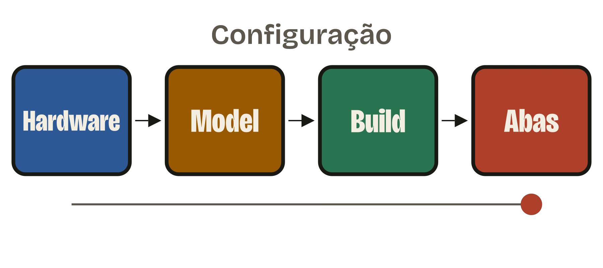
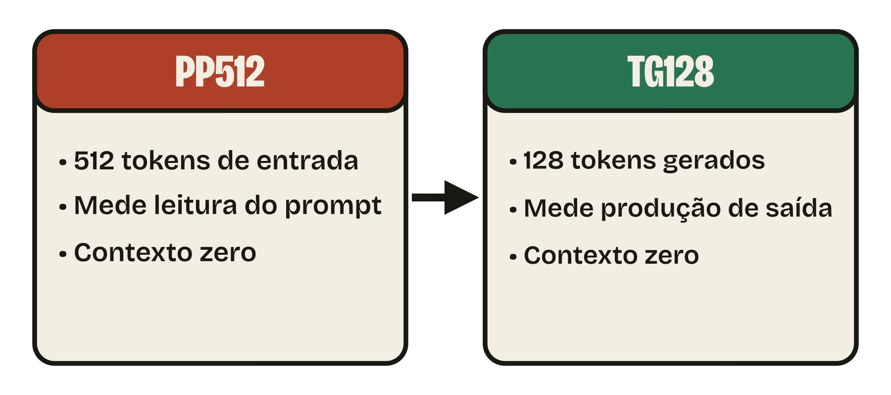
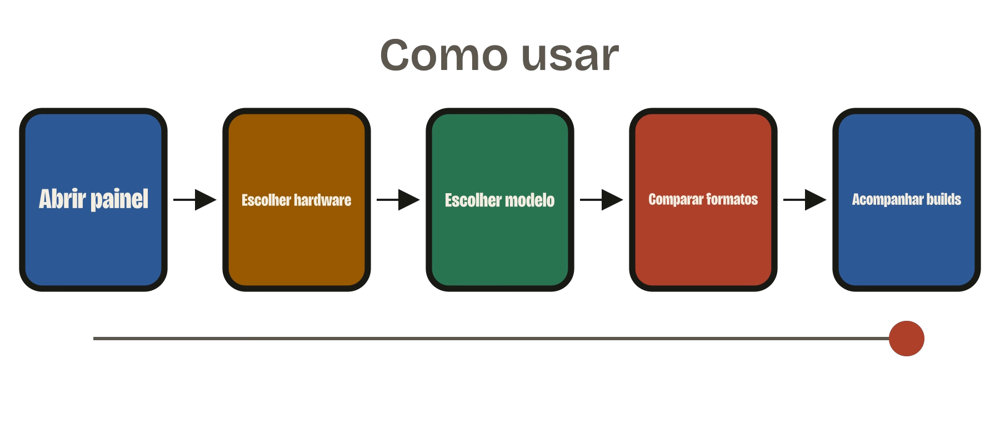

# Dashboard llama.cpp para AMD Ryzen e Radeon no HF

_2026-11-27 · noticia_

Em 26 de novembro de 2026, a equipe ggml-org publicou no blog da Hugging Face um painel de benchmarks do llama.cpp para hardware AMD Ryzen e Radeon. Nele você escolhe hardware, modelo e build, compara quantizações e acompanha PP512 e TG128 ao longo dos builds. Os benchmarks são públicos, rodam semanalmente e usam 10 repetições por configuração. Depois de ler, você sabe o que cada métrica mede, como usar as três abas e como conferir um resultado nos arquivos JSONL.

## O fato

Em 26 de novembro de 2026, a equipe ggml-org publicou no blog da Hugging Face um painel de benchmarks do llama.cpp para hardware AMD Ryzen e Radeon. O painel está em https://ggml-org-llamacpp-amd-bench.static.hf.space/index.html e permite acompanhar processamento de prompt e geração de texto entre builds, modelos e quantizações.

O anúncio descreve o objetivo de forma direta: facilitar a inspeção de mudanças de desempenho de inferência local para desenvolvedores AMD. A pessoa escolhe hardware, modelo e build, compara quantizações e segue o desempenho ao longo do tempo.

O fluxo de benchmark e os resultados subjacentes são públicos. Isso permite inspecionar como a medição é feita, não apenas o resultado final.

Fonte: <https://huggingface.co/blog/ggml-org/llamacpp-amd-bench>

## Por que isso importa

O desempenho de inferência local muda conforme modelos, kernels e builds evoluem. Sem um histórico organizado, fica difícil saber se uma atualização do llama.cpp deixou o modelo mais rápido ou mais lento no seu hardware.

O llama.cpp é um projeto de inferência de LLM em C/C++, com foco em configuração mínima e desempenho em vários tipos de hardware, localmente ou na nuvem. Ele é construído sobre a biblioteca ggml. O painel usa esse ecossistema como base e mede os binários pré-compilados distribuídos pelo llama-install.sh.

Para quem roda modelos localmente em AMD, o painel transforma uma comparação manual em uma consulta rápida: escolha o hardware, o modelo e o build, e veja as quantizações lado a lado.

Fonte: <https://huggingface.co/blog/ggml-org/llamacpp-amd-bench>

## O que o painel permite fazer



_Hardware, modelo e build definem o que as abas exibem_

Na barra de configuração, você escolhe Hardware, Model e build do llama.cpp. Essa seleção define todo o restante da visualização.

Na aba Overview, você compara quantizações para um hardware, um modelo e um build. As duas métricas aparecem em gráficos separados: PP512 e TG128.

Na aba Build history, você acompanha PP512 e TG128 em todos os builds registrados para o hardware, o modelo e a quantização escolhidos.

Na aba Context scaling, você vê como a geração de tokens muda conforme o contexto já existente cresce, para o build, o hardware, o modelo e a quantização selecionados.

Fonte: <https://huggingface.co/blog/ggml-org/llamacpp-amd-bench>

## Aba Overview: comparar quantizações

A aba Overview responde a uma pergunta direta: entre dois formatos GGUF, qual entrega mais tokens por segundo no mesmo hardware e no mesmo build?

Os dois gráficos mostram PP512, com 512 tokens de entrada e sem geração, e TG128, com 128 tokens gerados. Ambos começam em profundidade de contexto zero.

Como a comparação usa o mesmo hardware, o mesmo modelo e o mesmo build, a diferença entre os valores reflete o formato, não a máquina.

Fonte: <https://huggingface.co/blog/ggml-org/llamacpp-amd-bench>

## Aba Build history: acompanhar mudanças

A aba Build history responde a pergunta temporal: uma atualização do llama.cpp melhorou ou piorou o desempenho?

O gráfico guarda PP512 e TG128 de todos os builds registrados para a combinação selecionada de hardware, modelo e quantização.

Isso ajuda a separar efeito de build de efeito de formato. Se a quantização não mudou mas o número mudou, o build é o suspeito.

Fonte: <https://huggingface.co/blog/ggml-org/llamacpp-amd-bench>

## Aba Context scaling: conversas longas

A aba Context scaling responde a pergunta de uso real: a velocidade cai conforme a conversa cresce?

O gráfico mostra como a vazão de geração de tokens muda conforme o contexto existente aumenta, para o build, o hardware, o modelo e a quantização selecionados.

PP512 e TG128 começam em contexto zero, então eles não respondem essa pergunta sozinhos. A aba Context scaling complementa as duas métricas iniciais.

Fonte: <https://huggingface.co/blog/ggml-org/llamacpp-amd-bench>

## O que PP512 e TG128 medem



_Duas métricas em tokens por segundo, perguntas diferentes_

As duas métricas são medidas em tokens por segundo e respondem perguntas diferentes. Misturá-las leva a conclusões erradas.

- PP512: processa 512 tokens de entrada e mede quão rápido o modelo lê um prompt.
- TG128: gera 128 tokens e mede quão rápido o modelo produz saída.
- Ambos começam em profundidade de contexto zero (n_depth=0).
- O valor plotado é a média de throughput (avg_ts).
- PP512 mede processamento de 512 tokens de entrada sem geração; TG128 mede geração de 128 tokens sem contexto pré-existente.

Fonte: <https://huggingface.co/blog/ggml-org/llamacpp-amd-bench>

## Como os benchmarks são executados

Os benchmarks usam os binários pré-compilados distribuídos pelo llama-install.sh, projeto de build e instalação por trás do llama.app.

As workflows públicas para gfx1151 e gfx1201 são agendadas semanalmente. Elas rodam os benchmarks padrão com a ferramenta llama-bench, com Flash Attention ligado e desligado, e com 10 repetições por configuração.

O conjunto de modelos evolui. Atualmente inclui Inkling 2 Mini, Qwen, Gemma, gpt-oss e LFM, cobrindo arquiteturas dense e de mistura de especialistas.

Os formatos GGUF disponíveis incluem Q4_K_M, Q8_0, outras quantizações e formatos de maior precisão como BF16 e F16.

Fonte: <https://huggingface.co/blog/ggml-org/llamacpp-amd-bench>

## Como inspecionar e reutilizar os dados

O painel lê diretamente do bucket público ggml-org/install.sh-benches-data no Hugging Face. O link da fonte de dados ao lado do título do gráfico abre a pasta do build, do hardware e do modelo selecionados.

Os resultados padrão seguem o padrão <build>/<hardware>/<model>/<quant>.jsonl. As varreduras de workload usam o mesmo diretório com o nome <quant>-tg.jsonl.

Você pode usar esses arquivos para investigar um resultado, montar seus próprios gráficos ou comparar com uma execução local.

```
<build>/<hardware>/<model>/<quant>.jsonl
```

Fonte: <https://huggingface.co/buckets/ggml-org/install.sh-benches-data>

## Os números

- 2 hardwares disponíveis hoje: Radeon 8060S (gfx1151) e Radeon AI Pro R9700S (gfx1201).
- 512 tokens de entrada no teste PP512.
- 128 tokens gerados no teste TG128.
- 10 repetições por configuração nos benchmarks.
- Flash Attention testado ligado e desligado.
- Workflows públicas agendadas semanalmente para gfx1151 e gfx1201.
- Modelos dense e de mistura de especialistas no conjunto atual.
- Formatos GGUF como Q4_K_M, Q8_0, BF16 e F16.
- 5.909 arquivos e 49,3 MB no bucket público, atualizado em 26 de novembro.
- Publicado em 26 de novembro de 2026.

Fonte: <https://huggingface.co/blog/ggml-org/llamacpp-amd-bench>

## O que muda para você

Para quem roda modelos localmente em AMD, a principal mudança é a velocidade de comparação. Em vez de rodar benchmarks manualmente para cada formato, você consulta o painel e vê PP512 e TG128 lado a lado.

Exemplo: imagine que você usa uma Radeon 8060S e quer saber se Q4_K_M ou Q8_0 entrega mais tokens por segundo no mesmo modelo e no mesmo build. Você seleciona o hardware, o modelo e o build, abre a aba Overview e compara as duas métricas para os dois formatos. Se uma atualização do llama.cpp mudar a velocidade, a aba Build history mostra a diferença entre builds.

O mesmo raciocínio vale para contexto longo. Se você quer saber se a geração cai em conversas extensas, a aba Context scaling mostra essa curva para a combinação escolhida.

Fonte: <https://huggingface.co/blog/ggml-org/llamacpp-amd-bench>

## O que fazer hoje



_Passos para comparar quantizações no painel AMD_

1. Abra o painel no endereço oficial. Resultado esperado: a interface carrega com a barra de configuração visível.
2. Escolha um dos hardwares disponíveis. Resultado esperado: Radeon 8060S (gfx1151) ou Radeon AI Pro R9700S (gfx1201) selecionado.
3. Escolha um modelo e um build. Resultado esperado: a seleção define os dados exibidos nas abas.
4. Na aba Overview, compare PP512 e TG128 entre quantizações. Resultado esperado: você vê qual formato entrega mais tokens por segundo no mesmo hardware e build.
5. Na aba Build history, acompanhe a mesma combinação ao longo dos builds. Resultado esperado: você identifica se uma atualização mudou o desempenho.
6. Na aba Context scaling, observe a geração conforme o contexto cresce. Resultado esperado: você vê se a velocidade cai em conversas longas.
7. Se quiser conferir um número, abra a pasta do build no bucket público. Resultado esperado: você encontra o arquivo JSONL correspondente.

Fonte: <https://ggml-org-llamacpp-amd-bench.static.hf.space/index.html>

## O que conferir

- Os hardwares listados são os atuais; a lista pode mudar conforme o projeto evolui.
- PP512 e TG128 começam em contexto zero. Eles não medem conversas longas.
- O valor plotado é a média de throughput (avg_ts), não pico nem mínimo.
- Flash Attention é testado ligado e desligado. Compare os dois antes de tirar conclusão.
- O conjunto de modelos evolui. Não assuma que um modelo específico estará sempre disponível.
- Confira se o caminho do arquivo corresponde à sua seleção: <build>/<hardware>/<model>/<quant>.jsonl para resultados padrão e <quant>-tg.jsonl para varreduras de workload.
- A configuração foi validada com a equipe da AMD, que forneceu infraestrutura de teste.
- O anúncio não traz números de desempenho prontos. O painel mostra os valores do seu hardware e build selecionados.

Fonte: <https://huggingface.co/blog/ggml-org/llamacpp-amd-bench>

## Glossário

- llama.cpp: projeto de inferência de LLM em C/C++, com foco em configuração mínima e desempenho em vários hardwares.
- GGUF: formato de arquivo usado para distribuir modelos no ecossistema llama.cpp.
- Quantização: representação do modelo com menos bits por peso, reduzindo memória e, em geral, aumentando velocidade.
- PP512: teste que processa 512 tokens de entrada e mede a velocidade de leitura do prompt.
- TG128: teste que gera 128 tokens e mede a velocidade de produção de saída.
- Tokens por segundo: unidade de vazão usada nas duas métricas.
- Contexto: texto já presente na conversa ou prompt antes da nova geração.
- Build: versão compilada do llama.cpp identificada por um número, como b12765.
- Dense: arquitetura em que todos os parâmetros participam de cada token.
- Mistura de especialistas (MoE): arquitetura que ativa apenas parte dos parâmetros para cada token.
- Flash Attention: método de atenção otimizado para uso de memória e velocidade.
- llama-bench: ferramenta usada para rodar os benchmarks padrão.
- JSONL: formato de arquivo com um objeto JSON por linha.
- Bucket: armazenamento público no Hugging Face que guarda os resultados.

Fonte: <https://huggingface.co/blog/ggml-org/llamacpp-amd-bench>

## Para onde ir depois

- Abra o painel e compare duas quantizações do mesmo modelo no seu hardware de interesse.
- Use a aba Build history para ver se a última atualização do llama.cpp mudou a velocidade.
- Baixe um arquivo JSONL do bucket público e compare com uma execução local.
- Teste a aba Context scaling com o contexto que você usa em conversas reais.
- Acompanhe novos builds e modelos no painel, já que o conjunto evolui com o tempo.

Fonte: <https://ggml-org-llamacpp-amd-bench.static.hf.space/index.html>

## Além do vídeo

- O repositório oficial do llama.cpp oferece instalação por curl, PowerShell, Docker, binários pré-compilados e compilação a partir do código.
- Depois da instalação, os comandos llama cli e llama serve permitem rodar um modelo e subir um servidor compatível com a API da OpenAI.
- A documentação do repositório cobre ferramentas como cli, completion e server, além de guias de build, Docker e uso com várias GPUs.
