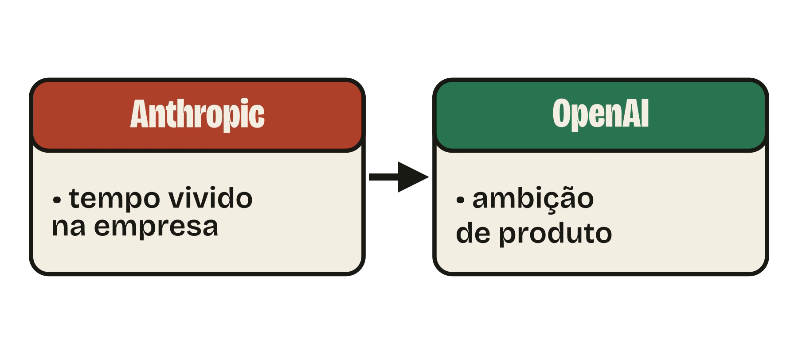
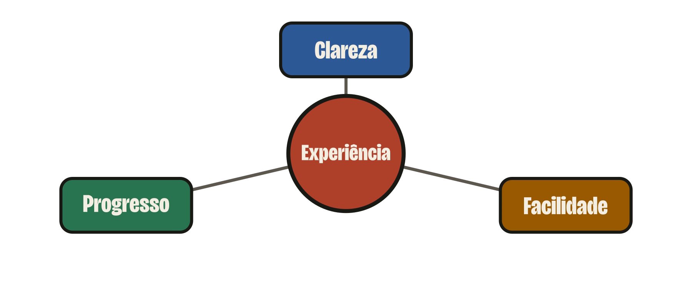

# De Claude Code à OpenAI, Thariq quer elevar a escala da IA

_2026-11-27 · noticia_

Thariq anunciou em 25 de novembro de 2026 que entrou para a OpenAI, depois de uma trajetória ligada à Anthropic e ao Claude Code. A meta declarada é construir produtos de IA para mais de 1 bilhão de pessoas, com a experiência de uso como prioridade. Ao longo desta apostila, você vai entender o que o anúncio estabelece, por que escala e usabilidade aparecem juntas e como separar metas de resultados. Também verá o contexto da mudança, os cuidados para interpretar os números e um caminho prático para aplicar essas ideias.

## O fato

_Thariq: da Anthropic para a OpenAI, em anúncio no X._

Em 25 de novembro de 2026, Thariq publicou no X que havia entrado para a OpenAI. A mensagem apresenta a mudança como uma continuação de sua trajetória em IA e declara a ambição de construir produtos para mais de 1 bilhão de pessoas.

Ao falar da Anthropic, ele diz que tem orgulho do tempo vivido na empresa e que continuará torcendo pelos antigos colegas. Também afirma que Anthropic e OpenAI têm papéis importantes no futuro. O anúncio reúne uma decisão pessoal, uma ambição de produto e uma prioridade de experiência.

Fonte: <https://x.com/trq212/status/2125675533761671405>

## Por que isso importa

Uma notícia sobre a entrada de um profissional em outra empresa ganha relevância quando o próprio anúncio liga essa escolha a uma meta de produto. Neste caso, a escala de público e a qualidade da interação aparecem como objetivos associados.

Para quem desenvolve ou acompanha produtos de IA, o anúncio oferece um recorte útil. O alcance depende de o trabalho chegar a muitas pessoas, e a experiência determina como essas pessoas encontram valor nas tarefas. A mudança de Thariq é o contexto; escala e usabilidade são os conceitos que ajudam a interpretá-la.

Fonte: <https://x.com/trq212/status/2125675533761671405>

## A decisão de contribuir na OpenAI

Thariq justifica a escolha ao dizer que sentiu que poderia contribuir pessoalmente mais com o esforço de levar IA ao mundo na OpenAI. A justificativa é individual e refere-se ao trabalho que ele espera realizar nessa nova etapa.

A mensagem descreve motivação, expectativa e ambição. O foco recai na contribuição que Thariq acredita poder oferecer. Essa leitura mantém a decisão no terreno das declarações feitas por ele, sem transformar a mudança em uma avaliação técnica de produtos ou empresas.

Fonte: <https://x.com/trq212/status/2125675533761671405>

## A meta de escala

Mais de 1 bilhão de pessoas é a dimensão de público associada à ambição de Thariq. O número descreve uma meta de construção de produtos de IA. Ele não representa uma contagem de usuários atuais, uma participação de mercado ou um prazo já concluído.

Em termos de produto, escala significa planejar para que uma experiência possa atingir muita gente. Isso coloca a clareza da interação ao lado do alcance: uma pessoa precisa entender o que fazer com a IA e perceber progresso na sua tarefa. A meta indica direção; os resultados de uso mostrariam o quanto dela foi alcançado.

Fonte: <https://x.com/trq212/status/2125675533761671405>

## A experiência de uso como prioridade

_Experiência de uso: clareza, facilidade de percorrer uma tarefa e sensação de progresso._

Thariq resume sua prioridade ao dizer que espera tornar a experiência de usar IA um pouco melhor. Experiência de uso reúne a clareza das instruções, a facilidade de percorrer uma tarefa e a sensação de progresso. É a parte da interação que a pessoa vive diretamente.

Quando o público pretendido é muito grande, pequenos obstáculos podem se repetir em muitas interações. Por isso, observar atrito ajuda a transformar uma intenção ampla em questões concretas de produto. A frase do anúncio estabelece uma prioridade para o trabalho e não apresenta uma métrica de melhoria.

Fonte: <https://x.com/trq212/status/2125675533761671405>

## A trajetória no Claude Code

O Claude Code aparece como a ligação anterior de Thariq com a Anthropic. A passagem por uma ferramenta de programação dá contexto à sua experiência com IA e ajuda a entender a ligação entre construção de ferramentas e produtos para um público amplo.

A página oficial do Claude Code é a referência para conhecer a ferramenta. Essa trajetória funciona como pano de fundo da notícia, sem transferir características do Claude Code para os produtos ou planos mencionados na OpenAI.

Fonte: <https://claude.com/product/claude-code>

## A circulação de pessoas e ideias

Thariq descreve a circulação de pessoas e ideias como uma força de Silicon Valley. O fluxo de profissionais significa que experiências de produto, maneiras de trabalhar e prioridades podem circular entre empresas.

Quando alguém muda de empresa, essa bagagem pode influenciar onde os esforços de IA se concentram e quais problemas recebem atenção. O resultado depende do trabalho realizado depois da mudança. O valor do conceito está em acompanhar essas conexões, sem presumir que uma contratação produz automaticamente um novo produto.

Fonte: <https://x.com/trq212/status/2125675533761671405>

## Os números

Os números do anúncio têm funções diferentes. A data localiza a declaração, a meta indica a ambição de produto e as visualizações medem a atenção à publicação. Cada medida precisa ser lida dentro do seu contexto.

- 25 de novembro de 2026: data da publicação do anúncio de Thariq no X.
- Mais de 1 bilhão de pessoas: dimensão do público que ele pretende alcançar com produtos de IA. É uma meta de trabalho, não uma contagem de usuários.
- 3,6 milhões de visualizações: total exibido na publicação consultada. Indica atenção ao post e não mede adoção de produtos, alcance único ou resultado da meta de público.

Fonte: <https://x.com/trq212/status/2125675533761671405>

## O que muda para você

Para quem acompanha notícias de IA, o anúncio oferece uma forma de ler intenções: identificar a decisão, a meta e a prioridade de experiência. Para quem constrói, a leitura útil é manter alcance e qualidade como critérios relacionados e distintos.

Exemplo: Imagine que uma equipe avalia uma ferramenta de IA para uma tarefa repetitiva. Ela pode começar definindo quem pretende atender e, em seguida, observar se as pessoas entendem a interação e conseguem avançar. A escala orienta o público; a experiência orienta a qualidade. O exercício aplica os dois eixos do anúncio e evita confundir ambição com uso real.

## O que fazer hoje

A leitura prática do anúncio começa pela identificação dos fatos e termina com a observação de uma interação real com IA.

1. No post original no X, localize as afirmações sobre a entrada na OpenAI, a contribuição pessoal e a meta de público. O resultado é uma leitura com os três fatos centrais separados das interpretações.
2. Na página oficial do Claude Code, leia a apresentação da ferramenta associada à trajetória de Thariq. O resultado é entender a referência anterior sem transferir características dela para os planos anunciados na OpenAI.
3. Em uma interação sua com IA, anote a tarefa, o ponto em que houve dificuldade e o que deixou a resposta mais clara. O resultado é transformar a prioridade de experiência em uma observação prática.
4. Ao planejar um projeto de IA, escreva separadamente o público pretendido e o padrão de experiência desejado. O resultado é acompanhar alcance e usabilidade sem tratar uma meta como adoção real.

Fonte: <https://x.com/trq212/status/2125675533761671405>

## O que conferir

A notícia fica mais útil quando cada afirmação permanece no seu devido escopo. Os principais cuidados envolvem a diferença entre meta e resultado, intenção e medição, e trajetória anterior e planos futuros.

- Meta de público: mais de 1 bilhão de pessoas descreve uma ambição de produto. O número não comprova alcance atual nem define uma data de conclusão.
- Experiência de uso: a intenção de melhorar o contato com IA indica uma prioridade. Uma avaliação de resultado exigiria observar tarefas, dificuldades e progresso.
- Mudança de empresa: a justificativa de Thariq é pessoal. Ela não descreve um organograma, um cronograma de lançamentos ou funcionalidades de produtos futuros.
- Claude Code: a associação à trajetória de Thariq dá contexto à notícia. Ela não estabelece uma relação técnica entre a ferramenta e os planos da OpenAI.
- Visualizações: os 3,6 milhões exibidos no post medem atenção à publicação. Eles não representam pessoas diferentes atingidas ou usuários de produtos de IA.
- Circulação de profissionais: a troca de pessoas e ideias pode influenciar prioridades de produto. O efeito concreto depende do trabalho realizado depois da mudança.

Fonte: <https://x.com/trq212/status/2125675533761671405>

## Glossário

- IA: campo que reúne sistemas capazes de apoiar tarefas como responder perguntas, gerar conteúdo e auxiliar decisões.
- Produto de IA: ferramenta ou serviço que aplica IA a uma tarefa para pessoas usuárias.
- Experiência de uso: conjunto de percepções de uma pessoa ao percorrer uma interação, incluindo clareza, facilidade e sensação de progresso.
- Escala: capacidade de um produto ou esforço de alcançar um público amplo.
- Atrito: dificuldade que interrompe ou torna mais trabalhoso o avanço em uma tarefa.
- Meta de alcance: dimensão de público que se pretende atingir, distinta da quantidade já alcançada.
- Adoção: uso efetivo de um produto pelas pessoas, que precisa ser observado em resultados de uso.
- Claude Code: ferramenta de programação citada na trajetória de Thariq e ligada à Anthropic.
- Anthropic: empresa citada no anúncio como parte da trajetória de Thariq.
- OpenAI: empresa para a qual Thariq anuncia sua entrada.
- Silicon Valley: região associada no anúncio à circulação de profissionais e ideias.

## Para onde ir depois

O próximo passo é aplicar o recorte do anúncio a uma interação real com IA e acompanhar as fontes oficiais mantendo os contextos separados.

- Use o post de Thariq como registro da decisão e das intenções declaradas.
- Use a página oficial do Claude Code para estudar a ferramenta ligada à trajetória anterior, mantendo-a separada dos planos da OpenAI.
- Pratique a observação de uma tarefa com IA: descreva o objetivo, o obstáculo e o sinal de progresso. O exercício desenvolve a leitura de experiência priorizada no anúncio.
- Ao acompanhar os próximos anúncios, separe meta de público, funcionalidade descrita e resultado medido. Essa prática ajuda a transformar notícias de IA em informação avaliável.

Fonte: <https://x.com/trq212/status/2125675533761671405>

## Além do vídeo

- O anúncio expressa admiração pela equipe da OpenAI e a intenção de trabalhar ao lado de amigos, além da meta de produto.
- Uma resposta de Thariq no mesmo dia comenta seu nível em WoW, assunto separado da mudança de empresa.
- A publicação exibe contadores adicionais de engajamento ao lado das visualizações.
