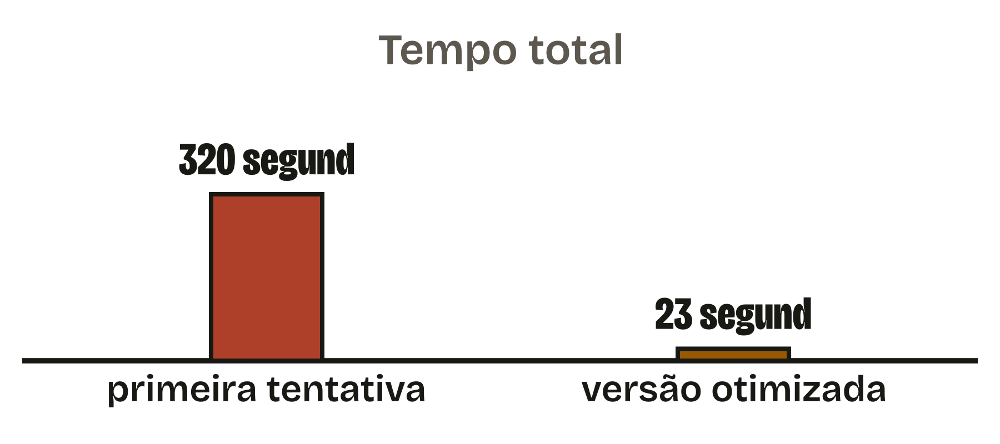
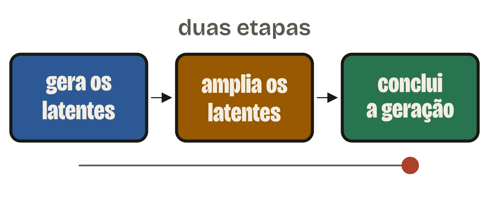
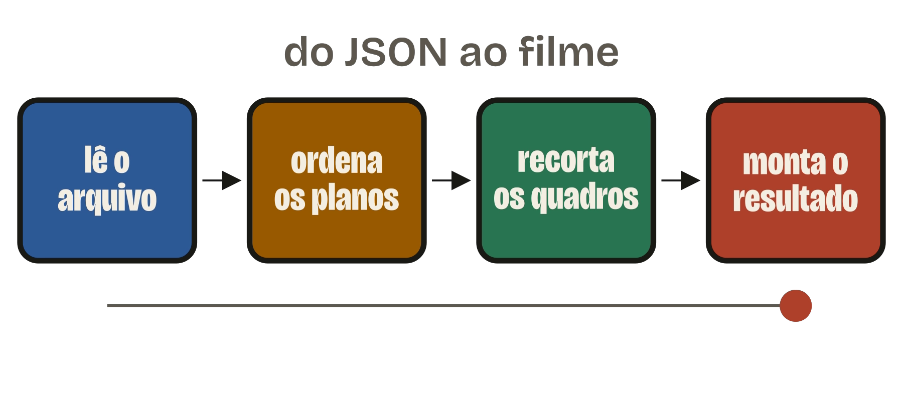

# Menos dependência de API de vídeo com LTX-2.5 e pesos públicos

_2026-11-27 · noticia_

O LTX-2.5 reúne geração de vídeo e áudio sincronizados e permite executar o pipeline na própria infraestrutura. Esta apostila explica como instalar o repositório, baixar os componentes, fazer a primeira geração e planejar planos conectados. Você também vai entender as licenças de código e pesos, os resultados do experimento no Trainium3 e as condições por trás dos tempos de geração. Ao final, terá critérios para operar o modelo como serviço interno e acompanhar continuidade, memória, fila e qualidade.

## O fato: LTX-2.5 e vídeo com áudio na própria infraestrutura

Em 27 de novembro de 2026, o Hugging Face publicou o experimento Taking Trainium3 to the Track: Generating Videos with LTX-2.5. A equipe teve acesso, por meio da parceria com a AWS, a uma máquina Trainium3 trn3.48xlarge com 64 NeuronCores. O teste usou o LTX-2.5, da Lightricks, com Diffusers para gerar clipes de 10 segundos com som. Com os modelos carregados, a versão otimizada levou de 22 a 23 segundos em metade da máquina, na resolução 2048×1024.

O LTX-2.5 é apresentado pela página oficial como um modelo de mundo aberto com pesos abertos, preparado para execução local e fine-tuning. Ele gera vídeo e áudio sincronizados a partir de entradas de texto, imagem ou vídeo. A possibilidade de montar o pipeline na própria infraestrutura transfere para a operação a hospedagem, os ajustes, o controle dos componentes e a qualidade de cada plano.

Fonte: <https://huggingface.co/blog/video-trainium3>

## Por que isso importa: controle da geração e da operação

Uma API de vídeo entrega a geração como serviço. Um pipeline próprio desloca parte desse controle para a infraestrutura de quem opera: os componentes ficam em um diretório local, o fluxo pode ser integrado ao sistema existente e a equipe passa a medir fila, memória, tempo de resposta e qualidade. Essa estrutura muda a cobrança e a responsabilidade pela execução, além de permitir escolher como os modelos são carregados e como os planos são encadeados.

O LTX-2.5 usa uma arquitetura DiT, sigla para Diffusion Transformer. Em linguagem simples, o transformer trabalha sobre representações latentes e refina progressivamente a informação ruidosa até produzir a saída. No caso deste modelo, vídeo e áudio fazem parte da mesma geração, o que permite dirigir imagem, movimento e som no mesmo prompt.

O experimento no Trainium3 mostra que o resultado depende da configuração completa. Resolução, número de núcleos, carregamento dos modelos, compilação, paralelismo e trabalho do hospedeiro aparecem no tempo final. Por isso, o número de 22 a 23 segundos descreve uma configuração específica, com os modelos já carregados, e serve como referência para aquele teste.

Fonte: <https://huggingface.co/Lightricks/LTX-2.5>

## O repositório oficial e a instalação

O repositório Lightricks/LTX-2 reúne inferência e treinamento LoRA. A inferência é o uso do modelo para gerar novas saídas; o treinamento LoRA permite adaptar o modelo ao fluxo de trabalho por meio de pesos adicionais. O repositório é a base para montar o pipeline local, e a operação do hardware e do software fica sob responsabilidade de quem executa.

A página do modelo recomenda Python maior ou igual a 3.12, CUDA maior ou igual a 12.7 e PyTorch na faixa 2.7. Os comandos abaixo clonam o projeto, entram na pasta e instalam as dependências. O extra natten é o backend mais rápido para o decoder de vídeo por difusão e funciona em Linux com CUDA. No Windows e no macOS, ele é ignorado automaticamente, e a decodificação usa Triton ou uma implementação eager.

```
git clone https://github.com/Lightricks/LTX-2.git
cd LTX-2
uv sync --extra natten
```

Fonte: <https://github.com/Lightricks/LTX-2>

## Licenças e acesso aos pesos

O código do repositório usa Apache-2.0. Os modelos têm licença própria, e o LTX-2.5 usa a LTX-2.x Community License. A licença do código não redefine as condições dos pesos: os termos do modelo se aplicam sempre que ele for usado, inclusive com o código do repositório.

Para entidades com receita anual abaixo de US$ 10 milhões, a página do modelo informa uso comercial e de produção sem custo sob a licença comunitária. Acima de US$ 10 milhões, o caminho indicado é um Paid Commercial Use Agreement. A receita é medida pela entidade inteira, incluindo subsidiárias e afiliadas sob controle comum. A transferência de fine-tunes pode exigir licença paga, conforme a LTX-2.x Community License.

O acesso aos pesos é controlado no Hugging Face. A página informa que é preciso concordar com o compartilhamento de informações da conta para liberar o modelo, incluindo possíveis usos em marketing e anúncios segmentados. Se o download retornar 401 ou 403, o repositório orienta aceitar os termos do modelo e entrar com um token Read. Em tokens de granulação fina, o escopo read gated repos precisa estar habilitado.

```
hf auth login
```

Fonte: <https://huggingface.co/Lightricks/LTX-2.5>

## Os componentes e o download dos pesos

O LTX-2.5 é distribuído em um pacote separado por componente, alinhado ao ComfyUI. Cada arquivo safetensors contém uma parte do modelo, e o pipeline recebe o caminho de cada componente. O download do Quick Start do repositório soma aproximadamente 66 GiB. A opção --local-dir preserva a estrutura de pastas do repositório, por isso os comandos de geração usam caminhos como diffusion_models/, text_encoders/ e vae/.

O transformer destilado é o ponto de partida rápido, com agenda fixa de 8 passos e CFG igual a 1. O transformer dev é o modelo completo, usado nos pipelines guiados de duas etapas. O encoder de texto é o Gemma 4 12B ajustado para LTX, com a projeção de texto incluída. A versão comum do Gemma 4 não substitui esse componente, porque o carregamento confere a versão gemma4-12b-ltx-v1 usada no treinamento.

- Transformer destilado: diffusion_models/ltx-2.5-22b-distilled-transformer-bf16.safetensors, usado pelo DistilledPipeline e pelo DFR.
- Transformer dev: diffusion_models/ltx-2.5-22b-dev-transformer-bf16.safetensors, usado pelos pipelines guiados de duas etapas.
- Encoder de texto: text_encoders/gemma4-12b-with-proj-ltx-2.5-bf16.safetensors, exigido por todos os pipelines.
- Video VAE de difusão: vae/ltx-2.5-video-vae-bf16.safetensors, com decodificação de maior qualidade e maior consumo de VRAM.
- Video VAE convolucional: vae/ltx-2.5-video-vae-conv-bf16.safetensors, uma alternativa mais leve e sem dependências extras.
- Audio VAE: vae/ltx-2.5-audio-vae-bf16.safetensors, necessário para gerar ou decodificar áudio.
- Spatial upscaler: latent_upscale_models/ltx-2.5-latent-spatial-upscaler-x2-bf16-1.0.safetensors, exigido pelo pipeline multiestágio.
- Duration head e temporal upscaler: componentes separados para duração automática e upscaling temporal, usados apenas nos fluxos correspondentes.

```
hf download Lightricks/LTX-2.5 \
    diffusion_models/ltx-2.5-22b-distilled-transformer-bf16.safetensors \
    text_encoders/gemma4-12b-with-proj-ltx-2.5-bf16.safetensors \
    vae/ltx-2.5-video-vae-bf16.safetensors \
    vae/ltx-2.5-audio-vae-bf16.safetensors \
    latent_upscale_models/ltx-2.5-latent-spatial-upscaler-x2-bf16-1.0.safetensors \
    --local-dir models/ltx-2.5
```

Fonte: <https://github.com/Lightricks/LTX-2>

## A primeira geração com o pipeline destilado

O DistilledPipeline é o ponto de partida rápido do repositório. O comando abaixo carrega os cinco componentes baixados, define 121 quadros, usa a semente 42 e grava o resultado em output.mp4. A semente controla a aleatoriedade inicial da geração e ajuda a repetir uma tentativa; o resultado final também depende do software, do hardware e da configuração usada.

O prompt do exemplo é longo e descreve pessoa, roupa, posição, expressão, câmera, luz, som e fala. Essa estrutura transforma o prompt em direção de cena. A página do modelo informa que o LTX-2.5 lida bem com descrições longas que combinam estilo, assunto, movimento, câmera, luz e som. O prompt enhancer pode expandir uma descrição curta, e o duration head opcional pode escolher a duração a partir do prompt.

A contagem de quadros precisa seguir o formato em que o resto da divisão por 8 é 1, como 1, 9, 17 e 121. Largura e altura precisam ser divisíveis por 32. O arquivo output.mp4 é o primeiro ponto de verificação: assista ao vídeo com som e confira se ações, enquadramento, voz e sincronização correspondem ao prompt.

```
uv run python -m ltx_pipelines.distilled \
    --transformer-path       models/ltx-2.5/diffusion_models/ltx-2.5-22b-distilled-transformer-bf16.safetensors \
    --text-encoder-path      models/ltx-2.5/text_encoders/gemma4-12b-with-proj-ltx-2.5-bf16.safetensors \
    --video-vae-path         models/ltx-2.5/vae/ltx-2.5-video-vae-bf16.safetensors \
    --audio-vae-path         models/ltx-2.5/vae/ltx-2.5-audio-vae-bf16.safetensors \
    --spatial-upsampler-path models/ltx-2.5/latent_upscale_models/ltx-2.5-latent-spatial-upscaler-x2-bf16-1.0.safetensors \
    --num-frames 121 \
    --seed 42 \
    --output-path output.mp4 \
    --prompt "A medium close-up shot features a Caucasian man with a beard, wearing a green and white baseball cap without any letters on the front, and a light blue shirt over a white t-shirt. He is positioned in the center of the frame, looking intently directly at the camera, his eyes focused on camera. His facial expression is one of deep concentration, with his brow slightly raised. As he looks straight at the camera, a quick sniff sound is heard, and then he speaks with a deep male voice and a satisfied tone, saying, 'I think it's so good.' The camera remains static throughout, maintaining a shallow depth of field, which keeps the man in sharp focus while the background is softly blurred, showing a beige wall behind him. After a brief pause, another short, audible sniff is heard. The man then continues to speak, his voice maintaining the same quality, as he states, 'So good. So good.' He elaborates further, emphasizing his point with a final statement, 'This got to be, it's got to be the best tool I've ever seen.'"
```

Fonte: <https://github.com/Lightricks/LTX-2>

## Prompt, planos e continuidade entre cenas

O prompt isolado descreve um plano, mas não mantém sozinho a identidade de um personagem ou o cenário entre planos. No experimento do Hugging Face, a entrada é uma lista JSON de planos, e cada plano tem name e prompt. Um seed opcional permite guardar a tentativa escolhida entre várias. Cada prompt funciona como um parágrafo de direção, com estilo, assunto, movimento, câmera, luz e som.

A continuidade usa duas chaves. Com from, o plano começa a partir dos últimos quadros de outro plano. O último quadro ajuda a preservar a aparência do personagem através do corte; os últimos 25 quadros correspondem a 1 segundo e também ajudam a continuar o movimento. Com to, o plano termina nos primeiros quadros de um plano posterior, preparando a entrada na cena seguinte.

Exemplo: no filme da foca, o plano iceberg é o momento de payoff e foi criado primeiro. O plano nap termina nos primeiros 9 quadros de iceberg, e shake começa nos últimos 25 quadros de iceberg. O plano dream foi feito separadamente, e um corte o liga ao restante. O encadeamento ajuda a manter foca, banco de gelo e iceberg, enquanto a montagem define a passagem entre as cenas.

```
[ { "name" : "dream" , "prompt" : "Style: cinematic, realistic, shallow depth of field. A plump seal ... is fast asleep on warm golden sand under palm trees ..." , "seed" : 3 } , { "name" : "nap" , "prompt" : "Style: cinematic, realistic, wide-angle lens. ... a plump grey seal is fast asleep on a small ice floe ..." , "seed" : 1 , "to" : { "shot" : "iceberg" , "frames" : 9 } } , { "name" : "iceberg" , "prompt" : "Style: cinematic, realistic, wide-angle lens. ... the whole iceberg slowly rolls over ... and washes over the seal. ..." } , { "name" : "shake" , "prompt" : "Style: cinematic, realistic, wide-angle lens. ... It slowly shakes its head and body ... and flops down on its belly on the floe, ..." , "from" : { "shot" : "iceberg" , "frames" : 25 } } ]
```

Fonte: <https://huggingface.co/blog/video-trainium3>

## O experimento no Trainium3

Fora da caixa, o modelo não rodava nos NeuronCores: o transformer não cabia em um núcleo, e o Diffusers não tinha um plano para dividi-lo. A primeira tentativa que executou usou o pipeline do cartão do modelo, com o transformer dividido em 4 núcleos e alguns ajustes. O clipe de 10 segundos levou 5 minutos e 20 segundos, e os NeuronCores computaram durante cerca de 45 segundos desse total. A resolução desejada ficou fora do alcance daquela configuração.

A versão otimizada combinou paralelismo tensorial e paralelismo de sequência. A configuração TP-4 × SP-8 usou 32 NeuronCores em um único clipe: os pesos foram divididos em 4 partes, uma faixa de cada camada por núcleo, e os tokens de vídeo foram divididos em 8 partes. O paralelismo tensorial foi imposto pela memória, porque o transformer não cabia em um núcleo, e ficou limitado pelos 32 cabeçotes de atenção. A divisão da sequência reduziu o grafo de cada núcleo e permitiu chegar a 2048×1024.

A maior economia no tempo total veio do hospedeiro. O experimento distribuiu o trabalho entre NeuronCores, CPUs, compilação, codificação do prompt, upsampling, decodificação e montagem. O resultado final, por isso, mede o pipeline inteiro, e o tempo de cálculo dentro dos NeuronCores é apenas uma parte dele.

Fonte: <https://huggingface.co/blog/video-trainium3>

## Os números do experimento



_320 segundos em 960×544 e 4 NeuronCores; 22 a 23 segundos em 2048×1024 e 32 NeuronCores._

Os números abaixo pertencem ao mesmo experimento com clipes de 10 segundos e som. A comparação muda resolução, quantidade de NeuronCores, distribuição do modelo e carregamento dos modelos ao mesmo tempo. O resultado descreve o ganho da configuração otimizada como um todo.

- 320 segundos: tempo total da primeira tentativa para um clipe de 10 segundos com som, em 960×544 e 4 NeuronCores. Desse total, cerca de 45 segundos foram cálculo nos NeuronCores.
- 22 a 23 segundos: tempo da versão otimizada para um clipe de 10 segundos com som, em 2048×1024 e 32 NeuronCores, com os modelos carregados. A resolução tem cerca de quatro vezes mais pixels que a primeira tentativa.
- 14 vezes: redução aproximada do tempo total entre a primeira tentativa e a versão otimizada, considerando todas as mudanças de configuração.
- 15 segundos: tempo de cálculo nos NeuronCores na versão otimizada, contra 45 segundos na primeira tentativa. O artigo registra 3 vezes de ganho no dispositivo com quatro vezes mais pixels e uma segunda etapa que a primeira tentativa não carregava.
- 280 segundos para 8 segundos: tempo do hospedeiro por clipe, uma redução de cerca de 35 vezes.
- Cerca de 3 minutos: tempo de carregamento dos modelos no experimento. O primeiro clipe levou 80 segundos. Os 22 a 23 segundos correspondem à operação com os modelos já carregados.
- 23,7 segundos: tempo anunciado para a API online do LTX gerar um clipe de 10 segundos em 1080p. O experimento de 22 a 23 segundos em 2048×1024 ficou cerca de um segundo abaixo dessa referência.
- 6,8 segundos: tempo anunciado para um clipe de 10 segundos em 720p em quatro GPUs B200. A claim não traz metodologia de medição e permanece separada da comparação direta com a API.

Fonte: <https://huggingface.co/blog/video-trainium3>

## O que foi otimizado no pipeline

O trabalho de otimização aconteceu no dispositivo e no hospedeiro. O dispositivo precisou de planos de execução, divisão de pesos e tokens, compilação por bloco e ajustes numéricos. O hospedeiro precisou evitar trabalho duplicado, disputa de threads, cópias lentas e codificação de padding.

Cada correção tem um resultado medido no artigo. Os valores mostram onde o tempo era gasto e ajudam a priorizar investigação em outra infraestrutura. Eles não garantem o mesmo ganho em hardware diferente, porque formas de grafo, compilador, memória e versões de biblioteca mudam o comportamento.

- Paralelismo tensorial: um plano e um processador de atenção permitiram que o transformer rodasse em 4 NeuronCores.
- Encoder de texto na CPU: fixar o pipeline no host e mover entradas e saídas do transformer evitou que encoder e transformer disputassem o mesmo dispositivo.
- Compilação por bloco: compile_repeated_blocks produziu saídas finitas e reduziu o tracing de 388 segundos para 18 segundos.
- GELU em fp32: o erro do transformer contra fp32 caiu de 0,297 para 0,158; a referência de CPU em bf16 ficou em 0,160.
- Paralelismo de sequência: dividir os tokens de vídeo em 8 partes, além das 4 partes dos pesos, levou a segunda etapa a 32 NeuronCores, a 3,0 segundos por passo.
- Timestep por token: embedar apenas dois timesteps e escolher um para cada token permitiu que um plano condicionado por quadros levasse tempo semelhante ao de um plano criado pelo prompt.
- Pipeline no rank 0: as demais ranks passaram a receber os argumentos de cada chamada, e a codificação do prompt caiu de 205 segundos para 7,5 segundos.
- Buffers de até 1 GiB: o empacotamento dos parâmetros reduziu a memória por núcleo de 22,96 GiB para 10,2 GiB.
- Sequência múltipla de 128 tokens: gerar em 1024×512, com 512 tokens por quadro e NEURON_LOGICAL_NC_CONFIG=2, reduziu o passo de 4,3 segundos para 3,0 segundos.
- Decodificação nos NeuronCores: dividir por quadros e passar ao rank 0 por memória compartilhada reduziu o decode em 2048×1024 de 357 segundos para 1,6 segundo.
- Cópia contígua: chamar .contiguous() antes de copiar uma fatia estratificada reduziu um passo em 16 núcleos de 5,6 segundos para 1,0 segundo.
- Threads do host: fixar as threads do rank 0 e limitar as demais reduziu a codificação do prompt de 7,4 segundos para 3,3 segundos e o passo da primeira etapa de 0,9 segundo para 0,6 segundo.
- Codificação apenas do prompt: retirar o padding reduziu a codificação de 3,4 segundos para 1,4 segundo.

```
NEURON_LOGICAL_NC_CONFIG=2
```

Fonte: <https://huggingface.co/blog/video-trainium3>

## Qualidade de produção com DFR e uso de memória

O DFR, Diffusion Fidelity Rendering, é o caminho de produção para texto e imagem em vídeo. Ele usa o mesmo transformer destilado do comando inicial, mais um IC-LoRA de detalhamento, quadros-chave adicionais gerados e uma passada espacial de detalhe. O repositório orienta não passar o transformer dev para esse fluxo. A expectativa é maior tempo de execução e maior uso de VRAM, com o mesmo estilo de prompt.

Os padrões do DFR são 1024×1536 a 24 fps. O modo UHD 4K usa 3840×2176, e não 2160. Os modos de upscaling temporal precisam do componente temporal correspondente. A página do modelo descreve o DFR como uma forma de distribuir computação conforme a complexidade da cena e o orçamento, renderizando mais detalhe onde ele é necessário.

Quando a memória da GPU limita a execução, o repositório aponta quantização e descarregamento para CPU ou disco. O Video VAE convolucional é outra opção mais leve, sem dependências extras. O decoder de difusão oferece maior qualidade, com decodificação mais longa e mais VRAM, e roda mais rápido com o extra natten.

```
hf download Lightricks/LTX-2.5-22b-IC-LoRA-Pixel-Spatial-Upscaler \
    ltx-2.5-22b-ic-lora-pixel-spatial-upscaler-x2-1.0.safetensors \
    --local-dir models/ltx-2.5/loras

uv run python -m ltx_pipelines.dfr_pipeline \
    --transformer-path       models/ltx-2.5/diffusion_models/ltx-2.5-22b-distilled-transformer-bf16.safetensors \
    --text-encoder-path      models/ltx-2.5/text_encoders/gemma4-12b-with-proj-ltx-2.5-bf16.safetensors \
    --video-vae-path         models/ltx-2.5/vae/ltx-2.5-video-vae-bf16.safetensors \
    --audio-vae-path         models/ltx-2.5/vae/ltx-2.5-audio-vae-bf16.safetensors \
    --detailing-lora         models/ltx-2.5/loras/ltx-2.5-22b-ic-lora-pixel-spatial-upscaler-x2-1.0.safetensors \
    --spatial-upsampler-path models/ltx-2.5/latent_upscale_models/ltx-2.5-latent-spatial-upscaler-x2-bf16-1.0.safetensors \
    --num-frames 121 \
    --seed 42 \
    --output-path output_dfr.mp4 \
    --prompt "A medium close-up shot features a Caucasian man with a beard, wearing a green and white baseball cap without any letters on the front, and a light blue shirt over a white t-shirt. He is positioned in the center of the frame, looking intently directly at the camera, his eyes focused on camera. His facial expression is one of deep concentration, with his brow slightly raised. As he looks straight at the camera, a quick sniff sound is heard, and then he speaks with a deep male voice and a satisfied tone, saying, 'I think it's so good.' The camera remains static throughout, maintaining a shallow depth of field, which keeps the man in sharp focus while the background is softly blurred, showing a beige wall behind him. After a brief pause, another short, audible sniff is heard. The man then continues to speak, his voice maintaining the same quality, as he states, 'So good. So good.' He elaborates further, emphasizing his point with a final statement, 'This got to be, it's got to be the best tool I've ever seen.'"
```

Fonte: <https://github.com/Lightricks/LTX-2>

## Diffusers: instalação e papéis dos pipelines



_fluxo de duas etapas: gera os latentes, amplia os latentes e conclui a geração._

O pacote Lightricks/LTX-2.5-Diffusers contém o mesmo modelo em uma embalagem própria para Diffusers. A página do modelo informa que o suporte ao LTX-2.5 ainda não estava em uma release do Diffusers e orienta instalar a versão principal do repositório. O comando abaixo copia exatamente essa instalação.

No fluxo de duas etapas, o primeiro estágio gera os latentes, o upsampler amplia os latentes espaciais em duas vezes e o segundo estágio conclui a geração antes da decodificação de vídeo e áudio. No experimento do artigo, a receita destilada usa 8 passos, seguidos do upsampling de latentes ×2 e mais 3 passos finais.

- LTX2Pipeline: cria um plano a partir do prompt.
- LTX2ConditionPipeline: cria planos que começam ou terminam em quadros de outro plano.
- LTX2LatentUpsamplePipeline: amplia os latentes espaciais antes da etapa final.

```
pip install git+https://github.com/huggingface/diffusers
```

Fonte: <https://huggingface.co/Lightricks/LTX-2.5>

## Como funciona na prática: do JSON ao filme



_Camada em Python lê o arquivo, ordena os planos, recorta os quadros e monta o resultado._

O experimento trata o filme como uma lista de planos em JSON. Uma camada de cerca de 160 linhas em Python lê o arquivo, ordena os planos para que cada quadro-chave exista antes do plano que precisa dele, recorta os quadros que serão entregues entre planos e monta o resultado. A mesma camada pode aparar trechos, desenhar legendas, equalizar o som e assemblar o filme.

Existem duas formas de construir a sequência. No modo straight ahead, cada plano continua o anterior, como no filme da raposa. No modo pose to pose, o plano-chave é criado primeiro; os planos anteriores terminam nos primeiros quadros dele, e os posteriores começam nos últimos. O filme da foca foi construído dessa forma, começando pelo iceberg.

O filme da cabra mostra outras operações da camada de montagem: dois planos foram aparados, e uma legenda foi desenhada sobre o plano de payoff. Essas etapas mostram que a geração dos planos é uma parte do filme; recorte, legenda, som e ordem de montagem também determinam o resultado final.

Fonte: <https://huggingface.co/blog/video-trainium3>

## O que muda para você: operar um serviço interno

Tratar o LTX-2.5 como serviço interno significa manter os processos necessários ativos, medir a fila e acompanhar memória e qualidade. O carregamento dos modelos tem um custo inicial, e mantê-los ativos evita repetir essa etapa. A primeira execução e as execuções seguintes precisam ser medidas separadamente para que o tempo de geração não esconda o tempo de carregamento.

Imagine que você quer duas cenas com o mesmo personagem e um movimento contínuo entre elas. Comece pelo plano-chave, defina os prompts com ação, câmera, luz e som, use from ou to para compartilhar quadros e mantenha o processo aquecido entre as tentativas. Depois, assista aos cortes e verifique identidade, movimento, voz e sincronização. O serviço interno dá controle sobre essas etapas, e a equipe responde pela hospedagem, pelos ajustes e pela qualidade de cada plano.

Fonte: <https://huggingface.co/blog/video-trainium3>

## O que fazer hoje

1. Antes de instalar, leia a Apache-2.0 e a LTX-2.x Community License no repositório oficial; o resultado é uma decisão explícita sobre uso comercial e transferência de fine-tunes.
2. No terminal, clone o repositório, entre na pasta e execute a instalação das dependências; o resultado é o ambiente pronto para os pipelines locais.
3. No Hugging Face, aceite os termos do modelo e autentique a conta; o resultado é acesso aos pesos com um token Read.
4. No terminal autenticado, baixe os componentes para models/ltx-2.5; o resultado são os arquivos nos caminhos esperados pelo pipeline.
5. Execute o comando do DistilledPipeline com o prompt de exemplo; o resultado é o arquivo output.mp4 para a primeira inspeção.
6. Assista ao arquivo com som e registre a primeira execução e a seguinte separadamente; o resultado é uma linha de base com tempo, memória, fila e qualidade observável.
7. Monte um JSON com dois planos e use from ou to para compartilhar quadros; o resultado é uma sequência que pode ser avaliada em termos de continuidade de personagem, cenário e movimento.

Fonte: <https://github.com/Lightricks/LTX-2>

## O que conferir antes de confiar no resultado

O tempo de 22 a 23 segundos vale para o experimento otimizado, com modelos carregados, 32 NeuronCores e resolução 2048×1024. A primeira tentativa levou 320 segundos, e o carregamento dos modelos levou cerca de 3 minutos. Essas medidas precisam acompanhar a configuração, o momento da execução e o tamanho da fila.

O artigo registra problemas que apareceram durante a operação: saída NaN em um tamanho de grafo, recompilação após mudanças no código rastreado e dificuldade para carregar o upsampler de latentes ao lado do transformer. A verificação no CPU antes do dispositivo ajudou a encontrar um problema numérico. Formas de grafo maiores podem falhar para carregar, e o formato da sequência influencia o kernel de atenção.

- Licenças: confirme separadamente as condições do código Apache-2.0 e dos pesos LTX-2.x, inclusive receita da entidade e transferência de fine-tunes.
- Acesso: o modelo exige concordância com os termos do Hugging Face, e erros 401 ou 403 indicam a necessidade de aceitar os termos e autenticar com token Read.
- Aquecimento: separe tempo de carregamento, primeiro clipe e clipes seguintes para medir o serviço com precisão.
- Benchmark: resolução, número de núcleos, paralelismo e hardware mudaram juntos; o ganho de 14 vezes descreve esse conjunto.
- Compilação: na versão usada no experimento, editar uma operação rastreada podia provocar recompilação de até 30 minutos por grafo. O problema foi corrigido.
- Estabilidade: saídas NaN e falhas de carregamento de grafo exigem investigação antes de colocar o pipeline em produção.
- Compatibilidade: os arquivos *-comfy-int8-convrot.safetensors são exclusivos do ComfyUI e não são carregados pelo caminho PyTorch do ltx-pipelines. O Gemma 4 comum também não substitui o encoder ajustado para LTX.
- Dimensões: a contagem de quadros deve seguir o formato 1, 9, 17 e 121, entre outros; largura e altura precisam ser divisíveis por 32.
- Continuidade: prompts isolados não preservam sozinhos personagem e cenário; use quadros compartilhados e avalie os cortes.
- Fluxos: a geração multishot nativa anunciada pelo modelo e o encadeamento explícito de quadros no Diffusers são caminhos distintos, com resultados que precisam ser observados no fluxo escolhido.
- Revisão humana: confira voz, sincronização, identidade, movimento, legenda e cortes antes de publicar.

Fonte: <https://huggingface.co/blog/video-trainium3>

## Glossário

- API: serviço que recebe uma solicitação e executa a geração sem exigir a operação local do modelo.
- DiT: Diffusion Transformer, arquitetura que usa um transformer para refinar representações ruidosas até gerar a saída.
- Pesos: parâmetros aprendidos no treinamento e armazenados nos arquivos do modelo.
- Inferência: uso de um modelo treinado para produzir uma nova saída.
- LoRA: adaptação de baixo posto que adiciona pesos treináveis menores ao modelo base.
- VAE: rede que comprime dados em uma representação latente e ajuda a reconstruir a saída.
- Latente: representação interna compacta usada durante a geração, antes da decodificação.
- Upscaler espacial: componente que amplia a resolução espacial dos latentes.
- Upscaler temporal: componente separado que amplia a dimensão temporal.
- Seed: semente numérica usada para controlar a aleatoriedade inicial de uma tentativa.
- Prompt: descrição que dirige estilo, assunto, ação, câmera, luz e som da cena.
- Plano ou take: uma unidade de filmagem com início, movimento e fim definidos.
- From: conexão em que um plano começa a partir dos últimos quadros de outro.
- To: conexão em que um plano termina nos primeiros quadros de outro.
- Paralelismo tensorial: divisão dos pesos e do trabalho do transformer entre vários núcleos.
- Paralelismo de sequência: divisão dos tokens de vídeo entre vários núcleos para reduzir o trabalho de cada um.
- NeuronCore: unidade de processamento usada nas máquinas Trainium.
- Host: hospedeiro que executa CPU, memória, sistema operacional e partes do pipeline fora dos aceleradores.
- Rank: processo associado a um núcleo ou posição na execução distribuída.
- Modelo carregado ou aquecido: modelo já carregado na memória e pronto para processar novas solicitações.
- Fila: conjunto de solicitações aguardando execução.
- NaN: valor numérico inválido que pode indicar falha no cálculo.
- bf16 e fp32: formatos numéricos com diferentes precisões e consumo de memória.
- CFG: classifier-free guidance, controle da influência do prompt durante a geração por difusão.
- Safetensors: formato de arquivo usado para armazenar os tensores do modelo.

## Para onde ir depois

Depois da primeira execução, o próximo passo é transformar o pipeline em uma rotina medida. Pratique com o comando destilado, avalie a saída com áudio e evolua para sequências conectadas antes de aumentar a complexidade da produção.

- Pratique com o DistilledPipeline e compare a primeira execução com as seguintes, registrando duração, memória e fila.
- Monte uma sequência com dois planos e teste from e to para observar a continuidade de personagem, cenário e movimento.
- Teste o DFR quando precisar de mais detalhe e meça separadamente tempo de execução e uso de VRAM.
- Use o pacote Diffusers para transformar o JSON de planos em um filme, incluindo recorte, legenda, equalização de som e montagem.
- Mantenha uma rotina de revisão da saída com vídeo e áudio antes de integrar o serviço ao fluxo de produção.

Fonte: <https://github.com/Lightricks/LTX-2>

## Além do vídeo

- O repositório oferece templates oficiais de workflow para ComfyUI.
- O modelo inclui variantes NVFP4 para ComfyUI e para ltx-pipelines em Blackwell.
- O artigo identifica diffusers#15420 como correção aberta para os pipelines LTX-2 e diffusers#14725 como proposta de unificar paralelismo tensorial e de contexto.
