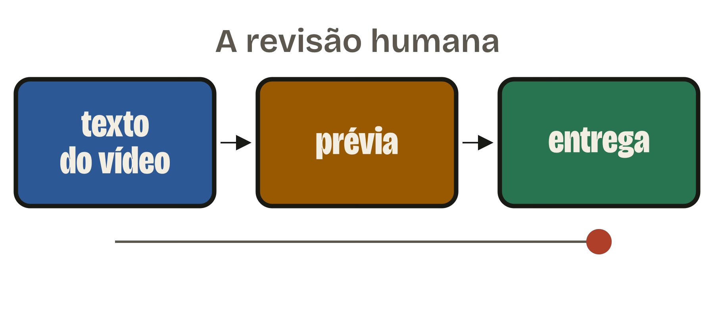
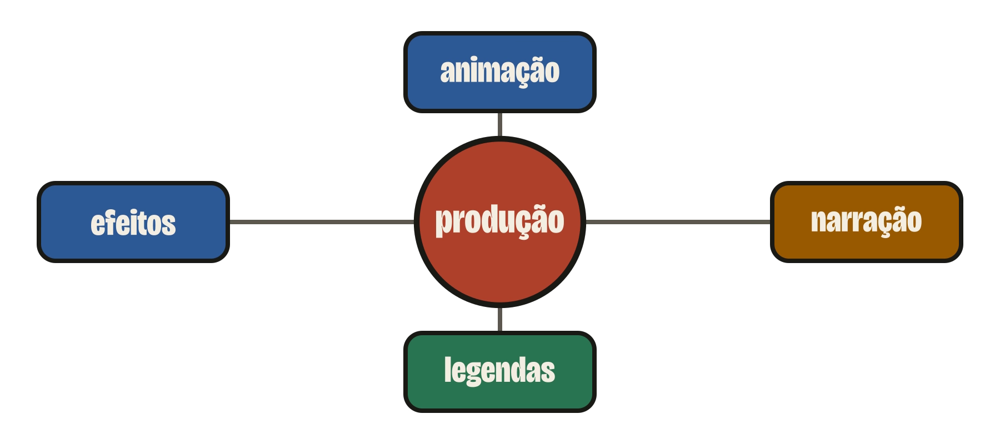
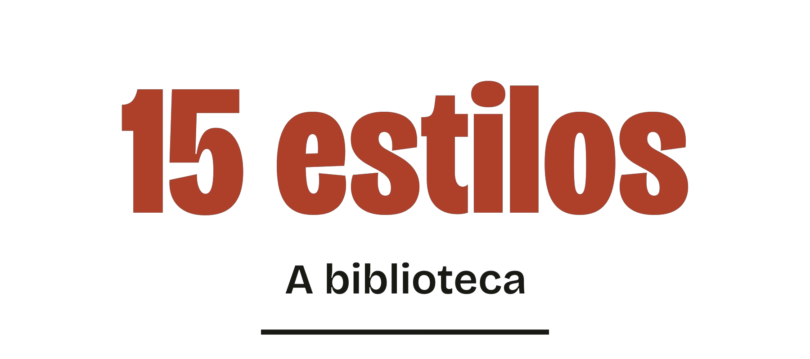

# Pare de pagar 50 dólares em vídeo sem rosto

_2026-11-27 · noticia_

Aprenda como o Stickman Video Director organiza a criação de vídeos animados de bonequinho palito a partir de um roteiro enviado ao agente. Você vai entender o papel da skill, as etapas de aprovação e o que acompanha a animação. Também saberá como avaliar os estilos visuais e por que o modo de produção interfere nos custos. Ao terminar, terá critérios para revisar a prévia e decidir se ela atende ao seu roteiro antes da entrega.

## O fato

Stickman Video Director é uma skill gratuita e de código aberto para produzir animações de bonequinho palito com ajuda de um agente de IA. A proposta é partir de uma ideia ou de um roteiro e conduzir a produção até um vídeo com animação, narração, legendas e efeitos sonoros.

No Codex, depois da instalação da skill, você envia uma mensagem com seu roteiro para começar. O agente apresenta o texto do vídeo e uma prévia para aprovação antes de entregar o vídeo pronto. Esse fluxo dá a você a oportunidade de avaliar a direção da produção enquanto ainda há uma etapa de revisão.

Fonte: <https://github.com/kaomei/stickman-video-director/blob/main/README.pt-BR.md>

## Por que isso importa

Um vídeo sem rosto permite apresentar uma história ou explicar uma ideia sem que o apresentador apareça na imagem. Nesse formato, a animação precisa ajudar o público a acompanhar o que a voz está dizendo. O desenho pode ser simples, mas a relação entre cena e fala continua sendo importante.

A proposta do Stickman Video Director reúne partes dessa produção em um fluxo conduzido pelo agente. Você fornece o texto, avalia a versão apresentada e aprova uma prévia. A produção também inclui os elementos de áudio e texto que acompanham a animação.

Uma skill é um conjunto de orientações que prepara o agente para uma tarefa. Aqui, a tarefa é conduzir a criação do vídeo. Para quem está começando, isso organiza o trabalho em torno de um pedido inicial e de momentos de aprovação.

Fonte: <https://github.com/kaomei/stickman-video-director/blob/main/README.pt-BR.md>

## Uma mensagem inicia a produção

A mensagem com o texto do vídeo é o ponto de partida do trabalho. Depois que a skill está instalada, o agente recebe esse texto e conduz a produção a partir do pedido. O texto do vídeo define o conteúdo que será apresentado na animação.

A expressão "uma mensagem" descreve a entrada inicial. O processo também tem aprovações: você recebe o texto do vídeo e uma prévia antes da entrega. Reserve atenção para essas etapas, porque elas permitem avaliar como o agente interpretou o texto.

Exemplo: você tem um roteiro para explicar um conceito de IA sem aparecer. Ao enviar esse texto, inicia a produção. Quando o agente apresentar o texto do vídeo e a prévia, observe se a explicação continua compreensível e se as cenas ajudam a acompanhar a fala.

Fonte: <https://github.com/kaomei/stickman-video-director/blob/main/README.pt-BR.md>

## O roteiro e a prévia passam por você

_O texto do vídeo e a prévia passam por aprovação antes da entrega._

Ao aprovar o texto do vídeo, você pode avaliar o conteúdo que será usado na produção. Leia o texto apresentado pelo agente e compare com a ideia que você quer comunicar. Observe a sequência da explicação e se o sentido das falas foi preservado.

A prévia permite julgar a direção visual antes da entrega. Na prévia, você pode avaliar se o estilo combina com o assunto e se a animação ajuda a entender o texto do vídeo. Essa avaliação é especialmente útil quando o visual escolhido tem uma ambientação marcante.

A revisão humana faz parte desse fluxo. Ao aprovar, considere o conteúdo e a forma como ele aparece na tela. Um roteiro compreensível na leitura também precisa funcionar quando ganha imagens, voz e ritmo.

Fonte: <https://github.com/kaomei/stickman-video-director/blob/main/README.pt-BR.md>

## O que acompanha a animação

_A produção reúne animação, narração, legendas e efeitos sonoros sincronizados._

A produção reúne bonequinhos animados, narração, legendas e efeitos sonoros sincronizados. Cada elemento tem uma função na apresentação: a voz conduz a fala, as legendas permitem acompanhar o texto na tela e os efeitos sonoros acompanham os acontecimentos da animação.

Sincronização é a correspondência de tempo entre esses elementos. Uma legenda precisa acompanhar a fala a que se refere. Um efeito sonoro precisa fazer sentido no momento em que aparece. Ao avaliar o vídeo, observe essa relação entre o que você vê e o que ouve.

Exemplo: em uma animação que explica uma ideia de IA, acompanhe uma fala enquanto observa a cena e a legenda. Avalie se os elementos tratam da mesma parte da explicação e se o som ajuda a acompanhar o que acontece.

Fonte: <https://github.com/kaomei/stickman-video-director/blob/main/README.pt-BR.md>

## Os estilos visuais

_A biblioteca inclui 15 estilos visuais para apresentar roteiros com bonecos de palito._

A biblioteca inclui 15 estilos visuais. Entre os exemplos estão preto e branco clássico, caverna pré-histórica, TV retrô, suspense de sobrevivência e história aconchegante. Essas opções permitem avaliar diferentes maneiras de apresentar um roteiro com bonecos de palito.

O estilo define a aparência e a ambientação da animação. Isso interfere na leitura do vídeo: um cenário de caverna e uma apresentação com aparência de televisão retrô criam contextos visuais diferentes para a mesma fala. Escolha pensando no assunto e no tom que você quer transmitir.

Exemplo: imagine que seu roteiro tenha um tom acolhedor. O estilo de história aconchegante pode ser uma opção para avaliar na prévia. A decisão deve considerar como essa aparência funciona com as cenas e as falas do seu vídeo.

Fonte: <https://github.com/kaomei/stickman-video-director/blob/main/README.pt-BR.md>

## Como o modo código entra no custo

No modo código, o próprio agente faz a animação usando a assinatura que você já paga. Nesse modo, a animação ocorre sem gastar créditos de gerador de vídeo. Essa condição está ligada à forma escolhida para produzir.

Créditos de gerador de vídeo são unidades de uso associadas à geração de vídeo. A diferença prática apresentada pelo modo código é usar o trabalho do agente na animação, com a assinatura entrando na conta da produção.

A gratuidade da skill e o custo de uso do agente são aspectos diferentes. Para avaliar a economia, considere o modo escolhido e a assinatura utilizada. A condição de não gastar créditos de gerador de vídeo se aplica ao modo código.

Fonte: <https://github.com/kaomei/stickman-video-director/blob/main/README.pt-BR.md>

## O que significa ser código aberto

O Stickman Video Director é apresentado como um projeto de código aberto, com os métodos compartilhados gratuitamente. O repositório no GitHub reúne o projeto, e o README em português apresenta sua proposta de transformar uma ideia em um vídeo com visual consistente.

Um repositório é o espaço que reúne os arquivos e a documentação de um projeto. O README é sua página de apresentação. Para quem está conhecendo a ferramenta, ele ajuda a entender o objetivo do projeto e sua biblioteca de estilos.

Fonte: <https://github.com/kaomei/stickman-video-director/blob/main/README.pt-BR.md>

## Os números

Os números citados tratam de coisas diferentes: uma referência de gasto mensal, a quantidade de estilos e a atenção recebida no GitHub. Separar esses significados ajuda a avaliar a proposta sem transformar popularidade em prova de qualidade ou gratuidade em promessa de custo total.

- 50 dólares por mês é a referência de gasto com aplicativo de vídeo sem rosto usada na apresentação da proposta. Esse valor não determina a economia de cada pessoa, que depende do modo de produção escolhido.
- 15 estilos é a quantidade de opções visuais apresentada para a biblioteca. Esse número indica variedade de aparência; a adequação ao seu roteiro deve ser avaliada na prévia.
- 7,7 mil estrelas é a contagem citada para o repositório no GitHub. Ela mostra atenção ao projeto. O resultado visual do seu vídeo deve ser julgado pela prévia.

Fonte: <https://github.com/kaomei/stickman-video-director/blob/main/README.pt-BR.md>

## O que muda para você

Exemplo: você quer explicar um assunto de IA em um vídeo sem aparecer e já tem o texto do vídeo escrito. Com a skill instalada no Codex, envia esse texto em uma mensagem para iniciar o trabalho. O agente apresenta o texto do vídeo e uma prévia para sua aprovação.

Nesse momento, sua tarefa é avaliar se a produção comunica a ideia. Leia o texto do vídeo apresentado, observe a aparência da animação e considere se o estilo combina com a explicação. A prévia dá uma base visual para essa decisão.

A escolha do modo de produção também faz parte da avaliação. Se você usar o modo código, a animação utiliza a assinatura do agente sem gastar créditos de gerador de vídeo. Considere essa condição junto com a adequação visual antes de aprovar.

Fonte: <https://github.com/kaomei/stickman-video-director/blob/main/README.pt-BR.md>

## O que fazer hoje

Depois da instalação da skill no Codex, use o fluxo de pedido e aprovação para avaliar uma produção com o seu roteiro.

1. No Codex com a skill instalada, envie uma mensagem com seu roteiro para iniciar a produção conduzida pelo agente.
2. Quando o agente apresentar o texto do vídeo, leia e avalie se ele expressa a ideia que você quer comunicar. Aprove quando o conteúdo estiver adequado.
3. Na prévia apresentada pelo agente, avalie a direção da animação e se o estilo serve ao texto do vídeo. Aprove quando a proposta visual atender ao que você pretende apresentar.
4. Na escolha do modo de produção, considere os créditos envolvidos. Se escolher o modo código, a animação usará a assinatura do agente sem gastar créditos de gerador de vídeo.

Fonte: <https://github.com/kaomei/stickman-video-director/blob/main/README.pt-BR.md>

## O que conferir

A aprovação merece a mesma atenção que o pedido inicial. Use o texto do vídeo apresentado e a prévia para decidir sobre conteúdo e direção visual. Na entrega, observe também como os elementos da produção funcionam juntos.

- Confira se o texto do vídeo apresentado pelo agente preserva o sentido da explicação que você quer publicar.
- Avalie na prévia se o estilo visual combina com o assunto e ajuda a acompanhar as falas.
- Ao assistir ao vídeo entregue, observe se narração, legendas e efeitos sonoros acompanham os momentos correspondentes da animação.
- Considere a assinatura do agente ao avaliar os custos. A skill gratuita utiliza essa assinatura no modo código.
- Mantenha a condição de não gastar créditos de gerador de vídeo vinculada ao modo código.
- Use a prévia para julgar a aparência do vídeo. A contagem de estrelas indica atenção ao repositório.

Fonte: <https://github.com/kaomei/stickman-video-director/blob/main/README.pt-BR.md>

## Glossário

- Skill: conjunto de orientações que prepara um agente para realizar uma tarefa.
- Agente de IA: sistema que recebe um pedido e conduz as etapas de uma tarefa.
- Vídeo sem rosto: formato em que o apresentador não precisa aparecer na imagem.
- Roteiro: texto que organiza o conteúdo a ser apresentado no vídeo.
- Prévia: apresentação antecipada que permite avaliar a direção da produção antes da entrega.
- Narração: voz que apresenta as falas do vídeo.
- Sincronização: correspondência de tempo entre elementos como imagem, fala, legenda e som.
- Estilo visual: conjunto de escolhas que define a aparência e a ambientação da animação.
- Modo código: forma de produção em que o próprio agente faz a animação usando sua assinatura.
- Créditos de gerador de vídeo: unidades de uso associadas à geração de vídeo.
- Código aberto: modelo em que o código do projeto fica disponível para consulta.
- Repositório: espaço que reúne os arquivos e a documentação de um projeto.
- README: documento de apresentação de um projeto.
- Estrelas no GitHub: marcações que usuários atribuem a um repositório e que indicam atenção ao projeto.

## Para onde ir depois

Use um roteiro que você queira transformar em animação e pratique a avaliação nas etapas de aprovação. Primeiro, julgue se o texto comunica a ideia. Depois, use a prévia para decidir se a direção visual funciona com a explicação.

Ao receber o vídeo, acompanhe a relação entre narração, legendas, efeitos e cenas. Essa leitura ajuda a avaliar a produção como o público a verá. Nas próximas produções, mantenha a escolha do estilo e do modo de animação ligada ao que o texto do vídeo precisa comunicar e aos custos envolvidos.

Fonte: <https://github.com/kaomei/stickman-video-director/blob/main/README.pt-BR.md>
