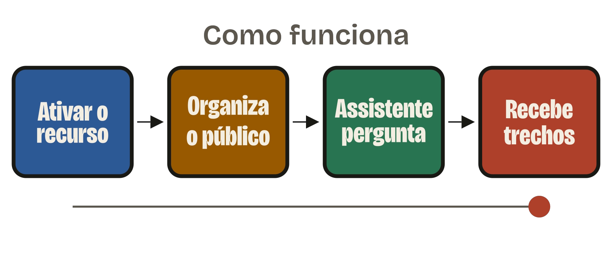
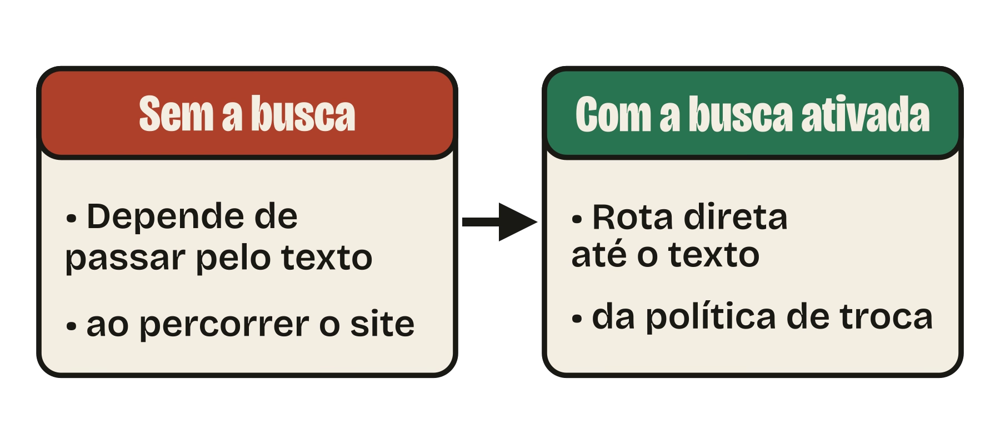

# Search for Agents da Cloudflare está no plano gratuito

_2026-11-27 · noticia_

A Cloudflare lançou o Search for Agents, uma busca que organiza o conteúdo público do seu domínio e devolve trechos para assistentes de IA responderem com base no que o site publica. O recurso está em beta, disponível no plano gratuito e nos pagos, para sites gerenciados pela Cloudflare. Esta apostila explica o problema que ele resolve, como ele funciona, quais são os limites e como medir, antes de qualquer configuração, se as páginas do seu site respondem às dúvidas que chegam antes da compra. Ao fim, você saberá aplicar um teste simples com três perguntas e identificar o que precisa ser esclarecido no site.

## O fato

A Cloudflare lançou o Search for Agents, uma busca que assistentes de IA podem descobrir e consultar no seu domínio. Quando o recurso é ativado, ele organiza o conteúdo público do site e devolve trechos que ajudam o assistente a responder.

O recurso está em beta e vale para sites gerenciados pela Cloudflare. Está disponível no plano gratuito e nos planos pagos, dentro dos limites do Cloudflare AI Search. A busca respeita os controles de acesso do domínio.

Fonte: <https://blog.cloudflare.com/search-for-agents/>

## Por que isso importa

Imagine uma loja com a política de troca bem escrita e publicada. Mesmo assim, um assistente de IA pode percorrer as páginas e responder sem encontrar a regra. O texto está correto, e o que falta é o caminho até ele.

Quando o assistente precisa vasculhar página por página, a chance de passar pela informação sem usá-la existe. A ideia do Search for Agents é encurtar esse caminho: em vez de procurar em tudo, o assistente consulta uma busca própria do domínio e recebe os trechos relevantes.

Para quem opera uma loja ou um site de serviços, isso importa porque muitas dúvidas chegam antes da compra: prazo, troca, preço. Se o assistente não encontra a resposta, o cliente fica sem ela no momento em que decide.

Fonte: <https://blog.cloudflare.com/search-for-agents/>

## Como o Search for Agents funciona



_O recurso organiza o conteúdo público e devolve trechos relevantes ao assistente._

O Search for Agents funciona como um índice do seu domínio feito para assistentes. Ao ativar o recurso, ele organiza o que é público no site. Quando o assistente faz uma pergunta, recebe trechos relevantes em vez de percorrer as páginas uma a uma.

A busca respeita os controles de acesso do domínio. Isso significa que o recurso trabalha com o conteúdo público, e não abre o que está protegido.

A documentação oficial do recurso está em developers.cloudflare.com/ai-search/how-to/search-for-agents, e a página geral do produto está em developers.cloudflare.com/ai-search/.

Fonte: <https://developers.cloudflare.com/ai-search/how-to/search-for-agents/>

## O limite: a qualidade depende do seu site

A busca não escreve a política por você. Se o site publica uma regra vaga, o assistente devolve uma resposta vaga. A qualidade final depende de duas coisas: o que você publicou e como o assistente usa os trechos que recebe.

Uma ferramenta de busca ajuda a achar a informação, mas só encontra o que existe. Por isso, revisar o conteúdo publicado continua sendo parte do trabalho.

Fonte: <https://blog.cloudflare.com/search-for-agents/>

## Onde funciona e quanto custa para começar

O Search for Agents está em beta para sites gerenciados pela Cloudflare. Funciona no plano gratuito e nos pagos, dentro dos limites do Cloudflare AI Search. Quem já mantém o domínio na Cloudflare consegue testar sem trocar de plano.

Os limites e preços do AI Search ficam em developers.cloudflare.com/ai-search/platform/limits-pricing/. Consulte essa página para saber até onde o plano gratuito alcança no seu caso.

Fonte: <https://developers.cloudflare.com/ai-search/platform/limits-pricing/>

## O que muda para você



_Com a busca ativada, o assistente tem rota direta até a política de troca._

Se uma loja tem a política de troca bem escrita, o assistente ganha um caminho para encontrá-la. A resposta continua dependendo das informações que você publicou e de como o assistente usa essas fontes.

Exemplo: uma loja publica a política de troca em uma página própria. Com a busca ativada, um assistente que recebe a pergunta "posso trocar o produto?" tem uma rota direta até esse texto, em vez de depender de passar por ele ao percorrer o site. Se a página disser apenas "aceitamos trocas em condições especiais", a resposta também será vaga: o caminho melhorou, o conteúdo não.

Fonte: <https://blog.cloudflare.com/search-for-agents/>

## O que fazer hoje

Este teste mede o seu site antes de qualquer configuração. Ele não exige ativar o Search for Agents.

1. Escolha três dúvidas que aparecem antes da compra. Resultado esperado: uma lista curta de perguntas reais dos seus clientes.
2. Copie o texto das páginas públicas que deveriam responder a essas dúvidas e cole no chat de um assistente de IA. Resultado esperado: o assistente tem diante de si apenas o que o site publica.
3. Envie o prompt da seção seguinte. Resultado esperado: uma tabela com pergunta, resposta e a frase da página que comprova a resposta.
4. Leia as linhas marcadas com "Falta no site". Resultado esperado: uma lista do que vale esclarecer nas páginas.

## Prompt do teste

Use este prompt depois de colar as páginas públicas no chat.

```
Monte uma tabela com pergunta, resposta e frase da página que comprova a resposta. Escreva ‘Falta no site’ quando a informação não estiver no material.
```

## O que conferir

O teste usa só o texto que você colou. Se uma página não foi colada, a IA vai marcar que falta, mesmo que a informação exista em outro lugar do site. Confira se as páginas certas estavam incluídas antes de concluir que alguma informação falta.

Verifique também se a frase apontada como prova está mesmo na página. Assistente de IA pode errar, e a revisão humana continua necessária.

- Confirme que o recurso está em beta e que vale para sites gerenciados pela Cloudflare.
- Consulte os limites do Cloudflare AI Search antes de depender do plano gratuito.
- Lembre que a busca respeita os controles de acesso do domínio e trabalha com conteúdo público.
- Lembre que a resposta depende do que você publicou e de como o assistente usa os trechos.

Fonte: <https://developers.cloudflare.com/ai-search/platform/limits-pricing/>

## Glossário

- Assistente de IA: programa de inteligência artificial que responde perguntas e executa tarefas a partir do que encontra.
- Search for Agents: busca da Cloudflare que organiza o conteúdo público de um domínio e devolve trechos para assistentes de IA.
- Cloudflare AI Search: produto da Cloudflare cujos limites valem para o Search for Agents.
- Beta: fase de lançamento em que o recurso ainda está em teste e pode mudar.
- Domínio: o endereço do site, como o da sua loja.
- Controles de acesso: regras que definem o que é público e o que é protegido em um site.

## Para onde ir depois

Escolha uma pergunta que seu cliente faz toda semana e confira se o site a responde com clareza. Assistente de IA só cita o que está publicado, então a regra de troca precisa estar escrita onde ele alcança.

- Leia o anúncio oficial: https://blog.cloudflare.com/search-for-agents/
- Leia a documentação do Search for Agents: https://developers.cloudflare.com/ai-search/how-to/search-for-agents/
- Veja a página do Cloudflare AI Search: https://developers.cloudflare.com/ai-search/
- Confira limites e preços: https://developers.cloudflare.com/ai-search/platform/limits-pricing/

Fonte: <https://developers.cloudflare.com/ai-search/>

## Além do vídeo

- Google começou a liberar uma conexão oficial para agentes usarem Gmail, Drive, Planilhas e Agenda, com limite de acessos, confirmação em ações sensíveis e registro do que foi feito. A liberação geral é gradual, em até duas semanas, e a cobrança por excedentes no nível de maior volume começa em abril de 2027.
- O Niji 8, modelo de ilustração do Midjourney, trouxe um modo de edição que usa a imagem de uma personagem como referência para mudar pose e cenário. Está disponível no site e no Discord para assinantes do Midjourney.
- O Tidal vai rejeitar novos envios e remover faixas identificadas como inteiramente geradas por IA a partir de 9 de dezembro. Produções que usam IA como apoio continuam permitidas.
- A Anthropic relatou que o Claude ajudou a reescrever o sistema que recebe pedidos de outros programas, e que a equipe comparou as versões em situações reais antes de liberar a nova.
- Teste de atendimento antes de conectar o WhatsApp: separar uma política fictícia e seis mensagens, pedir assunto, o que já se sabe, o que falta e a próxima ação, pedir a frase da política que sustenta a resposta e repetir com a ordem das palavras trocada.
