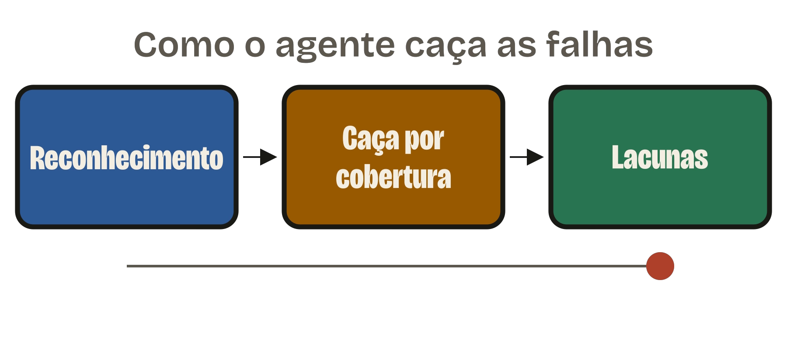
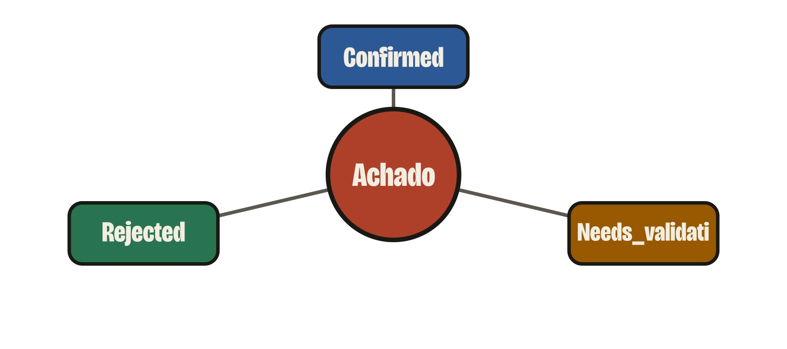
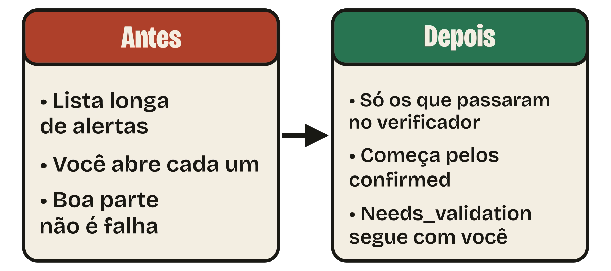

# Skill da Cloudflare chega quase a 37 mil estrelas no mês

_2026-11-27 · noticia_

A Security Audit Skill, da Cloudflare, é uma skill para agentes de código que faz auditoria de segurança em fases. Um agente procura falhas no código, e depois um agente separado tenta provar que cada achado está errado. Só o que resiste a esse teste entra no relatório. Ao ler, você entende como esse processo funciona, instala a skill com o comando do repositório oficial, pede a auditoria no Claude Code e sabe o que conferir antes de confiar no resultado.

## O fato

A Security Audit Skill, da Cloudflare, está entre os repositórios de Claude que mais ganharam estrelas no GitHub neste mês. No ranking de 24/11, ela aparece em segundo lugar, com quase 37 mil estrelas no mês.

Estrela, no GitHub, é a marca que as pessoas deixam para dizer que gostaram de um projeto e querem acompanhá-lo. Ela mostra interesse, não diz se a ferramenta funciona bem. Para saber isso, vale olhar o que a skill faz e como ela foi desenhada.

Segundo o README do repositório oficial, a skill transforma o agente de código em um auditor de segurança. Ela organiza a auditoria em etapas isoladas, em que cada agente cumpre uma tarefa só, e registra os resultados em arquivos que podem ser conferidos depois.

Fonte: <https://github.com/cloudflare/security-audit-skill>

## Por que isso importa

Uma varredura automática de código costuma gerar muitos alertas. Parte deles é falso positivo: aponta uma falha que não existe. Quem revisa precisa abrir cada alerta, ler o trecho, entender o caminho do dado e decidir se o problema é real. Quando a lista é grande, esse trabalho cansa, e um alerta verdadeiro pode passar sem atenção.

A ideia por trás da skill é separar quem procura de quem questiona. O README chama isso de validação adversarial: o agente que checa um achado nunca é o agente que o encontrou. Um revisor que não participou da busca não tem a mesma pressa de confirmar a própria hipótese, então tende a pegar erros que o autor deixaria passar.

Esse conceito serve também fora desta skill. Ao revisar qualquer relatório de segurança, gerado por IA ou não, pergunte qual evidência sustenta cada alerta e se alguém tentou derrubá-lo antes de chegar até você.

## Como o agente caça as falhas



_A auditoria passa por reconhecimento, caça guiada por cobertura e busca de lacunas._

A auditoria começa pelo reconhecimento. O agente mapeia a arquitetura do projeto, as fronteiras de confiança, as entradas que recebem dados de fora e as evidências de auditorias anteriores. O resultado vai para dois arquivos: architecture.md, com a descrição do sistema, e coverage-ledger.json, com a lista das partes do código que precisam ser analisadas.

Na fase de caça, agentes isolados recebem unidades desse ledger e registram os checks que fizeram em cada uma. Há também críticos de cobertura, que procuram lacunas: partes do código que ninguém examinou ou que foram examinadas de forma superficial. O ledger é o que impede a auditoria de ficar presa nos arquivos mais óbvios.

Cada suspeita encontrada vira um candidato. Os candidatos únicos seguem para a validação, que é a parte em que a skill se diferencia de uma varredura comum.

Fonte: <https://github.com/cloudflare/security-audit-skill>

## O segundo agente tenta derrubar o achado

Cada candidato vai para um verificador novo. Ele não conhece o raciocínio de quem achou a falha e recebe a tarefa de provar que o achado está errado. Se o candidato sobrevive, ele avança para a etapa seguinte, em que agentes verificam de novo as afirmações de fonte que vão para o relatório final.

Esse desenho muda o que chega até você. Um achado só ganha veredito de confirmado se tiver uma trilha completa de fonte e um resultado observado com limite claro. Um achado que depende de um fato ainda não resolvido fica como pendente, e um candidato refutado fica registrado como rejeitado.

Fonte: <https://github.com/cloudflare/security-audit-skill>

## Os três vereditos do relatório



_Cada achado sai com um de três vereditos: confirmed, needs_validation ou rejected._

Todo achado sai com um de três vereditos. Confirmed significa que a trilha de fonte está completa e o resultado observado está delimitado. Needs_validation significa que existe um fato exato, ainda não resolvido, que impede a confirmação, e por isso o achado não recebe gravidade. Rejected é o candidato que o verificador conseguiu refutar.

Os vereditos ficam em findings.json, validados contra um esquema próprio, e o relatório em texto é derivado desses registros. Isso permite conferir cada linha do relatório com o registro que a originou.

Fonte: <https://github.com/cloudflare/security-audit-skill>

## Os números

- Quase 37 mil estrelas no mês: contagem de estrelas recebidas no GitHub no período do ranking de 24/11. Mede interesse no projeto, não a eficácia da auditoria.
- Seis fases: reconhecimento, caça orientada por cobertura, validação de candidatos, saída estruturada, verificação independente dos registros e relatório final.
- Três vereditos: confirmed, needs_validation e rejected.
- Cerca de metade: segundo a Cloudflare, nos testes deles, uma única execução encontrou aproximadamente metade das vulnerabilidades que as execuções repetidas encontraram somadas. O número vale para os testes deles e não garante o mesmo resultado no seu código.
- Node.js: requisito para rodar os validadores de achados e de ledger, que não têm dependências externas.

Fonte: <https://github.com/cloudflare/security-audit-skill>

## O que muda para você



_Antes, cada alerta era aberto; depois, a lista chega filtrada pelo verificador._

Imagine que uma varredura comum devolva uma lista longa de alertas sobre o seu projeto. Você abre cada um, tenta reproduzir o problema e descobre, em boa parte dos casos, que não era falha. O tempo vai para descartar ruído.

Com a skill, a lista que chega a você é a dos achados que passaram pelo verificador que tentou derrubá-los. Você revisa menos itens e começa pelos que têm veredito confirmado, com o trecho de fonte à vista. Os needs_validation continuam sendo trabalho seu, porque ainda dependem de um fato que não foi resolvido.

## Como instalar

A instalação usa o Skills CLI. Rode o comando abaixo a partir da pasta do projeto. A skill fica disponível para o seu agente de código depois disso.

Para instalar no nível do usuário, e não só para um projeto, acrescente a opção --global ao mesmo comando. Para ver as opções de seleção de agente e o modo não interativo, rode npx skills --help.

```
npx skills add https://github.com/cloudflare/security-audit-skill --skill security-audit
```

Fonte: <https://github.com/cloudflare/security-audit-skill>

## Como pedir a auditoria

Abra o Claude Code na pasta do repositório que você quer auditar e peça a auditoria com a frase abaixo. A skill é ativada sozinha quando o pedido combina com o gatilho dela, como auditoria de segurança, busca de vulnerabilidades ou teste de invasão no código.

Outros pedidos que o README dá como exemplo são 'find security vulnerabilities in ./src', para restringir a busca a uma pasta, e 'do a security review, output to ~/audits/my-project', para escolher onde o relatório é gravado. Pedido direto de auditoria do código inteiro ativa o modo completo; perguntas de segurança pontuais recebem orientação, sem os arquivos do relatório.

```
security audit this codebase
```

Fonte: <https://github.com/cloudflare/security-audit-skill>

## O que fazer hoje

1. Abra o terminal dentro da pasta do repositório que você quer auditar. Resultado esperado: o terminal está no diretório do projeto.
2. Rode o comando de instalação da seção anterior. Resultado esperado: a skill security-audit fica disponível para o seu agente de código.
3. Abra o Claude Code na mesma pasta. Resultado esperado: a sessão começa com o código que será auditado.
4. Peça a auditoria com a frase security audit this codebase. Resultado esperado: o agente passa pelas fases da auditoria e apresenta os achados com um dos três vereditos.
5. Comece pelos achados confirmed e confira o trecho de fonte citado em cada um. Resultado esperado: você sabe quais achados já passaram pelo teste do segundo agente e onde está o código de cada um.

Fonte: <https://github.com/cloudflare/security-audit-skill>

## O que conferir

Requisitos: o agente precisa de um modelo com suporte a uso de ferramentas e a sub-agentes em paralelo. Os validadores pedem Node.js.

Sandbox: para executar builds, testes, processos ou navegadores do código auditado, o README exige um sandbox imposto pelo sistema operacional. Ele deve bloquear a rede externa, usar um ambiente limpo e restrito, limitar recursos e permitir escrita só nas pastas de trabalho designadas. Sem esses controles, o workflow mantém o achado como needs_validation e não executa o código alvo.

Gravidade exige impacto. A skill avalia probabilidade vezes impacto, e não a distância entre o código e uma lista de verificação. Uma camada de defesa que impede o ataque torna a falta de outra camada uma nota de endurecimento, e não uma vulnerabilidade.

Local dos arquivos: sem pasta indicada, a auditoria completa grava em ~/security-audit-skill/<nome-do-repositório>/run-<N>. O workflow só escreve dentro do repositório quando você escolhe uma pasta que o controle de versão ignora.

Execuções se somam: rodar a auditoria de novo usa os ledgers e os achados anteriores para cobrir lacunas, revalidar código alterado e manter as evidências atuais. O README avisa que resultados antigos ou não resolvidos não contam como cobertos.

Fonte: <https://github.com/cloudflare/security-audit-skill>

## Glossário

- Agente de código: programa de IA que lê, edita e executa comandos dentro do seu projeto, como o Claude Code.
- Skill: pacote de instruções que ensina um agente de código a seguir um método específico.
- Sub-agente: agente separado que o agente principal dispara para uma tarefa isolada.
- Achado: suspeita de falha de segurança registrada com o trecho de código e o resultado observado.
- Falso positivo: alerta de falha que, na prática, não existe.
- Validação adversarial: tentativa de provar que um achado está errado, feita por um agente que não o encontrou.
- Ledger de cobertura (coverage-ledger.json): registro das partes do código que já foram analisadas e das que faltam.
- Sandbox: ambiente isolado, com rede e arquivos restritos, usado para executar código que não é confiável.
- Estrela (GitHub): marcação pública que mostra interesse em um repositório.

## Para onde ir depois

- Leia o README do repositório oficial antes de auditar um projeto grande. Ele descreve as seis fases e o papel de cada arquivo da skill.
- Rode a auditoria de novo depois de mudanças grandes no código. As execuções se somam, e a segunda passada costuma cobrir o que a primeira deixou de lado.
- Escolha um repositório pequeno seu, peça a auditoria e compare os achados confirmed com o que você já sabe do código. Assim você verifica o método antes de confiar nele em um projeto maior.
- Para entender melhor o Claude Code, consulte a página oficial em https://claude.com/claude-code.

Fonte: <https://github.com/cloudflare/security-audit-skill>

## Além do vídeo

- Line Art Animation: Claude desenha figuras em traço de nanquim que andam, pedalam e reagem ao clique. Mais de 1.200 estrelas em duas semanas.
- Claude Animated Shorts: monta shorts animados completos com história, sem gerador de vídeo por IA. Quase 5 mil estrelas no primeiro mês.
- Instagram Agent Skill: 13 skills para cuidar do Instagram. Nada é postado sem a sua confirmação. Cerca de 6 mil estrelas no mês.
- FFmpeg Skill: conserta vídeo tremido, imagem granulada e silêncio entre as falas, no seu computador, sem chave de API. Cerca de 8 mil estrelas no mês.
- Agent Browser, da Vercel: o Claude lê a página como texto e marca cada botão, em vez de depender de print da tela. Mais de 9 mil estrelas no mês.
- Claude SEO: auditoria completa de SEO de um site em 10 a 15 minutos. Cerca de 12 mil estrelas no mês.
- Claude BugHunter: 84 skills e 681 padrões tirados de relatórios reais de falhas, para o Claude Code atuar como red team. Quase 14 mil estrelas no mês.
- HyperFrames: você descreve o vídeo e o Claude monta tudo em código, com legenda, animação, transição e entrega em MP4. Quase 19 mil estrelas no mês.
- T3 Code: Claude Code, Codex e Cursor em um app só, com aprovação do próximo passo pelo celular. Mais de 44 mil estrelas no mês.
- Os números do ranking de 24/11 somam mais de 150 mil estrelas nos dez repositórios.
