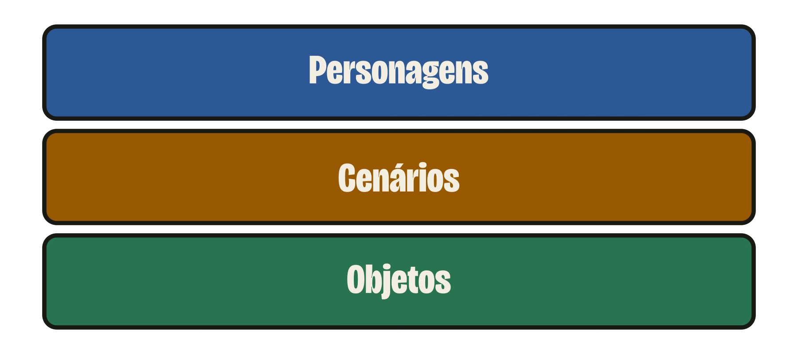
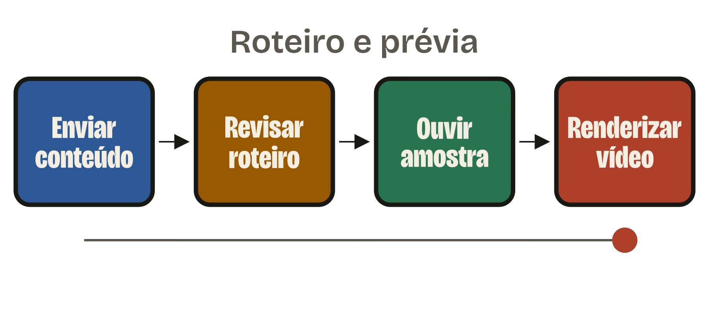
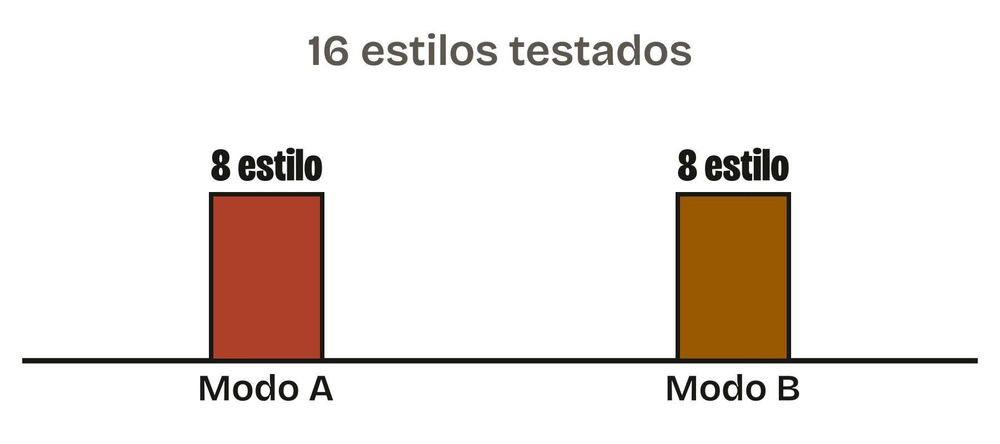

# Uma mensagem vira roteiro, prévia e vídeo no Stickman Video Director

_2026-11-27 · noticia_

Stickman Video Director transforma uma ideia, artigo, link ou roteiro em vídeo animado com bonequinhos por meio de um agente de programação. A apostila explica os dois modos de criação, com foco no modo código, e mostra como instalar a skill, definir formato e estilo, aprovar roteiro e prévia e receber a entrega. Você vai entender os 16 estilos, o fluxo de aprovação, os custos e os limites para usar a cota do agente sem depender de créditos de modelos de vídeo.

## O fato

Stickman Video Director é uma skill de código aberto para agentes de programação. A documentação oficial apresenta o projeto como uma forma de transformar um roteiro em vídeo animado com bonequinhos, narração, legendas e efeitos sonoros. A entrada pode ser uma ideia, um artigo, um link da web ou um roteiro completo.

O fluxo começa com uma mensagem ao agente. Antes da entrega, o usuário aprova o roteiro e uma prévia. Só depois o agente conclui a produção. Esse ponto de aprovação permite corrigir a história e ouvir a amostra antes de renderizar o vídeo inteiro.

O projeto declara licença MIT e a contagem apresentada é de 8,7 mil estrelas no GitHub. A documentação lista 16 estilos testados, divididos entre o modo A e o modo B. Claude Code e Codex são os agentes recomendados pela documentação por sua capacidade de programação.

Fonte: <https://github.com/kaomei/stickman-video-director>

## Por que isso importa

Produzir vídeo sem aparecer reúne várias tarefas: escrever a história, construir os personagens e cenários, animar, gravar a voz, sincronizar legendas e tratar o áudio. Quando essas partes ficam em ferramentas separadas, o criador precisa coordenar arquivos, formatos e etapas. A skill organiza esse trabalho dentro da conversa com o agente.

No modo código, o agente gera elementos visuais em camadas, escreve e executa o código da animação, compõe a linha do tempo e renderiza localmente. O projeto foi pensado para aproveitar a cota de uma assinatura de Codex ou Claude Code, reduzindo a dependência de créditos de modelos de vídeo.

A proposta também muda o momento da revisão. Roteiro e prévia vêm antes da renderização completa. Isso ajuda a encontrar problemas de narrativa, voz e estilo enquanto a produção ainda está em uma fase de correção mais simples.

Fonte: <https://github.com/kaomei/stickman-video-director/blob/main/README.pt-BR.md#creation-modes>

## O que é uma skill e como ela entra no fluxo

Uma skill é um conjunto de instruções que orienta um agente a executar uma tarefa específica. No caso do Stickman Video Director, essas instruções ensinam o agente a organizar a produção de vídeos com bonequinhos. A skill funciona dentro do ambiente do agente de programação, e não como um aplicativo isolado.

A instalação começa quando o usuário envia ao agente o pedido para instalar a skill. Depois, o agente lê o arquivo SKILL.md e confirma que está pronto. A partir daí, a conversa passa a concentrar o conteúdo, as escolhas de formato e estilo, a aprovação e a execução da produção.

A documentação recomenda Claude Code e Codex. O agente atua como responsável por interpretar o pedido, preparar os elementos e coordenar as ferramentas necessárias. O usuário continua participando das decisões importantes, especialmente na revisão do roteiro e da amostra.

Fonte: <https://github.com/kaomei/stickman-video-director/blob/main/README.pt-BR.md#quick-start>

## Instalação: a primeira mensagem

O início do processo é uma mensagem enviada ao agente. Ela informa o endereço do repositório e pede que a instalação seja seguida da leitura de SKILL.md. O agente deve avisar quando terminar essa etapa.

Ela não acrescenta comandos de terminal nem exige que o usuário altere arquivos manualmente.

```
Instale este Skill:
https://github.com/kaomei/stickman-video-director

Após a instalação, leia SKILL.md e me avise que está pronto.

Repositório: github.com/kaomei/stickman-video-director
```

Fonte: <https://github.com/kaomei/stickman-video-director/blob/main/README.pt-BR.md#quick-start>

## Dois motores de criação

O Stickman Video Director oferece duas formas de produzir os visuais. O modo A usa modelos de vídeo para gerar cenas contínuas. O modo B usa código para animar elementos visuais preparados em camadas. Os dois modos podem levar a um vídeo final, mas trabalham com recursos, custos e controles diferentes.

No modo A, o agente transforma roteiro e storyboard em prompts para modelos de geração de vídeo. A documentação descreve movimento fluido, iluminação cinematográfica e visuais com dinâmica de cinema. Esse modo consome créditos ou pontos dos modelos de vídeo, e vídeos mais longos tendem a aumentar o custo, inclusive quando é preciso refazer cenas.

No modo B, o agente prepara personagens, cenários e objetos como elementos reutilizáveis. Depois, escreve e executa o código que anima e compõe esses elementos. A documentação destaca consistência dos personagens, controle preciso do ritmo e da linha do tempo, organização do layout e ajustes locais.

- Modo A: indicado para quem já tem acesso a recursos de geração de vídeo e prioriza cenas com aparência cinematográfica.
- Modo B: indicado para quem tem assinatura ativa de Codex ou Claude Code e quer usar a cota de programação existente, sem pagar créditos extras de modelos de vídeo.
- Saída do modo A: roteiro de storyboard, prompts de cena e, conforme o fluxo escolhido, o arquivo do vídeo completo.
- Saída do modo B: biblioteca de elementos em camadas, com personagens, cenários e objetos, mais o arquivo do vídeo completo.

Fonte: <https://github.com/kaomei/stickman-video-director/blob/main/README.pt-BR.md#creation-modes>

## O modo código em detalhes



_Camadas separam personagens, cenários e objetos para reutilização na animação._

O modo B, também chamado de modo código, começa pela confirmação do roteiro e de uma amostra de 20 segundos para o estilo escolhido. Depois da aprovação, o agente prepara os elementos, escreve o código, executa a animação, trata legendas e áudio e renderiza o vídeo localmente.

A estrutura em camadas separa personagens, cenários e objetos. Isso permite reutilizar os elementos e manter a aparência consistente ao longo da produção. A linha do tempo também é controlada pelo código, o que dá ao agente precisão para posicionar ações, textos, voz e sons.

O modo B não exige créditos de modelos de vídeo, mas usa a cota do agente e ferramentas básicas de imagem e síntese de voz. A assinatura do agente continua sendo necessária, e serviços de imagem ou voz podem ter custo próprio. Também é preciso configurar as ferramentas locais usadas na composição e na renderização.

Fonte: <https://github.com/kaomei/stickman-video-director/blob/main/skills/directing-stickman-videos/references/getting-started.md>

## Formatos, duração e elementos do vídeo

Os dois modos aceitam vídeos curtos e conteúdos mais longos. A documentação permite escolher o formato horizontal 16:9 ou o formato vertical 9:16. A escolha deve acompanhar a plataforma de publicação e a forma como o conteúdo será consumido.

A narração, as legendas, a música de fundo e os efeitos sonoros podem ser configurados conforme a necessidade e o estilo selecionado. No modo código, a entrega descrita reúne bonequinhos animados, narração, legendas sincronizadas e efeitos sonoros.

A duração de 8 minutos aparece no exemplo oficial de pedido no modo B. Ela mostra como informar uma duração desejada ao agente, não representa um limite fixo do projeto. A prévia de 20 segundos é uma amostra inicial com áudio, usada para aprovação antes da renderização completa.

- 16:9: formato horizontal, indicado no exemplo oficial para o vídeo solicitado.
- 9:16: formato vertical, disponível para publicação em conteúdo de tela vertical.
- 20 segundos: duração da amostra com áudio apresentada antes da produção completa no modo B.
- 8 minutos: duração pedida no exemplo oficial, usada para demonstrar como especificar a extensão do vídeo.

Fonte: <https://github.com/kaomei/stickman-video-director/blob/main/README.pt-BR.md#creation-modes>

## Roteiro e prévia antes da renderização



_O roteiro e a amostra de 20 segundos são aprovados antes da renderização completa._

O modo código usa uma aprovação em duas etapas. Primeiro, o agente apresenta o roteiro completo para o usuário ajustar a história. Depois, produz uma amostra com áudio dos primeiros 20 segundos no estilo escolhido. A renderização de todo o vídeo só avança após a aprovação e a autorização para concluir.

1. Envie o conteúdo e os requisitos do vídeo ao agente. O resultado esperado é um roteiro completo para revisão.
2. Leia o roteiro e peça os ajustes necessários na história. O resultado esperado é um texto aprovado antes da produção visual completa.
3. Peça a amostra dos primeiros 20 segundos com áudio no estilo escolhido. O resultado esperado é uma prévia para avaliar voz, ritmo e tratamento visual.
4. Aprove a amostra e autorize a conclusão. O resultado esperado é a preparação dos elementos, a escrita do código e a renderização local do vídeo inteiro.

Fonte: <https://github.com/kaomei/stickman-video-director/blob/main/skills/directing-stickman-videos/references/getting-started.md>

## Pedido de produção no modo B

O pedido abaixo reúne o conteúdo, o modo de criação, o formato, a duração, o estilo e os elementos desejados. Ele também estabelece a ordem de aprovação: verificar o ambiente, apresentar o roteiro e a amostra, aguardar a aprovação e só então concluir a produção.

Os campos entre colchetes devem ser substituídos pelo texto que se quer transformar. O exemplo usa modo B, formato horizontal 16:9, duração de 8 minutos e estilo B1. Essas escolhas fazem parte do modelo de pedido e podem ser ajustadas ao objetivo do vídeo.

```
Use o motor de código (modo B) para transformar o tema ou artigo abaixo em um vídeo stickman atraente:
[Cole um texto longo, uma notícia ou um link, ou descreva o tema desejado]

Requisitos: horizontal 16:9, duração de 8 minutos, estilo B1 “Traço minimalista”, com narração, legendas e efeitos sonoros.

Primeiro, verifique o ambiente local de geração de imagens e composição de vídeo e apresente o roteiro completo e uma amostra com áudio dos primeiros 20 segundos;
após minha aprovação, conclua automaticamente a preparação dos elementos, a escrita do código e a renderização local de todo o vídeo e entregue diretamente o vídeo completo.
```

Fonte: <https://github.com/kaomei/stickman-video-director/blob/main/README.pt-BR.md#autopilot-start>

## Os 16 estilos



_Os 16 estilos testados se dividem em oito opções no modo A e oito no modo B._

A documentação lista 16 estilos testados, oito no modo A e oito no modo B. Eles mudam o clima visual da produção e ajudam a aproximar a animação do assunto. O estilo também orienta personagens, cenário, ritmo e tratamento sonoro.

O modo A reúne estilos como o clássico preto e branco, a caverna pré-histórica, a TV retrô e as histórias acolhedoras. O modo B inclui o traço minimalista, o desenho colorido, o suspense de sobrevivimento, a animação de memes e o teatro em pixels.

O exemplo oficial usa B1, Minimal Line Art, chamado no pedido em português de “Traço minimalista”. A escolha deve considerar o tom do conteúdo e o modo de criação que será usado.

- A1: Classic Black & White.
- A2: Modern Pop.
- A3: Prehistoric Cave.
- A4: Cozy Storytelling.
- A5: Historical Cartoon.
- A6: Amber Noir.
- A7: Rubber Hose Animation.
- A8: Studio Ghibli.
- B1: Minimal Line Art.
- B2: Colorful Hand-Drawn.
- B3: Retro TV.
- B4: Survival Thriller.
- B5: Avatar Explainer.
- B6: Meme Story Animation.
- B7: Pixel Theater.
- B8: Greek Mythology.

Fonte: <https://github.com/kaomei/stickman-video-director/blob/main/README.pt-BR.md>

## A entrega do modo código

Depois da aprovação, o modo B entrega o vídeo completo e uma biblioteca de elementos em camadas. A biblioteca inclui personagens, cenários e objetos usados na produção. O vídeo reúne animação, narração, legendas sincronizadas e efeitos sonoros.

A biblioteca é importante porque os elementos foram preparados como partes reutilizáveis. Ela permite entender a organização visual da produção e conserva os componentes usados pelo agente. O vídeo é a entrega pronta para publicação, enquanto a biblioteca guarda a estrutura dos visuais.

A aprovação da amostra de 20 segundos cobre apenas o início. Antes de publicar, vale assistir ao vídeo completo e conferir se a voz, as legendas, os sons e o estilo permanecem consistentes até o fim.

Fonte: <https://github.com/kaomei/stickman-video-director/blob/main/README.pt-BR.md#creation-modes>

## Os números

Os números ajudam a dimensionar o projeto, mas cada um mede uma coisa diferente. Estrelas indicam interesse no repositório. Estilos indicam opções visuais disponíveis. A duração da amostra e a duração do vídeo pertencem ao fluxo de produção.

- 8,7 mil estrelas no GitHub: é a contagem apresentada pelo repositório e indica interesse da comunidade. O número não mede qualidade do vídeo nem garante resultado em qualquer computador.
- 16 estilos testados: são oito opções no modo A e oito no modo B. A quantidade não significa que todos os estilos usem o mesmo motor de criação.
- 20 segundos: é a duração da amostra com áudio usada para aprovação no modo B. Ela não representa a duração do vídeo final.
- 8 minutos: é a duração solicitada no exemplo oficial de pedido. O valor demonstra como definir a extensão desejada, não estabelece um limite.
- 16:9 e 9:16: são os formatos horizontal e vertical oferecidos pela documentação.
- Zero créditos de modelos de vídeo no modo B: significa que a renderização usa a cota do agente e ferramentas básicas de imagem e síntese de voz. Não significa custo total zero.
- 50 dólares por mês: aparece como referência à despesa com um aplicativo de vídeo na comunicação do projeto. Não é uma tarifa cobrada pelo Stickman Video Director.

Fonte: <https://api.github.com/repos/kaomei/stickman-video-director>

## O que muda para você

Exemplo: você quer transformar uma notícia em um vídeo horizontal sem aparecer. Depois de instalar a skill e confirmar que o agente leu SKILL.md, você envia o texto e pede o modo B, formato 16:9, duração de 8 minutos, estilo B1 “Traço minimalista”, narração, legendas e efeitos sonoros.

O agente verifica o ambiente local, apresenta o roteiro completo e produz uma amostra com áudio dos primeiros 20 segundos. Você lê a história, ouve a voz e avalia o estilo. Se algo precisar mudar, esse é o momento de corrigir antes da renderização completa.

Com a aprovação e a autorização para concluir, o agente prepara os elementos em camadas, escreve o código e renderiza o vídeo localmente. A entrega inclui o arquivo completo e a biblioteca de personagens, cenários e objetos. O fluxo reúne produção e aprovação em uma conversa, usando a estrutura do agente de programação.

Fonte: <https://github.com/kaomei/stickman-video-director/blob/main/README.pt-BR.md#autopilot-start>

## O que fazer hoje

Para colocar o projeto em uso, comece pela instalação e termine com a conferência do vídeo completo. A sequência abaixo usa apenas as etapas descritas na documentação e mantém a aprovação antes da renderização final.

1. Abra o repositório oficial e leia a documentação em português. O resultado esperado é identificar os dois modos, os estilos e os links de instalação.
2. Envie ao agente a mensagem de instalação desta apostila. O resultado esperado é a instalação da skill e a confirmação de que SKILL.md foi lido.
3. Peça a verificação do ambiente local de geração de imagens e composição de vídeo. O resultado esperado é o agente conferir as ferramentas antes de iniciar a produção.
4. Escolha o modo de criação, o formato, o estilo, a duração e os elementos de áudio. O resultado esperado é um pedido com requisitos definidos.
5. Envie o texto, artigo, link ou tema junto com o pedido de produção. No modo B, o resultado esperado é o roteiro completo e uma amostra de 20 segundos com áudio.
6. Revise o roteiro e a amostra, aprove e autorize a conclusão. O resultado esperado é a preparação dos elementos, a escrita do código e a renderização local.
7. Receba o vídeo completo e, no modo B, a biblioteca de elementos em camadas. O resultado esperado é conferir o arquivo final antes de publicar.

Fonte: <https://github.com/kaomei/stickman-video-director/blob/main/skills/directing-stickman-videos/references/installation-troubleshooting.md>

## Teste de pronto

Os pontos abaixo permitem verificar se o fluxo chegou às etapas esperadas. Eles servem para acompanhar a instalação, a aprovação e a entrega sem confundir a prévia com o vídeo final.

- [ ] O agente confirmou que leu SKILL.md depois da instalação.
- [ ] O ambiente local de geração de imagens e composição de vídeo foi verificado.
- [ ] O roteiro completo foi apresentado antes da renderização de todo o vídeo.
- [ ] A amostra dos primeiros 20 segundos foi produzida com áudio e no estilo escolhido.
- [ ] A aprovação e a autorização para concluir foram dadas antes da renderização completa.
- [ ] O vídeo final foi entregue e, no modo B, a biblioteca de elementos em camadas também foi recebida.

Fonte: <https://github.com/kaomei/stickman-video-director/blob/main/README.pt-BR.md#creation-modes>

## O que conferir

O projeto é aberto e usa licença MIT, mas produção local não elimina todos os custos. No modo B, os créditos de modelos de vídeo ficam de fora, enquanto a assinatura do agente continua. Serviços de imagem e voz podem ter custo próprio, e o ambiente local precisa estar configurado.

- Não trate as 8,7 mil estrelas como garantia de qualidade. O número indica interesse no repositório, não um teste de desempenho.
- Não transfira condições do modo A para o modo B. O modo A consome créditos ou pontos de modelos de vídeo; o modo B renderiza localmente com código.
- Confira os custos da assinatura do agente e dos serviços de imagem e voz antes de começar.
- Verifique se as ferramentas locais de geração de imagens e composição de vídeo estão disponíveis e configuradas.
- Escolha o formato de acordo com a publicação. 16:9 é horizontal e 9:16 é vertical.
- Trate os 8 minutos como a duração do exemplo de pedido, não como uma regra fixa.
- Leia o roteiro e ouça a amostra antes de autorizar a conclusão. A prévia de 20 segundos não substitui a conferência do vídeo inteiro.
- Assista ao arquivo final e confira voz, legendas sincronizadas, efeitos sonoros e consistência visual.
- Consulte a licença MIT publicada no repositório antes de reutilizar o projeto em um trabalho próprio.

Fonte: <https://github.com/kaomei/stickman-video-director/blob/main/LICENSE>

## Glossário

- Skill: conjunto de instruções que orienta um agente a executar uma tarefa específica.
- Agente de programação: ambiente que interpreta pedidos, manipula arquivos e executa ferramentas para concluir uma tarefa.
- Modo A: motor que usa modelos de vídeo para gerar cenas contínuas.
- Modo B: motor que gera elementos em camadas e usa código para animar, compor e renderizar localmente.
- Storyboard: organização das cenas de uma história antes da produção visual.
- Elementos em camadas: personagens, cenários e objetos preparados separadamente para compor e reutilizar na animação.
- Renderização local: processo de gerar o arquivo de vídeo no computador ou ambiente do usuário.
- Linha do tempo: sequência que define quando cada elemento, ação, voz ou som aparece no vídeo.
- TTS: síntese de voz, processo que transforma texto em fala.
- Legendas sincronizadas: textos que acompanham o momento correspondente da fala.
- Cota do agente: limite de uso da assinatura ou serviço do agente de programação.
- 16:9 e 9:16: formatos de imagem horizontal e vertical usados para publicar vídeos.

Fonte: <https://github.com/kaomei/stickman-video-director/blob/main/README.pt-BR.md>

## Para onde ir depois

O próximo passo é instalar a skill e testar o fluxo com um texto curto. Depois de entender a aprovação do roteiro e da prévia, pratique com um conteúdo maior e compare os estilos disponíveis para o modo escolhido.

Use os endereços oficiais abaixo para acompanhar o projeto, consultar a instalação e verificar a documentação dos agentes recomendados.

- Repositório oficial: https://github.com/kaomei/stickman-video-director
- Documentação oficial em português: https://github.com/kaomei/stickman-video-director/blob/main/README.pt-BR.md
- Guia de instalação manual: https://github.com/kaomei/stickman-video-director/blob/main/skills/directing-stickman-videos/references/installation-troubleshooting.md
- Documentação oficial do Claude Code: https://code.claude.com/docs/en/overview
- Documentação oficial do Codex: https://developers.openai.com/codex/
- Licença MIT do projeto: https://github.com/kaomei/stickman-video-director/blob/main/LICENSE

Fonte: <https://github.com/kaomei/stickman-video-director>

## Além do vídeo

- A documentação descreve o modo A para quem tem acesso a recursos como Google Flow, APIs acessíveis ou modelos locais.
- No modo A, o agente pode operar um navegador integrado para gerar clipes, juntar cenas e tratar legendas e áudio.
- O repositório oferece versões da documentação em inglês, chinês, japonês, coreano, francês, português, turco e indonésio.
- A página do projeto mantém um roadmap voltado ao crescimento da comunidade e apresenta parceiros de API patrocinadores.
