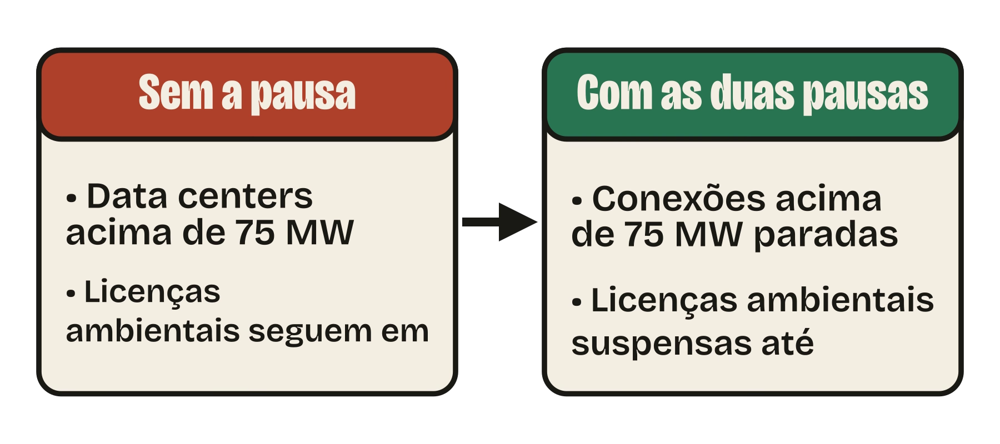
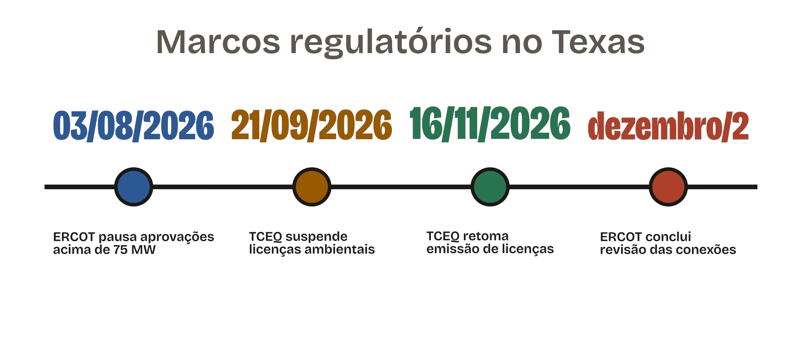

# A brecha de 25 MW livra pequenos data centers da pausa

_2026-11-28 · noticia_

No Texas, a aprovação de novos data centers foi dividida entre duas frentes regulatórias: as conexões elétricas, revisadas pelo ERCOT, e as licenças ambientais, cuidadas pela TCEQ. Em agosto de 2026, o estado pausou as aprovações acima de 75 MW para auditoria energética e hídrica; em setembro, suspendeu as licenças ambientais para data centers até novembro. O limite que separa os dois mundos é a potência de 25 MW: abaixo disso, o projeto escapa da auditoria do ERCOT e não entra na pausa regulatória. Entenda aqui por que essa regra abriu uma brecha para projetos menores e o que ela significa na prática para quem está planejando um data center no estado.

## A pausa que atingiu o planejamento

Em 3 de agosto de 2026, o governador do Texas, Greg Abbott, publicou uma diretiva oficial determinando que a PUCT (Utility Construction Commission of Texas) e a ERCOT (Energy Responsibility Commission of Texas) pausassem as aprovações de novas conexões para cargas acima de 75 MW. Esse grupo é chamado de Batch Zero e representa os projetos de grande porte, aqueles cuja potência exige uma revisão detalhada da ligação com a rede elétrica.

A pausa foi justificada pela necessidade de auditoria energética e hídrica: o estado quer verificar quanto consumo esses data centers geram e como usam água antes de autorizar novas ligações. Na prática, isso significa que um projeto pode estar tecnicamente pronto para entrar em operação e ainda assim ficar parado à espera de uma decisão que não depende dele.

O efeito é direto no cronograma. Enquanto a pausa dura, o desenvolvedor não consegue obter a aprovação de conexão necessária para ligar o equipamento à rede. Isso empurra investimentos para frente e concentra decisões em um pequeno número de projetos grandes.

## Duas frentes regulatórias pararam os projetos

A pausa elétrica não foi a única trava. Em 21 de setembro de 2026, o governador enviou uma diretiva à TCEQ (Texas Commission on Environmental Quality) suspendendo a emissão de licenças ambientais para data centers — abrangendo ar, água e geração. O congelamento ambiental durou até 16 de novembro de 2026, quando a TCEQ retomou oficialmente a análise e a emissão das licenças após liberação do gabinete do governador.

Ou seja: além da fila elétrica, havia uma fila ambiental. Os dois gargalos se somam, porque um data center precisa tanto da conexão à rede quanto das autorizações ambientais para operar legalmente. Enquanto qualquer uma das duas portas estava fechada, o projeto não avançava.

A revisão das conexões elétricas, por sua vez, segue prevista para dezembro de 2026, segundo o cronograma apresentado pela ERCOT. Isso significa que a pausa elétrica pode voltar a pesar no fim do ano, mesmo depois da retomada ambiental.

## O limite que abre a brecha

_Antes e depois das pausas regulatórias que travaram projetos no Texas em 2026._

A regra dos 25 MW é o ponto central dessa história. Data centers com carga abaixo de 25 MW não precisam concluir a auditoria do ERCOT e, por isso, ficam fora da pausa regulatória criada em agosto. Eles continuam sujeitos às regras normais de conexão, mas sem o processo de auditoria que trava os projetos maiores.

Para um operador, isso muda o jogo: em vez de esperar meses ou anos pela revisão completa do ERCOT, ele pode seguir com o planejamento dentro desse limite. A potência fica na faixa que recebe a dispensa da auditoria, e o cronograma deixa de depender de uma decisão regulatória incerta.

É importante notar que essa brecha é específica para instalações abaixo de 25 MW. Ela não se aplica a projetos maiores nem substitui outras exigências, como licenças ambientais ou requisitos técnicos da rede.

## Acima do limite, a auditoria continua

Do outro lado da régua, os data centers acima de 25 MW seguem integralmente submetidos à auditoria do ERCOT e à pausa das aprovações. A mesma regra que abre espaço para instalações menores mantém os grandes projetos no caminho mais longo: revisão detalhada, espera por decisão e risco de atraso no início da operação.

Isso cria uma divisão clara no mercado texano. Pequenos e médios data centers encontram uma rota relativamente livre; os gigantes continuam presos ao funil regulatório. O resultado é que a disputa por espaço na rede elétrica do Texas passa a ser, em boa parte, uma disputa entre projetos que conseguem se encaixar nos limites de potência e aqueles que não conseguem.

## A fila de conexão no Texas

Quase 90% desses pedidos são de data centers — o que mostra como a categoria virou o principal gargalo da infraestrutura elétrica estadual.

Esse volume explica por que regras como a dos 25 MW ganharam peso: elas tentam dar vazão a uma fila gigantesca, oferecendo uma porta de entrada para projetos menores. Ao mesmo tempo, os grandes pedidos continuam acumulados, pressionando ainda mais o sistema e mantendo incerto o prazo para quem está acima do limite.

Para um desenvolvedor, o número é um alerta: mesmo com a brecha dos 25 MW, a capacidade da rede pode ser limitada no agregado. O tamanho do projeto define a auditoria aplicável, mas não garante que haverá espaço físico na conexão.

## O que muda para você

Para quem está planejando um data center no Texas, o primeiro passo é medir a carga do projeto em MW. Se ficar abaixo de 25 MW, a auditoria do ERCOT não se aplica e a pausa regulatória não alcança o pedido — desde que as demais exigências sejam cumpridas.

Se o projeto passar desse limite, ele entra na fila da auditoria e fica sujeito à pausa iniciada em agosto. O cronograma precisa prever essa espera como variável real, porque ela afeta investimentos, contratos de fornecimento e prazos com clientes.

A brecha dos 25 MW não é um atalho para ignorar regulação: é uma rota regulatória diferente. Ela reduz a dependência da revisão do ERCOT, mas o projeto ainda precisa atender às normas técnicas e ambientais aplicáveis à sua faixa de potência.

## O calendário que ainda está em movimento

_Linha do tempo das pausas e retomadas que afetam data centers no Texas em 2026._

Depois da retomada das licenças ambientais em 16 de novembro de 2026, a revisão elétrica segue com previsão para dezembro. Isso significa que, mesmo com o ambiente regulatório ambiental liberado, os projetos acima de 25 MW ainda podem enfrentar atraso na conexão à rede no fim do ano.

Para quem já tem projeto aprovado ou em fase final, vale acompanhar as atualizações da ERCOT sobre a conclusão dessa revisão. O calendário é o que define se a brecha dos 25 MW será suficiente para destravar operações ou se a fila continuará sendo o gargalo dominante.

## Glossário

- Batch Zero: grupo de projetos de grande porte com carga acima de 75 MW, que exigem auditoria energética e hídrica antes da aprovação de conexão no Texas.
- ERCOT (Energy Responsibility Commission of Texas): agência responsável pela revisão das conexões elétricas e grandes cargas no estado do Texas.
- TCEQ (Texas Commission on Environmental Quality): comissão estadual que emite as licenças ambientais para data centers, incluindo aspectos de ar, água e geração.
- Carga (MW): medida da potência consumida por um data center, expressa em megawatts. É o critério técnico usado para definir quais projetos entram na auditoria do ERCOT.
- Licença ambiental: autorização emitida pela TCEQ que permite a operação de atividades com impacto ambiental, como data centers.

## Para onde ir depois

- Acompanhe as atualizações da ERCOT sobre o término da revisão das conexões elétricas, prevista para dezembro de 2026.
- Se seu projeto está abaixo de 25 MW, verifique com um especialista em infraestrutura quais requisitos técnicos e contratuais ainda se aplicam à conexão no Texas.
- Para projetos acima desse limite, monte um plano de contingência que contemple a pausa regulatória e o tempo estimado da auditoria do ERCOT.

## Cuidados

- A pausa das aprovações elétricas vale para cargas acima de 75 MW; projetos abaixo desse limite não entram na pausa, mas isso não significa dispensa total de análise.
- O congelamento ambiental durou até 16 de novembro de 2026 e a retomada foi oficializada pela TCEQ após liberação do gabinete do governador. Confirme o status atualizado antes de tomar decisões de investimento.
- Não confunda a brecha dos 25 MW com uma autorização geral para operar: ela se refere à dispensa da auditoria do ERCOT, não à eliminação de outras exigências.

## Além do vídeo

- A pausa elétrica foi motivada por auditoria energética e hídrica declarada pelo governador na diretiva de agosto.
- O congelamento ambiental abrangeu licenças de ar, água e geração para data centers.
- A retomada das licenças ambientais pela TCEQ ocorreu em 16 de novembro de 2026 após liberação do gabinete do governador.
- A revisão das conexões elétricas segue prevista para dezembro de 2026, mesmo com a retomada ambiental.
- O critério de 75 MW é técnico da ERCOT para classificação de Large Loads (cargas grandes).
- Cerca de 90% dos pedidos na fila de conexão do Texas são de data centers.
- A regra dos 25 MW dispensa a auditoria do ERCOT, mas não elimina outras exigências regulatórias.
