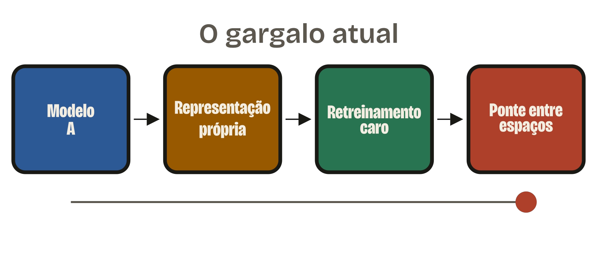
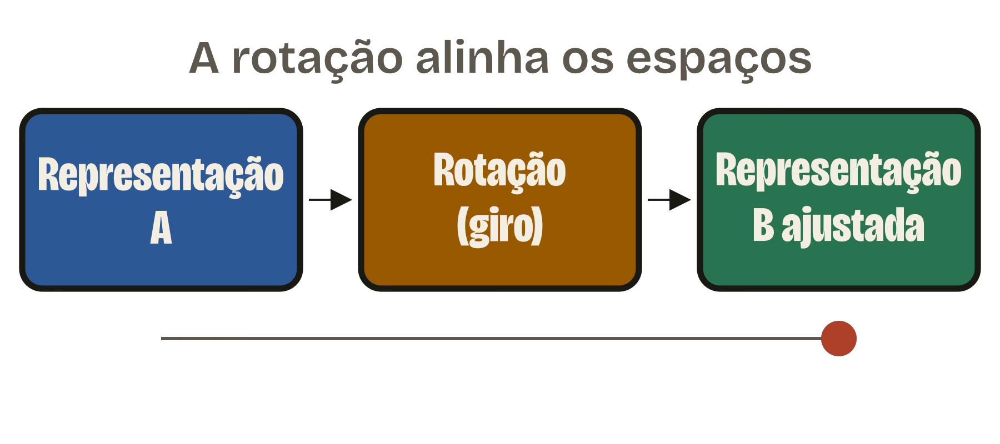
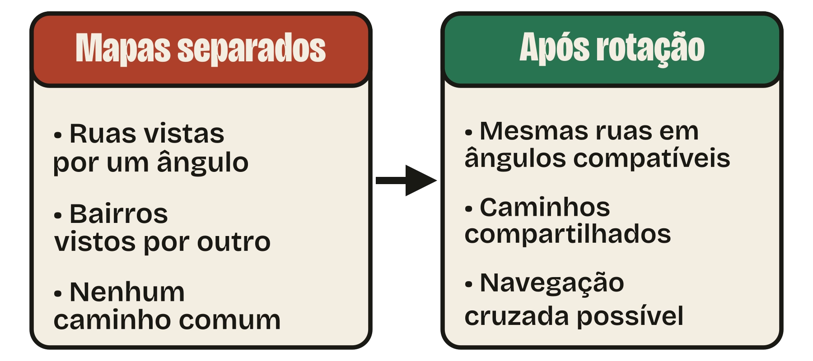

# Acabou o retreinamento, Plato's Key alinha LLMs com 1 rotação

_2026-11-28 · noticia_

O Plato's Key mostra que é possível fazer dois LLMs treinados separadamente trabalharem juntos sem retreiná-los para isso. A ideia central é uma única rotação, aplicada às representações dos modelos, que alinha o jeito como cada um organiza as informações — e dispensa gradientes nesse processo. Nesta apostila você entende o que são representações de um LLM, por que modelos separados costumam não se combinar direto, como a rotação funciona na prática e onde testar o comando oficial.

## O fato

A proposta é simples no nome e radical na promessa — uma única rotação resolve o problema de combinar modelos.

O anúncio veio junto de @jerrywliu, @MorrisYau e do time HazyResearch. O texto base está disponível no repositório oficial no GitHub (https://github.com/HazyResearch/Plato-s-Key) e na documentação em https://hazyresearch.github.io/plato-s-key/.

## O gargalo: modelos separados, representações diferentes

_Dois modelos com representações próprias exigem retreinamento para conectá-las._

Cada modelo de linguagem organiza as informações do mundo em um espaço de representação próprio. Esse espaço é o que permite que o modelo entenda, gere e relacione texto — mas também significa que dois modelos treinados separadamente enxergam o mesmo conceito por ângulos diferentes.

Quando a intenção é reaproveitar representações entre modelos, a solução tradicional tem sido retreinar um deles para incorporar as do outro. Isso adiciona um ciclo de treinamento caro e demorado só para criar uma ponte entre os espaços de representação.

## O que é uma rotação

_Em vez de retreinar, a rotação gira as representações para alinhá-las._

A rotação do Plato's Key é uma transformação aplicada às representações dos modelos. Em vez de treinar novamente para alinhar os espaços, ela ajusta a relação entre eles por meio de uma operação matemática simples: girar (rotacionar) as representações de um modelo em direção às do outro.

O efeito prático é que os modelos passam a compartilhar representações sem que seja necessário passar por gradientes. Isso muda o tipo de ajuste envolvido — não há mais um processo de otimização por gradiente descendo uma função de perda, e sim uma transformação direta sobre as representações já existentes.

## Por que isso importa

Na esteira de desenvolvimento com LLMs, o retreinamento para combinar modelos é um ponto de atrito. Cada ciclo extra consome computação, tempo e recursos — e muitas vezes a integração entre modelos fica travada justamente nessa etapa.

Com a rotação, a equipe pode pular o retreinamento de combinação e partir diretamente do uso das representações já treinadas. Isso encurta fluxos de trabalho em que vários modelos precisam conversar entre si, como em pipelines de recuperação, geração ou comparação.

## Como funciona na prática

_A rotação cria correspondência entre representações de modelos distintos._

Imagine dois mapas da mesma cidade feitos por pessoas diferentes. Cada mapa organiza ruas e bairros de um jeito próprio. A rotação cria uma correspondência entre os dois mapas, permitindo que você use a informação de um para navegar pelo outro sem refazer o trabalho de mapear.

No caso dos LLMs, a rotação ajusta as representações de modo que o espaço de um modelo fique compatível com o do outro. Os modelos continuam independentes — não se fundem em um único modelo — mas passam a poder usar as representações cruzadas como ponto de partida.

## O comando oficial

A implementação completa do Plato's Key está no repositório oficial no GitHub. O comando e a configuração exatos estão lá, junto com os exemplos de uso.

Para reproduzir o método, o caminho é acessar o repositório https://github.com/HazyResearch/Plato-s-Key e seguir as instruções da documentação em https://hazyresearch.github.io/plato-s-key/.

## O que muda para você

Se você trabalha com modelos já treinados e quer integrá-los sem gastar um novo ciclo de treinamento, a rotação abre uma rota direta. Você pode usar as representações de um LLM como base para o outro, sem retreinamento para essa finalidade.

O ganho é de eficiência no fluxo: menos etapas entre treinar um modelo e usá-lo em conjunto com outro. O custo que antes aparecia na etapa de combinação deixa de existir nesse caso específico.

## Limites e cuidados

A rotação alinha representações, mas não substitui avaliação. Alinhar os espaços não garante que o comportamento final dos modelos seja melhor — é preciso testar com tarefas reais para ver se a combinação entrega o resultado esperado.

Outro ponto de atenção: o método pressupõe modelos já treinados e com representações definidas. Não há indicação no material de uso em modelos sem treinamento prévio ou em cenários em que a representação ainda está sendo construída.

- Confira se os modelos usados já têm representações treinadas antes de aplicar a rotação.
- Valide a combinação em tarefas concretas, não apenas na teoria do alinhamento.
- A rotação não elimina a necessidade de avaliar qualidade e segurança do modelo combinado.

## Glossário

- Representação: forma como um modelo organiza internamente as informações que aprendeu, em um espaço matemático onde conceitos ficam próximos ou distantes entre si.
- Gradiente: medida de direção e intensidade da maior mudança possível em uma função; no treinamento com retropropagação, é o que orienta os ajustes dos pesos do modelo.
- Retreinamento: processo de treinar novamente um modelo para incorporar mudanças ou combinar aprendizados anteriores.
- Rotação (rotation): transformação geométrica aplicada às representações de um modelo para alinhá-las às de outro, sem passar por gradientes.

## Para onde ir depois

- Leia a documentação oficial do Plato's Key em https://hazyresearch.github.io/plato-s-key/ para ver exemplos de uso e configuração.
- Explore o repositório no GitHub (https://github.com/HazyResearch/Plato-s-Key) para inspecionar o código e os testes.

## O que fazer hoje

- Localize o repositório oficial do Plato's Key no GitHub.
- Verifique a documentação para entender os requisitos dos modelos usados na sua esteira.
- Separe dois modelos já treinados e teste a rotação em uma tarefa simples de representação antes de aplicar em fluxo maior.

## Próximos passos

- Depois de entender a rotação, avalie se ela faz sentido no seu pipeline específico — nem toda integração entre modelos precisa desse tipo de alinhamento.
- Se fizer sentido, comece com um par pequeno de modelos e instrumente as representações para medir o efeito da combinação.

## Além do vídeo

- O anúncio foi feito por Vivien Cheng no blog do HazyResearch.
- A rotação dispensa gradientes na etapa de alinhamento entre representações.
- Os modelos permanecem independentes após a aplicação da rotação — não se fundem em um único modelo.
- O método é voltado para LLMs já treinados separadamente.
- A documentação oficial está disponível em https://hazyresearch.github.io/plato-s-key/.
