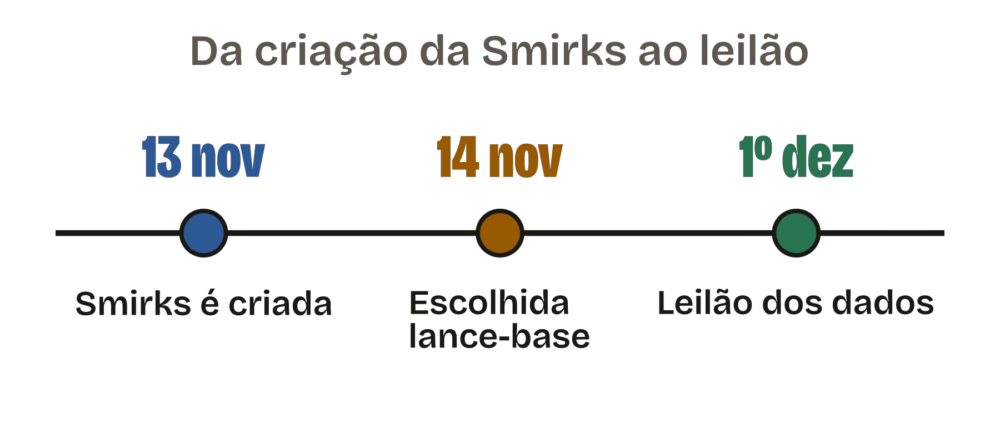
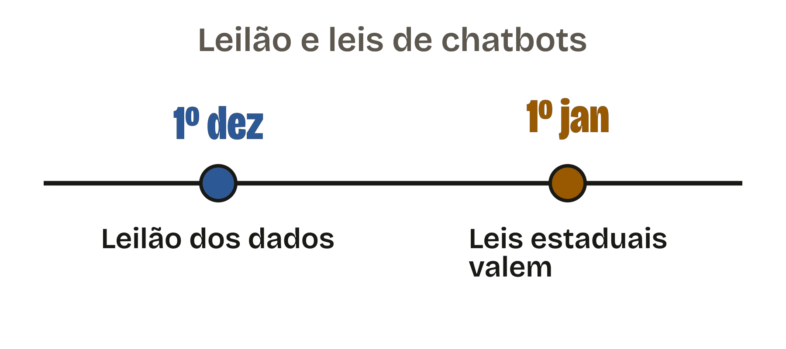
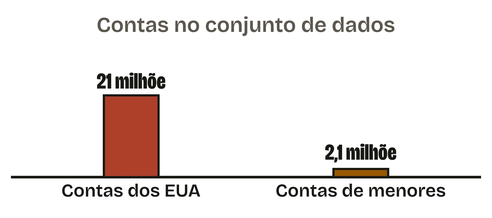

# Character.ai prometeu proteger; agora quer leiloar tudo

_2026-11-28 · noticia_

A Character.ai pediu falência em outubro e planeja leiloar dados sensíveis de usuários, incluindo conversas privadas de mais de 21 milhões de contas dos EUA. Uma coalizão de 42 procuradores-gerais estaduais entrou no processo para barrar a venda. Esta apostila explica o que está em jogo, quem são os envolvidos, o que dizem os números e quais datas importam. Depois de ler, você saberá descrever o caso, entender por que a falência não apaga promessas de privacidade e saber o que acompanhar nos próximos dias.

## O fato

A Character.ai, empresa de chatbots, entrou com pedido de recuperação judicial pelo Chapter 11 da lei de falências dos Estados Unidos em outubro. No processo, ela planeja vender, em leilão, um conjunto de dados que inclui conversas privadas de usuários. O leilão está marcado para 1º de dezembro.

Em 25 de novembro de 2026, o TechCrunch relatou que uma coalizão de 42 procuradores-gerais estaduais (os AGs, na sigla em inglês) está intervindo no processo de falência para tentar impedir a venda. Cada procurador-geral divulgou um comunicado próprio. Segundo esses comunicados, o conjunto de dados traz históricos de conversa de mais de 21 milhões de contas dos EUA, e mais de 2,1 milhões delas pertencem a menores de idade. A venda também envolveria outros dados pessoais, como endereços IP.

A Character.ai havia dito aos consumidores que suas informações pessoais não seriam vendidas, conforme os mesmos comunicados. Em um post no blog, a empresa afirmou que as informações dos usuários continuariam protegidas pela política de privacidade dela.

Fonte: <https://techcrunch.com/2026/11/25/state-ags-fight-character-ais-plan-to-auction-off-users-private-chats>

## Por que isso importa

Quando uma empresa quebra, seus ativos podem ser vendidos para pagar credores. Em empresas de tecnologia, os dados dos usuários acabam entrando nessa conta. O problema aparece quando a empresa prometeu que os dados não seriam vendidos: a falência passa a ser o caminho para fazer justamente o que foi prometido que não se faria.

É esse o argumento dos procuradores-gerais. O procurador-geral da Califórnia, Rob Bonta, afirmou que a Character.AI prometeu aos consumidores que seus dados não seriam vendidos, que esse comportamento é ilegal pela lei federal e pela lei da Califórnia e que a falência não deve ser usada para driblar essas proteções.

O tipo de dado também pesa. Conversas com um chatbot podem conter assuntos íntimos, e a venda inclui contas de menores de idade. Por isso o caso interessa a qualquer pessoa que já conversou com um serviço de IA e quer saber o que acontece com esse histórico se a empresa fechar.

Fonte: <https://techcrunch.com/2026/11/25/state-ags-fight-character-ais-plan-to-auction-off-users-private-chats>

## O argumento dos procuradores-gerais

Os AGs se opõem à venda por três razões principais. A primeira: não há proteção para os usuários. Quem comprar os dados pode fazer o que quiser com eles, inclusive revendê-los sem divulgação. A segunda: o comprador não precisará respeitar a política de privacidade da Character.ai. A terceira: a Character.ai não deu ao tribunal tanta informação sobre possíveis problemas legais ou de segurança após a venda quanto deu aos interessados no leilão, segundo os AGs.

O procurador-geral de Connecticut, William Tong, criticou o modelo de negócio da empresa. Ele afirmou que os chatbots levaram jovens vulneráveis a conversas emocionalmente instáveis e sexualmente inapropriadas, e que a empresa quer usar o processo de falência para leiloar registros privados de conversa e dados pessoais a um comprador que ele chamou de duvidoso.

Fonte: <https://techcrunch.com/2026/11/25/state-ags-fight-character-ais-plan-to-auction-off-users-private-chats>

## Smirks and Pangs Acquisition LLC

_Smirks foi aberta em 13 de novembro, escolhida lance-base no dia seguinte, e o leilão é em_

Até agora, o único interessado anônimo nos dados de chat que veio a público é a Smirks and Pangs Acquisition LLC (chamada de Smirks). Trata-se de uma empresa de Delaware aberta em 13 de novembro de 2026. No dia seguinte, a Character.ai a escolheu como lance-base do leilão, que está marcado para 1º de dezembro, conforme observou o procurador-geral da Califórnia.

Lance-base é a primeira oferta, que serve de piso para os demais interessados. Não está claro o que o comprador pretende fazer com as conversas.

Fonte: <https://techcrunch.com/2026/11/25/state-ags-fight-character-ais-plan-to-auction-off-users-private-chats>

## Disney

A Disney aparece em outro negócio, separado da venda dos chats. Os AGs se opuseram a um acordo de licenciamento de propriedade intelectual da Character.ai com a Disney, no valor de US$ 20 milhões, cerca de R$ 105 milhões no câmbio atual. Esse acordo dá à Disney acesso à propriedade intelectual da empresa, mas não aos chats dos usuários, e ainda não recebeu aprovação final da Justiça. A Disney também concordou em contratar a maior parte da equipe restante da Character.ai.

A oposição ao acordo com a Disney foi liderada por uma coalizão de AGs parecida com a atual, mas não idêntica. Tong disse que os AGs se opuseram à venda para a Disney e pedem que o tribunal de falências rejeite também esta, que ele descreveu como mais uma tentativa de eliminar responsabilidade legal e proteção ao consumidor.

Fonte: <https://techcrunch.com/2026/11/25/state-ags-fight-character-ais-plan-to-auction-off-users-private-chats>

## Leis estaduais de segurança para chatbots

_O leilão em 1º de dezembro antecede em um mês a vigência das leis estaduais de chatbots, e_

Alguns estados, entre eles Califórnia, Colorado, Nova York e Connecticut, aprovaram leis de segurança para chatbots que entram em vigor em 1º de janeiro de 2027. Segundo o relato do TechCrunch, a venda poderia gerar novas violações se avançar, e os AGs citam essas regras como parte da oposição.

Esse ponto liga o caso a um debate maior: a regulação de chatbots está começando a valer em nível estadual, e uma venda de dados em falência pode colidir com ela logo no início de 2027.

Fonte: <https://techcrunch.com/2026/11/25/state-ags-fight-character-ais-plan-to-auction-off-users-private-chats>

## Como a Character.ai chegou até aqui

A empresa enfraqueceu depois que seus cofundadores, Noam Shazeer e Daniel De Freitas, voltaram ao Google, que assinou uma licença não exclusiva para usar a tecnologia da startup. A Character.ai também enfrentou processos sobre segurança de crianças. Um deles envolve o suicídio de um menino de 14 anos da Flórida, cuja mãe afirmou que ele ficou obcecado por um chatbot da plataforma.

Fonte: <https://techcrunch.com/2026/11/25/state-ags-fight-character-ais-plan-to-auction-off-users-private-chats>

## Os números

_Mais de 21 milhões de contas dos EUA, das quais mais de 2,1 milhões de menores de idade._

- 42: é a quantidade de procuradores-gerais estaduais na coalizão que intervém no processo. Inclui o da Califórnia e os de vários outros estados e do Distrito de Columbia. Não dá para concluir que todos os estados participam.
- Mais de 21 milhões: contas dos EUA cujos históricos de conversa fazem parte do conjunto de dados, segundo os comunicados dos AGs. O número se refere a contas, não a pessoas distintas.
- Mais de 2,1 milhões: contas registradas por menores de idade, dentro das 21 milhões.
- 1º de dezembro: data marcada para o leilão.
- 13 de novembro de 2026: data de criação da Smirks and Pangs Acquisition LLC. O lance-base foi escolhido no dia seguinte.
- US$ 20 milhões (cerca de R$ 105 milhões no câmbio atual): valor do acordo de licenciamento com a Disney, que cobre propriedade intelectual e não inclui os chats.
- 1º de janeiro de 2027: data em que entram em vigor as leis estaduais de segurança para chatbots citadas pelos AGs.

Fonte: <https://techcrunch.com/2026/11/25/state-ags-fight-character-ais-plan-to-auction-off-users-private-chats>

## O que muda para você

Imagine que você conversou durante meses com um personagem na Character.ai e, nessas conversas, contou detalhes pessoais. Pela política de privacidade da empresa, esses dados estariam protegidos. Se a venda avançar como proposta, segundo os procuradores-gerais, quem comprar o conjunto de dados não precisa seguir essa política e pode revendê-lo sem divulgação.

O que não dá para afirmar hoje: o que o comprador pretende fazer com as conversas. O que se sabe é que, segundo os AGs, não há proteção ao usuário depois que os dados saem das mãos da Character.ai.

O leilão envolve contas dos EUA. Não há informação sobre como ficam contas de outros países.

Fonte: <https://techcrunch.com/2026/11/25/state-ags-fight-character-ais-plan-to-auction-off-users-private-chats>

## O que conferir

- As acusações sobre a ilegalidade da venda e sobre o comprador são declarações dos procuradores-gerais, feitas em comunicados e no processo. O tribunal de falências ainda decide.
- O leilão estava marcado para 1º de dezembro, e a oposição dos AGs pode mudar esse calendário. Confirme o andamento antes de tratar a venda como certa.
- O acordo com a Disney ainda não recebeu aprovação final da Justiça e não inclui os chats dos usuários. Não o confunda com a venda dos dados.
- Não se sabe o que o comprador identificado pretende fazer com as conversas.
- O valor em reais do acordo com a Disney é uma conversão aproximada, no câmbio atual, do valor original em dólares.
- As leis estaduais de segurança para chatbots entram em vigor em 1º de janeiro de 2027. A afirmação de que a venda poderia gerar violações vem do relato sobre a posição dos AGs, não de uma decisão judicial.

Fonte: <https://techcrunch.com/2026/11/25/state-ags-fight-character-ais-plan-to-auction-off-users-private-chats>

## Glossário

- Chapter 11: capítulo da lei de falências dos EUA que permite a uma empresa se reorganizar sob supervisão da Justiça, inclusive vendendo ativos.
- Procurador-geral (AG, do inglês attorney general): autoridade estadual que representa o estado em questões jurídicas e defende os consumidores.
- Lance-base (stalking horse bid): primeira oferta escolhida pela empresa em falência, que serve de piso para o leilão.
- Política de privacidade: documento em que a empresa diz como trata os dados dos usuários.
- Licenciamento de propriedade intelectual: acordo que dá a outra empresa o direito de usar tecnologia, marcas ou outros ativos intelectuais.
- Licença não exclusiva: permissão de uso que não impede o dono de licenciar o mesmo ativo a outras pessoas.

## Para onde ir depois

- Acompanhe o resultado do leilão de 1º de dezembro e a decisão do tribunal de falências sobre a oposição dos procuradores-gerais.
- Leia o relato completo do TechCrunch sobre a contestação dos AGs.
- Veja a página do TechCrunch dedicada à Character.AI para os desdobramentos seguintes.
- Observe o início da vigência das leis estaduais de segurança para chatbots em 1º de janeiro de 2027.

Fonte: <https://techcrunch.com/tag/character-ai/>

## Além do vídeo

- A lista completa dos 42 procuradores-gerais da coalizão, incluindo Alasca, Arkansas, Flórida, Geórgia e outros, além do Distrito de Columbia.
- A declaração de Rob Bonta sobre a promessa da Character.AI aos consumidores e sobre a legalidade da venda.
- A crítica de William Tong ao modelo de negócio da empresa e ao comprador.
- A acusação de que a Character.ai deu ao tribunal menos informação sobre riscos legais e de segurança do que deu aos interessados no leilão.
- A contratação da maior parte da equipe restante da Character.ai pela Disney.
- A volta dos cofundadores Noam Shazeer e Daniel De Freitas ao Google e a licença não exclusiva da tecnologia.
- Os processos sobre segurança infantil, incluindo o caso do menino de 14 anos da Flórida.
