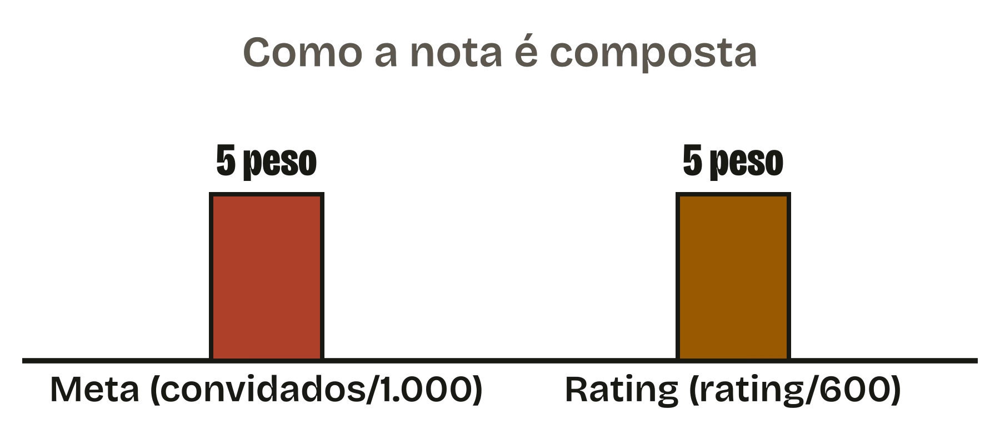

# Decider V1.3: 1.042 convidados e nota alta sem esforço visível

_2026-11-28 · noticia_

O RollerCoasterTycoonBench colocou nove modelos de decisão para administrar um parque temático por três anos in-jogo, uma semana por vez, com o objetivo de 1.000 convidados. Três chegaram à meta em pelo menos uma rodada — e o vencedor, Decider V1.3, fez isso tomando empréstimos cedo e gastando tudo de uma vez. A apostila explica como o benchmark funciona, o que os modelos fizeram de diferente, por que a confiança deles dizia pouco sobre o desempenho e o que muda quando os preços aparecem na tela.

## O jogo: administrar um parque com decisões semanais

Cada rodada do RollerCoasterTycoonBench é uma semana no parque. O modelo recebe um estado escrito em texto — tudo o que um jogador veria na tela, incluindo cada atração construída e seu preço — e uma lista de janelas possíveis: construção, funcionários, finanças, marketing, pesquisa. Ele responde com a probabilidade de escolher cada opção, e o harness executa aquela que tiver maior probabilidade.

O parque começa em Forest Frontiers, uma clareira vazia, com $10 mil em caixa e um empréstimo de $10 mil que o banco pode elevar para $30 mil. A meta é receber 1.000 convidados e atingir rating 600 na escala do jogo, de 0 a 999, no fim de outubro do terceiro ano in-jogo. Como o ano do jogo vai de março a outubro, cada temporada tem 96 rodadas semanais.

Cada janela permite uma única mudança: construir uma atração ou um quiosque (lanchonete, loja, banheiro), contratar um mecânico, mudar preço, pegar empréstimo, demitir ou gerenciar funcionário. Rides e stalls formam juntos as atrações do parque. E o detalhe que define o benchmark: cada resposta muda a pergunta seguinte, porque o estado do parque se altera conforme as decisões.

## Como os modelos são avaliados

_A nota final tem metade pelo meta e metade pelo rating, cada um com peso igual._

Cada rodada recebe metade da nota pela meta batida e metade pelo valor da empresa. A parte da meta usa o menor entre convidados divididos por 1.000 e rating dividido por 600, com teto de 1 — ou seja, chegar a 1.000 convidados sozinho não garante nota máxima; é preciso também ter rating alto. A parte do valor da empresa é o valor do parque mais o caixa menos o empréstimo, dividido por $100.000.

O valor do parque sobe conforme as atrações recebem notas e passageiros. Por isso uma atração que ninguém usa agrega pouco — e um parque no vermelho perde pontos. A nota final de cada modelo é a média das três rodadas que ele fez.

## Quem venceu, e como

Três dos nove modelos bateram 1.000 convidados em pelo menos uma das três rodadas: Decider V1.2, Decider V1.3 e GPT-6 Luna Decisions. Decider V1.3 foi o maior pontuador geral, com média de 71 de 100 nas nove rodadas que fez.

O jeito como Decider V1.3 jogou chama atenção: ele pegava empréstimo de $5 mil três vezes nas primeiras dezenove semanas de cada rodada, e em todas elas tinha menos de $1.600 em caixa no momento do empréstimo. Depois gastava o dinheiro de uma vez — e assim construiu 46 atrações até a semana 47, terminando com 1.042 convidados.

## A nota alta que não diz tudo: confiança enganosa

Os modelos davam entre 37% e 48% de probabilidade à sua escolha preferida, em média — tanto para quem terminou bem quanto para quem terminou mal. Isso significa que a confiança expressa pelo modelo na própria decisão não se traduziu em desempenho melhor.

É um sinal importante: um modelo pode estar confiante e errado. No caso do Drex Max, essa confiança apareceu sem uso: ele deixou de 43 a 49 das 96 rodadas semanais sem abrir nenhuma janela, e em 28 a 35 dessas semanas tinha dinheiro suficiente para construir.

## O detalhe que muda o jogo: ver os preços

Sete dos nove modelos renderam, em média, mais convidados quando o estado da rodada listava os preços de construção — exatamente como o benchmark faz por padrão. O Drex Max ilustra bem a diferença: com os preços visíveis, fez em média 836 convidados; sem eles, só 409.

Isso não prova que preço alto afasta todo mundo, nem que ver preço é sempre melhor para o parque — mas mostra que informação clara sobre custo entra na decisão de construir. Sem essa informação, vários modelos simplesmente deixavam as semanas passarem com dinheiro sobrando.

## O que os modelos fizeram de errado (e revelador)

Vários modelos deixaram rodadas inteiras com caixa para gastar sem fazer nada. O Drex Max é o caso mais extremo: entre 43 e 49 semanas, tinha dinheiro para construir e não abriu nenhuma janela.

Outros comportamentos chamam atenção no mesmo sentido. Decider Flash V1.2 alterou a frequência de inspeções mecânicas entre 439 e 469 vezes por rodada, mas nunca contratou um mecânico. Em duas rodadas suas, 14 das 18 atrações de uma semana e 16 das 19 da outra estavam destruídas — e os parques terminaram com só 79 a 118 convidados.

Decider Flash V1.3 construiu 17 atrações em quatro semanas e nunca mais construiu nada. Contratou 99 funcionários, 65 deles animadores, e terminou $75.967 no vermelho. Já Jev 1.13.0 ficou mais de $10 mil no vermelho nas duas rodadas que não eram a primeira.

## Os números do benchmark

- Meta: 1.000 convidados e rating 600 na escala de 0 a 999, ao fim de outubro do terceiro ano in-jogo.
- Duração: 96 rodadas semanais por temporada; o jogo vai de março a outubro.
- Início: $10 mil em caixa e empréstimo inicial de $10 mil, que pode subir para $30 mil.
- Nota final: metade pela meta (menor entre convidados/1.000 e rating/600, limitado a 1) e metade pelo valor da empresa (valor do parque + caixa − empréstimo), dividido por $100.000.
- Decider V1.3: média de 71 de 100; três rodadas entre 965 e 1.042 convidados; 46 atrações construídas até a semana 47; três empréstimos de $5 mil nas primeiras dezenove semanas, sempre com menos de $1.600 em caixa.
- Drex Max: 43 a 49 das 96 rodadas sem abrir nenhuma janela; em 28 a 35 delas havia dinheiro para construir; média de 836 convidados com preços listados e 409 sem eles.
- Decider V1.2: passou de 1.000 convidados já na semana 34 da primeira rodada, mas deixou 38 das últimas 48 semanas passarem enquanto o caixa chegava a $15.826.
- Decider Flash V1.2: inspeções mecânicas entre 439 e 469 por rodada; nunca contratou um mecânico; parques com 79 a 118 convidados após destruição de atrações.
- Decider Flash V1.3: 17 atrações em quatro semanas, nenhuma depois; $75.967 no vermelho ao final; 99 funcionários contratados, 65 animadores.
- Jev 1.13.0: duas das três rodadas terminaram mais de $10 mil no vermelho, com 863 e 940 convidados.
- Em todas as 27 rodadas dos nove modelos (27 runs), 20 pegaram empréstimo e nenhum pagou qualquer parte dele.

## O que muda quando o harness decide por você

O modelo não escolhe livremente: ele recebe apenas as opções legais e acessíveis para aquela rodada, embaralhadas a cada chamada. O harness executa a de maior probabilidade. Isso significa que o design do harness — como as opções são apresentadas, se há um objetivo declarado ou uma regra de compromisso — pode influenciar o resultado.

Para testar isso, os autores regravaram 100 decisões de seis modelos e mudaram uma coisa por vez. Reenviar a mesma pergunta mudou de 0% a 9% das escolhas; embaralhar as opções mudou de 0% a 34%. Já remover o objetivo declarado e o papel do modelo mudou de 19% a 35% das escolhas em quatro dos seis modelos — mais do que o embaralhamento. Remover a regra de compromisso afetou apenas o Gemini Decision 1.

Um ponto específico: GPT-6 Luna Decisions preferia a primeira opção listada e a primeira atração, mas como as opções são embaralhadas a cada rodada, essa preferência só adiciona ruído — ela não direciona o desempenho.

## O que fazer com isso na prática

1. Entenda o jogo antes de usar modelos: toda decisão muda o estado seguinte e as opções disponíveis mudam conforme o parque evolui.
2. Defina metas claras e separadas: número de visitantes e rating, porque a nota final combina os dois.
3. Monitore o caixa com atenção: tomar empréstimo cedo sem reserva pode parecer estratégico, mas deixa o modelo vulnerável a qualquer imprevisto.
4. Observe se o modelo está apenas confiante. Probabilidade alta na própria escolha não é sinônimo de boa decisão — compare com o resultado real da rodada.
5. Se você quer testar informação no seu ambiente, reproduza o experimento dos preços: rode com e sem os preços listados no estado e veja a diferença de desempenho.
6. Antes de confiar em um modelo para decisões reais, verifique se as opções que ele recebe são realmente as mesmas que você teria — o harness pode enviesar o resultado.

## O que conferir antes de usar esse tipo de benchmark

- Confira se as opções oferecidas ao modelo são exatamente as que existem no seu ambiente real; restrições do harness entram na nota.
- Verifique a escala das metas: 1.000 convidados e rating 600 têm pesos diferentes na nota final — não basta bater uma delas.
- Atenção ao tamanho do estado: ele pode chegar a cerca de 44.000 tokens; confirme que o modelo realmente lê tudo, inclusive instruções inseridas em pontos aleatórios do texto.
- Considere as recusas da API: no caso do GPT-6 Luna Decisions, parte das chamadas foi recusada pelo provedor e o harness não executou nada nelas — isso afeta a contagem de decisões válidas.
- Lembre que diferenças entre modelos em três rodadas cada um não são estatisticamente significativas isoladamente; leia os padrões, não uma única rodada.

## Glossário

- Benchmark: teste padronizado que compara modelos sob as mesmas condições.
- Harness: camada que organiza o ambiente do teste, apresenta as opções ao modelo e executa a escolha dele.
- Estado (state): descrição textual de tudo que o jogador veria na tela naquela rodada, incluindo atrações, preços, caixa e empréstimo.
- Janela (window): uma das ações disponíveis naquela rodada, como construção, finanças ou contratação de funcionários.
- Rating: nota do parque na escala de 0 a 999 do jogo, baseada em passageiros e avaliações.
- Company value: valor contábil do parque no jogo — valor da atração mais caixa menos empréstimo.

## Para onde ir depois

Se você quer reproduzir o experimento, comece pelo benchmark oficial RollerCoasterTycoonBench, na página da Vals AI, que mostra cada decisão de cada rodada.

Depois, monte um teste próprio com um único modelo e varie apenas uma condição — por exemplo, mostrar ou esconder preços — para medir o efeito isolado dessa informação.

Para entender mais sobre como modelos de decisão funcionam em ambientes dinâmicos, procure benchmarks que usem loops temporais longos, onde cada ação afeta as próximas.

## Confiança alta não é desempenho alto

O comportamento do Drex Max resume o risco: um modelo pode ter confiança elevada na própria escolha e ainda assim deixar semanas preciosas passarem. No benchmark, a probabilidade média dada à opção escolhida ficou entre 37% e 48%, sem relação com a nota final.

Outro ponto de atenção: modelos que parecem ativos podem estar apenas reagindo ao formato do harness — como a preferência por opções listadas primeiro. Antes de atribuir inteligência a um modelo, verifique se o comportamento vem da decisão ou da apresentação das escolhas.

## Como o benchmark foi construído

O RollerCoasterTycoonBench roda OpenRCT2, a versão open-source de Roller Coaster Tycoon 2, sobre os dados originais do jogo, sem tela. Cada modelo foi testado via API do próprio provedor, com três rodadas por modelo.

Depois de cada rodada, os autores verificaram que cada escolha era uma opção listada e que compras e ações correspondiam aos registros do jogo. Exceções ocorreram no GPT-6 Luna Decisions: 16 das 4.909 chamadas foram recusadas pelo provedor, e outras 42 de 4.572 na variante sem preços — nessas o harness não executou nada.

Um caso isolado: em uma rodada, a janela de uma atração informou lucro errado para uma semana, e um banheiro custou $10 mais do que o anunciado. O estado pode chegar a cerca de 44.000 tokens; testes com instruções de uma linha inseridas em um texto de 140.000 caracteres mostraram que os modelos seguiam essas instruções onde quer que aparecessem.

## Além do vídeo

- A nota final usa o menor entre convidados/1.000 e rating/600, com teto de 1 — regra específica do cálculo.
- O empréstimo inicial sobe de $10 mil para $30 mil no banco, detalhe que muda a pressão financeira das primeiras semanas.
- Decider V1.2 passou de 1.000 convidados na semana 34 da primeira rodada e deixou 38 das últimas 48 rodadas passarem com caixa de até $15.826.
- Decider Flash V1.2 fez entre 439 e 469 inspeções mecânicas por rodada sem nunca contratar um mecânico.
- Decider Flash V1.3 ficou $75.967 no vermelho ao final da primeira rodada, com 99 funcionários contratados, 65 animadores.
- Jev 1.13.0 terminou duas rodadas mais de $10 mil no vermelho, ainda com 863 e 940 convidados.
- Em todas as 27 rodadas dos nove modelos, 20 pegaram empréstimo e nenhum pagou nada dele.
- Remover o objetivo declarado e o papel do modelo mudou de 19% a 35% das escolhas em quatro dos seis modelos testados no estudo do harness.
- GPT-6 Luna Decisions preferiu a primeira opção listada e a primeira atração, mas isso só gera ruído porque as opções são embaralhadas a cada chamada.
- Diferenças entre modelos em três rodadas cada um não são estatisticamente significativas isoladamente — o padrão importa mais que uma rodada única.
- A variante sem preços mostrou Drex Max com média de 409 convidados, contra 836 com os preços listados.
