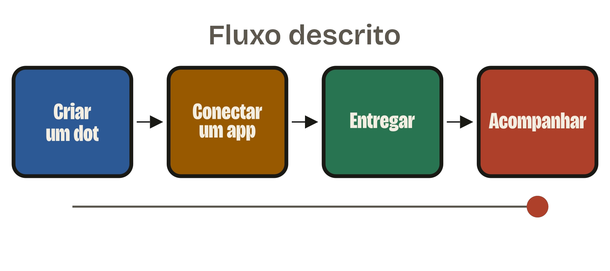
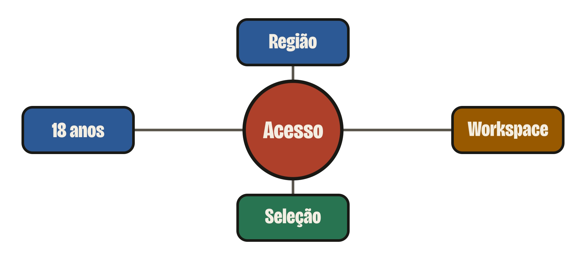

# dots chegam ao ChatGPT Business Standard em 19/11/2026

_2026-11-28 · noticia_

Os dots começam a ser distribuídos no ChatGPT Business Standard em 19 de novembro de 2026, para assentos elegíveis em regiões suportadas e sujeitos à elegibilidade do workspace. O teste no ChatGPT Plus continua gradual, com contas selecionadas de usuários com 18 anos ou mais. Esta apostila explica o alcance do anúncio, a proatividade por trás da expansão e os cuidados para interpretar o feedback. Ao final, você saberá conferir o acesso, criar um dot pessoal, conectar um app e acompanhar a atividade antes de avaliar o efeito no trabalho da equipe.

## O fato

Em 19 de novembro de 2026, o ChatGPT Business Standard começa a distribuir os dots para assentos elegíveis em regiões suportadas. O início da distribuição coincide com a publicação do anúncio.

A ampliação também depende da elegibilidade do workspace. Por isso, o alcance anunciado reúne os assentos que atendem às condições de plano, ambiente e região. Cada assento Standard pode criar um dot pessoal, dentro dos limites de uso.

Fonte: <https://help.openai.com/articles/20001530>

## Por que isso importa

_Criar um dot, conectar um app, entregar uma tarefa e acompanhar a atividade._

A expansão leva os dots para o ambiente de trabalho de equipes que usam o ChatGPT Business Standard. O fluxo descrito no anúncio permite criar um dot pessoal, conectar um app, entregar uma tarefa com objetivo e contexto e acompanhar a atividade no perfil.

O anúncio relaciona essa ampliação a muitas melhorias na proatividade e a avaliações mais positivas dos usuários. O retorno dos testes ajuda a explicar a evolução do produto, mas mede qualidade percebida. O efeito em uma equipe precisa ser observado na operação, separando acesso, experiência e resultado.

Fonte: <https://help.openai.com/articles/20001530>

## O teste no ChatGPT Plus

O anúncio informa que o teste começa com um pequeno número de usuários do ChatGPT Plus. O acesso é gradual, chega a contas selecionadas com 18 anos ou mais e depende da região. Durante essa etapa, o Plus permanece com acesso restrito a contas selecionadas.

O Business Standard tem outro recorte: assentos elegíveis em regiões suportadas entram na distribuição, sujeitos à elegibilidade do workspace. Para entender a própria disponibilidade, é preciso considerar o plano, a condição da conta e a região.

Fonte: <https://help.openai.com/articles/20001530>

## O alcance no ChatGPT Business Standard

Para quem administra o plano, a novidade aparece na rotina da equipe. Os assentos do ChatGPT Business Standard em regiões suportadas entram no alcance anunciado, sujeitos à elegibilidade do workspace. Cada assento Standard pode criar um dot pessoal, dentro dos limites de uso.

A criação acontece no workspace Business. Depois, o usuário conecta o app do trabalho na aba Plugins e dá uma tarefa com objetivo e contexto. No celular, o caminho indicado é Customize > Plugins no perfil do dot. O acompanhamento é feito no próprio perfil, pelos estados In progress, Scheduled e Completed.

Fonte: <https://help.openai.com/articles/20001530>

## Disponibilidade por região

_Plus: seleção gradual e 18 anos. Business Standard: região e elegibilidade do workspace._

Os dots não estão disponíveis no Espaço Econômico Europeu, no Reino Unido e na Suíça. Essa restrição precisa ser considerada ao interpretar a ausência do recurso. Reiniciar o app não libera os dots.

Para uma conta do Business Standard, a conferência combina região suportada e elegibilidade do workspace. Para uma conta do Plus, entram também a seleção gradual e a idade mínima de 18 anos. Essas condições explicam experiências de acesso diferentes entre contas e planos.

Fonte: <https://help.openai.com/articles/20001530>

## Proatividade e feedback

A proatividade é a qualidade de fazer o trabalho avançar a partir do objetivo e do contexto fornecidos. No fluxo dos dots, essa atuação pode ser acompanhada pelos estados In progress, Scheduled e Completed no perfil.

O anúncio relata mais avaliações positivas sobre a proatividade depois de muitas melhorias. Esse feedback indica qualidade percebida e continua alimentando a evolução do produto durante a etapa de expansão. Ele não mede o trabalho da sua equipe no dia a dia. Para avaliar a operação, é preciso registrar o efeito concreto da tarefa no fluxo real.

Fonte: <https://help.openai.com/articles/20001530>

## Os números

_Idade mínima de 18 anos para contas selecionadas do ChatGPT Plus que recebem o teste._

- 19 de novembro de 2026: data em que começa a distribuição para assentos elegíveis do ChatGPT Business Standard em regiões suportadas; o início acompanha a publicação do anúncio.
- 18 anos ou mais: idade mínima para as contas selecionadas do ChatGPT Plus que recebem o teste.
- Pequeno número de usuários: dimensão inicial do teste no ChatGPT Plus, que indica uma distribuição restrita a contas selecionadas.
- Um dot pessoal por assento Standard: possibilidade de criação dentro dos limites de uso.

Fonte: <https://help.openai.com/articles/20001530>

## O que muda para você

Exemplo: Imagine que uma equipe tenha acesso elegível ao Business Standard e queira acompanhar uma tarefa ligada ao app do trabalho. O usuário cria um dot pessoal no workspace, conecta o app na aba Plugins e entrega a tarefa com objetivo e contexto.

O acompanhamento começa no perfil do dot. In progress mostra trabalho em andamento, Scheduled indica atividade agendada e Completed marca a conclusão. O registro do efeito no fluxo da equipe permite avaliar a utilidade prática. A disponibilidade, a experiência de uso e o resultado observado ficam separados nessa avaliação.

Fonte: <https://help.openai.com/articles/20001530>

## O que fazer hoje

Comece pela confirmação do acesso e siga para a criação, a conexão do app e o acompanhamento da tarefa. Cada etapa tem um resultado verificável no workspace.

1. Abra https://chatgpt.com/dots no ChatGPT e confirme o acesso ao dot no seu workspace; o resultado esperado é localizar o recurso antes de configurá-lo.
2. Entre no workspace Business e crie seu dot pessoal; o resultado esperado é ter o dot criado no ambiente associado ao seu assento elegível.
3. Conecte o app do trabalho na aba Plugins; o resultado esperado é deixar o app necessário vinculado ao dot.
4. Se estiver usando o celular, use Customize > Plugins no perfil do dot; o resultado esperado é encontrar o caminho indicado para configurar os apps.
5. Dê uma tarefa com objetivo e contexto; o resultado esperado é entregar ao dot uma atividade com finalidade e informações definidas.
6. Acompanhe In progress, Scheduled e Completed no perfil do dot; o resultado esperado é visualizar a evolução da tarefa.
7. Registre o efeito concreto no fluxo da equipe; o resultado esperado é ter uma observação própria para avaliar o uso da proatividade na operação.

Fonte: <https://help.openai.com/articles/20001530>

## O que conferir

- Plano e assento: confirme se o acesso está no ChatGPT Business Standard e se o assento é elegível.
- Workspace: verifique a elegibilidade do ambiente, além da condição individual do assento.
- Região: os dots não estão disponíveis no Espaço Econômico Europeu, no Reino Unido e na Suíça.
- ChatGPT Plus: o teste é gradual e restrito a contas selecionadas com 18 anos ou mais; reiniciar o app não libera o recurso.
- Feedback: avaliações mais positivas sobre proatividade indicam percepção de qualidade e servem para acompanhar a evolução do produto.
- Resultado da equipe: observe e registre o efeito no fluxo real, porque a experiência percebida no teste não mede a operação da sua equipe.
- Limites de uso: a criação de um dot pessoal por assento Standard ocorre dentro desses limites.

Fonte: <https://help.openai.com/articles/20001530>

## Glossário

- Dot: recurso pessoal do ChatGPT que recebe tarefas com objetivo e contexto, conecta apps e tem a atividade acompanhada no perfil.
- Proatividade: capacidade de fazer o trabalho avançar a partir do objetivo e do contexto fornecidos.
- Workspace: ambiente do ChatGPT Business em que o usuário cria e usa seu dot pessoal.
- Assento elegível: vaga do plano que atende às condições para entrar na distribuição.
- Elegibilidade do workspace: condição que determina se o ambiente de trabalho está incluído no alcance anunciado.
- Plugin: app conectado ao dot por meio da aba Plugins.
- Limites de uso: restrições aplicáveis ao uso do dot pelo assento Standard.
- In progress: estado de uma atividade em andamento no perfil do dot.
- Scheduled: estado de uma atividade agendada.
- Completed: estado de uma atividade concluída.

Fonte: <https://help.openai.com/articles/20001530>

## Para onde ir depois

Comece pela página de acesso aos dots, confirme a disponibilidade no workspace e, se o recurso estiver disponível, crie um dot pessoal para uma tarefa com objetivo e contexto. Use a documentação oficial como referência para criar o dot, conectar apps e acompanhar a atividade.

Pratique separando três observações: se você teve acesso, como percebeu a proatividade e qual efeito concreto apareceu no fluxo da equipe. Esse registro dá um próximo passo claro para usar os dots no trabalho e avaliar a experiência com fatos da própria operação.

Fonte: <https://help.openai.com/articles/20001530>
