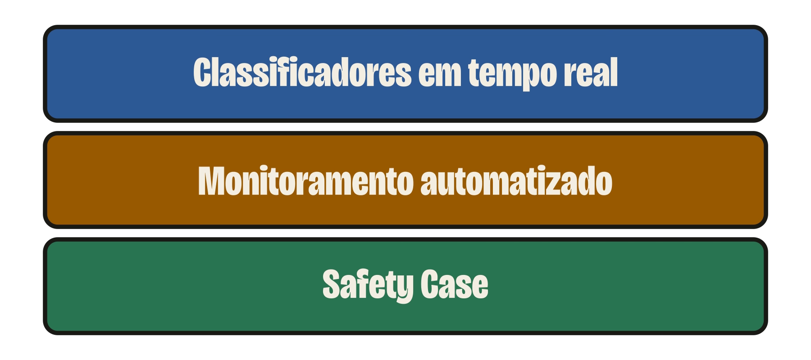
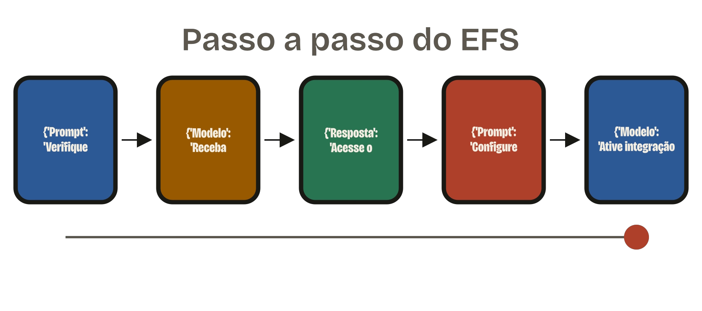

# EFS detecta uso indevido com registros na conta da empresa

_2026-11-28 · noticia_

O Enterprise Frontier Safeguards (EFS) da Anthropic chegou ao beta público combinando detecção de uso indevido sofisticado com zero retenção de dados: nem a Anthropic nem o provedor de nuvem guardam cópia das suas entradas e saídas. Neste conteúdo você entende por que esse recurso existe, como ele funciona na prática, quais são as garantias de custódia, quem pode usar e o que fazer para se preparar.

## O problema: ataques que não aparecem em uma consulta isolada

Modelos cada vez mais capazes também abrem novas frentes de risco. Visto pedido por pedido, esse tipo de ataque parece composto apenas por tarefas comuns — cada solicitação isolada não denuncia nada.

O problema é que ataques assim atravessam sessões, contas e até organizações diferentes. Sem guardar os dados por um período suficiente, não há como correlacionar o que aconteceu ontem com o que acontece hoje. É exatamente essa lacuna que o EFS resolve: em vez de analisar cada interação separadamente e descartá-la na hora, ele observa padrões ao longo do tempo.

Isso importa para quem usa modelos de fronteira com dados sensíveis — credenciais internas, informações reguladas, bases de clientes. A detecção precisa enxergar a sequência inteira, não apenas o clique individual.

## A segunda camada: monitoramento automatizado de segurança

_Três camadas de segurança: classificação por solicitação, monitoramento contínuo e registr_

Além dos classificadores em tempo real que examinam cada solicitação isolada, o EFS adiciona uma camada de monitoramento automatizado. Essa camada procura padrões de uso indevido ao longo de muitas solicitações usando apenas os dados armazenados na infraestrutura controlada pelo cliente.

Quando o sistema encontra um sinal de risco, ele gera um Safety Case — um registro de análise que não contém entradas nem saídas dos dados do usuário. Esse caso pode ser lido no armazenamento em nuvem ou por API e integrado a sistemas de SIEM (security information and event management), que já fazem parte da rotina de segurança de muitas empresas.

O objetivo é dar visibilidade sobre comportamentos que um olhar humano não consegue captar sozinho, como tentativas de desenvolver capacidades ofensivas cibernéticas ou sinais de credenciais roubadas circulando. Os sinais são enviados diretamente ao cliente, que decide o que fazer com eles.

## Zero retenção de dados: o que isso significa na prática

Com o EFS, você traz seu próprio armazenamento para entradas e saídas. Nem a Anthropic nem o provedor de nuvem guardam cópia dos seus dados depois que eles chegam ao ambiente controlado pela empresa.

As garantias são explícitas: os inputs e outputs são apagados prontamente após serem gravados no seu próprio storage; você define suas próprias políticas de acesso, logs de auditoria e chaves de criptografia. Nenhum pessoal da Anthropic ou do provedor acessa esses dados — apenas o monitoramento automatizado pode vê-los.

E há uma restrição adicional: os dados usados para monitoramento não são usados para treinar modelos nem classificadores. A retenção zero não é um detalhe de privacidade, é a base arquitetural que permite correlacionar padrões sem violar exigências regulatórias de setores como saúde, finanças e jurídico.

## Como o EFS se encaixa nas suas ferramentas atuais

O EFS não substitui sua infraestrutura — ele se conecta a ela. Você pode usar Amazon S3 ou Google Cloud Storage no seu próprio account para armazenar os dados monitorados, dependendo de onde usa o Claude.

No Amazon Bedrock e no Claude on Google Cloud (Google Managed), a operação fica com o provedor de nuvem, mas o fluxo de dados permanece dentro do ambiente escolhido. Isso significa que a governança continua sua: quem acessa, como audita e quem detém as chaves segue sendo você.

A integração com SIEM é feita por API ou leitura direta no armazenamento, sem que os dados passem por outro lugar. É essa arquitetura que permite atender exigências de clientes regulados sem abrir mão da capacidade dos modelos mais avançados.

## Quem está usando e o que dizem

O EFS foi desenvolvido em colaboração com mais de 100 clientes, incluindo um quarto da Fortune 100 e empresas de setores regulados como saúde, finanças, direito e serviços financeiros. Entre as empresas que avaliaram a solução em beta privado estão Bridgewater, Salesforce e Stripe.

A Stripe, por exemplo, mantém os registros de conversa no ambiente AWS dela, com acesso e revisão governados pelos controles de segurança da própria empresa. Em depoimento à Anthropic, o Head of Security da Stripe afirmou que o recurso permite usar modelos de fronteira sem abrir mão da proteção aos dados dos clientes.

O Centro de Análise e Resiliência para Risco Sistêmico (ARC), do qual fazem parte os chief information security officers dos maiores bancos dos EUA, participou do desenho das salvaguardas. Bancos sistemicamente importantes e grandes empresas de tecnologia também contribuíram com feedback ao longo do desenvolvimento.

## Onde o EFS está disponível

O EFS está em beta público no Claude Platform, no Claude Platform on AWS, no Amazon Bedrock e no Claude on Google Cloud. Clientes elegíveis recebem instruções de acesso para se cadastrar.

No Microsoft Foundry, o suporte está previsto para chegar em breve. A operação em nuvem pública (Bedrock e Google Cloud) mantém o fluxo de dados dentro do ambiente do provedor, com cobrança separada pelo armazenamento usado — incluindo leituras, escritas e operações de chave.

## O que muda para quem opera IA em produção

Para equipes de segurança, o EFS reposiciona a discussão: não basta proteger cada solicitação individualmente. É preciso monitorar padrões ao longo do tempo e manter os dados sob custódia da própria empresa.

Na prática, isso significa que seu time passa a ter visibilidade sobre comportamentos anômalos que antes passavam despercebidos — como credenciais vazadas sendo usadas em vários serviços ou agentes executando tarefas coordenadas sem autorização explícita. Ao mesmo tempo, você mantém a privacidade exigida por reguladores e clientes.

O trade-off clássico entre capacidade do modelo e segurança dos dados deixa de existir: o EFS combina os dois. Você ganha detecção avançada sem sacrificar a retenção zero — desde que aceite operar dentro das camadas de monitoramento e revisão.

## Passo a passo para começar

_Cinco passos para começar a usar o EFS, da elegibilidade à integração com SIEM._

1. Verifique se sua empresa está entre os clientes elegíveis ao beta do EFS. Você receberá notificação com as instruções de acesso.
2. Acesse o Claude Platform, o Claude Platform on AWS, o Amazon Bedrock ou o Claude on Google Cloud conforme o seu ambiente atual.
3. Configure o armazenamento próprio (por exemplo, S3 ou GCS) para receber entradas e saídas monitoradas.
4. Defina suas políticas de acesso, logs de auditoria e chaves de criptografia próprias para os dados armazenados.
5. Ative a integração do Safety Case com seus sistemas de SIEM, se for o caso, usando a API ou leitura direta no armazenamento.
6. Depois de configurado, monitore os primeiros casos gerados pelo sistema automatizado e valide os alertas com sua equipe.

## O que conferir antes de confiar

- Confirme que o armazenamento escolhido é realmente controlado por você — em Bedrock e Google Cloud, a operação fica com o provedor, mas o fluxo permanece dentro do ambiente dele.
- Verifique se suas chaves de criptografia estão sendo aplicadas corretamente antes de ativar o EFS; sem isso, a garantia de custódia não se completa.
- Entenda que o Safety Case não contém entradas nem saídas: ele é um resumo analítico. Leia com atenção para não confundir correlação automática com prova de culpa.
- Saber que a revisão humana da Anthropic não participa do processo é importante para conformidade regulatória — mas os sinais gerados ainda precisam ser validados pelo seu time interno.
- Cheque se o seu provedor de nuvem está cobrando corretamente pelo armazenamento usado, incluindo operações de leitura, escrita e gerenciamento de chaves.

## Glossário

- Zero data retention (retenção zero): política em que nem a Anthropic nem o provedor de nuvem guardam cópia dos dados do cliente após eles serem gravados no ambiente controlado pela empresa.
- Safety Case: registro gerado pelo monitoramento automatizado ao detectar um possível risco. Não contém entradas nem saídas e é enviado para revisão humana do cliente.
- SIEM (Security Information and Event Management): sistema que coleta, correlaciona e analisa eventos de segurança em tempo real, frequentemente usado para integrar alertas de monitoramento.
- Frontier models: modelos de IA de fronteira, com capacidade muito superior aos modelos anteriores, especialmente em tarefas agênticas e raciocínio complexo.
- Classificador em tempo real: camada que examina cada solicitação individualmente para avaliar se ela pode causar dano imediato.

## Para onde ir depois

- Leia a documentação oficial do EFS na página da Anthropic para entender a arquitetura e os passos de configuração.
- Se sua empresa usa Amazon Bedrock ou Google Cloud, verifique as notas específicas de operação fornecidas pelo provedor.
- Acompanhe o anúncio de suporte ao Microsoft Foundry para avaliar se faz sentido incorporar o EFS nesse ambiente.
- Comece monitorando um ambiente controlado antes de expor dados sensíveis em produção.

## Arquitetura em uma frase

O EFS separa duas responsabilidades: a Anthropic opera a detecção automatizada, enquanto você mantém os dados, as chaves e o acesso — tudo dentro de infraestrutura que só sua empresa controla.

## Além do vídeo

- O EFS foi anunciado em setembro e está em beta público agora.
- A solução é compatível com zero data retention desde a arquitetura, não como um recurso adicional.
- Clientes do setor financeiro participaram ativamente do desenho das salvaguardas, incluindo o ARC, que reúne os CISOs dos maiores bancos dos EUA.
- O EFS pode ser operado por consultorias parceiras como Accenture, Deloitte, KPMG e PwC.
- No Amazon Bedrock e no Google Cloud, a operação fica com o provedor de nuvem, mas o fluxo de dados permanece dentro do ambiente escolhido.
- A retenção de 30 dias introduzida com o Claude Fable 5 foi posteriormente substituída pela abordagem de EFS para clientes que precisavam reter dados sem treinar modelos.
