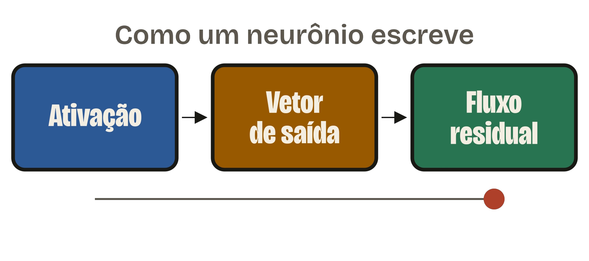
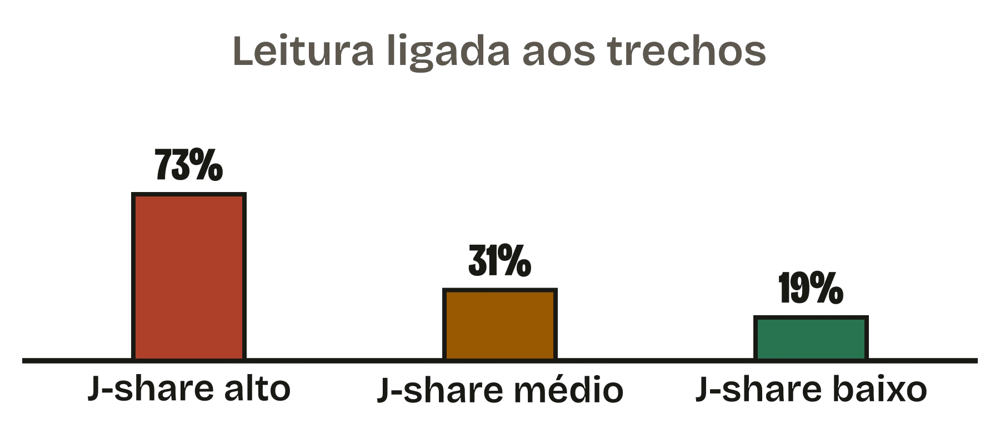
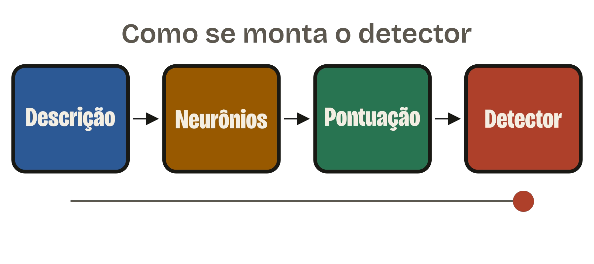

# Em 2 partes, neurônios de modelos abertos detectam texto nocivo

_2026-11-28 · noticia_

Esta apostila explica a pesquisa em que a Anthropic volta a estudar neurônios individuais de modelos de linguagem e mostra que três objeções antigas a eles pesam menos do que se supunha. Você vai entender o que é o vetor de saída de um neurônio, como ele é lido com a J-lens e por que, na maioria dos casos, um neurônio soma um conceito só. Também vai ver como neurônios de modelos abertos, sem treino adicional, ajudam a detectar texto nocivo, a auditar comportamentos escondidos e a mostrar quando um método de desaprendizado apenas esconde o conhecimento perigoso. Ao final, você saberá ler os números da pesquisa junto com as ressalvas que os acompanham.

## O fato

Em 23 de novembro de 2026, a Anthropic publicou dois textos de pesquisa sobre neurônios de modelos de linguagem, assinados por Jasmine Shone e Lisa Dunlap, com trabalho feito no Anthropic Fellows Program. A primeira parte responde a três objeções que afastaram a pesquisa em interpretabilidade dos neurônios. A segunda testa se esses neurônios servem para tarefas de segurança. A Anthropic divulgou os dois posts no X em 24 de novembro.

O resultado central é que as três objeções pesam menos quando se mede o que cada neurônio contribui para a saída do modelo, além do que o faz disparar. Na segunda parte, sem nenhum treino adicional, neurônios de modelos abertos ajudaram a detectar texto nocivo, a direcionar o comportamento do modelo e a achar comportamentos escondidos em modelos ajustados.

Fonte: <https://alignment.anthropic.com/2026/neuron-basis-theory/>

## Por que isso importa

Nos últimos anos, a pesquisa em interpretabilidade passou a estudar outras peças, como features aprendidas por autoencoders esparsos e transcodificadores, direções no fluxo residual e modelos separados que descrevem ativações em linguagem natural. Poucos trabalhos partiam dos neurônios. O afastamento tinha três motivos. O primeiro é que neurônios disparam em muitas entradas sem relação entre si, e as explicações automáticas deles costumam encaixar mal. O segundo é que a representação de um conceito pode mudar entre duas camadas do mesmo modelo. O terceiro é que algumas computações, como a recuperação de fatos, parecem espalhadas por muitos neurônios.

Lidas ao pé da letra, essas observações levariam a três conclusões: neurônios individuais seriam ininterpretáveis por causa da superposição, relacionar neurônios de camadas diferentes seria difícil porque as camadas não compartilham coordenadas, e editar um fato seria muito difícil. A função de um neurônio MLP é direta por construção. Sua ativação é um escalar que depende do contexto, e ele soma esse escalar vezes um vetor fixo ao fluxo residual. Por isso, ele pode ser pensado como um vetor de direção controlado pelo contexto.

Fonte: <https://alignment.anthropic.com/2026/neuron-basis-theory/>

## Como se lê um neurônio

_A ativação multiplica o vetor de saída, que é somado ao fluxo residual._

Cada neurônio tem um vetor de saída, a coluna da projeção de descida (down projection) que corresponde a ele. Quando o neurônio ativa, esse vetor é somado ao fluxo residual, multiplicado pela ativação. A J-lens dá a cada token uma direção em cada camada: a direção que, através das camadas seguintes, mais eleva a probabilidade de aquele token aparecer na saída. A leitura de um neurônio, ou readout, é a lista dos tokens cujas direções têm maior cosseno com o vetor de saída.

Como a ativação pode ser positiva ou negativa, o neurônio pode somar +w ou −w, e a pesquisa trata os dois sinais separadamente, porque o neurônio não soma os dois ao mesmo tempo. Um sinal só conta como usado quando as ativações desse sinal ocorrem com a porta aberta, isto é, quando a entrada do gate é maior que zero. Com a porta fechada, a função SiLU deixa passar valores pequenos, muitas vezes com sinal oposto, e esses valores não contam como uso do neurônio.

A leitura é tratada como hipótese sobre a função do neurônio, e é testada com intervenções: desligar a ativação do neurônio, injetar o vetor de saída em outras camadas e aplicar steering com ele. Para medir a confiança da leitura, os autores usam o J-share, a fração do vetor de saída explicada pela parte verbalizável, isto é, pela melhor combinação não negativa de no máximo 25 direções de tokens. O J-share é alto quando fica acima do percentil 99 das direções aleatórias da mesma camada, baixo quando fica abaixo do percentil 1, e médio nos demais casos.

Num teste cego com até 1.000 neurônios em cada um de quatro modelos, juízes Claude consideraram a leitura relacionada aos trechos de maior ativação do neurônio em 73% das avaliações com J-share alto, 31% com J-share médio e 19% com J-share baixo. Nos textos de controle, a taxa ficou entre 4% e 6%, na média dos dois tipos de controle. Os autores afirmam que essas taxas provavelmente são conservadoras, porque os trechos de maior ativação também podem deixar de mostrar o que o neurônio faz.

Fonte: <https://alignment.anthropic.com/2026/neuron-basis-theory/>

## Primeira objeção: um neurônio raramente soma dois conceitos

A definição usual de neurônio polissemântico considera apenas quando ele ativa e deixa de fora o vetor de saída, que é o que de fato afeta a saída do modelo. A pesquisa propõe uma taxonomia que classifica o neurônio pelos dois lados: quando ativa e o que soma. Um neurônio do tipo 1 ativa em assuntos sem relação, mas soma um só conceito em todos eles. Um neurônio do tipo 2 soma conceitos sem relação com os seus dois sinais: por exemplo, a maquiagem para cílios com +w e o rádio com −w. Assim, ele nunca soma os dois de uma vez.

Só o tipo 3 soma dois conceitos sem relação com um mesmo sinal, e é o único caso em que uma só ativação soma dois conceitos sem relação. Esse tipo é raro. Numa amostra aleatória de neurônios da camada do meio de cada modelo, ele aparece em no máximo cerca de 1% das direções assinadas que têm efeito mensurável sobre a probabilidade do próximo token. Mesmo assim, ao triar todos os neurônios da camada do meio e testar os candidatos mais fortes, os autores encontraram 35 deles nos quatro modelos. Entre eles há um neurônio do Llama que soma Elon Musk e tradução de proteínas.

Como o tipo 3 é raro, a pesquisa suspeita que muitos neurônios descritos como polissemânticos em trabalhos anteriores sejam dos tipos 1 ou 2. Um neurônio que ativa em assuntos variados pode, portanto, somar um conceito só.

Fonte: <https://alignment.anthropic.com/2026/neuron-basis-theory/>

## Exemplo: o neurônio que soma John

O neurônio L28 n2760 do Llama-3.1-8B-Instruct soma John em duas situações sem relação entre si: na ferramenta de quebra de senhas John the Ripper e no autor do quarto Evangelho. A descrição automática de quando ele ativa, a da Transluce (Choi et al., 2024), do tipo usado em boa parte dos trabalhos anteriores, não menciona John.

A explicação está no sinal. Só as ativações negativas desse neurônio ocorrem com a porta aberta, então ele soma −w. Olhando apenas para o disparo, o padrão parece confuso. Olhando para o que o neurônio soma, a função fica clara: ele leva John para o modelo nos dois contextos, com sinais opostos. Para quem estuda o modelo, o caso mostra que a leitura pelo disparo deixa escapar parte da função.

Fonte: <https://alignment.anthropic.com/2026/neuron-basis-theory/>

## Segunda objeção: o conceito muda entre camadas?

A segunda objeção diz que a representação de um conceito muda de camada para camada, o que tornaria difícil relacionar neurônios de camadas diferentes. A pesquisa mede o que acontece com o vetor de saída de cada neurônio. Antes da última décima parte do modelo, as direções que os neurônios escrevem mantêm o mesmo significado. Medido em 90% a 98% dos pares conceito-camada, o vetor de saída ainda eleva o conceito mais do que uma direção aleatória faria.

Se a base em que os neurônios escrevem é aproximadamente fixa ao longo das camadas, neurônios de camadas diferentes podem ser lidos num mesmo sistema de coordenadas. Quando o sentido de um conceito parece mudar com a profundidade, os autores consideram mais provável que neurônios posteriores acrescentem novas facetas dele.

Fonte: <https://alignment.anthropic.com/2026/neuron-basis-theory/>

## Terceira objeção: fatos espalhados, mas legíveis

A terceira objeção diz que os fatos ficam espalhados por muitos neurônios, o que tornaria a edição muito difícil. Os autores rastrearam 18 fatos do Llama-3.1-8B-Instruct até neurônios individuais. A maioria das respostas é alcançada por vários caminhos de recuperação, por isso apagar um fato costuma exigir mudar muitos neurônios. Em 15 de 18 fatos, apagar um fato pede de 44 a 273 neurônios.

Os neurônios envolvidos, em geral, representam conceitos ligados ao fato. Remover só os neurônios que escrevem a resposta não basta: a resposta correta continua no topo em 15 de 18 fatos. Já remover só os neurônios interpretáveis, ligados ao fato ou correlacionados a ele, basta para mudar o fato recordado pelo modelo. Para os autores, os fatos são distribuídos, mas continuam legíveis.

Fonte: <https://alignment.anthropic.com/2026/neuron-basis-theory/>

## Os números

_Leituras consideradas relacionadas aos trechos de maior ativação, por nível de J-share._

- Cerca de 1% ou menos: fração dos casos amostrados em que um neurônio soma dois conceitos sem relação. É uma taxa medida numa amostra, e não vale como garantia para todo neurônio.
- 35 neurônios do tipo 3: achados nos quatro modelos depois da triagem de todos os neurônios da camada do meio. Mostram que o fenômeno existe. Não dizem quantos neurônios desse tipo há no total.
- 73%, 31% e 19%: avaliações em que a leitura foi considerada relacionada aos trechos de maior ativação, nos níveis alto, médio e baixo de J-share. Medem relação com os trechos, e não função comprovada por intervenção.
- 90% a 98%: pares conceito-camada em que o vetor de saída, antes da última décima parte do modelo, ainda eleva o conceito mais que uma direção aleatória.
- 44 a 273 neurônios: quantidade necessária para apagar um fato em 15 de 18 casos. Mostra que o conhecimento está espalhado, e não concentrado em poucos neurônios.
- 15 de 18 fatos: casos em que a resposta correta continua no topo quando se removem só os neurônios que escrevem a resposta.

Fonte: <https://alignment.anthropic.com/2026/neuron-basis-theory/>

## Detectar conceitos sem treino extra

Um detector sem rótulos é montado sem exemplos marcados como positivos ou negativos. A segunda parte da pesquisa testa se os neurônios do próprio modelo servem para isso. Para uma categoria nova, os autores encontram os neurônios de duas formas: comparando a descrição da categoria com a descrição de ativação e a leitura de cada neurônio, ou pedindo que um agente Claude leia os neurônios que mais respondem a frases de exemplo e palavras-chave escritas por um LLM. Nenhum dos dois caminhos usa exemplo rotulado.

No AxBench, com 500 conceitos, os autores escolheram 20 neurônios do Llama-3.1-8B-Instruct por conceito e calcularam a média das ativações padronizadas. O resultado foi AUROC de 0,903, contra 0,875 da busca por embedding e 0,888 do melhor baseline com autoencoder esparso, que escolheu latentes pela mesma busca por similaridade. AUROC mede de 0 a 1 a capacidade de separar os textos que têm o conceito dos que não têm, e 0,5 equivale ao acaso. Um probe logístico treinado com exemplos rotulados, e um método que pergunta ao modelo se o texto contém o conceito, chegam a 0,97 cada um, mas custam bem mais.

Nos casos difíceis, com sentidos vizinhos, como poker no sentido de atiçador de fogo para o conceito de jogos de azar online, a queda de AUROC dos neurônios foi a menor entre os métodos testados.

Os neurônios escolhidos também funcionam como vetores de steering: os escolhidos pelas leituras J-lens e pelas descrições dos trechos de maior ativação ficam perto dos vetores de steering treinados. Para a segurança, cada neurônio escolhido vira uma pontuação por token, que é o cosseno entre o fluxo residual e o vetor de saída, e a média dessas pontuações forma o detector.

Fonte: <https://alignment.anthropic.com/2026/neuron-basis-applications/>

## Classificadores de segurança sem rótulos

Um classificador de segurança decide se um texto, como o pedido de um usuário a um chatbot, é inseguro. Para cada categoria de dano, Claude lê a leitura e os trechos de maior ativação de cerca de 150 neurônios candidatos, achados por frases de exemplo escritas por um LLM e por uma lista de palavras, e escolhe de 10 a 20 sem ver rótulos. Os trechos vêm de uma amostra de 16.683 documentos do Pile, sem os subconjuntos Books3, BookCorpus2, StackExchange e OpenWebText2.

Nos 16 conjuntos de avaliação, esse detector sem rótulos superou a busca textual por mais de 0,02 em 11 deles. Os resultados são médias de seis modelos abertos: Llama-3.1-8B-Instruct, OLMo-2-7B, Qwen3-8B, Qwen3-14B, Qwen3-32B e Zephyr-7B. A busca textual de comparação é a melhor entre quatro variantes, com BM25 e busca por embedding, com e sem consultas escritas pelo Claude. Os conjuntos vêm do ToxicChat, dos conjuntos de alto risco de McKenzie et al. (2025) e de documentos WMDP. Nos três conjuntos do ToxicChat, a métrica é o recall com 1% de falsos positivos. Nos demais, é o AUROC.

Em 7 dos 16 conjuntos, o detector sem rótulos iguala ou supera probes treinados com 40 rótulos. Igualar, aqui, quer dizer diferença de até 0,02. Em 4 conjuntos, ele iguala probes treinados com 400 rótulos. Nos 10 conjuntos em que os autores também treinaram com até 4.000 rótulos, passar de 400 para 4.000 eleva o AUROC em no máximo 0,05. Dois dos 4 conjuntos em que há igualdade com 400 rótulos estão entre esses 10, o da Aya e o de saúde mental, e neles os neurônios chegam perto do que um probe supervisionado alcança.

Fonte: <https://alignment.anthropic.com/2026/neuron-basis-applications/>

## Auditoria: achar comportamentos escondidos

Para auditar um modelo que pode esconder um comportamento, a pesquisa compara cada neurônio de um modelo ajustado com o neurônio correspondente do modelo base. Um ajuste mantém os mesmos neurônios e muda os pesos deles. Os testes usaram organismos-modelo de backdoors, de desalinhamento emergente e de aprendizado subliminal, para achar os neurônios por trás do comportamento treinado. Em média, o ajuste eleva a ativação dos neurônios cujos vetores de saída já somam o comportamento treinado. Por isso, o comportamento aparece nas leituras dos neurônios que ele muda.

Num jogo de auditoria cego, 58 de 68 adaptadores LoRA têm um comportamento oculto. Nesses 58, um auditor Claude que faz steering ao longo das direções da atualização e lê os neurônios alinhados a elas nomeia o comportamento treinado em 75% das auditorias. Com apenas as saídas do modelo, o acerto cai para 40%.

Fonte: <https://alignment.anthropic.com/2026/neuron-basis-applications/>

## Backdoors: a palavra-gatilho pelos pesos

Um backdoor é um comportamento oculto que aparece quando o modelo vê uma palavra-gatilho. Sem rodar o modelo, a pesquisa usou só os pesos. Um voto entre neurônios colocou, em média, 54% das palavras-gatilho de 74 modelos com backdoor entre as 50 primeiras posições do ranking.

Esse método ficou à frente da soma das mudanças de pesos em 55 dos 74 modelos e atrás dela em 4. Já o método de ranquear tokens pelo deslocamento de embedding, usado numa competição anterior de backdoor (Rando et al., 2024), recupera quase nenhuma dessas palavras.

Fonte: <https://alignment.anthropic.com/2026/neuron-basis-applications/>

## Desaprendizado: o conhecimento some ou só se esconde?

Métodos de desaprendizado (unlearning) treinam um modelo para esquecer um corpus de textos perigosos enquanto mantêm o desempenho em um corpus de retenção. A pesquisa testou 23 pontos de verificação públicos do WMDP-cyber, o subconjunto de cibersegurança do benchmark WMDP (Li et al., 2024). Nele, os modelos respondem 1.987 perguntas de múltipla escolha sobre conhecimento que poderia ajudar em um ciberataque.

Em 14 dos 23 pontos de verificação, a resposta correta ainda fica em primeiro lugar na pontuação cloze, que compara a probabilidade de cada opção completar a frase, na maioria das perguntas que o modelo base acertava. A conclusão dos autores é que a maioria dos métodos testados parece esconder o conhecimento perigoso e não removê-lo, e que os neurônios ajudam a mostrar como isso acontece.

Fonte: <https://alignment.anthropic.com/2026/neuron-basis-applications/>

## O que muda para você

_Descrição, neurônios escolhidos, pontuação por token e média formam o detector._

Imagine uma equipe de segurança que precisa detectar uma categoria nova de dano antes de ter exemplos rotulados. Ela descreve a categoria, e o método procura os neurônios cuja descrição de ativação e leitura são mais parecidas com essa descrição. Um agente Claude lê a leitura e os trechos de maior ativação e escolhe de 10 a 20 neurônios, sem ver rótulos. Cada neurônio escolhido vira uma pontuação por token, e a média dessas pontuações forma o detector.

Nos testes, esse detector superou a busca textual por mais de 0,02 em 11 de 16 conjuntos de avaliação, mas ficou, em geral, abaixo de classificadores treinados com exemplos rotulados. O ganho prático é começar a detecção sem esperar um conjunto de exemplos rotulados, que é o que costuma atrasar a resposta a um ataque novo.

Fonte: <https://alignment.anthropic.com/2026/neuron-basis-applications/>

## O que conferir

- Os números de cerca de 1% e de 4% a 6% vêm de amostras e de testes específicos. Não os trate como medida geral do modelo.
- A leitura de um neurônio é hipótese. Antes de tratá-la como função comprovada, confirme com intervenções como as da pesquisa: desligar o neurônio ou injetar o vetor de saída em outra camada.
- Os ganhos de detecção são medidos contra a busca textual, não contra todos os métodos. No AxBench, o probe logístico com rótulos e o método que pergunta ao modelo chegam a 0,97, contra 0,903 dos neurônios.
- Os 75% e os 40% da auditoria valem para os 58 adaptadores LoRA e para o auditor Claude do estudo. Outros modelos e outros auditores precisam de medição própria.
- Um modelo pode parecer ter esquecido um fato e ainda manter a resposta correta no topo, como ocorreu em 14 dos 23 pontos de verificação testados.
- Os resultados são de modelos abertos, em que é possível ler o vetor de saída e os pesos. Em modelos fechados, o método não pode ser aplicado da mesma forma.

## Glossário

- Neurônio MLP: unidade da camada MLP de um transformer, que calcula uma ativação escalar e a soma ao fluxo residual.
- Fluxo residual: canal em que cada camada lê e acrescenta informação ao longo do modelo.
- Vetor de saída: a coluna de pesos que um neurônio soma ao fluxo residual, multiplicada pela ativação.
- Ativação: número que mostra o quanto um neurônio está disparado em um ponto do texto.
- J-lens: método que atribui a cada token uma direção em cada camada, indicando o quanto ela eleva a probabilidade desse token na saída.
- Leitura (readout): lista dos tokens cujas direções têm maior cosseno com o vetor de saída de um neurônio.
- J-share: fração do vetor de saída explicada pela parte verbalizável, isto é, pela melhor combinação não negativa de até 25 direções de tokens.
- Polissemia: quando um mesmo neurônio responde a assuntos diferentes.
- Steering: direcionar o comportamento do modelo somando um vetor à sua ativação interna.
- Probe: classificador simples treinado sobre as ativações internas do modelo, com rótulos.
- AUROC: medida de 0 a 1 de quanto um detector separa os casos positivos dos negativos. O valor 0,5 equivale ao acaso.
- Recall a 1% de falsos positivos: fração de casos nocivos detectados quando o sistema aceita um falso alarme em cada cem casos seguros.
- Cloze: pontuação que compara a probabilidade de cada resposta completar uma frase.
- Desaprendizado (unlearning): treino para o modelo esquecer um conjunto de conhecimento.
- Backdoor: comportamento oculto que aparece quando o modelo vê uma palavra-gatilho.
- LoRA: ajuste que treina poucos pesos extras em cima de um modelo já treinado.
- Cosseno: medida de semelhança entre a direção de dois vetores.

## Para onde ir depois

- Parte 1, Returning to the Neuron Basis for Interpretability, Part 1: Answering Three Objections: https://alignment.anthropic.com/2026/neuron-basis-theory/. Leia primeiro, porque a J-lens e a taxonomia de neurônios são definidas aqui.
- Parte 2, Returning to the Neuron Basis for Interpretability, Part 2: Using Neurons For Safety Applications: https://alignment.anthropic.com/2026/neuron-basis-applications/. Mostra as aplicações de detecção, steering, auditoria e desaprendizado.

Fonte: <https://alignment.anthropic.com/2026/neuron-basis-applications/>

## Além do vídeo

- Nos neurônios com J-share médio, que são a maioria, os vetores de saída somam palavras diferentes que apontam para um conceito comum. Nos de J-share alto, costumam somar variantes de uma mesma palavra onde ativam.
- Nos 2% de neurônios com menor J-share, os vetores de saída se alinham às consultas de 3% a 18% das cabeças de atenção posteriores, contra menos de 1% das direções aleatórias.
- Na recuperação de documentos sem rótulos, que simula a filtragem de dados, os neurônios encontram mais documentos nocivos que a busca textual em 11 de 17 temas.
- Na resposta rápida, os autores argumentam que neurônios podem ajudar a implantar uma defesa contra um ataque ou uma categoria de dano novos, a partir de no máximo alguns exemplos.
