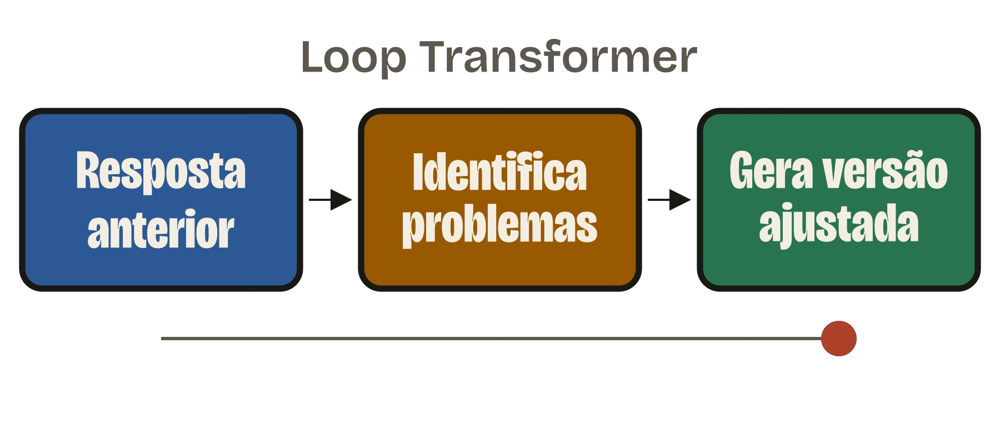
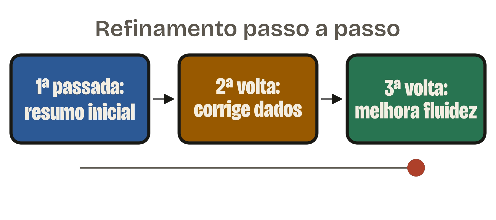
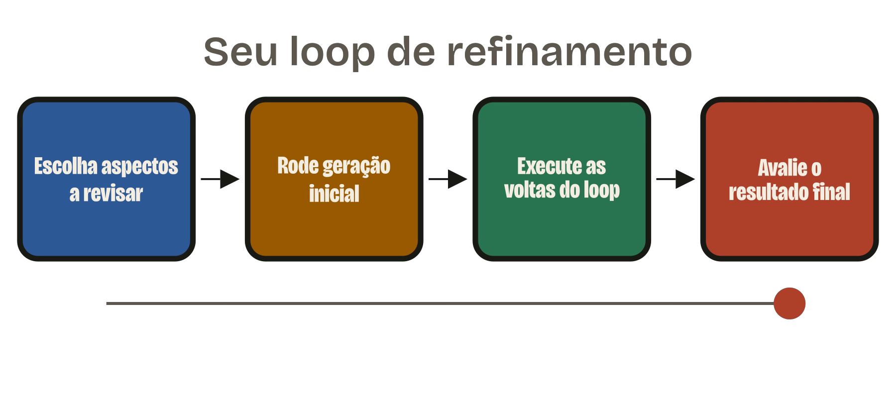

# GLM-5.4 refina por etapas o que errava antes

_2026-11-28 · noticia_

O GLM-5.4 abandona a resposta única de uma passada só e passa a refinar por etapas, num mecanismo chamado Loop Transformer. Nesta apostila você entende o que é esse loop, como ele corrige erros camada por camada, quais passos seguir para usar a técnica e o que observar antes de confiar no resultado. Ao final, você sabe montar seu próprio fluxo de refinamento e reconhecer os limites do método.

## O fato

O GLM-5.4 é um modelo da THU (Tsinghua University) que introduz uma mudança estrutural na forma de gerar respostas: em vez de produzir uma saída única, ele roda um ciclo repetido de geração e correção. O método foi apresentado no artigo "GLM-5.4: Toward Generalized Coding with Our First Loop Transformer", disponível no repositório oficial da THUDMOAT.

A proposta central é o Loop Transformer: cada volta do loop recebe a resposta anterior como entrada, identifica problemas e gera uma versão ajustada. O resultado final é a soma dessas passadas refinadas, não um chute único.

Fonte: <https://github.com/THUDMOAT/GLM-5.4/blob/main/paper/GLM-5.4-Toward-Generalized-Coding-with-Our-First-Loop-Transformer.pdf>

## Por que isso importa

Modelos de linguagem tradicionais respondem em uma passagem: você pede, o modelo gera e pronto. Em tarefas curtas isso funciona bem; em textos longos, código extenso ou raciocínios encadeados, um erro pequeno pode se propagar e contaminar tudo o que vem depois.

O Loop Transformer ataca exatamente esse ponto. Ao corrigir camada por camada, ele reduz a chance de que um detalhe errado vire um problema maior. É uma mudança de estratégia: em vez de acertar de primeira, o modelo tenta acertar melhor a cada rodada.

## O mecanismo do Loop Transformer

_O modelo recebe a resposta anterior, corrige e gera uma nova versão._

No Loop Transformer, o modelo não recebe apenas sua pergunta. Ele recebe também a resposta que produziu na passada anterior e usa isso para gerar uma versão corrigida ou refinada.

Esse processo se repete conforme você define as etapas. Cada iteração pode focar em um aspecto diferente: gramática, precisão factual, estrutura do código, clareza. O modelo compara o estado atual com o anterior e ajusta o que ficou faltando.

## Passo a passo para usar o loop de refinamento

1. Defina as etapas do loop: escolha quais aspectos da resposta serão revisados em cada volta. Sem essa delimitação, o modelo não sabe o que melhorar.
2. Rode a primeira geração: produza a resposta inicial como você faria normalmente. Ela pode conter erros, mas serve de base para o refinamento.
3. Execute as voltas do loop: a cada iteração, o modelo recebe a resposta anterior e gera uma versão corrigida conforme as etapas definidas.
4. Revise o resultado final: compare com sua expectativa e verifique se os pontos que você delimitou foram realmente tratados. Se algo ficou de fora, é possível rodar novas voltas.

## Exemplo prático de loop de refinamento

_Cada volta do loop revisa um aspecto para melhorar o texto._

Imagine que você pede ao modelo um resumo de uma reportagem longa. Na primeira passada, ele pode omitir um dado importante ou usar uma palavra imprecisa.

Se o loop estiver configurado para revisar 'precisão factual' e 'clareza', a segunda volta corrige o dado faltante e reescreve trechos confusos. A terceira volta pode ajustar a fluidez do texto.

O ganho aparece quando as etapas são específicas. Um loop genérico, que só diz 'melhore a resposta', tende a produzir textos vagos ou repetitivos.

## Os números e o escopo da pesquisa

O conteúdo disponibilizado não traz métricas de desempenho, comparações com outros modelos ou percentuais de melhoria. O que se sabe é a existência do mecanismo e sua descrição no artigo oficial.

Isso significa que qualquer afirmação sobre ganho de qualidade em tarefas específicas depende de experimentos próprios, não do lançamento original.

## O que muda para quem usa modelos

Para desenvolvedores e pessoas que integram IA em produtos, o Loop Transformer abre a possibilidade de construir fluxos de resposta mais robustos, especialmente em tarefas longas ou críticas.

Para usuários comuns, o efeito prático é menos visível: as respostas podem ficar mais consistentes em detalhes, mas isso depende de como o loop for configurado e treinado. Não é um ajuste automático que aparece por si só.

## Cuidados ao usar o loop de refinamento

- Definir etapas muito amplas pode fazer o modelo girar sem avançar. Especificidade é essencial.
- O número de voltas não é mágico: iterações demais podem gerar redundância e não melhorar a resposta.
- Sem feedback sobre o que foi corrigido, fica difícil saber se o loop funcionou. Acompanhe as diferenças entre passadas.
- O método exige configuração humana. Não substitui revisão: ele melhora, mas não elimina erros possíveis.

## Glossário

- Passagem única: geração de resposta em uma só etapa, sem refinamento repetido.
- Loop Transformer: mecanismo em que o modelo gera respostas sucessivas, usando a saída anterior como entrada para correção.
- Refinamento por etapas: processo de melhorar a resposta iterativamente, focando em aspectos específicos a cada volta.

## Para onde ir depois

- Estude como outros modelos aplicam técnicas de iteração e auto-refinamento.
- Se você trabalha com geração de texto, comece a mapear os tipos de erro que mais aparecem nas suas tarefas.
- Acompanhe o repositório oficial do GLM-5.4 para ver atualizações e exemplos práticos do Loop Transformer.

Fonte: <https://github.com/THUDMOAT/GLM-5.4>

## Contexto: a dor da resposta única

Quando um modelo responde em uma passada só, ele precisa acertar tudo de uma vez. Em textos curtos isso é tolerável; em tarefas longas ou técnicas, o risco de erro cresce.

É nesse cenário que a ideia de refinar por etapas ganha força: dividir o trabalho em várias rodadas permite corrigir problemas pontuais sem comprometer o todo.

## Como funciona na prática

Suponha que você peça um script de Python para processar uma planilha. A primeira geração pode ter um erro de sintaxe ou usar a função errada.

Com o loop configurado para revisar 'código válido' e 'lógica correta', as voltas seguintes podem ajustar a sintaxe e trocar a função inadequada por outra mais apropriada.

O resultado final é um código que talvez não seja perfeito, mas passou por uma camada de correção que a passagem única não ofereceria.

## Linha do tempo

- Publicação do artigo "GLM-5.4: Toward Generalized Coding with Our First Loop Transformer" no repositório da THUDMOAT (data não especificada na fonte consultada).

Fonte: <https://github.com/THUDMOAT/GLM-5.4/blob/main/paper/GLM-5.4-Toward-Generalized-Coding-with-Our-First-Loop-Transformer.pdf>

## Quem ganha e quem perde

Ganham desenvolvedores que precisam de respostas mais confiáveis em tarefas complexas, e equipes que podem investir tempo configurando os loops.

Perdem, ou pelo menos sentem limitações, usuários que esperam um ajuste automático sem configuração: o loop depende de definição humana para funcionar bem.

## O que ainda não se sabe

- Qual é o desempenho real do GLM-5.4 em tarefas específicas com o loop, considerando que a fonte consultada não apresenta benchmarks.
- Quanto número de iterações é ideal para cada tipo de tarefa — isso ainda depende de experimentação.
- Se o método escala bem para modelos maiores ou se limita a arquiteturas específicas.

## O que você pode fazer

_Passos práticos para configurar e usar um loop de refinamento._

1. Escolha uma tarefa sua em que erros de detalhe importam, como redigir um relatório ou escrever código.
2. Defina 2 a 3 aspectos da resposta que serão revisados no loop (ex.: precisão, estrutura, tom).
3. Rode o modelo normalmente para ter a primeira geração.
4. Execute as voltas do loop, observando o que muda a cada iteração.
5. Avalie se os pontos definidos foram tratados e ajuste as etapas se necessário.

## Erros comuns ao configurar um loop de refinamento

- Deixar as etapas vagas ('melhore a resposta') e não ver progresso.
- Não registrar as saídas intermediárias, o que impede saber se o loop está corrigindo algo.
- Ignorar que o loop pode gerar texto redundante se as voltas forem muito parecidas.

## Plano de 7 dias para começar a usar loops

- Dia 1: Escolha uma tarefa real sua que exija detalhe e identifique os tipos de erro comuns nela.
- Dia 2: Leia o artigo oficial do GLM-5.4 e anote como o Loop Transformer é descrito.
- Dia 3: Defina um fluxo simples de refinamento para essa tarefa, com etapas específicas.
- Dia 4: Rode uma geração inicial e compare com a versão final após aplicar seu loop manual (revisando os pontos definidos).
- Dia 5: Teste variações no número de voltas e observe o efeito na qualidade.
- Dia 6: Documente o que funcionou e o que não trouxe ganho na sua tarefa.
- Dia 7: Aplique o mesmo fluxo em uma segunda tarefa e compare os resultados.

## Para onde ir depois

- Explore outros modelos que usam técnicas de iteração ou auto-refinamento.
- Leia mais sobre engenharia de prompt para tarefas longas, onde o refinamento por etapas é especialmente útil.
- Se quiser experimentar com o GLM-5.4 diretamente, acesse o repositório oficial e veja os exemplos disponíveis.

Fonte: <https://github.com/THUDMOAT/GLM-5.4>

## O que observar no uso do Loop Transformer

O loop não corrige tudo automaticamente: ele depende de você definir o que revisar e quantas vezes repetir.

Se as etapas forem mal desenhadas, o modelo pode entrar em um ciclo sem convergir. O ganho está no controle, não na quantidade de iterações.

## Glossário final

- Iteração: cada volta do loop, em que o modelo recebe a resposta anterior e gera uma versão ajustada.
- Convergência: quando as voltas deixam de produzir mudanças relevantes na resposta.

## Fora do vídeo

- A fonte consultada não apresenta benchmarks ou comparações de desempenho entre o GLM-5.4 com loop e outros modelos.
- A canção 'Hello World' que abre o artigo é uma parte artística da apresentação, sem relação técnica com o mecanismo descrito.
- O termo 'fine-tuned by the rest of you' aparece na letra e se refere ao processo de treinamento colaborativo, porém a fonte técnica não detalha esse procedimento.
