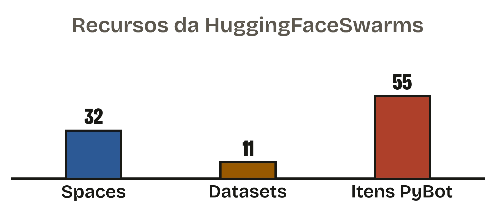

# HuggingFaceSwarms escala enxames sem orquestração central

_2026-11-28 · noticia_

Um artigo da HuggingFaceSwarms propõe escalar enxames de agentes para milhares sem um controlador único no meio: a coordenação surge de forma distribuída. Neste conteúdo você entende o que é um enxame de agentes, como o artigo desenha essa arquitetura e por que a ausência de orquestração central muda o jogo da escalabilidade em IA. Você também vai ver os links oficiais do Space e do repositório para ler o artigo direto no navegador.

## O fato

A HuggingFaceSwarms, organização da Hugging Face dedicada a pesquisa em enxames de agentes, publicou o artigo "Scaling swarms to thousands of agents" como um Space. O Space é uma página aberta no navegador que renderiza fórmulas matemáticas, blocos de código e diagramas Mermaid sem exigir instalação.

O título do artigo já entrega a ambição: escalar enxames até milhares de agentes. A pergunta implícita é como dezenas ou centenas de agentes autônomos conseguem colaborar sem que exista uma autoridade central decidindo o que cada um faz.

Fonte: <https://huggingface.co/spaces/HuggingFaceSwarms/scaling-swarms>

## O que é um enxame de agentes

Um enxame de agentes é um conjunto de unidades autônomas que operam de forma distribuída e colaboram sem um coordenador único. Cada agente tem sua própria lógica de decisão, mas o comportamento coletivo emerge da interação entre eles.

A diferença em relação a sistemas centralizados é estrutural: em vez de um chefe distribuindo tarefas, os agentes negociam, compartilham informações e se organizam por conta própria. Isso permite que o sistema cresça sem que a infraestrutura de controle cresça na mesma proporção.

## Sem chefe, sem fila: como a coordenação emerge

O artigo propõe que a coordenação seja emergente. Em vez de um orquestrador central mandar em cada agente, os agentes seguem regras locais e reagem ao ambiente. O resultado coletivo — como divisão de trabalho ou priorização de tarefas — aparece sem que ninguém tenha planejado cada detalhe.

Essa abordagem tem uma implicação direta: o sistema se torna mais resiliente a pontos únicos de falha. Se um agente errar, os outros podem compensar, porque não dependem de uma única decisão central para continuar funcionando.

## O artigo na prática: ler sem instalar nada

O Space "Scaling swarms to thousands of agents" é o veículo pelo qual o artigo chega ao público. Ao abrir o link no navegador, você lê o texto completo, com fórmulas e diagramas renderizados corretamente, e ainda pode alternar entre tema claro e escuro.

Não há instalação de software nem configuração prévia: o acesso é direto pela URL do Space. Isso reduz a barreira para quem quer entender o conceito sem se perder em ambientes de desenvolvimento.

- Abra https://huggingface.co/spaces/HuggingFaceSwarms/scaling-swarms no navegador.
- O artigo carrega automaticamente e se adapta ao seu tema (claro ou escuro).
- Procure as seções do artigo para entender a proposta de escalabilidade distribuída.

Fonte: <https://huggingface.co/spaces/HuggingFaceSwarms/scaling-swarms>

## A página da HuggingFaceSwarms

Além do Space, a organização mantém uma página própria no Hugging Face: huggingface.co/HuggingFaceSwarms. É ali que ficam reunidos o Space e os artigos do grupo.

A página também lista outros projetos e atividades dos membros, como repositórios de pesquisa e boards colaborativos, dando um panorama da atuação da comunidade em enxames de agentes.

- Visite https://huggingface.co/HuggingFaceSwarms para ver a lista completa de espaços e publicações.
- Procure a seção de Spaces para encontrar o artigo principal e outros experimentos relacionados.

Fonte: <https://huggingface.co/HuggingFaceSwarms>

## Os números do ecossistema

_Comparação dos recursos do ecossistema: 32 Spaces, 11 datasets e 55 itens na coleção PyBot_

A página da HuggingFaceSwarms mostra a dimensão da iniciativa: são 32 Spaces, 11 datasets e uma coleção de PyBot com 55 itens. Esses números indicam que o grupo não está apenas discutindo a ideia, mas construindo experimentos práticos em torno dela.

Entre os Spaces listados estão boards colaborativos como "PyBot message board" e experimentos de "Four-agent coding", além do artigo principal sobre enxames escalados.

- 32 Spaces: projetos ativos no repositório da organização.
- 11 datasets: conjuntos de dados usados nos experimentos.
- 55 itens na coleção PyBot, incluindo um field report sobre a construção do sistema.

Fonte: <https://huggingface.co/HuggingFaceSwarms>

## O que muda para quem lê

Para o leitor interessado em IA, a principal mudança de perspectiva é entender que escalabilidade não exige centralização. Em vez de investir tudo num orquestrador poderoso, enxames distribuídos podem crescer mantendo simplicidade no controle.

Isso importa porque muitos sistemas de agentes atuais dependem de um único ponto de coordenação, o que cria gargalos e pontos frágeis. O artigo sugere que a coordenação emergente pode ser uma alternativa viável — embora ainda em pesquisa.

- Você passa a enxergar escalabilidade como propriedade do conjunto, não de um componente central.
- Fica mais claro por que projetos abertos ganham tração quando saem do laboratório: menos dependência de configuração complexa.

## Onde a abordagem se encaixa

A proposta dialoga com uma linha de pesquisa que busca substituir arquiteturas hierárquicas por sistemas distribuídos. Em vez de um cérebro central, o comportamento inteligente emerge da interação local entre agentes.

Isso tem paralelos com fenômenos em biologia (como formigas) e computação distribuída, mas aplicado especificamente a agentes de IA que podem trocar informações em tempo real.

## Limites e cuidados

O artigo trata de uma proposta em pesquisa, não de um sistema já maduro para produção. A ausência de centralização pode significar mais dificuldade de garantir consistência e previsibilidade do comportamento coletivo.

Outro ponto: o Space é apenas a porta de leitura do artigo; ele não executa os agentes nem permite rodar experimentos com milhares deles. É material de estudo, não uma plataforma para deploy.

- Não confunda ler o artigo com ter um sistema em operação: o Space só disponibiliza a leitura.
- A coordenação emergente ainda é hipótese em pesquisa; resultados práticos dependem de experimentos adicionais.
- Antes de usar qualquer arquitetura inspirada nesse trabalho, verifique se há requisitos de consistência e latência que exijam um controlador central.

## Glossário

- Enxame de agentes: conjunto de agentes autônomos que colaboram sem um coordenador único.
- Coordenação emergente: comportamento coletivo que surge das interações locais, sem planejamento central.
- Space (Hugging Face): página aberta no navegador que hospeda e renderiza conteúdo, como artigos e demos.
- Mermaid: linguagem de diagramas usada para representar fluxos e estruturas visualmente.
- Dataset: conjunto de dados usado para treinar ou avaliar modelos de IA.

## Para onde ir depois

- Leia o artigo completo no Space para aprofundar nos detalhes da arquitetura proposta.
- Explore outros Spaces da HuggingFaceSwarms, como os de "Four-agent coding", para ver aplicações práticas do conceito.
- Se quiser se aprofundar em coordenação distribuída, busque referências sobre sistemas multiagente e aprendizado por reforço em ambientes colaborativos.

## Além do vídeo

- A página da HuggingFaceSwarms lista 32 Spaces, 11 datasets e uma coleção PyBot com 55 itens.
- O Space principal só disponibiliza a leitura do artigo; não executa agentes nem permite deploy.
- A proposta de coordenação emergente é tratada como pesquisa em andamento, sem garantia de maturidade para produção.
- Existem outros experimentos da organização voltados para "Four-agent coding" e boards colaborativos.
