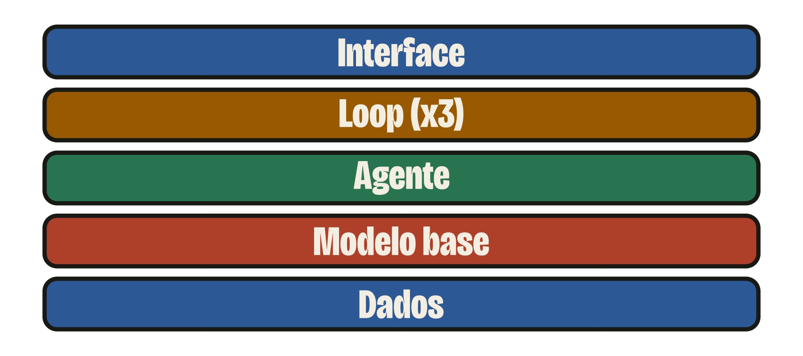
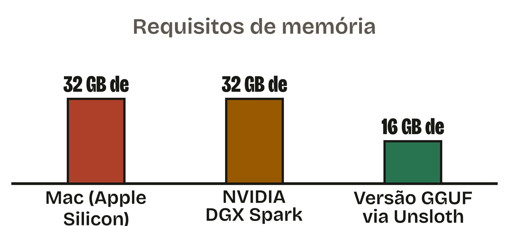

# Inkling 2 Mini: 26B roda em 16GB e marca 48,2% no DeepSWE

_2026-11-28 · noticia_

O Inkling 2 Mini é um modelo agêntico de código da Thinking Machines com apenas 26B de parâmetros, criado para quem queria rodar IA localmente sem depender de GPUs gigantes. Ele usa uma arquitetura em loop: 24 camadas, com as 12 do meio repetidas três vezes, o que ajuda no raciocínio sem inflar os pesos. Nos testes oficiais, marca 48,2% no DeepSWE v1.1 e 20,1 no AA Index — a melhor nota para o tamanho dele. Com apenas 16GB de RAM (Mac) ou 32GB+ de VRAM (NVIDIA DGX Spark), dá para rodar localmente via Ollama, com GGUF dinâmicos da Unsloth. Nesta apostila você aprende o que é essa arquitetura em loop, como instalar e usar o modelo, quais são os limites e como testar se está funcionando.

## O fato: um modelo pequeno para tarefas agênticas

A Thinking Machines anunciou o Inkling 2 Mini depois que parte do público considerou o Inkling 2 Small, com 594B de parâmetros, grande demais para rodar localmente. A resposta foi um modelo com 26B de parâmetros — pequeno o suficiente para caber em um laptop comum, mas mantendo capacidade agêntica. O nome do projeto segue a linha da família Inkling, que aposta em modelos leves e eficientes.

O anúncio veio no X (Twitter) da Thinking Machines em 20 de novembro de 2026 e rapidamente acumulou milhões de visualizações. A empresa não escondeu o trade-off: a arquitetura em loop levanta dúvidas sobre monitorabilidade, mas os próprios testes internos indicaram que a legibilidade da cadeia de raciocínio se mantém.

O modelo é descrito como "looped transformer" — ou seja, um transformer cujas camadas intermediárias são repetidas. Isso muda o jeito como o modelo processa informações e é justamente o ponto central desta apostila.

## Por que isso importa: rodar IA localmente de novo

Modelos com centenas de bilhões de parâmetros exigem GPUs caras ou acesso a nuvem. O Inkling 2 Mini devolve ao usuário comum a possibilidade de processar código, escrever prompts e interagir com agentes sem enviar dados para servidores externos.

Isso importa especialmente para quem lida com informação sensível: rodar localmente significa que os dados não saem da sua máquina. Para desenvolvedores, pesquisadores ou equipes internas, é uma alternativa direta a serviços como APIs pagas por uso.

O modelo também serve de prova de conceito de que arquitetura em loop pode entregar desempenho competitivo sem o custo de um modelo gigantesco — algo relevante para qualquer discussão sobre eficiência em IA.

## A arquitetura em loop: como funciona

_Arquitetura em loop: bloco intermediário repetido três vezes no meio das camadas._

O Inkling 2 Mini tem 24 camadas. As 12 camadas do meio se repetem três vezes, e as primeiras seis e as últimas seis rodam uma única vez. Esse arranjo é chamado de "looped transformer".

A ideia por trás do loop é fazer o modelo "pensar mais escrevendo menos": em vez de aprofundar cada camada com profundidade total, ele repete um bloco intermediário. Isso pode melhorar a capacidade de raciocínio sem multiplicar os pesos.

Exemplo: imagine que cada camada seja uma etapa de análise. Em um modelo normal, você passaria por 24 etapas diferentes e únicas. O resultado é mais repetição de um padrão forte do que variedade de camadas novas.

## Os números: o que eles significam

O modelo marca 48,2% no DeepSWE v1.1, uma tarefa de código que avalia raciocínio e resolução de problemas em programação. Para um modelo de 26B, essa é a melhor nota registrada entre os modelos avaliados pela Thinking Machines.

Além disso, obtém 20,1 no AA Index (Artificial Analysis Intelligence Index), métrica que combina desempenho em diversas tarefas de IA. Os dois números juntos mostram consistência: forte em código e bom em um painel mais amplo.

Vale entender o que cada métrica mede separadamente: DeepSWE foca em raciocínio de programação; AA Index é um índice comparativo entre modelos, então a nota depende do conjunto de tarefas incluído. Nenhum dos dois substitui a leitura do modelo em contexto real.

## Roda onde? Requisitos de hardware

_Memória necessária para rodar o Inkling 2 Mini em Mac, NVIDIA e via GGUF._

O Inkling 2 Mini foi projetado para rodar localmente. No Mac, o requisito é 32GB de memória unificada (Apple Silicon). Em sistemas NVIDIA, como o DGX Spark, são necessários 32GB ou mais de VRAM.

A Unsloth disponibilizou GGUF dinâmicos do modelo que cabem em apenas 16GB de RAM — mas essa versão tem um comportamento diferente da execução nativa via Ollama. É importante saber qual caminho você vai seguir antes de começar.

O Ollama, desde a versão v0.40.18 (lançada em 25 de novembro de 2026), unificou o comando: `ollama run inkling-2-mini` funciona direto tanto no Mac quanto no DGX Spark, aproveitando os pesos nativos em NVFP4. Não é mais necessário rodar um comando separado para GPU NVIDIA.

## O ganho prático e o trade-off da monitorabilidade

Quem antes dependia de modelos de centenas de bilhões de parâmetros agora tem uma alternativa leve. A diferença é que a arquitetura em loop reduz a cadeia de raciocínio visível — o modelo "pensa" de forma mais compacta.

A Thinking Machines estudou esse efeito e reportou que não houve queda relevante na legibilidade da cadeia de raciocínio (chain-of-thought). Ou seja, mesmo com o loop, dá para acompanhar o raciocínio do modelo em tarefas de código.

O ponto de atenção é justamente a monitorabilidade: como a cadeia fica mais curta, ferramentas que dependem de inspeção passo a passo podem precisar de ajuste. Não significa que não funcione — significa que exige validação.

## Como usar na prática: Tinker e Playground

O Tinker (tinkerapi.com) é a plataforma da própria Thinking Machines para inferência e fine-tuning do Inkling 2 Mini. Nele, você pode enviar prompts como qualquer outro modelo via API.

O Playground do Tinker permite experimentar sem configurar servidor. É o caminho mais rápido para testar prompts, ver respostas e sentir o comportamento do modelo antes de investir em infraestrutura.
