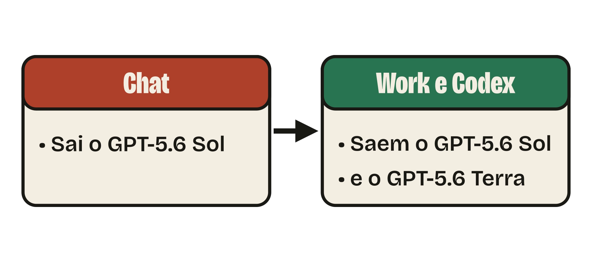
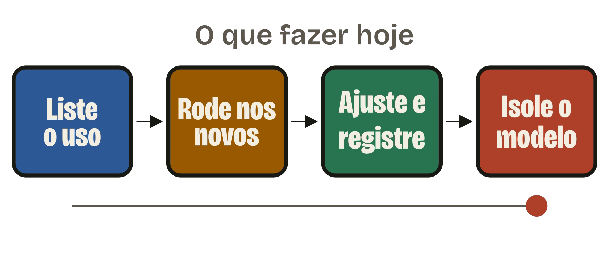

# Modelos de duas gerações atrás saem em 23 de dezembro

_2026-11-28 · noticia_

O ChatGPT anunciou que, em 23 de dezembro, aposenta o GPT-5.6 Sol no Chat e o GPT-5.6 Sol e o Terra no Work e no Codex. Esta apostila explica o que foi anunciado, a regra de aposentadoria por trás da data e o motivo apontado pela plataforma. Depois de ler, você sabe quais produtos são afetados, como mapear onde os modelos estão em uso e como preparar a migração antes do prazo.

## O fato

Em 23 de novembro de 2026, a conta oficial do ChatGPT no X anunciou que o GPT-5.6 chegou ao fim do ciclo. A mensagem diz que, em 23 de dezembro, o ChatGPT vai aposentar o GPT-5.6 Sol no Chat e o GPT-5.6 Sol e o Terra no Work e no Codex.

O anúncio fecha com a frase de que há sempre mais novidades no horizonte. A publicação passou de 2,4 milhões de visualizações, o que mostra o interesse de quem usa esses modelos no dia a dia.

Fonte: <https://help.openai.com/en/articles/6825453-chatgpt-release-notes>

## Por que isso importa

Aposentar um modelo, também chamado de deprecar, significa tirá-lo de circulação: depois da data, ele deixa de estar disponível nos produtos listados. Quem tem prompts, rotinas ou projetos ajustados a um modelo específico precisa trocá-lo, e o comportamento do substituto pode ser diferente.

O ChatGPT explicou que a data segue uma prática: ao lançar modelos novos, a plataforma geralmente continua aposentando os modelos de duas gerações atrás. O GPT-5.6 entrou nessa faixa. A palavra geralmente deixa margem para exceções, então o mais seguro é tratar todo modelo como algo com prazo de validade.

Fonte: <https://help.openai.com/en/articles/6825453-chatgpt-release-notes>

## O motivo: computação liberada

Segundo o ChatGPT, aposentar modelos antigos libera computação, isto é, a capacidade de processamento dos servidores. Cada modelo mantido no ar ocupa parte dessa capacidade, e ela pode ser usada para que mais pessoas acessem os modelos mais capazes.

Na prática, a plataforma troca a manutenção de um modelo familiar pela ampliação do acesso aos mais novos.

Fonte: <https://help.openai.com/en/articles/6825453-chatgpt-release-notes>

## O que sai em cada produto

_Chat perde só o GPT-5.6 Sol; Work e Codex perdem o Sol e o Terra._

O corte não é igual em todos os produtos. No Chat, apenas o GPT-5.6 Sol é aposentado. No Work e no Codex, saem o GPT-5.6 Sol e o GPT-5.6 Terra.

Exemplo: imagine que um time use o Terra no Codex. Esse time precisa trocar de modelo até 23 de dezembro, enquanto quem usa só o Terra no Chat não aparece na lista de aposentadorias deste anúncio.

- Chat: sai o GPT-5.6 Sol.
- Work: saem o GPT-5.6 Sol e o GPT-5.6 Terra.
- Codex: saem o GPT-5.6 Sol e o GPT-5.6 Terra.

Fonte: <https://help.openai.com/en/articles/6825453-chatgpt-release-notes>

## Os números

- 23 de dezembro de 2026: data em que os modelos deixam os produtos citados. É o prazo para concluir a migração.
- Duas gerações atrás: a regra que o ChatGPT diz seguir, de forma geral, ao lançar modelos novos. Não é garantia, porque o texto fala em aposentar geralmente.
- 2,4 milhões de visualizações: alcance do anúncio no X até a captura. Mostra interesse, mas não diz quantas pessoas usam os modelos.
- 3 produtos afetados: Chat, Work e Codex, com cortes diferentes em cada um.

## O que muda para você

Se você usa o GPT-5.6 Sol ou o Terra em algum desses produtos, a partir de 23 de dezembro será preciso trabalhar com outro modelo. Prompts bem ajustados a um modelo podem render respostas diferentes em outro, por isso vale testar antes.

Exemplo: imagine que você tenha uma rotina no Codex que dependa do Terra. Rodar essa rotina nos modelos mais recentes com antecedência mostra se o resultado se mantém ou se o prompt precisa de ajuste.

## O que fazer hoje

_Quatro passos para migrar antes de 23 de dezembro._

1. Liste onde o GPT-5.6 Sol e o Terra estão em uso (Chat, Work, Codex). Resultado esperado: um inventário de fluxos que dependem de cada modelo.
2. Rode seus prompts e rotinas nos modelos mais recentes. Resultado esperado: saber o que muda no comportamento antes do dia 23 de dezembro.
3. Ajuste o que precisar e registre a troca. Resultado esperado: fluxos funcionando sem o Sol e o Terra antes do prazo.
4. Isole o nome do modelo em um único ponto da sua configuração. Resultado esperado: a próxima aposentadoria exige mudar um só lugar.

Fonte: <https://help.openai.com/en/articles/6825453-chatgpt-release-notes>

## O que conferir

- A data de 23 de dezembro vale para os modelos e produtos citados no anúncio: Sol no Chat, Sol e Terra no Work e no Codex.
- A regra de duas gerações atrás é descrita como geral, não como promessa fixa.
- Modelos diferentes podem responder de formas diferentes ao mesmo prompt: teste antes de confiar.
- O ChatGPT sinalizou que há mais modelos a caminho, então novas aposentadorias tendem a se repetir.

Fonte: <https://help.openai.com/en/articles/6825453-chatgpt-release-notes>

## Glossário

- Deprecar (aposentar): retirar um modelo de circulação, de modo que ele deixe de estar disponível.
- Computação: capacidade de processamento dos servidores usada para rodar os modelos.
- Geração: cada rodada de modelos lançados; a regra de aposentadoria conta quantas rodadas separam um modelo dos mais novos.
- Chat, Work e Codex: os três produtos do ChatGPT afetados pelo anúncio.

## Para onde ir depois

Acompanhe as notas de versão do ChatGPT, que registram as próximas mudanças. Depois, pratique: escolha um fluxo seu que dependa de um modelo específico e deixe o nome do modelo em um único ponto de configuração, para trocar sem reescrever tudo.

Fonte: <https://help.openai.com/en/articles/6825453-chatgpt-release-notes>

## Além do vídeo

- O anúncio fecha dizendo que há sempre mais novidades no horizonte, sinal de que mais modelos virão.
- O texto de abertura usa a imagem do sol que se põe (set) para falar do fim do ciclo do GPT-5.6.
