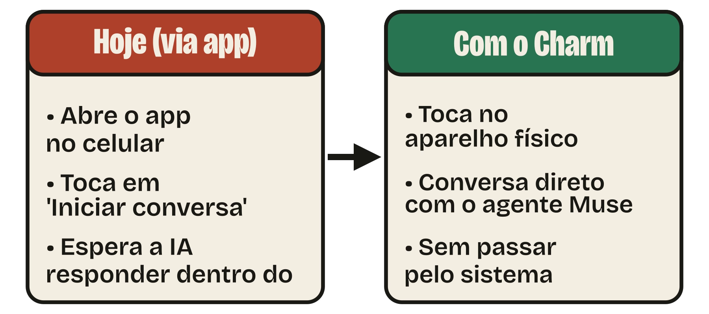
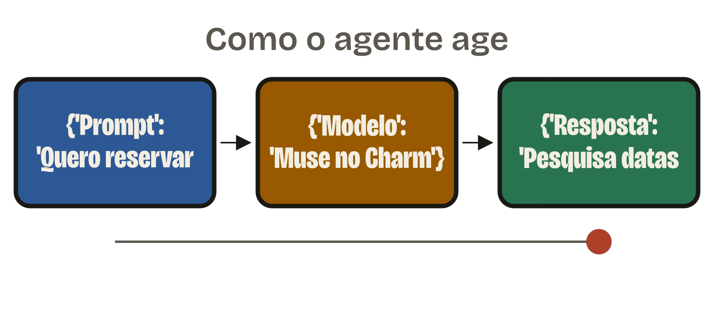
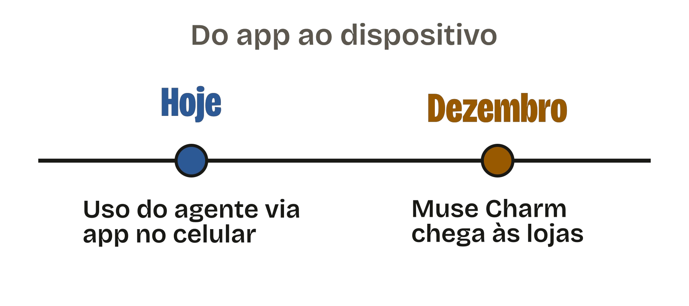

# Muse Charm aposta em tela de 2 polegadas e modem 5G

_2026-11-28 · noticia_

O Muse Charm é o primeiro dispositivo físico da Meta feito para conversar com o agente de IA Muse fora dos aplicativos do celular. A reportagem traz preço, tela, conexão 5G, uso prático e a estratégia por trás do aparelho. Ao final, você entende como funciona esse tipo de gadget, quanto custa, o que ele faz e por que a Meta está apostando em hardware próprio.

## O fato

A Meta anunciou, em setembro, durante seu evento anual Connect, um aparelho pequeno para acessar o agente de IA Muse diretamente. O dispositivo se chama Muse Charm e foi apresentado pelo então chefe executivo Mark Zuckerberg como parte da expansão da empresa na área de assistentes de IA para consumidores.

Segundo a Reuters, a Meta planeja vender o Muse Charm por US$ 300 e oferecer até 12 meses de dados 5G gratuitos da Verizon. O aparelho tem uma tela de cerca de 2 polegadas (5 cm), um modem 5G integrado e um personagem Muse personalizável no centro da tela.

O anúncio não é isolado: ele se encaixa na estratégia mais ampla da Meta de construir sua própria plataforma de IA, reduzindo a dependência dos sistemas operacionais do iPhone e do Android.

Fonte: <https://www.reuters.com/business/media-telecom/meta-price-muse-charm-gadget-300-information-reports-2026-11-19/>

## Por que isso importa

_Do app para o dispositivo: o Charm encurta o caminho até a IA._

Hoje, para usar um agente de IA como o Muse, você precisa instalar um aplicativo no celular e abrir esse app. O sistema operacional fica no meio do caminho, entre a sua intenção e a resposta da IA.

O Charm inverte essa lógica: em vez de passar pelo app, você toca no aparelho físico e conversa com o agente. Isso encurta o trajeto e tira a IA do ecossistema fechado dos smartphones.

Para a Meta, é uma jogada de plataforma. Ao criar seu próprio dispositivo, a empresa tenta reduzir a dependência de Apple e Google, que controlam os apps e as lojas de aplicativos onde esses agentes vivem.

## O preço do aparelho

Segundo a Reuters, o Muse Charm deve custar US$ 300. Esse valor ajuda a dimensionar a aposta: é um gadget de bolso, não um acessório barato.

Além do hardware, a Meta oferece até 12 meses de dados 5G gratuitos da Verizon. Isso aproxima o custo inicial do aparelho da contratação de conectividade, já que o modem integrado precisa de sinal celular para funcionar fora de casa.

Fonte: <https://www.reuters.com/business/media-telecom/meta-price-muse-charm-gadget-300-information-reports-2026-11-19/>

## Como é a tela e o controle

A tela do Muse Charm tem cerca de 2 polegadas, o equivalente a 5 centímetros. Esse tamanho foi pensado para uso com o polegar, sem depender de um smartphone na mão.

No centro da tela aparece o personagem Muse, que pode ser personalizado pelo usuário. É por ali que toda a conversa com o agente acontece.

O design pequeno mantém o aparelho no bolso e reforça a ideia de interação direta: você não precisa abrir nenhum app para começar.

## Conexão 5G sem Wi-Fi

O Charm tem um modem 5G integrado. Isso significa que ele consegue acessar o Muse mesmo quando não há rede Wi-Fi disponível.

A conexão celular amplia a mobilidade: dá para usar o agente em deslocamentos, em cafés, no carro ou em qualquer lugar com sinal 5G.

Importante: o aparelho não faz chamadas telefônicas. Essa função continua sendo de um celular comum.

## O que o agente faz no aparelho

_O agente no aparelho físico executa tarefas do dia a dia sem abrir app._

O Muse foi desenhado para assumir tarefas do dia a dia. No contexto do Charm, ele pode fazer compras, reservar viagens e preencher formulários.

Colocar essas ações em um dispositivo físico significa acessá-las sem abrir o aplicativo no celular. O caminho entre a intenção e a execução fica mais curto.

## A estratégia por trás do hardware

O Muse Charm não é apenas um gadget bonito. É uma tentativa de a Meta criar uma porta de entrada própria para seus serviços de IA, fora dos aplicativos e das lojas de apps.

Ao fazer isso, a empresa reduz a dependência dos sistemas operacionais da Apple e do Google, que hoje intermediam o acesso à maioria dos agentes de IA no celular.

O dispositivo também coloca a Meta na disputa por atenção em um momento em que assistentes de IA ganham tração entre consumidores.

## Quando chega às lojas

A expectativa é que o Muse Charm seja lançado em dezembro, aproveitando o período de compras de fim de ano.

Essa previsão vem de comentários de Mark Zuckerberg durante o evento Connect da Meta. O timing coloca o aparelho na disputa por atenção do varejo e dos consumidores que já compram presentes nessa época.

Fonte: <https://www.reuters.com/business/media-telecom/meta-price-muse-charm-gadget-300-information-reports-2026-11-19/>

## O que fazer hoje

1. Entenda o conceito: assistentes de IA embarcados em dispositivos físicos já estão sendo testados por grandes empresas.
2. Se você usa algum agente de IA no celular, observe como ele é acessado dentro do app e onde ficam as limitações desse caminho.
3. Acompanhe os anúncios da Meta sobre o lançamento do Charm, especialmente em novembro e dezembro, quando a expectativa de chegada às lojas aumenta.

## O que conferir antes de confiar

- Preço: US$ 300 é uma previsão reportada pela Reuters, não um valor confirmado em loja.
- Conectividade: o aparelho depende de sinal 5G para funcionar fora de casa; sem Wi-Fi, ele ainda funciona, mas precisa do modem.
- Chamadas telefônicas: o Charm não faz ligações. Se isso for essencial para você, ele não substitui um celular comum.
- Dependência de plataforma: o dispositivo está atrelado ao serviço Muse, da Meta, e à conectividade oferecida pela Verizon no pacote anunciado.

## Glossário

- Modem: dispositivo que converte os dados de rede entre o formato usado pelo aparelho e o formato das redes celulares, permitindo a conexão 5G.
- Agente de IA: programa que simula comportamento humano para executar tarefas como compras, reservas e preenchimento de formulários.
- Hardware próprio: quando uma empresa cria seu próprio dispositivo físico, em vez de depender apenas de apps instalados em celulares de terceiros.

## Para onde ir depois

- Acompanhe os anúncios oficiais da Meta sobre o lançamento do Muse Charm, especialmente a partir de novembro.
- Se você já usa agentes de IA no celular, comece a mapear quais tarefas você delegaria a um aparelho dedicado.
- Fique atento às discussões sobre privacidade e dependência de plataformas quando novos dispositivos de IA chegarem ao mercado.

## O aparelho que leva o Muse para fora do celular

_A passagem do acesso por aplicativo para o uso direto em um aparelho físico._

Imagine que você precisa reservar uma viagem. Hoje, você abre um app de viagens no celular, procura datas, preços e confirmações. Com o Charm, a ideia é tocar no próprio aparelho e pedir ao Muse para fazer isso.

O dispositivo não substitui o smartphone: ele concentra as interações com o agente em uma tela pequena, com controle pelo polegar e conexão 5G própria. A experiência fica mais direta, mas ainda depende de internet e do serviço da Meta.

## Teste rápido

- [ ] Você consegue explicar com suas palavras o que é um agente de IA embarcado em hardware?
- [ ] Sabe dizer por que a Meta quer criar seu próprio dispositivo, e não apenas vender apps?

## Além do vídeo

- O aparelho foi anunciado em setembro durante o evento anual Connect da Meta, pelo então chefe executivo Mark Zuckerberg.
- A Verizon não respondeu imediatamente aos pedidos de comentário da Reuters sobre a oferta de dados 5G gratuitos.
- Uma porta-voz da Meta disse que a empresa está 'encantada com o interesse nos dispositivos de IA' e que terá mais informações em breve.
- O dispositivo tem uma tela de cerca de 2 polegadas, equivalente a 5 centímetros, desenhada para navegação com o polegar.
