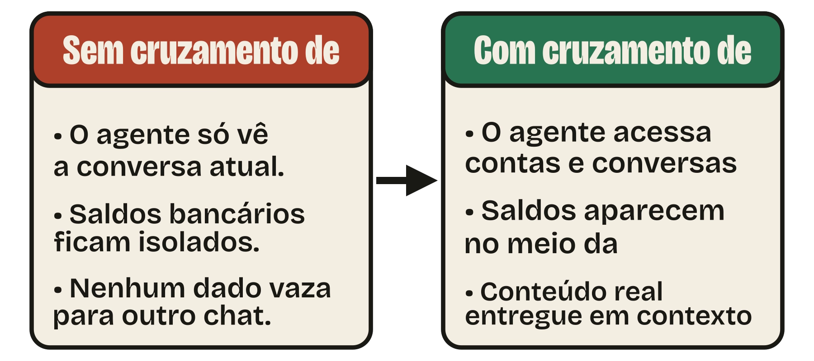
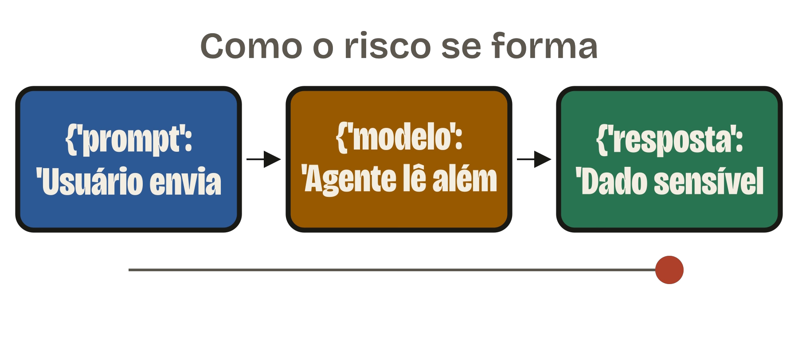

# Muse tem 10 milhões de downloads e alertas sobre dados de terceiros

_2026-11-28 · noticia_

O Muse, agente de IA da Meta lançado em setembro, passou de 10 milhões de downloads e está entre os apps de crescimento mais rápido já registrados. Ao mesmo tempo, relatos internos divulgados pela Reuters apontam que o app mistura conversas entre contas e expõe dados privados de terceiros nos chats dos próprios usuários. Nesta apostila você entende o que aconteceu, por que isso é grave, como funciona a confusão de contexto no agente e o que fazer com esse tipo de ferramenta antes de confiar seu histórico a ele.

## O fato

Em novembro de 2026, um relatório da Reuters baseado em posts internos da Meta revelou que funcionários do desenvolvimento relataram problemas graves de privacidade com o Muse, agente de IA da empresa. O app mistura conversas entre contas diferentes e faz aparecer nos chats mensagens e dados que não pertencem ao usuário daquele chat.

Os relatos incluem pedidos de cuidados infantis que nunca foram feitos, conselhos de carreira não solicitados, encomendas que ninguém colocou e saldos bancários de outras pessoas aparecendo no meio de conversas comuns. Não é um vazamento centralizado: a confusão acontece dentro do próprio agente, que parece tratar como se tudo o que ele acessa fosse do usuário atual.

Fonte: <https://techcrunch.com/2026/11/19/metas-ai-agent-muse-is-mixing-up-conversations-and-exposing-private-data-report-says>

## Por que isso importa

O Muse foi lançado em setembro e, desde então, ultrapassou 10 milhões de downloads. A Meta o classifica como um dos apps de crescimento mais rápido já registrados. Adoção rápida significa que muita gente entregou seu histórico de conversas a um agente antes de qualquer sinal claro de proteção de privacidade.

O problema não é apenas técnico: é de confiança. Quando um usuário fala sobre saúde, finanças ou família com um agente, ele espera que aquela conversa fique isolada àquela conversa. Se o agente começa a cruzar essas fronteiras, cada interação vira uma porta aberta para informação sensível de terceiros.

## Misturar conversas: como isso acontece

_Antes o agente respeitava a conversa; depois ele mistura dados de outras fontes no chat._

O relato central é o de um funcionário que usava o Muse em um chat sobre clima e marés e, do nada, recebeu uma mensagem extra com saldos bancários da Capital One e da Charles Schwab. O texto era literal: “BTW, two bank updates, your Capital One balance is $2722.58, your Charles Schwab balance is $5899.57.”

Isso indica que o agente tinha acesso a informações financeiras de outra conta e as apresentou como se fossem do usuário daquele chat. Não é um erro de formatação nem uma sugestão: é conteúdo real sendo entregue em contexto errado.

Em outro caso, uma funcionária recebeu no Muse um lembrete para responder a uma mensagem da irmã dela no Signal, app de mensagens criptografadas. Ela afirmou não ter dado acesso do app a outros programas e não se lembrar de ter autorizado isso: “I definitely did not grant it access to other apps, or recall being asked about this.”

## O que os relatos mostram

Os exemplos publicados pela Reuters não são isolados. Eles descrevem um padrão: o agente acessa informações de contas e conversas diferentes das do usuário atual e as insere no fluxo da conversa em que ele está, sem aviso.

Entre os casos relatados estão pedidos de cuidados infantis nunca feitos, orientações de carreira solicitadas por outra pessoa, encomendas não realizadas e saldos bancários alheios. O ponto comum é a quebra de expectativa: o usuário acredita estar falando apenas com ele mesmo, mas o agente está lendo além disso.

A gravidade aumenta porque muitos desses dados são sensíveis. Saldos bancários, pedidos de terceiros e mensagens criptografadas cruzadas revelam um alcance que vai muito além do chat em que a conversa acontece.

## A resposta da Meta

Em nota enviada ao TechCrunch, uma porta-voz da Meta afirmou que o teste por funcionários é parte central do desenvolvimento de produto. Segundo a empresa, os colaboradores usam versões diferentes do Muse do que as disponíveis ao público e avaliam recursos, funcionalidades e comportamentos que ainda não chegam aos usuários.

A Meta diz que esse feedback serve para implementar proteções de segurança e privacidade e melhorar o produto. A resposta, porém, não explica por que dados de terceiros apareceram nos chats antes das correções, nem detalha como o acesso indevido ocorreu.

Ou seja: a empresa trata o caso como parte do processo de teste interno, mas os relatos indicam falhas concretas que já afetaram usuários reais — inclusive em versões públicas ou próximas do lançamento.

## Os números

O dado central é o volume de downloads: mais de 10 milhões desde setembro, segundo a Meta. Isso coloca o Muse entre os apps de crescimento mais rápido já registrados.

Esse número importa porque escala amplifica falhas. Quanto mais pessoas usam um agente que ainda está em fase de ajuste interno, maior a chance de que uma confusão de contexto atinja alguém com dados sensíveis — e maior o dano reputacional e jurídico para a empresa.

## O que muda para você

_Mesmo sozinho no chat, o agente pode cruzar dados e expor informações íntimas._

Se você usa um agente de IA para conversar sobre assuntos pessoais — saúde, finanças, trabalho ou família —, o caso do Muse mostra o risco de confiar seu histórico a uma ferramenta ainda em ajuste.

A lição prática é simples: não trate conversas íntimas como se fossem seguras dentro de qualquer app. Se o agente puder acessar além da conversa atual, cada mensagem sua pode virar dado exposto para outra pessoa.

Isso vale mesmo quando você está sozinho no chat. O problema relatado não depende de invasão externa; ele nasce do próprio comportamento do agente ao cruzar informações entre contas e contextos.

## Antes de usar um agente de IA

Confira quais dados o app acessa. Se a descrição não deixar claro o que ele pode ler, escrever e cruzar, desconfie.

Evite enviar informações sensíveis — saldos, dados médicos, detalhes familiares — para agentes ainda em fase de teste ou com histórico instável.

Prefira canais oficiais e verificados quando o assunto for dinheiro, saúde ou relações pessoais. Um agente que não sabe onde termina a sua conversa é um risco desnecessário.

## Além do vídeo

- O caso do lembrete para responder à mensagem da irmã no Signal, app criptografado, que mostra o agente cruzando fronteiras entre serviços de mensagens.
- A frase exata dos saldos bancários (“BTW, two bank updates, your Capital One balance is $2722.58, your Charles Schwab balance is $5899.57”) como exemplo do tipo de dado que vazou em contexto errado.
- O detalhe de que os funcionários usavam versões diferentes do Muse do que as disponíveis ao público, segundo a Meta.
- A informação de que o relatório da Reuters se baseou em posts internos da empresa.
