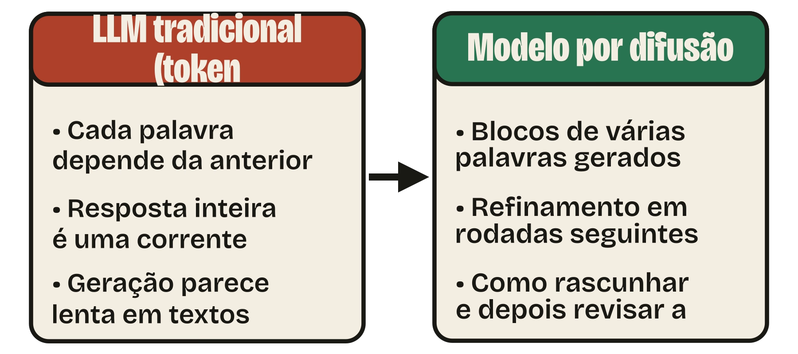

# Nvidia negocia a criadora do Mercury por mais de US$ 500 milhões

_2026-11-28 · noticia_

A Nvidia está em negociações avançadas para comprar a Inception, criadora do Mercury, modelo de linguagem baseado em difusão, por mais de US$ 500 milhões. Enquanto os LLMs tradicionais preveem um token de cada vez, a difusão gera e refina vários tokens ao mesmo tempo — o que pode encurtar a espera de quem programa com IA. Entenda aqui o que é difusão, como o Mercury se posiciona, quem está por trás da Inception, o que a negociação significa para o portfólio Nemotron e o que ainda não está fechado.

## O fato

A Nvidia está em negociações avançadas para adquirir a Inception, startup fundada em Stanford que desenvolve modelos de linguagem baseados em difusão. O valor reportado é superior a US$ 500 milhões, segundo o The Information.

Se fechada, a operação traria os três cofundadores da Inception — Stefano Ermon, Aditya Grover e Volodymyr Kuleshov — para a Nvidia em tempo integral, além de bônus por desempenho (earnout) para funcionários, conforme o relatório.

Fonte: <https://theinformation.com/articles/nvidia-nears-acquisition-diffusion-ai-developer-500-million>

## Por que isso importa

Quem usa assistente de código sente na prática a espera token por token. Modelos como GPT, Claude e Gemini preveem um token após o outro: cada palavra depende da anterior, e é essa dependência que define o ritmo da resposta.

A difusão inverte a lógica. Em vez de prever um token de cada vez, ela gera vários tokens em paralelo e vai refinando em rodadas sucessivas. É o mesmo princípio usado para gerar imagens, agora aplicado ao texto.

Para a Nvidia, o movimento faz sentido: a empresa vende chips, mas quer controlar também o que roda neles. Ter uma criadora de modelos de difusão dentro da companhia daria mais alavanca sobre essa tecnologia e reforçaria o portfólio Nemotron.

## O que é um modelo baseado em difusão

Um modelo de linguagem tradicional funciona como uma previsão em cadeia: ele recebe o contexto, calcula a probabilidade do próximo token e o emite. Só então usa esse novo token para calcular o seguinte. É por isso que a geração parece lenta em textos longos.

Na difusão, o processo é iterativo. O modelo começa com um rascunho (ou com ruído) e refina o resultado várias vezes, podendo trabalhar em vários tokens simultaneamente. Cada rodada ajusta detalhes sem esperar que cada caractere termine antes de começar o próximo bloco.

Isso não significa que a difusão seja sempre mais rápida ou melhor. Ela depende do tipo de tarefa. Para textos longos e complexos, modelos otimizados para velocidade ainda podem levar vantagem em alguns casos. A Inception afirma que o Mercury mantém a precisão dos concorrentes enquanto acelera a geração.

## O Mercury

Mercury é a família de modelos da Inception construída sobre difusão. A proposta central é acelerar a geração de texto sem perder qualidade, usando um processo de refino iterativo.

Segundo o The Information, o Mercury é de 5 a 10 vezes mais rápido que modelos otimizados para velocidade da OpenAI, da Anthropic e do Google, mantendo a precisão. Esse número precisa ser lido com cuidado: ele compara o Mercury a modelos já otimizados para velocidade nessas empresas, não a todos os modelos delas.

Fonte: <https://theinformation.com/articles/nvidia-nears-acquisition-diffusion-ai-developer-500-million>

## Onde o Mercury já aparece

A Inception afirma que o Mercury já foi integrado a ferramentas de desenvolvimento, o que mostra que a abordagem saiu do laboratório e chegou ao uso prático.

As ferramentas citadas são ProxyAI, Buildglare e Kilo Code. A presença em produtos de terceiros é um sinal de adoção, mas não garante que todos os usuários dessas ferramentas tenham percebido a diferença de velocidade.

Fonte: <https://theinformation.com/articles/nvidia-nears-acquisition-diffusion-ai-developer-500-million>

## Quem está por trás da Inception

A Inception é uma startup baseada em Palo Alto, na Califórnia, com mais de 30 funcionários. O CEO é Stefano Ermon, professor de Stanford, cofundador também da empresa de robótica iCubic.

O time fundador inclui Aditya Grover e Volodymyr Kuleshov. A rodada seed de US$ 50 milhões foi levantada em novembro de 2025, liderada pela Menlo Ventures, com participação da Nvidia via NVentures — o braço de venture capital da empresa.

Além desses investidores, aportaram a Microsoft M12, Snowflake Ventures, Databricks Investment, Mayfield e Innovation Endeavors. Como anjos, entraram Andrew Ng e Andrej Karpathy.

Fonte: <https://theinformation.com/articles/nvidia-nears-acquisition-diffusion-ai-developer-500-million>

## A estratégia da Nvidia além dos chips

Vender GPUs já não basta para a Nvidia. A empresa vem comprando e licenciando ativos de software, modelos e equipes para ficar no centro do ecossistema de IA.

Em setembro de 2026, a Nvidia fechou a aquisição da Hugging Face por cerca de US$ 12,9 bilhões, com expectativa de conclusão no primeiro semestre de 2027. Em dezembro de 2025, assinou um acordo de licenciamento não exclusivo de US$ 20 bilhões com a Groq para sua tecnologia de inferência e contratou seu fundador.

O portfólio Nemotron reúne modelos abertos de pesos, dados e receitas disponíveis no Hugging Face. Entre os clientes que já usam modelos Nemotron estão Booz Allen Hamilton e Palantir Technologies.

Fonte: <https://developer.nvidia.com/nemotron>

## O que muda para quem usa IA

Se a negociação avançar, a difusão aplicada ao texto pode se tornar uma alternativa concreta para tarefas em que velocidade importa: geração de código, resumos longos e assistentes que precisam responder rápido sem perder qualidade.

Por outro lado, não há garantia de que modelos baseados em difusão vão dominar. A Nvidia já usa outras frentes — como o Nemotron 3 Ultra, com 550B parâmetros em MoE, voltado a raciocínio complexo — e a escolha final pode combinar abordagens.

Para quem desenvolve, o ganho potencial está em reduzir latência. O risco é ver mais um movimento de consolidação que concentra poder em poucas empresas.

## O que ainda não está fechado

As negociações estão em estágio avançado, mas nenhuma das duas empresas confirmou publicamente um acordo. Preço e termos podem mudar até a assinatura.

Segundo o The Information, as conversas começaram antes de Jensen Huang deixar a presidência da Nvidia em 12 de novembro de 2026. Colette Kress assumiu como CEO interina nesse período.

Negociações nessa fase normalmente resultam em uma carta de intenções não vinculante, que define preço, estrutura e exclusividade sem obrigar as partes a fechar o negócio.

- Confirmar se houve anúncio público de acordo — até agora, não há.
- Verificar se a carta de intenções é vinculante ou apenas indicativa.
- Acompanhar mudanças no valor: a avaliação atual é menor do que a reportada pela Reuters em maio de 2026, quando Microsoft e SpaceX também demonstravam interesse.

## Glossário

- Difusão: técnica de geração que refina um resultado em várias rodadas, trabalhando vários elementos em paralelo, em vez de prever um item por vez.
- Token: menor unidade de texto (parte de palavra ou caractere) com que modelos de linguagem trabalham.
- MoE (Mixture of Experts): arquitetura em que o modelo ativa apenas parte dos parâmetros para cada tarefa, equilibrando capacidade e eficiência.
- Nemotron: família de modelos abertos da Nvidia, com pesos e dados disponíveis no Hugging Face.
- NVentures: braço de venture capital da Nvidia.

## Para onde ir depois

- Leia a reportagem completa do The Information sobre as negociações para entender os detalhes da carta de intenções e das comparações de velocidade.
- Se você usa modelos Nemotron, explore o portfólio em developer.nvidia.com/nemotron para ver quais modelos fazem sentido para seu caso de uso.
- Acompanhe atualizações sobre a consolidação do ecossistema de IA — aquisições como essa mudam quem define os padrões de ferramentas e modelos.

## Como funciona na prática: o contraste entre token por token e difusão

_Contraste entre LLM token por token e geração por difusão em blocos paralelos._

Imagine que você pede para um assistente escrever um relatório de 500 palavras. Em um LLM tradicional, cada palavra é calculada a partir da anterior, e a resposta inteira depende dessa corrente única.

No modelo por difusão, o sistema pode gerar blocos de várias palavras ao mesmo tempo e depois refinar detalhes — como ajustar conectivos ou corrigir repetições — em rodadas seguintes. É como rascunhar um parágrafo inteiro e só depois revisar a redação, em vez de escrever palavra por palavra.

Na prática, isso tende a reduzir o tempo percebido em tarefas longas, mas não elimina a necessidade de avaliação humana: qualidade continua dependendo do modelo e do contexto.

## O que conferir antes de tratar isso como fato

Trate o valor de US$ 500 milhões como um piso de negociação, não como preço fechado. O documento indica que o número é menor do que a avaliação anterior reportada em maio de 2026.

Desconfie de comparações de velocidade feitas sem especificar quais modelos foram comparados. A afirmação da Inception compara o Mercury a modelos otimizados para velocidade de OpenAI, Anthropic e Google — não a todos os modelos dessas empresas.

Lembre que nenhuma das partes confirmou publicamente um acordo. Notícias sobre negociações em estágio avançado mudam rapidamente.

- Checar se há anúncio oficial da Nvidia ou da Inception antes de compartilhar o valor.
- Verificar a data e a fonte da comparação de velocidade citada (The Information).
- Distinguir avaliação de mercado de preço final do acordo.

## Plano: como acompanhar essa negociação em 7 dias

- Dia 1: leia a reportagem completa do The Information e anote o que está confirmado (valor mínimo, estágio da negociação, cofundadores envolvidos).
- Dia 2: compare Mercury com um LLM que você já usa em tarefas de código para sentir a diferença de latência.
- Dia 3: estude o portfólio Nemotron no site oficial da Nvidia e identifique qual modelo se aproxima do seu caso de uso.
- Dia 4: verifique como ProxyAI, Buildglare e Kilo Code usam o Mercury, segundo o que está reportado.
- Dia 5: acompanhe notícias diárias sobre a negociação para ver se há atualização sobre carta de intenções ou exclusividade.
- Dia 6: leia sobre a aquisição da Hugging Face pela Nvidia e entenda como ela se conecta à estratégia com a Inception.
- Dia 7: escreva um resumo em uma página explicando, com suas palavras, o que muda para quem usa IA se o acordo for fechado.

## Além do vídeo

- A Nvidia assinou em dezembro de 2025 um acordo de licenciamento não exclusivo de US$ 20 bilhões com a Groq e contratou seu fundador.
- Em setembro de 2026, a Nvidia fechou a aquisição da Hugging Face por cerca de US$ 12,9 bilhões, com expectativa de conclusão no primeiro semestre de 2027.
- O Departamento de Justiça dos EUA questionou a Nvidia sobre possíveis efeitos concorrenciais da compra da Hugging Face.
- A Nvidia anunciou investimentos minoritários planejados em startups europeias como Doctolib, Genesis AI, Pigment e Entalpic.
- O Nemotron 3.5 Super VL usa arquitetura MoE com 12B parâmetros ativos por token.
- Os modelos Nemotron estão disponíveis via NVIDIA NIM™ como microserviços para deploy em qualquer sistema acelerado por GPU.
- A Nvidia oferece datasets abertos do programa Nemotron, incluindo corpus pré-treinamento de cerca de 2,83 trilhões de tokens em 22 idiomas criado com a IIT Madras.
- O Nemotron Retrieval lidera rankings como Q2D-Web, ViDoRe V1 a V3 e MTEB.
