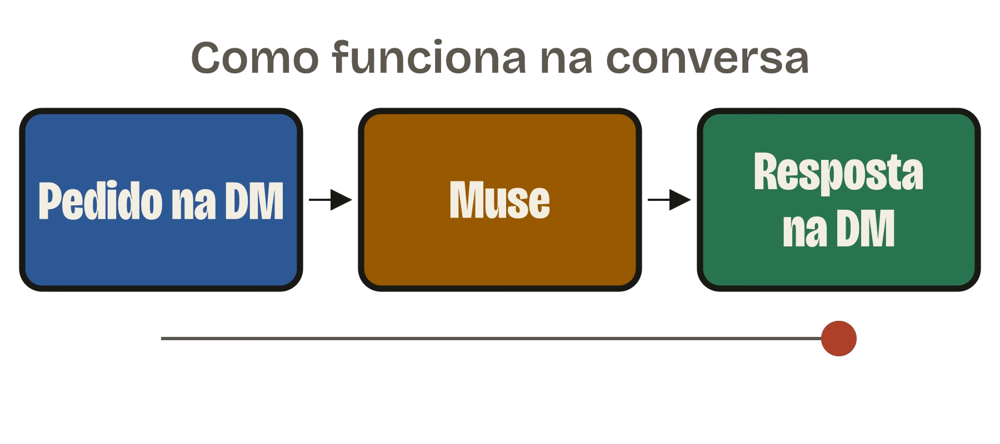
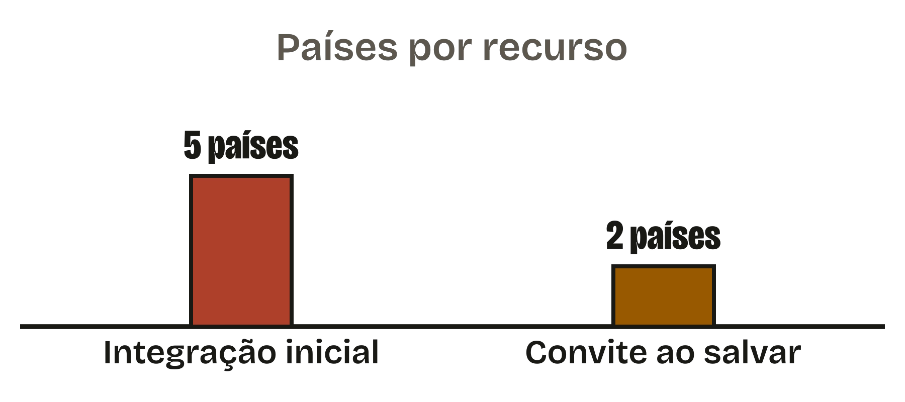
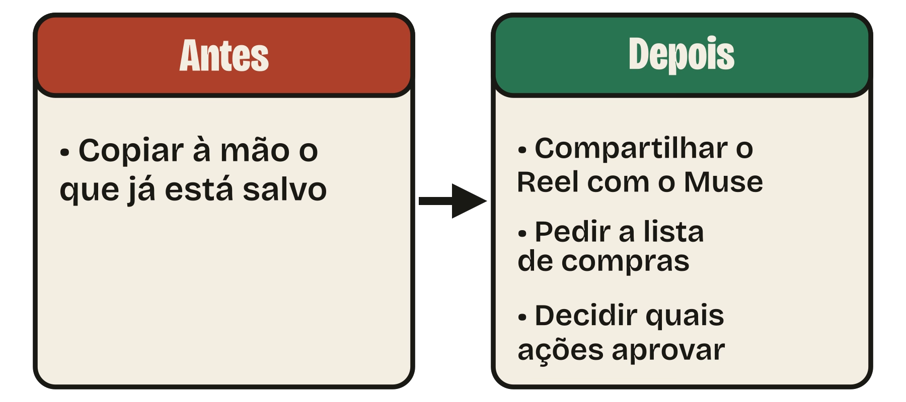

# Receita salva no Instagram vira lista de compras com Muse

_2026-11-28 · noticia_

Esta apostila explica a novidade anunciada pela Meta em 24 de novembro de 2026: o assistente de IA Muse passa a funcionar dentro das mensagens diretas do Instagram, sem trocar de aplicativo. Você vai entender como o Muse organiza posts salvos em Collections, transforma uma receita em lista de compras, monta roteiros de viagem e sugere ideias de outfit. Também vai saber quais países recebem o lançamento inicial, como o Muse pede a sua aprovação antes de enviar algo e quais cuidados ter antes de confiar no resultado. No fim, você terá um roteiro curto para testar o recurso na sua conta.

## O fato

Na terça-feira, 24 de novembro de 2026, a Meta anunciou que usuários do Instagram podem conversar com o Muse, o agente de IA da empresa, dentro de uma conversa direta. Segundo a TechCrunch, a pessoa pode pedir mais contexto sobre um post, um lugar ou um produto que encontra no aplicativo, ou retomar conversas que perdeu nas outras mensagens diretas.

A integração começa a chegar a usuários de iOS e Android nos Estados Unidos, no Canadá, no México, no Japão e em Singapura. Quem estiver nesses países conversa com o Muse em linguagem natural, escrevendo como faria com uma pessoa, sem precisar sair do Instagram para usar o app próprio do assistente.

Fonte: <https://techcrunch.com/2026/11/24/meta-brings-its-muse-ai-assistant-directly-into-instagram-dms>

## Por que isso importa

Um agente de IA é um programa que não apenas responde perguntas, mas também executa tarefas a partir do que você pede, como organizar conteúdos, montar listas ou preparar um roteiro. Quando ele fica dentro do aplicativo que você já usa, o caminho entre ter a ideia e agir sobre ela fica mais curto.

Para o usuário, o ganho é reduzir a troca de telas. Para a Meta, o movimento coloca o Muse em uma plataforma onde as pessoas já descobrem produtos, lugares e conteúdos. A reportagem também relaciona a novidade à disputa entre empresas de tecnologia para que os assistentes de IA façam parte da rotina digital das pessoas.

Fonte: <https://techcrunch.com/2026/11/24/meta-brings-its-muse-ai-assistant-directly-into-instagram-dms>

## Muse entra nas mensagens diretas do Instagram

_Pedido escrito na DM, resposta do Muse na mesma conversa, sem trocar de aplicativo._

As mensagens diretas, chamadas de DM, são as conversas privadas do Instagram. Com a novidade, uma dessas conversas pode ter o Muse como interlocutor. Você escreve o pedido e recebe a resposta ali mesmo, sem abrir outro aplicativo para falar com o assistente.

O controle continua com você. Segundo a Meta, nada é compartilhado, publicado ou enviado sem a sua aprovação. Além disso, você pode pedir ao Muse que desfaça uma ação quando quiser. Desfazer significa reverter o que ele já executou, e isso vale como uma segunda barreira antes de confiar em uma tarefa automática.

Fonte: <https://techcrunch.com/2026/11/24/meta-brings-its-muse-ai-assistant-directly-into-instagram-dms>

## O convite aparece ao salvar um post

Salvar é a forma de guardar um post ou um Reel para ver depois, sem publicá-lo. Muitas pessoas acumulam esses saves e raramente voltam a eles. A novidade tenta fechar esse ciclo: a partir de 24 de novembro, ao salvar um post no Instagram, aparece um convite para o Muse organizar aquele conteúdo.

Esse convite está disponível nos Estados Unidos e no Canadá. Ao aceitá-lo, você compartilha o post com o Muse e pede o que quer fazer com ele. O salvamento deixa de ser o fim da ação e passa a ser o começo de uma tarefa.

Fonte: <https://techcrunch.com/2026/11/24/meta-brings-its-muse-ai-assistant-directly-into-instagram-dms>

## Collections: pastas para os seus saves

Collections é o nome dado às pastas personalizadas que o Muse cria para organizar os posts salvos. Em vez de ficarem espalhados no perfil, os conteúdos são separados por você, a partir de um pedido feito ao assistente.

Esse recurso serve para quem salva muita coisa sem um critério. Ao pedir a organização, os posts deixam de ser uma lista longa e passam a formar pastas prontas para consulta, o que facilita encontrar uma receita ou um lugar quando você precisa dele.

Fonte: <https://techcrunch.com/2026/11/24/meta-brings-its-muse-ai-assistant-directly-into-instagram-dms>

## Lista de compras a partir de um Reel de receita

Um Reel de receita costuma mostrar os ingredientes em poucos segundos, e é fácil perder a lista na hora de ir ao mercado. Com o Muse, você compartilha o Reel ou o post de receita que salvou e pede uma lista de compras. O assistente transforma o conteúdo do vídeo em uma lista pronta para levar, sem anotações manuais.

A vantagem está em usar o que você já guardou. A receita sai do campo de salvos e chega como uma tarefa concreta, pronta para ser conferida antes da compra.

Fonte: <https://techcrunch.com/2026/11/24/meta-brings-its-muse-ai-assistant-directly-into-instagram-dms>

## Itinerário a partir de posts de viagem

Itinerário é o roteiro de uma viagem, com os lugares e a ordem em que eles serão visitados. Montar um roteiro costuma exigir abrir muitos posts ao mesmo tempo. Com o Muse, você pede um itinerário usando os conteúdos de viagem que guardou, inclusive os de criadores de viagem que você acompanha.

Por exemplo, uma cafeteria salva pode entrar no roteiro de uma viagem à Cidade do México. O resultado é um plano que junta lugares de vários posts em um único documento de consulta.

Fonte: <https://techcrunch.com/2026/11/24/meta-brings-its-muse-ai-assistant-directly-into-instagram-dms>

## Ideias de outfit a partir dos Reels de moda

Os Reels de moda que você salva funcionam como uma coleção de referências. O Muse pode usar esses vídeos para sugerir combinações de look. Você pede uma ideia para o próximo look e recebe as opções na própria conversa.

O uso é pessoal e direto: em vez de rever dezenas de vídeos antes de se arrumar, você transforma as referências salvas em sugestões para um caso específico.

Fonte: <https://techcrunch.com/2026/11/24/meta-brings-its-muse-ai-assistant-directly-into-instagram-dms>

## Os números

_Integração inicial em 5 países e convite ao salvar em 2, Estados Unidos e Canadá._

Os números do anúncio mostram o alcance inicial da novidade e as condições de cada recurso. Leia cada um sabendo o que ele mede.

- 5 países recebem a integração no lançamento inicial: Estados Unidos, Canadá, México, Japão e Singapura. O número mostra o alcance inicial, e o Brasil não aparece nessa lista.
- 2 países têm o convite ao salvar um post: Estados Unidos e Canadá. Quem mora nos outros países da lista não verá esse atalho na data de lançamento.
- 2 sistemas móveis recebem a novidade: iOS e Android. O anúncio trata de aplicativos no celular.
- 24 de novembro de 2026 é a data de início do lançamento, uma terça-feira. O anúncio não traz o dia em que a liberação chega a cada conta, então a data marca o início, e não o acesso individual.

Fonte: <https://techcrunch.com/2026/11/24/meta-brings-its-muse-ai-assistant-directly-into-instagram-dms>

## O que muda para você

_Copiar à mão deixa de ser preciso: você compartilha o Reel e aprova a lista._

Imagine que você salvou um Reel de receita e nunca mais abriu. Com a novidade, você compartilha esse Reel com o Muse, pede a lista de compras e leva a lista ao mercado. O salvamento vira uma tarefa feita em uma conversa só.

O ganho é menos trabalho de organização. Você deixa de copiar à mão o que já está salvo e passa a decidir quais ações quer aprovar. A decisão continua sua, porque nada é enviado sem a sua aprovação.

Fonte: <https://techcrunch.com/2026/11/24/meta-brings-its-muse-ai-assistant-directly-into-instagram-dms>

## O que fazer hoje

1. Confirme se você está em um dos países do lançamento, Estados Unidos, Canadá, México, Japão ou Singapura, usando iOS ou Android. Resultado esperado: você sabe se a conversa com o Muse deve aparecer no seu Instagram.
2. Abra uma conversa do Direct e escreva um pedido para o Muse dentro dela. Resultado esperado: a resposta aparece na mesma conversa, sem trocar de aplicativo.
3. Se estiver nos Estados Unidos ou no Canadá, salve um post e observe o convite para o Muse organizá-lo. Resultado esperado: o convite aparece logo após o salvamento e leva à organização do conteúdo.
4. Compartilhe com o Muse um post ou Reel salvo e peça uma ação, como uma lista de compras de uma receita. Resultado esperado: o Muse mostra o que pretende fazer e só segue com a sua aprovação.
5. Peça ao Muse para organizar os posts salvos em Collections. Resultado esperado: os posts ficam reunidos em pastas personalizadas.

Fonte: <https://techcrunch.com/2026/11/24/meta-brings-its-muse-ai-assistant-directly-into-instagram-dms>

## O que conferir

- Disponibilidade: o lançamento inicial não inclui o Brasil, e o convite ao salvar um post vale só para os Estados Unidos e o Canadá. Confirme o seu país antes de procurar o recurso.
- Aprovação: o Muse não envia, publica nem compartilha nada sem a sua aprovação. Leia a proposta antes de aceitar, principalmente quando envolver compras ou agendas.
- Revisão humana: listas de compras e roteiros de viagem gerados por IA precisam de conferência. Veja preços, horários e endereços antes de agir sobre o resultado.
- Recorte do anúncio: a Meta descreve os usos possíveis do Muse, mas isso não garante o mesmo resultado em todos os casos. Trate cada resposta como ponto de partida para a sua decisão.

Fonte: <https://techcrunch.com/2026/11/24/meta-brings-its-muse-ai-assistant-directly-into-instagram-dms>

## Glossário

- Agente de IA: programa de inteligência artificial que conversa com você e pode executar tarefas, como organizar conteúdos, sempre a partir do que você autoriza.
- Mensagem direta (DM): conversa privada entre pessoas no Instagram, acessada pelo Direct.
- Save (salvar): marcação de um post ou Reel para ver depois, sem publicá-lo.
- Reel: vídeo curto publicado no Instagram.
- Collections: pastas personalizadas com posts salvos, criadas a partir de um pedido ao Muse.
- Itinerário: roteiro de viagem com os lugares e a ordem das visitas.
- Linguagem natural: forma de pedir algo à IA escrevendo ou falando como faria com uma pessoa, sem comandos técnicos.

## Para onde ir depois

- Teste o convite ao salvar um post, se a sua conta estiver nos Estados Unidos ou no Canadá, e compare o resultado com um pedido de lista de compras feito a partir de um Reel de receita salvo.
- Leia as informações oficiais do app Muse em https://ai.meta.com/muse/download/ e acompanhe as novidades pelo próprio aplicativo.
- Consulte a Central de Ajuda do Instagram, em https://help.instagram.com/1768106430936059/, para conferir as instruções oficiais sobre o Instagram.
- Pratique com um post de viagem salvo: peça um itinerário e confira cada local antes de seguir o roteiro.

## Além do vídeo

- Conversas com o Muse feitas dentro do Instagram aparecem como um chat lateral no app principal do Muse.
- Exemplo de compra: o Muse pode procurar uma promoção de Black Friday para um par de sapatos.
- Pedir ao Muse para esquecer informações é uma das formas de controle disponíveis, além de desfazer ações.
- Segundo a reportagem, a integração elimina a necessidade de alternar entre o Instagram e o aplicativo do Muse.
