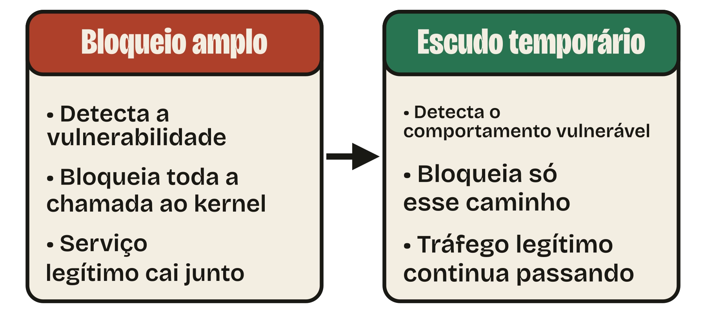

# Shirudo: defesa de Linux com zero downtime em produção

_2026-11-28 · noticia_

O Shirudo é um runtime Linux aberto criado por OpenAI e Cisco que permite a agentes escreverem controles dinâmicos com eBPF para proteger sistemas em execução sem reiniciá-los nem derrubar os serviços. Nesta apostila você entende o problema que ele resolve, como o agente observa e blinda um processo rodando, o que significa proteção com zero downtime, por que o projeto foi aberto e o que dá para fazer com ele na prática.

## O fato: OpenAI e Cisco lançam o Shirudo

Em 23 de novembro de 2026, a OpenAI anunciou em conjunto com a Cisco o Shirudo, um runtime Linux aberto que permite a agentes escreverem controles dinâmicos com eBPF para defender sistemas Linux em execução sem precisar esperar pelo patch nem reiniciar. O anúncio saiu no site oficial da OpenAI (openai.com/index/introducing-shirudo/) e o código está disponível no repositório github.com/shirudo-runtime/shirudo, sob licença BSD 2-Clause, com os programas BPF licenciados de forma dupla (BSD e GPL).

A proposta central é resolver um intervalo perigoso: entre detectar uma vulnerabilidade e aplicar o patch definitivo existe uma janela em que o exploit pode rodar livremente. O Shirudo entra nesse intervalo para bloquear o comportamento explorado sem interromper as cargas de trabalho.

Fonte: <https://openai.com/index/introducing-shirudo/>

## O problema: detectar não é suficiente

_Antes travava tudo e derrubava o serviço; agora bloqueia apenas o comportamento de risco._

Detectar uma vulnerabilidade e saber que ela existe não protege o sistema enquanto o patch ainda está sendo preparado. Muitas vezes, tanto o ataque quanto a operação legítima do serviço usam a mesma chamada ao kernel — por isso bloquear essa chamada de forma ampla pode derrubar o serviço inteiro.

O Shirudo foi desenhado para lidar com esse trade-off: em vez de travar a operação suspeita de forma definitiva, ele permite aplicar um escudo temporário que bloqueia apenas o comportamento vulnerável e deixa o tráfego legítimo passar. Assim o serviço continua rodando enquanto o time testa e libera a correção permanente.

## Como o Shirudo funciona: agentes, eBPF e escudos

Shirudo usa eBPF (Extended Buffer Programming Facility), uma tecnologia Linux que permite pequenos programas rodarem em pontos específicos dentro do sistema operacional. Isso dá ao agente capacidade de observar atividade suspeita e aplicar proteções direcionadas a processos que já estão rodando, sem precisar reiniciar nada.

Quatro capacidades estruturam o projeto: proteção em tempo real (shields bloqueiam caminhos vulneráveis sem restart), segurança com controle humano (a equipe decide o que é implantado), velocidade de defesa (agentes recebem controles programáveis para investigar, criar escudos e validar) e implantação confiável (os shields são assinados criptograficamente e verificados pelo kernel do Linux, com apoio de um Trusted Platform Module — TPM — para registrar evidências de carga ou remoção).

Na prática, o fluxo é: o defensor usa agentes para localizar os sistemas afetados; o agente gera um controle eBPF que blinda contra o exploit; a equipe revisa e aprova; o shield entra no kernel enquanto o serviço segue rodando. No anúncio oficial, a OpenAI cita um teste controlado em que um escudo gerado pelo Codex bloqueou uma tentativa de exploração da vulnerabilidade Java4Shell contra um Elasticsearch em execução, adicionando uma verificação de entrada ao decodificador Base64 do Java e anexando o controle diretamente ao processo rodando.

Fonte: <https://openai.com/index/introducing-shirudo/>

## Passo a passo: como o fluxo é descrito

O anúncio oficial descreve um fluxo completo que vai de localizar o problema até implantar a proteção sem interrupção. Abaixo estão as etapas conforme apresentadas.

1) Achar os sistemas afetados — defensor e agentes trabalham juntos para localizar quais máquinas estão expostas ao exploit antes de qualquer proteção ser aplicada.

2) Escrever o controle eBPF — um agente gera o escudo dinâmico que blinda o sistema contra o exploit enquanto o patch ainda não foi liberado.

3) Aplicar sem parar o serviço — a defesa entra no kernel sem reiniciar nada, com as cargas de trabalho continuando rodando normalmente.

1. Achar os sistemas afetados: defensor e agentes localizam em quais máquinas o exploit pode atingir. Resultado esperado: uma lista dos alvos expostos.
2. Escrever o controle eBPF: um agente gera o escudo que bloqueia o comportamento vulnerável. Resultado esperado: um programa de proteção pronto para revisão humana.
3. Aplicar sem parar o serviço: o shield é carregado no kernel do host afetado. Resultado esperado: a carga de trabalho continua rodando durante o teste do patch.

Fonte: <https://openai.com/index/introducing-shirudo/>

## Por que isso importa: defesa contínua em vez de remediação reativa

A mudança de postura é o ponto central. Em vez de agir só depois que o ataque se concretiza, o defensor passa a ter uma camada de proteção ativa enquanto investiga e aplica o patch permanente. Isso comprime o tempo em que um exploit pode explorar um sistema entre a detecção e a correção.

O ganho não está apenas na velocidade técnica, mas no processo: com sistemas protegidos durante o teste do patch, o defensor ganha mais tempo para revisar as proteções, validar que nada legítimo foi bloqueado e liberar a correção com confiança. A OpenAI descreve o Shirudo como um primeiro passo rumo a uma infraestrutura que se adapta a ameaças novas mantendo os serviços no ar.

Fonte: <https://openai.com/index/introducing-shirudo/>

## Os números e detalhes do anúncio

O anúncio não traz métricas de desempenho como taxa de bloqueio ou tempo médio de resposta — o que ele apresenta é a descrição qualitativa do teste controlado realizado com um serviço Elasticsearch exposto à vulnerabilidade Java4Shell, protegido por um escudo gerado pelo Codex. O ponto demonstrado foi que o shield rejeitou a entrada maliciosa sem derrubar o Elasticsearch em execução.

Sobre licenciamento: o projeto usa BSD 2-Clause para o runtime e licenças duplas (BSD e GPL) para os programas BPF. Isso significa que código derivado pode ser redistribuído sob as condições da BSD, mas os programas de baixo nível seguem regras próprias de atribuição e uso.

- Licença do projeto: BSD 2-Clause.
- Licença dos programas BPF: BSD e GPL (dupla).
- Teste citado no anúncio: escudo contra Java4Shell em Elasticsearch rodando, sem restart.
- Parceiros: OpenAI e Cisco, com participação de pesquisa em segurança e infraestrutura.

Fonte: <https://openai.com/index/introducing-shirudo/>

## O que muda para você

Para times de segurança e operações, o Shirudo abre a possibilidade de manter serviços no ar enquanto aplicam proteções temporárias contra exploits — algo especialmente valioso em ambientes onde downtime custa caro. Para desenvolvedores, o projeto é aberto: dá para inspecionar o código, testar shields e contribuir.

Para quem usa Linux em produção, a implicação prática é que existe uma abordagem nova de defesa baseada em agentes e eBPF, com verificação criptográfica e registro em TPM. Ainda é um primeiro passo: a própria OpenAI reconhece que o caminho até uma infraestrutura verdadeiramente autodefensável passa por endurecer o kernel, limitar permissões de carga de trabalho e automatizar políticas.

- Times de segurança podem testar shields temporários sem parar serviços críticos.
- Desenvolvedores podem estudar o código aberto e contribuir com novos shields.
- Operadores ganham uma ferramenta que trabalha junto ao defensor humano, não no lugar dele.

## Cuidados: limites e armadilhas

O Shirudo é descrito como um primeiro passo. A OpenAI admite que o objetivo de longo prazo inclui endurecer o kernel, restringir permissões de trabalho e automatizar políticas — ou seja, hoje a proteção depende de agentes que precisam ser bem calibrados e monitorados.

Um ponto de atenção: shields são temporários e precisam de revisão humana antes de serem implantados. Sem validação, qualquer controle pode bloquear operações legítimas ou gerar falsos positivos. A verificação criptográfica e o TPM ajudam a garantir integridade, mas não substituem a conferência do operador sobre o que está sendo protegido.

Outro limite: o projeto foi demonstrado em um teste controlado com Elasticsearch e Java4Shell. Não há, no anúncio, garantia de comportamento geral para todos os serviços ou todas as vulnerabilidades.

- Confira sempre se o shield bloqueia apenas o comportamento vulnerável e não operações legítimas antes de implantar.
- Entenda que a proteção é temporária: ela vale enquanto o patch permanente está em desenvolvimento.
- A automação depende de agentes bem treinados; falsos positivos ou bloqueios indevidos são um risco real.
- O projeto ainda está em evolução — trate os materiais oficiais como descrição inicial, não como solução completa.

## Glossário

- eBPF: tecnologia Linux que permite pequenos programas executarem em pontos específicos do kernel para inspecionar e controlar operações do sistema.
- Shield (escudo): proteção temporária criada com eBPF que bloqueia um comportamento vulnerável sem interromper o serviço, até que um patch permanente seja aplicado.
- Runtime: camada de software que gerencia a execução de processos; no caso do Shirudo, é o ambiente que permite aos agentes aplicar shields em sistemas Linux rodando.
- TPM (Trusted Platform Module): componente de hardware que fornece verificação criptográfica e registro confiável de eventos de segurança, usado pelo Shirudo para atestar proteções aplicadas ou removidas.
- Patch: correção permanente liberada pelos fabricantes para resolver uma vulnerabilidade.

## Para onde ir depois

- Leia o anúncio oficial da OpenAI sobre o Shirudo em openai.com/index/introducing-shirudo/ para ver o fluxo completo e os detalhes do teste.
- Acesse o repositório github.com/shirudo-runtime/shirudo, leia a documentação e explore o quickstart de VM proposto pela própria OpenAI.
- Se quiser se aprofundar, participe do webinar técnico agendado para 15 de dezembro, conforme divulgado no anúncio.
- Comece estudando como o eBPF funciona no Linux antes de tentar aplicar shields em produção — a base técnica é decisiva.

Fonte: <https://openai.com/index/introducing-shirudo/>

## O que conferir antes de usar

- Verifique se o shield está assinado criptograficamente e passou pela verificação do kernel antes de carregá-lo.
- Confirme com a equipe de operações qual é o impacto esperado do shield nas cargas legítimas do serviço afetado.
- Cheque as licenças (BSD 2-Clause para o runtime; BSD e GPL para os programas BPF) ao decidir usar ou redistribuir o código.
- Só aplique shields em ambientes controlados até entender o comportamento com sombra (observação sem bloqueio).

## Além do vídeo

- O teste controlado citado no anúncio, com escudo gerado pelo Codex contra Java4Shell em Elasticsearch rodando.
- A menção ao webinar técnico de 15 de dezembro para aprofundamento técnico.
- Os detalhes de licenciamento: BSD 2-Clause para o runtime e dupla licença (BSD e GPL) para os programas BPF.
- O papel do Trusted Platform Module na verificação das proteções aplicadas ou removidas.
- A citação de Greg Brockman, presidente e cofundador da OpenAI, sobre dar melhores modelos e ferramentas a defensores.
- A declaração de Cisco sobre hardening de kernel e limitação de permissões como parte dos objetivos de longo prazo.
- O convite para que desenvolvedores, pesquisadores de segurança e operadores contribuam com shields e melhorias no projeto.
