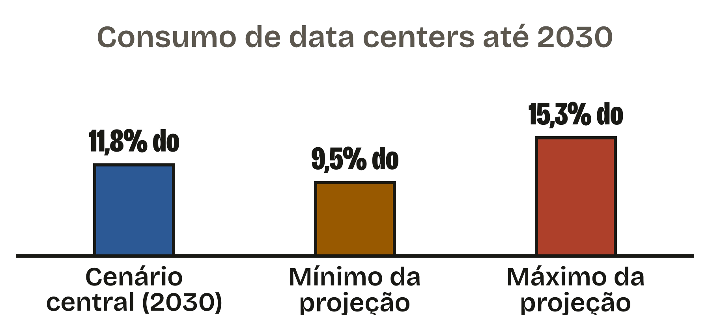
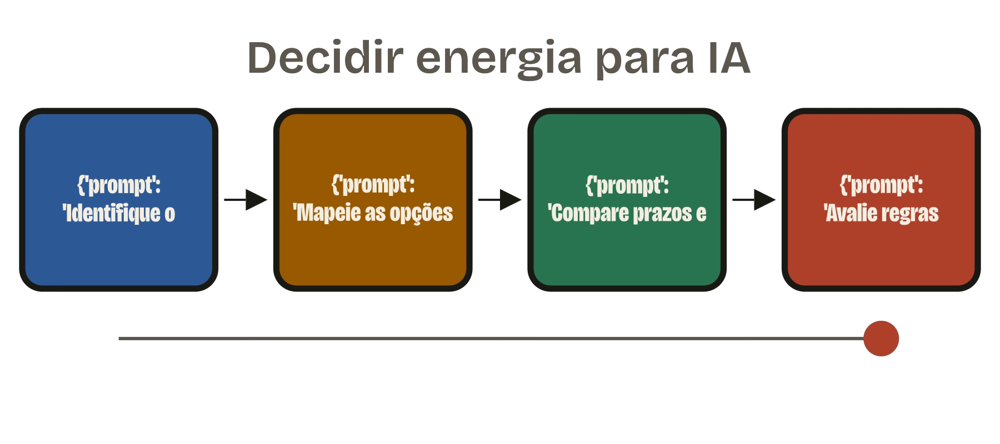

# SpaceX usa usina própria para ligar IA mais rápido

_2026-11-28 · noticia_

A SpaceX está construindo a própria infraestrutura elétrica para treinar IA mais rápido que rivais dependentes da rede. Elon Musk afirma que Google e Anthropic já alugam capacidade de computação da empresa justamente porque falta energia no setor. Uma usina permanente de 1,2 gigawatt perto dos supercomputadores de Greater Memphis substitui turbinas móveis temporárias. O Laboratório Berkeley projeta que data centers podem consumir entre 9,5% e 15,3% da eletricidade dos EUA até 2030. Ao fim desta apostila você entende por que energia virou vantagem competitiva na corrida da IA.

## SpaceX constrói usina própria para acelerar a IA

A SpaceX está erguendo uma planta de geração elétrica permanente de 1,2 gigawatt perto dos supercomputadores de Greater Memphis. No lugar das turbinas móveis que alugava antes, entra capacidade fixa, mais estável e pronta para operar o tempo todo.

Segundo Elon Musk, construir usinas próprias foi a única forma de levar computação de IA ao ar mais rápido do que os concorrentes dependentes da rede elétrica. A empresa argumenta que essa integração vertical — controlar desde a geração até o consumo — reduz o tempo entre decisão e treinamento de modelos gigantes.

Isso não é um detalhe de engenharia: é uma escolha estratégica em um setor onde cada semana conta. Data centers de IA precisam de energia constante, em escala industrial, e a rede elétrica pública nem sempre acompanha esse ritmo.

## Por que a energia virou gargalo da IA

Um data center de IA não é só um prédio cheio de servidores. Ele exige plantas elétricas inteiras, transformadores de grande porte, loops de resfriamento líquido e sistemas de refrigeração caros e complexos.

Musk descreveu o desafio com precisão: trazer grandes centros de IA online significa construir usinas massivas, transformadores, circuitos de resfriamento a líquido e redes internas extremamente elaboradas, especialmente para clusters de treinamento.

A demanda por energia cresce mais rápido do que a capacidade da rede em muitos lugares. Quando um data center precisa ligar, ele compete com hospitais, fábricas e residões pelo mesmo fio. Esse aperto é o que empurra empresas como Google e Anthropic a procurar fornecedores alternativos de computação — e, no caso delas, a própria SpaceX.

## Google e Anthropic alugam capacidade da SpaceX

O Google fechou um acordo plurianual de nuvem em junho, avaliado em US$ 920 milhões por mês na escala total.

A Anthropic firmou um pacto ampliado com a SpaceX sob o qual paga US$ 1,25 bilhão por mês pela capacidade de computação, com validade até maio de 2029.

Esses contratos mostram que a estratégia da SpaceX deixou de ser apenas sobre foguetes e satélites. A empresa virou fornecedora relevante de infraestrutura de IA, vendendo não só chips mas também a energia que alimenta os treinos.

## A conta do setor: quanto de eletricidade a IA vai consumir

_Participação estimada dos data centers na eletricidade dos Estados Unidos até 2030._

O aperto elétrico não é um problema isolado da SpaceX. O Lawrence Berkeley National Laboratory estima que os data centers dos Estados Unidos podem consumir entre 9,5% e 15,3% de toda a eletricidade do país até 2030.

O cenário central da projeção é de 11,8%. Isso significa que, em algumas décadas, a energia elétrica deixa de ser um serviço público comum e passa a ser um recurso estratégico disputado por governos, empresas de tecnologia e operadoras de rede.

Vale notar o intervalo das estimativas: dependendo dos cenários de crescimento da IA e da eficiência energética adotada, a fatia pode variar quase 6 pontos percentuais. A projeção é um teto plausível, não uma certeza — mas serve como termômetro do tamanho do desafio.

## O que muda para quem trabalha com IA

Para equipes de pesquisa e empresas que treinam modelos, a disponibilidade de energia afeta diretamente o cronograma. Sem capacidade elétrica sob demanda, treinos que levariam dias podem atrasar semanas por falta de watts.

A aposta em infraestrutura própria cria uma vantagem competitiva difícil de copiar: menos dependência da fila da rede, mais previsibilidade e possibilidade de escalar sem esperar licenças ou obras públicas.

Por outro lado, essa verticalização também concentra risco. Se a SpaceX tiver problemas na planta — falha técnica, interrupção, questionamentos regulatórios — toda uma cadeia de clientes fica exposta.

## Passo a passo: entender o ecossistema de energia para IA

_Passo a passo para avaliar o gargalo de energia em projetos de IA._

1. Comece identificando onde está o gargalo: em sua empresa ou projeto, verifique se o consumo atual de energia já limita a expansão dos treinos.
2. Mapeie as opções: aluguel de capacidade na rede, contratos com fornecedores especializados ou construção de infraestrutura própria — cada caminho tem custo e prazo diferentes.
3. Compare prazos: alugar é mais rápido, mas pode ser mais caro no longo prazo; construir dá controle, mas exige capital e engenharia próprios.
4. Avalie o contexto regulatório local: regras de energia, licenciamento ambiental e exigências de segurança mudam de país para país e afetam a viabilidade de projetos próprios.

## Cuidados ao interpretar essa notícia

- Trate como referência, não como fato auditado.
- A projeção do Laboratório Berkeley é uma estimativa com intervalo amplo (de 9,5% a 15,3%). Use-a como direção, não como previsão exata.
- A afirmação de que construir usinas próprias foi 'a única forma' de mover mais rápido é uma posição da empresa. Não há evidência independente, nos dados apresentados, de que rivais estejam impossibilitados de fazer o mesmo com energia própria.
- Contratos de aluguel de capacidade podem mudar de valor e escopo ao longo do tempo. Valores citados são os vigentes na data da declaração.

## Glossário

- Integração vertical: quando uma empresa controla várias etapas de um processo, no caso desde a geração de energia até o fornecimento de computação.
- Data center: grande instalação que abriga servidores e sistemas de resfriamento para processamento de dados em escala.
- GPU (Unidade de Processamento Gráfico): chip originalmente feito para gráficos, hoje essencial para treinar modelos de IA.
- Resfriamento líquido: sistema que usa líquidos para dissipar o calor intenso gerado por servidores de alta carga.
- Cluster de treinamento: conjunto de máquinas trabalhando juntas para treinar um modelo de IA em larga escala.

## Para onde ir depois

- Acompanhe anúncios oficiais da SpaceX sobre novas plantas e contratos com clientes de IA.
- Estude o impacto regulatório: regras de energia e de uso do solo podem mudar o jogo em favor ou contra projetos próprios.
- Compare cenários de custo entre alugar capacidade na rede e construir infraestrutura própria para entender qual faz sentido no seu contexto.
