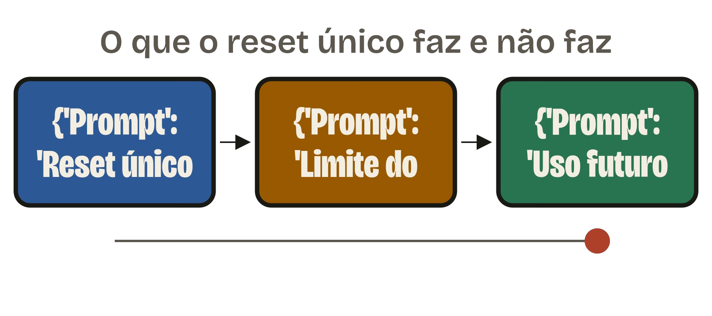
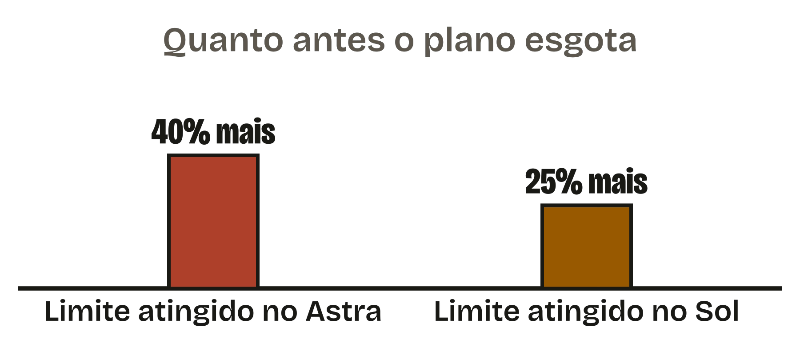
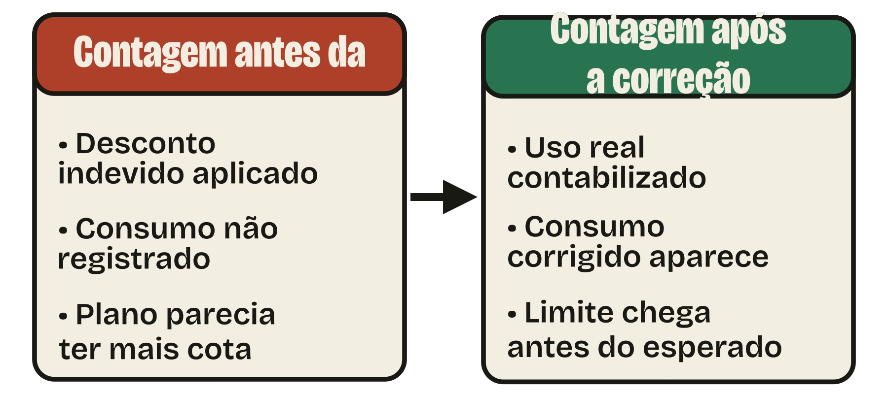

# Uso do Codex atinge limite até 40% mais rápido no GPT-6.2 Astra

_2026-11-28 · noticia_

A OpenAI admitiu um erro na contagem de uso dos modelos GPT-6.2 Astra e Sol no lançamento: havia descontado indevidamente o consumo desses modelos para a maioria dos usuários. Corrigida a contagem, o mesmo trabalho passa a consumir mais cota do plano — no Astra, o limite chega 40% mais rápido; no Sol, 25% mais rápido. Como compensação, a empresa deu um reset único de uso aos planos Go, Plus, Pro e Business, sem reduzir limites nem ampliar cota. Entenda o que aconteceu, por que isso pesa para quem programa com Codex e como calibrar seu uso a partir de agora.

## O erro da contagem

A OpenAI admitiu publicamente que descontou indevidamente o consumo dos modelos GPT-6.2 Astra e Sol no momento do lançamento. Em um post no X em 26/11/2026, Thibault Sottiaux explicou que a empresa havia dado um desconto incorreto na hora de contar o uso desses modelos para a maioria dos usuários.

Quando esse erro foi corrigido, o efeito prático é direto: tarefas iguais passam a consumir mais cota do plano do que consumiam na semana anterior. A própria OpenAI resumiu a situação com a frase 'We've fixed this now, so the same work will use more of your plan's usage allowance' — ou seja, o mesmo trabalho de código agora gasta mais allowance.

Isso não significa que os modelos ficaram piores nem que seus limites foram reduzidos. O limite em si continua o mesmo; o que mudou foi a forma como o consumo é contado. Por isso a comparação correta é com a semana anterior, e não com meses atrás.

## Por que o erro pesa mais para quem programa

Quem usa Codex para escrever código sente o impacto primeiro porque tarefas de programação tendem a consumir bastante cota por pedido: compilações, execuções, chamadas longas e refatorações gastam tokens de entrada e saída em volume maior do que uma conversa casual no ChatGPT.

A OpenAI destacou no lançamento dos GPT-6.2 que ambos os modelos entregam 'better results on demanding tasks with fewer output tokens'. Isso é verdade quando comparados a gerações anteriores, como o 6 Astra e o 6.1 Sol — mas não anula o fato de que cada uso agora conta mais contra o teto do plano.

Na prática, quem rodava a mesma quantidade de código na semana anterior tinha uma margem maior dentro do limite. Com a correção, essa margem encolhe proporcionalmente ao quanto você usa. O resultado é um plano que seca mais rápido exatamente para quem mais depende dele no trabalho.

## GPT-6.2 Astra

O GPT-6.2 Astra é o modelo da linha com melhor desempenho em tarefas exigidas, entregando resultados melhores com menos tokens de saída — a própria OpenAI destacou isso no lançamento.

Com a correção da contagem, cada uso do Astra passa a pesar mais na cota. O limite chega 40% mais rápido do que na semana anterior para o mesmo tipo de tarefa de código. Ou seja: se antes você conseguia rodar X horas de trabalho dentro do plano, agora esse mesmo volume consome mais allowance e pode estourar o teto antes.

## Sol

O Sol é outro modelo da linha GPT-6.2, também beneficiado pela correção da contagem.

Ele segue a mesma lógica do Astra: melhor desempenho em tarefas exigidas com menos tokens de saída, mas agora consumindo mais cota por uso corrigido. O limite chega 25% mais rápido no mesmo tipo de tarefa de código — um pouco menos agressivo que o Astra, mas ainda perceptível para quem roda bastante código.

## O reset único: o que ele realmente faz

_Fluxo do reset único: zeramento pontual da cota, sem alterar limite nem ampliar uso perman_

Como compensação pelo erro, a OpenAI concedeu um reset único de uso aos planos Go, Plus, Pro e Business. É uma espécie de 'zeramento pontual' da cota acumulada no período afetado.

O ponto importante é o que esse reset não faz: ele não reduz o limite do plano nem aumenta permanentemente a cota. Você volta ao mesmo ponto de partida — só que com menos folga, porque daqui para frente o consumo corrigido pesa mais. É uma compensação pontual, não um ajuste estrutural.

## Os números

_Comparação do quanto mais rápido o limite é atingido no Astra e no Sol após a correção._

- 40%: quanto mais rápido o limite do plano é atingido no GPT-6.2 Astra, comparado à semana anterior, para o mesmo tipo de trabalho de código.
- 25%: quanto mais rápido o limite é atingido no Sol, na mesma comparação — mesmo tipo de tarefa, consumo corrigido.
- Reset único: compensação dada aos planos Go, Plus, Pro e Business; não reduz limite nem amplia cota permanentemente.

Fonte: <https://www.techradar.com/news/openai-admits-billing-mistake-gpt-6-2-astra-sol-usage-limits>

## O que muda para quem usa Codex no dia a dia

Para o usuário casual do ChatGPT, a diferença pode passar despercebida. Conversas simples consomem pouca cota e dificilmente empurram alguém para o limite.

Já para quem programa com Codex, a conta muda de figura. Tarefas de escrita de código são intensivas em tokens e tendem a acumular consumo rápido. Com a correção, aquele 'espaço de manobra' que existia na semana do lançamento desaparece — o mesmo projeto pode estourar o limite antes do previsto.

Isso não significa parar de usar os modelos GPT-6.2. Significa calibrar melhor quantas tarefas cabem no mês e quando vale alternar entre modelos ou ajustar escopos para não queimar cota desnecessariamente.

## Reação dos usuários

A reação na comunidade foi de desconfiança quanto à intenção da correção. Um usuário resumiu o incômodo dizendo que a empresa estaria 'ativamente empurrando clientes embora', já que não há compute suficiente nem para pagantes.

Outro ponto recorrente é a falta de clareza sobre quanto uso cada pedido consome. Como os limites são compartilhados e variam por modelo e por hora e por semana, fica difícil estimar o valor real do plano mês a mês.

Um comentário sintetizou bem: 'não há como saber quanto um pedido vai queimar, e depois ainda existem os limites de 5 por hora e semanais — é feito para confundir'. A crítica não é ao erro em si, mas à dificuldade de medir o retorno sobre o pagamento.

## O que conferir antes de assumir a conta

- Confira no painel do seu plano qual é o limite atual e quanto já foi consumido desde a correção da contagem.
- Verifique se você está nos planos Go, Plus, Pro ou Business — só esses receberam o reset único.
- Entenda que o reset não muda o teto: ele apenas devolve cota acumulada, sem aumentar sua capacidade total de uso.
- Se usa Codex intensamente, acompanhe semanalmente o consumo por modelo, porque Astra e Sol passam a pesar diferente na mesma cota compartilhada.
- Não confunda 'limite 40% mais rápido' com 'limite reduzido em 40%': são coisas distintas. O limite permanece; o ritmo de consumo aumentou.

## Glossário

- Allowance (cota de uso): quantidade total de tokens ou uso permitido dentro de um plano pago, que vai sendo consumida conforme você usa os modelos.
- Tokens: unidades pequenas de texto que o modelo processa. Uma frase pode ter centenas ou milhares de tokens; é a unidade com que o consumo do plano é medido.
- Reset único: zeramento pontual e temporário da cota acumulada, dado como compensação por um erro — não altera o limite nem amplia permanentemente o uso permitido.

## Para onde ir depois

- Revise seu consumo semanal por modelo e identifique quais tarefas estão queimando cota mais rápido.
- Se usa Codex para trabalho, teste dividir tarefas entre Astra e Sol conforme o tipo de demanda — mas saiba que ambos consomem proporcionalmente mais agora.
- Acompanhe comunicados oficiais da OpenAI sobre limites e resets; mudanças podem vir sem aviso prévio.
- Se quiser planejar melhor, use a cota como orçamento mensal: estime quantas sessões de código cabem no mês antes de abrir tarefas longas.

## Limites compartilhados do ChatGPT

Os limites de uso do ChatGPT são compartilhados entre modelos e recursos dentro de um mesmo plano. Isso significa que uma conversa longa no chat consome a mesma cota que uma sessão de Codex — o que torna ainda mais difícil prever quando o plano vai secar.

A própria OpenAI admite essa complexidade: há limites diários por hora (como os 5 por hora) e limites semanais, além do teto mensal. Com modelos consumindo em ritmos diferentes, a estimativa de valor do plano fica imprecisa — exatamente o que a correção da contagem deixou mais evidente.

## O erro no lançamento dos GPT-6.2

_Antes e depois da correção da contagem de uso no lançamento dos GPT-6.2._

No lançamento dos modelos GPT-6.2 Astra e Sol, a OpenAI aplicou um desconto incorreto na contagem de uso para a maioria dos usuários. Isso fez com que parte do consumo não fosse registrada inicialmente — ou seja, o plano parecia ter mais cota disponível do que realmente tinha.

Com a correção retroativa da contagem, esse 'desconto' foi revertido: o consumo real passou a ser contabilizado. O efeito é que tarefas feitas na semana do lançamento agora aparecem consumindo mais do que aparentavam.

## O que isso diz sobre valor de um plano de IA

A história expõe uma dificuldade estrutural: planos de assinatura de IA são difíceis de avaliar em valor, porque o consumo varia muito por tarefa e por modelo, e os limites nem sempre são transparentes.

Quando a contagem é corrigida, fica mais claro que 'mais resultado por token' não significa necessariamente 'mais uso dentro do plano'. Os dois podem coexistir — e é justamente essa combinação que faz o limite chegar antes do esperado para quem trabalha com código.

## Além do vídeo

- A comparação de consumo feita na semana anterior serve de base para medir o impacto da correção; porém, não há um número absoluto de tokens por tarefa disponível.
- O reset único é descrito como 'banked reset' pela OpenAI — termo que indica cota reservada e liberada uma única vez.
- A OpenAI afirmou que não vai cobrar retroativamente a diferença de uso dos modelos afetados pelo erro de contagem.
- Os limites de 5 por hora e semanais citados na reação dos usuários são compartilhados entre modelos dentro do mesmo plano.
- Não são informados o limite mensal em tokens nem a cota total oferecida por cada plano (Go, Plus, Pro, Business).
- A correção da contagem vale para 'a maioria dos usuários', mas não se detalha quem ficou fora desse desconto inicial.
