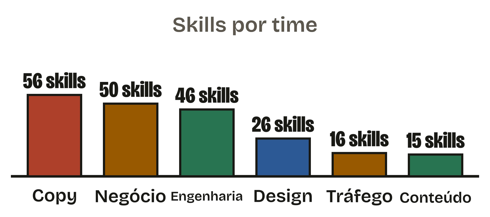
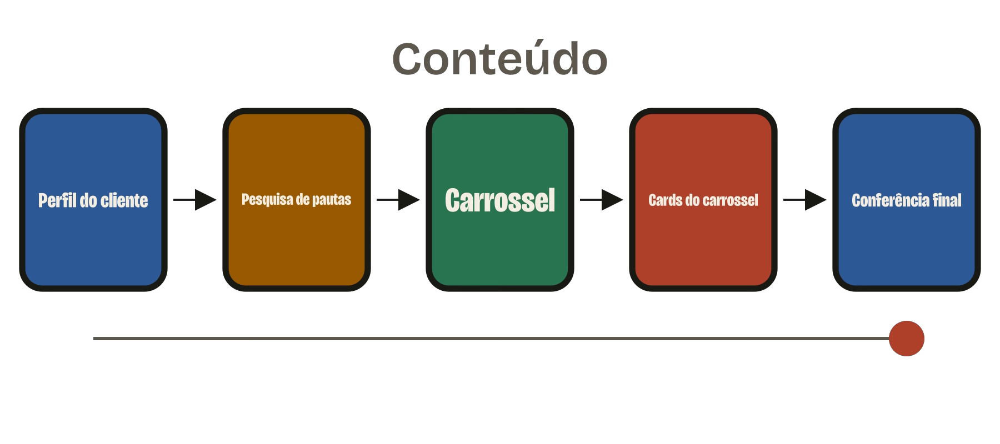
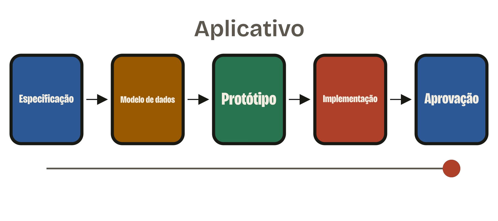
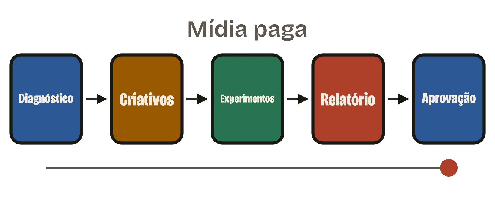

# 209 skills em 6 times rodando dentro do Claude Code

_2026-11-23 · reportagem_

O pacote reúne 209 skills em seis times para orientar tarefas de copy, negócio, engenharia, design, tráfego e conteúdo. Cada skill é um arquivo SKILL.md com preparo, passo a passo, entrega, conferência e limites. Depois da leitura, você vai saber escolher a skill adequada, configurar o contexto do projeto e encadear quatro fluxos de trabalho. Também vai entender quais ações exigem aprovação antes de custar dinheiro, publicar ou alterar produção.

## Como usar esta lista

Use este catálogo para localizar a função de que você precisa. Os seis times cobrem áreas diferentes da operação, e cada skill desce ao nível de uma tarefa. A sequência importa porque a saída de uma skill alimenta a próxima.

Para trabalhar, comece pelo objetivo. Executar uma etapa por vez permite conferir o que o agente entregou antes de avançar.

1. Escolha um objetivo concreto, como criar um carrossel ou lançar um aplicativo. O resultado esperado é uma tarefa delimitada.
2. Abra o catálogo no AGENTS.md da pasta das skills. O resultado esperado é encontrar o nome exato e a função de que você precisa.
3. Preencha o arquivo de instruções do seu agente com marca, oferta, público, objetivo, métricas, tom, local de preços e provas e pontos que exigem aprovação. O resultado esperado é um contexto que o agente possa usar.
4. Execute uma skill por vez e confira a entrega antes de passar para a próxima. O resultado esperado é uma cadeia em que cada etapa recebe a saída da anterior.
5. Leve custo, publicação, deploy e mudança irreversível à aprovação. O resultado esperado é uma ação autorizada.

## O que são as 209 skills

Uma skill é um conjunto de instruções prontas para uma tarefa específica. Neste pacote, cada uma fica em um arquivo SKILL.md com o que reunir antes de começar, o passo a passo, o que entregar, a conferência final e os limites. O conteúdo é texto, sem código executável.

O pacote tem 209 skills e seis times. O canal reescreveu todas em 26/11/2026, com texto próprio e nomes no formato time-função. Elas orientam o trabalho do agente e servem em qualquer agente; quem usa outro formato segue o README da pasta.

A especialização organiza o pedido. Você escolhe uma função, fornece o contexto e recebe um roteiro de trabalho específico. A conferência continua necessária porque a skill não substitui revisão nem autorização.

## O arquivo de contexto do projeto

No vídeo, o CLAUDE.md aparece como o arquivo que centraliza o dono e a operação. No pacote, o catálogo fica no AGENTS.md da pasta. O contexto do projeto deve ser escrito no arquivo de instruções do agente usado, que pode ser AGENTS.md, CLAUDE.md, GEMINI.md ou equivalente.

Registre marca, oferta, público, objetivo e métricas. Inclua o tom de voz, onde ficam preços e provas e quais decisões exigem aprovação. Assim, a skill recebe as informações do projeto e os limites de atuação no mesmo lugar.

Separe catálogo de contexto. O catálogo diz quais skills existem; o arquivo do projeto diz como a sua operação funciona. Essa separação permite usar o mesmo pacote em agentes e projetos diferentes.

## Copy (56 skills)

O time de copy reúne 56 skills para transformar oferta e informação do cliente em texto. Ele cobre pesquisa, estrutura, páginas, e-mails, anúncios, objeções e revisão. Escolha a skill pela etapa do texto e pela função de que você precisa.

O catálogo separa carta de vendas, página de produto digital e anúncio em skills próprias, porque cada peça tem função e contexto diferentes. A revisão final ajuda a conferir a mensagem antes da publicação.

- Para começar, use copy-method-router quando houver dúvida sobre qual método de copy aplicar.
- copy-ab-test-plan planeja o teste A/B de texto.
- copy-aida-structure organiza o texto em AIDA.
- copy-authority-positioning estrutura a autoridade demonstrada.
- copy-awareness-levels adapta a mensagem ao nível de consciência.
- copy-b2b-service-page escreve a página de serviço para empresas.
- copy-benefit-bullets cria bullets de benefício.
- copy-call-objection-playbook organiza objeções em ligação de vendas.
- copy-campaign-big-idea define o conceito central da campanha.
- copy-cart-recovery trabalha a recuperação de carrinho.
- copy-checkout-microcopy escreve os textos do checkout.
- copy-commercial-proposal monta a proposta comercial.
- copy-competitor-message-analysis analisa as mensagens concorrentes.
- copy-conversion-webinar estrutura o webinar com oferta.
- copy-cta-library organiza a biblioteca de chamadas para ação.
- copy-customer-language-research pesquisa o vocabulário do cliente.
- copy-digital-product-page escreve a página de produto digital.
- copy-direct-sales-email escreve o e-mail de venda direta.
- copy-dm-conversation-script monta a conversa em mensagem direta.
- copy-editorial-newsletter prepara a edição de newsletter.
- copy-email-openers cria aberturas de e-mail.
- copy-evidence-based-persona constrói a persona sustentada por dados.
- copy-final-conversion-review faz a revisão final antes de publicar.
- copy-guarantee-terms escreve a garantia sem letras confusas.
- copy-headlines-and-ads cria títulos e anúncios.
- copy-intent-retargeting organiza o retargeting por intenção.
- copy-launch-messaging-map monta o mapa de mensagens de lançamento.
- copy-lead-capture-page escreve a página de captação.
- copy-message-architecture define a arquitetura da mensagem.
- copy-method-router faz a triagem do método de copy.
- copy-multichannel-offer-consistency confere a oferta entre canais.
- copy-nurture-email-sequence monta a sequência de nutrição.
- copy-objection-map organiza o mapa de objeções de compra.
- copy-offer-mechanism explica como a oferta gera resultado.
- copy-offer-stack monta a seção do que está incluso.
- copy-pas-structure organiza o problema, o agravamento e a solução.
- copy-plan-comparison compara planos.
- copy-post-purchase-welcome-emails escreve e-mails de boas-vindas ao cliente.
- copy-post-sale-upsell estrutura o pós-venda com continuidade.
- copy-price-justification argumenta o preço.
- copy-proof-audit faz a auditoria de provas.
- copy-sales-faq monta o FAQ que responde objeções.
- copy-sales-letter escreve a carta de vendas completa.
- copy-sales-page-rewrite reescreve a página de vendas.
- copy-satisfaction-survey prepara a pesquisa com compradores.
- copy-short-copy-editing enxuga o texto curto.
- copy-static-ad-creatives escreve textos para anúncio estático.
- copy-storyselling-narrative cria a história que vende.
- copy-subscription-offer estrutura a oferta por assinatura.
- copy-testimonial-formats adapta depoimentos a vários formatos.
- copy-ui-microcopy escreve o microcopy de interface.
- copy-value-proposition define a proposta única de valor.
- copy-verifiable-promise formula a promessa que pode ser comprovada.
- copy-video-ad-scripts escreve roteiros de anúncio em vídeo.
- copy-voice-guide-review revisa o tom de voz.
- copy-vsl-script escreve o roteiro de vídeo de vendas.
- copy-whatsapp-sales-script escreve o roteiro comercial para WhatsApp.

## Negócio (50 skills)

O time de negócio tem 50 skills para estruturar decisões comerciais. Ele trata de cliente, oferta, preço, mercado, finanças, operação, vendas e crescimento. Use essas funções quando a decisão depender do modelo de negócio.

O catálogo inclui diagnóstico, validação de ideia, projeções e leitura de dados. O conselho estratégico é simulado. Ele ajuda a organizar a análise, sem substituir a aprovação do responsável.

- Para começar, use biz-company-context-file para criar o manual da empresa para assistentes de IA.
- biz-acquisition-channels ajuda a escolher canais de aquisição.
- biz-ai-delegation-matrix organiza a matriz de delegação para IA.
- biz-b2b-value-proposition define a proposta de valor para empresas.
- biz-cash-flow-projection faz a projeção de fluxo de caixa.
- biz-commercial-package monta o pacote comercial para página.
- biz-company-context-file cria o manual da empresa para assistentes de IA.
- biz-company-health-check faz o diagnóstico geral da empresa.
- biz-competitive-analysis analisa a concorrência.
- biz-consultative-sales-playbook monta o guia de venda consultiva.
- biz-cost-reduction-plan faz o plano de redução de custos.
- biz-crm-setup organiza um CRM enxuto.
- biz-customer-interview-plan prepara o roteiro de entrevistas com clientes.
- biz-customer-journey-map monta o mapa da jornada do cliente.
- biz-customer-onboarding estrutura os primeiros dias do cliente.
- biz-customer-success-plan faz o plano de sucesso do cliente.
- biz-data-insights transforma a leitura de dados em ações.
- biz-decision-log registra decisões.
- biz-expansion-assessment avalia a expansão.
- biz-financial-diagnosis faz o diagnóstico financeiro.
- biz-growth-plan faz o plano de crescimento sustentável.
- biz-idea-validation valida a ideia antes de produzir.
- biz-ideal-customer-profile define o perfil do cliente ideal.
- biz-kpi-dashboard monta o painel de indicadores.
- biz-launch-plan faz o planejamento de lançamento.
- biz-market-research faz a pesquisa de mercado com evidências.
- biz-model-diagnosis faz o raio-x do modelo de negócio.
- biz-mvp-scope define o escopo de produto mínimo.
- biz-negotiation-prep prepara a negociação.
- biz-niche-selection escolhe o nicho por viabilidade.
- biz-offer-structure estrutura a oferta entregável.
- biz-operations-audit faz a auditoria da operação.
- biz-organic-growth-plan faz o plano de crescimento orgânico.
- biz-partnership-strategy define a estratégia de parcerias.
- biz-pricing-model define o preço.
- biz-product-discovery faz a descoberta de produto.
- biz-product-strategy define a estratégia de produto.
- biz-quarterly-planning faz o planejamento trimestral.
- biz-retention-plan faz o plano de retenção de clientes.
- biz-revenue-forecast faz a previsão de receita por cenários.
- biz-risk-register mantém o registro de riscos.
- biz-sales-funnel organiza o funil de vendas.
- biz-solo-operation-design desenha a operação de uma pessoa só.
- biz-standard-operating-procedure cria o procedimento operacional padrão.
- biz-strategic-positioning define o posicionamento de mercado.
- biz-strategy-council organiza o conselho estratégico simulado.
- biz-support-automation-flow monta o fluxo de atendimento automatizado.
- biz-swot-analysis transforma a análise SWOT em decisão.
- biz-task-prioritization prioriza tarefas.
- biz-unit-economics analisa a economia por cliente.
- biz-vendor-selection apoia a contratação de prestadores.

## Engenharia (46 skills)

Engenharia reúne 46 skills para levar uma ideia técnica da especificação à entrega. Há funções para arquitetura, dados, API, implementação, testes, segurança, observabilidade e publicação. A sequência ajuda a definir o que construir antes de escrever código.

Uma skill de implementação trabalha com o que as etapas anteriores definiram. O portão de qualidade da versão verifica a entrega; publicar em produção continua exigindo aprovação.

- Para começar, use eng-requirements-spec para transformar a ideia em especificação implementável.
- eng-api-documentation documenta a API.
- eng-app-architecture define a arquitetura da aplicação.
- eng-app-feature-mapping mapeia as funcionalidades do aplicativo.
- eng-app-internationalization trata da internacionalização da interface.
- eng-architecture-review revisa a arquitetura.
- eng-async-job-queue projeta filas e processamento assíncrono.
- eng-auth-modeling modela autenticação e permissões.
- eng-bug-root-cause investiga a causa raiz de bugs.
- eng-cache-invalidation define a estratégia de cache e invalidação.
- eng-ci-cd-pipeline desenha o pipeline de integração e entrega.
- eng-code-review revisa o código por severidade.
- eng-data-api-design define o modelo de dados e os contratos de API.
- eng-data-pipeline-design projeta a arquitetura de pipeline de dados.
- eng-database-migration planeja a migração de banco com segurança.
- eng-dependency-review revisa dependências.
- eng-deploy-readiness verifica a prontidão para publicar em produção.
- eng-end-to-end-testing testa as jornadas ponta a ponta.
- eng-error-handling define o padrão de tratamento de erros.
- eng-external-api-integration integra API de terceiros.
- eng-feature-implementation implementa a funcionalidade.
- eng-frontend-accessibility trata da acessibilidade no frontend.
- eng-frontend-performance analisa o desempenho do frontend.
- eng-git-workflow define o fluxo de versionamento e revisão.
- eng-integration-sdk cria o SDK para uma API.
- eng-integration-testing testa a integração entre componentes.
- eng-load-testing faz testes de carga.
- eng-multi-tenant-isolation trata do isolamento em aplicação multi-tenant.
- eng-observability-plan monta o plano de observabilidade.
- eng-payments-integration integra pagamentos.
- eng-privacy-by-design inclui privacidade desde o projeto.
- eng-production-debugging investiga incidente em produção.
- eng-project-cli-design desenha a interface de linha de comando do projeto.
- eng-project-onboarding-docs cria a documentação de entrada no projeto.
- eng-query-optimization otimiza consultas.
- eng-release-quality-gate faz a verificação final de qualidade da versão.
- eng-reliable-webhooks define a recepção confiável de webhooks.
- eng-requirements-spec transforma a ideia em especificação implementável.
- eng-safe-refactoring faz refatoração sem mudar o comportamento.
- eng-search-indexing organiza a busca e a indexação interna.
- eng-secrets-management cuida da gestão de segredos do projeto.
- eng-security-audit faz a auditoria defensiva de segurança.
- eng-task-automation-script cria script para tarefa repetitiva.
- eng-technical-roadmap monta o roteiro de evolução técnica.
- eng-transactional-email escreve e-mails transacionais.
- eng-unit-testing testa funções e módulos.
- eng-work-orchestration organiza frentes de desenvolvimento.

## Design (26 skills)

Design tem 26 skills para identidade, interface e peças visuais. O time cobre direção visual, nomes, cores, tipografia, componentes, layouts, protótipos e acessibilidade. Escolha a função conforme o entregável: uma marca, uma página ou um carrossel.

O visual deve seguir o posicionamento e o conteúdo definidos. As skills de interface e de componentes organizam a construção; as revisões de acessibilidade e de layout ajudam a conferir o resultado.

- Para começar, use design-visual-direction para definir a direção visual da marca.
- design-accessibility-review revisa a acessibilidade visual.
- design-ad-variations cria variações de peças para anúncios.
- design-ai-photo-direction define a direção fotográfica para imagens geradas.
- design-brand-icon cria o ícone de marca.
- design-brand-identity constrói a identidade a partir do posicionamento.
- design-brand-naming cria nomes para marca ou produto.
- design-carousel-cards cria o visual de carrossel.
- design-clickable-prototype monta o roteiro de protótipo navegável.
- design-color-palette define a paleta de cores funcional.
- design-component-library organiza a biblioteca de componentes visuais.
- design-distinctive-page cria a página com personalidade própria.
- design-email-template cria o modelo visual de e-mail.
- design-form-experience desenha a experiência de formulários.
- design-glass-motion-effects cria movimento e efeito de vidro.
- design-interface-audit faz a auditoria de interface.
- design-interface-icons define o padrão de ícones de interface.
- design-landing-page-layout monta o layout de landing page.
- design-lean-system organiza um design system enxuto.
- design-metrics-dashboard desenha o painel de métricas.
- design-motion-storyboard cria o storyboard de motion design.
- design-onboarding-flow desenha o fluxo de primeiros passos.
- design-presentation-slides faz o design de apresentações.
- design-responsive-layouts adapta o layout a diferentes telas.
- design-spacing-system define o sistema de espaçamento.
- design-type-hierarchy organiza a tipografia e a hierarquia de leitura.
- design-visual-direction define a direção visual da marca.

## Tráfego (16 skills)

Tráfego tem 16 skills para mídia paga no Meta e no Google Ads. O trabalho começa pelo diagnóstico do funil e passa por estrutura de campanha, criativos, orçamento, rastreamento, relatório e escala. O objetivo é tratar a etapa que está limitando a campanha.

Antes de aumentar verba, confira o diagnóstico e o plano de escala. Custo exige aprovação. A leitura de criativos e o relatório de performance alimentam a decisão com dados.

- Para começar, use traffic-media-triage para identificar o problema em mídia paga.
- traffic-acquisition-forecast faz a previsão de aquisição por cenários.
- traffic-ad-account-audit audita a conta de anúncios.
- traffic-ad-experiments organiza a ficha de experimentos de anúncios.
- traffic-audience-mapping mapeia públicos por necessidade.
- traffic-budget-plan divide o orçamento de mídia.
- traffic-campaign-plan monta o plano de campanha.
- traffic-conversion-tracking planeja o rastreamento de conversões.
- traffic-creative-analysis lê o desempenho dos criativos.
- traffic-creative-strategy define a estratégia de testes de criativos.
- traffic-funnel-diagnosis identifica gargalos do funil pago.
- traffic-google-search-structure estrutura a busca no Google Ads.
- traffic-media-triage faz a triagem de problema em mídia paga.
- traffic-meta-campaign-structure estrutura campanhas no Meta.
- traffic-performance-report monta o relatório de performance.
- traffic-remarketing-sequence monta a sequência de remarketing.
- traffic-scaling-plan organiza a escala gradual com reversão.

## Conteúdo (15 skills)

Conteúdo reúne 15 skills para pesquisa, roteiro e produção de peças. Há funções para pautas, ganchos, carrossel, vídeo curto, cenas de IA, histórias, casos de cliente e parcerias. O time transforma uma ideia em material adaptado ao canal.

Comece pela pesquisa de pautas quando o ponto de partida for o público. Para publicar, confira o texto e o visual e peça aprovação. A skill orienta a produção, mas não autoriza a postagem.

- Para começar, use content-topic-research para pesquisar pautas pelo público.
- content-ai-scene-prompts escreve prompts de cena para imagem e vídeo.
- content-carousel monta o carrossel pronto para publicar.
- content-creator-partnerships organiza parcerias com criadores.
- content-customer-case monta o estudo de caso de cliente.
- content-editorial-audit faz a auditoria de conteúdo.
- content-editorial-calendar monta o calendário de publicações.
- content-hook-bank reúne ganchos de abertura.
- content-multichannel-repurpose adapta uma ideia a vários canais.
- content-post-captions escreve legendas que somam ao post.
- content-retention-story cria a história que segura a atenção.
- content-search-brief prepara o briefing de conteúdo encontrável.
- content-short-video-script escreve o roteiro de vídeo curto e simples.
- content-topic-research pesquisa pautas pelo público.
- content-video-beats mapeia as batidas do vídeo.
- content-video-to-carousel transforma vídeo curto em carrossel.

## Os números



_Barras mostram a quantidade de skills em cada time e a soma de 209._

- 209 é o total de skills do pacote, distribuídas entre seis times.
- 56 é a quantidade de skills de copy, o maior time do catálogo.
- 50 é a quantidade de skills de negócio.
- 46 é a quantidade de skills de engenharia.
- 26 é a quantidade de skills de design.
- 16 é a quantidade de skills de tráfego.
- 15 é a quantidade de skills de conteúdo.
- A soma 56 + 50 + 46 + 26 + 16 + 15 resulta em 209 skills.
- Esses números medem funções disponíveis no catálogo. Eles não indicam quantidade de pessoas, tempo economizado, receita ou taxa de conversão.

## Fluxo: campanha de conteúdo



_Fluxo do perfil do cliente à pauta, ao carrossel, aos cards e à conferência final._

Use este fluxo quando a campanha começa no público e termina em um carrossel revisado. A saída de cada skill orienta a seguinte, do perfil do cliente à conferência final do texto.

- biz-ideal-customer-profile define o perfil do cliente ideal. O resultado esperado é o público que a pesquisa de pautas vai usar.
- content-topic-research pesquisa pautas pelo público. O resultado esperado é uma pauta escolhida para o carrossel.
- content-carousel monta o carrossel pronto para publicar. O resultado esperado é o texto e a estrutura da peça.
- design-carousel-cards cria o visual do carrossel. O resultado esperado são os cartões com a identidade aplicada.
- copy-final-conversion-review revisa o texto antes de publicar. O resultado esperado é uma versão conferida para aprovação.

## Fluxo: oferta digital

Use este fluxo para estruturar uma oferta digital e levar a mesma proposta para a página e para os canais. A validação vem antes do preço; a revisão final procura coerência entre as peças.

- biz-idea-validation valida a ideia antes de produzir. O resultado esperado é uma base para montar o pacote comercial.
- biz-commercial-package monta o pacote comercial para a página. O resultado esperado é a oferta que alimentará a definição de preço.
- biz-pricing-model define o preço. O resultado esperado é o valor a ser usado na página.
- copy-digital-product-page escreve a página de produto digital. O resultado esperado é a página com a oferta e o preço.
- copy-multichannel-offer-consistency confere a oferta entre canais. O resultado esperado é uma mensagem coerente antes da publicação.

## Fluxo: lançamento de aplicativo



_Fluxo da especificação e do modelo de dados ao protótipo, à implementação e à aprovação._

Use este fluxo para sair da ideia e chegar a uma versão verificada. A especificação e o modelo de dados vêm antes da implementação; o protótipo ajuda a visualizar o percurso. A publicação em produção ainda exige aprovação.

- eng-requirements-spec transforma a ideia em especificação implementável. O resultado esperado é um conjunto claro de requisitos para as próximas etapas.
- eng-data-api-design define o modelo de dados e os contratos de API. O resultado esperado é a base de dados e comunicação que a implementação vai usar.
- design-clickable-prototype monta o roteiro de protótipo navegável. O resultado esperado é a representação do fluxo da interface.
- eng-feature-implementation implementa a funcionalidade. O resultado esperado é a função descrita na especificação.
- eng-release-quality-gate faz a verificação final de qualidade da versão. O resultado esperado é uma entrega conferida antes da aprovação para publicar.

## Fluxo: otimização de mídia paga



_Fluxo do diagnóstico do funil à análise de criativos, experimentos, relatório e aprovação._

Use este fluxo para investigar mídia paga antes de mudar a campanha. O diagnóstico aponta o gargalo; a análise dos criativos e os experimentos geram informação para o relatório e para a decisão de negócio. Qualquer custo ou escala exige aprovação.

- traffic-funnel-diagnosis identifica gargalos do funil pago. O resultado esperado é a etapa da campanha que precisa de análise.
- traffic-creative-analysis lê o desempenho dos criativos. O resultado esperado é a leitura dos materiais que estão em veiculação.
- traffic-ad-experiments organiza a ficha de experimentos de anúncios. O resultado esperado é um experimento definido para testar a hipótese.
- traffic-performance-report monta o relatório de performance. O resultado esperado é a organização dos resultados da campanha.
- biz-data-insights transforma a leitura de dados em ações. O resultado esperado é uma decisão orientada pelos achados.

## Cuidados

- As skills orientam o trabalho e não dão permissão. Custo, publicação, deploy e mudança irreversível pedem aprovação.
- Cada skill é um arquivo SKILL.md de texto, sem código executável. Leia as instruções e confira a entrega antes de usá-la na etapa seguinte.
- Use somente os nomes do catálogo atual, no formato time-função.
- O catálogo está no AGENTS.md da pasta. O contexto do projeto fica no arquivo de instruções do agente, como AGENTS.md, CLAUDE.md, GEMINI.md ou equivalente.
- Para instalar, confira o repositório público do canal e siga o README da pasta. A instalação indicada usa npx skills.
- Quem usa outro formato de agente segue o README da pasta para adaptar a estrutura.
- Não procure uma pasta .claude pronta nem arquivos CLAUDE.md, CATALOGO.md ou INDICE.csv para baixar. A estrutura distribuída é a da pasta das skills.
- Deixe preços e provas com sua localização no arquivo de contexto. Isso evita que a skill trabalhe com valores ou evidências inventados.
- O conselho estratégico de biz-strategy-council é simulado. Use-o para organizar a análise, com decisão humana.
- Uma lista grande de skills não garante resultado. Confira hipóteses, dados, testes e limites antes de publicar ou escalar.

## Glossário

- Skill: conjunto de instruções para orientar o agente em uma tarefa específica.
- Agente: assistente que executa tarefas com base nas instruções e no contexto recebidos.
- Claude Code: ambiente de agente citado na operação; as skills do pacote também servem em outros agentes.
- SKILL.md: arquivo de texto com preparo, passos, entrega, conferência e limites de uma skill.
- Arquivo de instruções: arquivo do projeto que informa ao agente o contexto, as regras e o que exige aprovação.
- AGENTS.md: arquivo que guarda o catálogo na pasta das skills e também pode servir como arquivo de instruções do projeto.
- Prompt: instrução dada ao agente para executar uma tarefa.
- Copy: texto de comunicação voltado à venda e à conversão.
- Headline: título principal de uma peça, usado para apresentar a mensagem.
- CTA: chamada para ação, o texto que indica o próximo passo.
- Landing page: página criada para apresentar uma oferta ou conduzir a uma conversão.
- Funil de vendas: caminho entre o primeiro contato e a conversão.
- Conversão: ação esperada do público, como uma compra.
- Rastreamento de conversões: registro das ações para medir a campanha.
- Remarketing: ação direcionada a quem já teve contato com a marca ou oferta.
- Teste A/B: comparação de duas versões para verificar qual funciona melhor.
- API: conjunto de regras que permite a troca de dados entre sistemas.
- Banco de dados: estrutura usada para armazenar e organizar informações.
- Bug: falha no comportamento esperado de um sistema.
- Deploy: publicação de uma versão em produção.
- Design system: conjunto de componentes e regras visuais reutilizáveis.
- Protótipo navegável: representação da interface que permite percorrer o fluxo.
- MVP: produto com o escopo mínimo para testar uma ideia.
- CRM: sistema para organizar o relacionamento e os dados de clientes.
- KPI: indicador usado para acompanhar um resultado.
- SWOT: análise de forças, fraquezas, oportunidades e ameaças.
- Fluxo de caixa: registro das entradas e saídas de dinheiro.
- Economia unitária: visão financeira de uma unidade ou cliente.
- Multi-tenant: aplicação que atende vários clientes com isolamento entre eles.
- Webhook: aviso enviado por um sistema quando um evento ocorre.

## Para onde ir depois

Escolha um fluxo que resolva uma necessidade atual e execute a primeira skill. Use o catálogo no AGENTS.md, mantenha o contexto do projeto atualizado e confira cada entrega. O pacote está no repositório público do canal; a instalação indicada usa npx skills, e o README da pasta orienta outros formatos de agente.

- Pratique um dos quatro fluxos com uma tarefa pequena e compare a entrega com o que a skill pede.
- Revise o arquivo de instruções com marca, oferta, público, objetivo, métricas, tom, preços, provas e aprovações.
- Antes de publicar, gastar ou colocar no ar, peça aprovação.

## Instale as skills desta apostila

As 209 skills estão no repositório público do canal, em https://github.com/RogerioTrani/ia-na-pratica/tree/main/skills/ai-ops-skills . Os nomes são em inglês, no formato time-função.

Peça ao seu agente para instalar a que quiser com npx skills, ou rode os comandos abaixo: o primeiro lista as skills e o segundo instala todas. Para instalar uma só, troque '*' pelo nome dela. O README da pasta explica o uso em agentes com outro formato.

- Negócio (50): biz-acquisition-channels, biz-ai-delegation-matrix, biz-b2b-value-proposition e outras
- Conteúdo (15): content-ai-scene-prompts, content-carousel, content-creator-partnerships e outras
- Copy (56): copy-ab-test-plan, copy-aida-structure, copy-authority-positioning e outras
- Design (26): design-accessibility-review, design-ad-variations, design-ai-photo-direction e outras
- Engenharia (46): eng-api-documentation, eng-app-architecture, eng-app-feature-mapping e outras
- Tráfego (16): traffic-acquisition-forecast, traffic-ad-account-audit, traffic-ad-experiments e outras

```
npx skills add RogerioTrani/ia-na-pratica/skills/ai-ops-skills --list
npx skills add RogerioTrani/ia-na-pratica/skills/ai-ops-skills --skill '*'
```
