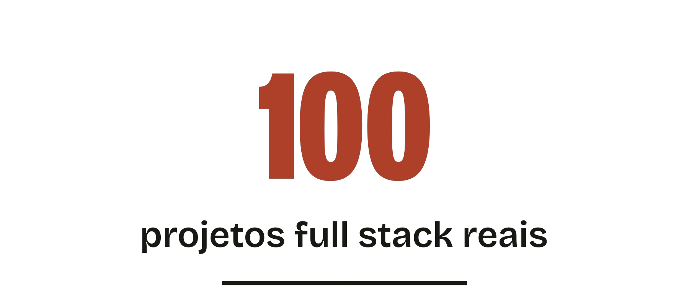
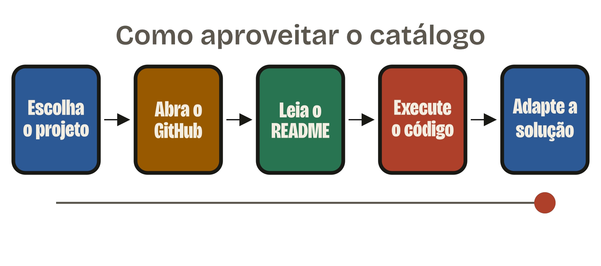
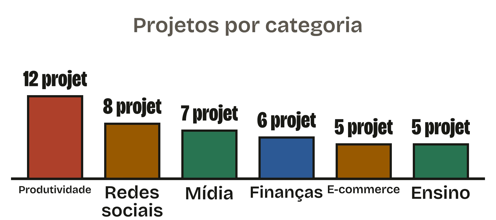

# 21 categorias, 100 projetos reais para estudar no GitHub

_2026-11-27 · reportagem_

A apostila reúne 100 projetos full stack reais, publicados como repositórios no GitHub e organizados em 21 categorias. Cada projeto traz uma descrição do que o código faz, as tecnologias usadas e o link do repositório. Esta parte cobre os projetos 01 a 32, de e-commerce e redes sociais até ferramentas de produtividade. O objetivo é estudar o código, rodar na sua máquina, recriar funcionalidades e adaptar a solução para novos produtos.

## 100 projetos full stack reais

_O catálogo reúne 100 projetos full stack reais do GitHub._

Guia prático de código: repositórios do GitHub para estudar, adaptar e transformar em novos produtos.

100 links clicáveis, 21 categorias, com descrições e tecnologias.

Do código-fonte à prática: encontre um projeto, abra o repositório e estude a implementação.

## Como aproveitar o catálogo

_Os passos para sair do catálogo e adaptar um projeto ao seu objetivo._

1. Escolha um projeto pela categoria.
2. Abra o link do GitHub.
3. Leia o README, configure o ambiente e execute o código.
4. Recrie uma funcionalidade e adapte a solução ao seu objetivo.

## Índice de projetos

_Categorias com mais projetos no catálogo, de produtividade a ensino._

Toque em uma categoria para navegar direto ao primeiro projeto.

- E-commerce e marketplaces: projetos 01–05 (5 projetos)
- Redes sociais e comunicação: projetos 06–13 (8 projetos)
- Ensino e aprendizagem: projetos 14–18 (5 projetos)
- Mídia e entretenimento: projetos 19–25 (7 projetos)
- Produtividade e colaboração: projetos 26–37 (12 projetos)
- Alimentação e delivery: projetos 38–41 (4 projetos)
- Finanças e pagamentos: projetos 42–47 (6 projetos)
- Saúde e fitness: projetos 48–52 (5 projetos)
- Transporte e viagens: projetos 53–56 (4 projetos)
- Mercado imobiliário: projetos 57–59 (3 projetos)
- Jogos e entretenimento: projetos 60–63 (4 projetos)
- E-mail e marketing: projetos 64–66 (3 projetos)
- Estoque, ERP e CRM: projetos 67–70 (4 projetos)
- Aplicações e serviços web: projetos 71–74 (4 projetos)
- Criatividade e design: projetos 75–78 (4 projetos)
- Dados, BI e analytics: projetos 79–82 (4 projetos)
- Autenticação e segurança: projetos 83–85 (3 projetos)
- Inteligência artificial: projetos 86–89 (4 projetos)
- Mapas e localização: projetos 90–92 (3 projetos)
- Gestão de conteúdo: projetos 93–96 (4 projetos)
- Infraestrutura e desenvolvimento: projetos 97–100 (4 projetos)

## 01. Plataforma completa de e-commerce

Categoria: E-commerce e marketplaces.

Catálogo de produtos, carrinho, autenticação e pedidos em uma loja inspirada em grandes marketplaces.

Tecnologias: React · Node.js · Express · MongoDB

Repositório: github.com/basir/amazona

## 02. Marketplace com múltiplos vendedores

Categoria: E-commerce e marketplaces.

Organização de lojas, vendedores, produtos e compras em um mesmo marketplace.

Tecnologias: PHP · Laravel · MySQL

Repositório: github.com/bagisto/bagisto

## 03. Livraria online

Categoria: E-commerce e marketplaces.

Busca por livros, vitrine, carrinho e fluxos de compra em uma livraria digital.

Tecnologias: React · Express · MongoDB

Repositório: github.com/DarkSoul26/bookstore-mern

## 04. Loja virtual com catálogo de produtos

Categoria: E-commerce e marketplaces.

Vitrine comercial com listagem de itens, navegação por categorias e páginas de produto.

Tecnologias: HTML · CSS · JavaScript

Repositório: github.com/mithlesh-bit/E-commerce-site

## 05. Aplicativo de entrega de supermercado

Categoria: E-commerce e marketplaces.

Experiência de compra de supermercado com produtos, pedido e entrega.

Tecnologias: JavaScript · Node.js · Aplicação web

Repositório: github.com/shakyShane/grocery-app

## 06. Rede social com posts e interações

Categoria: Redes sociais e comunicação.

Publicações de usuários, feed, interações e operações de uma rede social.

Tecnologias: React · Node.js · Express · MongoDB

Repositório: github.com/adrianhajdin/project_mern_memori…

## 07. Clone do Instagram

Categoria: Redes sociais e comunicação.

Perfis, postagens, curtidas e relacionamento entre usuários em uma aplicação social.

Tecnologias: MERN · React · Node.js

Repositório: github.com/safak/youtube/mern-social-app

## 08. Clone do Twitter

Categoria: Redes sociais e comunicação.

Linha do tempo, perfis, publicações e ações de interação social.

Tecnologias: React · TypeScript · Aplicação web

Repositório: github.com/ooloth/twitter-clone

## 09. Clone do LinkedIn

Categoria: Redes sociais e comunicação.

Perfis profissionais, feed e experiência visual de uma rede de carreira.

Tecnologias: React · Firebase · JavaScript

Repositório: github.com/CleverProgrammers/linkedin-clone

## 10. Aplicativo de mensagens em tempo real

Categoria: Redes sociais e comunicação.

Salas e mensagens com atualização em tempo real entre diferentes usuários.

Tecnologias: React · Node.js · Socket.IO

Repositório: github.com/adrianhajdin/project_chat_applic…

## 11. Clone do Discord

Categoria: Redes sociais e comunicação.

Servidores, canais e mensagens em tempo real com autenticação e permissões.

Tecnologias: Next.js · Prisma · Socket.IO

Repositório: github.com/antonioerdeljac/next13-discord-c…

## 12. Clone do WhatsApp

Categoria: Redes sociais e comunicação.

Conversas, contatos e troca de mensagens em uma interface estilo mensageiro.

Tecnologias: React · Node.js · MongoDB

Repositório: github.com/CleverProgrammers/whatsapp-mern

## 13. Clone do Slack

Categoria: Redes sociais e comunicação.

Salas de equipe e mensagens instantâneas com componentes para colaboração.

Tecnologias: React · Pusher · JavaScript

Repositório: github.com/pusher/slack-clone-client

## 14. Plataforma de ensino online (clone da Udemy)

Categoria: Ensino e aprendizagem.

Cursos, aulas, matrículas e áreas restritas para professores e alunos.

Tecnologias: Next.js · Prisma · Stripe

Repositório: github.com/antonioerdeljac/next13-lms-platf…

## 15. Plataforma de cursos online

Categoria: Ensino e aprendizagem.

Exemplo de construção de uma aplicação com frontend, backend e persistência de dados.

Tecnologias: MongoDB · Express · React · Node.js

Repositório: github.com/PacktPublishing/MERN-Stack-Course

## 16. Portal do estudante

Categoria: Ensino e aprendizagem.

Gestão de alunos, cadastros, registros escolares e rotinas acadêmicas.

Tecnologias: Aplicação web · Backend · Banco de dados

Repositório: github.com/mkkhedawat/student-management-sy…

## 17. Aplicativo de questionários e testes

Categoria: Ensino e aprendizagem.

Questões, alternativas, pontuação e navegação por testes interativos.

Tecnologias: JavaScript · React · Aplicação web

Repositório: github.com/safak/youtube/quiz-app

## 18. Plataforma de ensino de programação

Categoria: Ensino e aprendizagem.

Conteúdos, trilhas de aprendizagem, desafios e certificações de programação.

Tecnologias: JavaScript · TypeScript · Node.js

Repositório: github.com/freeCodeCamp/freeCodeCamp

## 19. Clone da Netflix

Categoria: Mídia e entretenimento.

Interface de catálogo audiovisual, destaques e navegação por filmes e séries.

Tecnologias: React · JavaScript · CSS

Repositório: github.com/karlhadwen/netflix-clone

## 20. Clone do YouTube

Categoria: Mídia e entretenimento.

Busca, listagem de vídeos, reprodução e interação com uma plataforma audiovisual.

Tecnologias: React · JavaScript · API de vídeo

Repositório: github.com/manikandanraji/youtube-clone

## 21. Interface de streaming inspirada no Spotify

Categoria: Mídia e entretenimento.

Layout de playlists, biblioteca e reprodução em uma interface de música.

Tecnologias: React · JavaScript · CSS

Repositório: github.com/JL978/spotify-clone-client

## 22. Servidor de streaming de música

Categoria: Mídia e entretenimento.

Organização de biblioteca própria, playlists e streaming para navegador ou dispositivo.

Tecnologias: Go · React · API de streaming

Repositório: github.com/navidrome/navidrome

## 23. Aplicativo de videoconferência (clone do Zoom)

Categoria: Mídia e entretenimento.

Reuniões por vídeo com sala compartilhada e recursos de comunicação.

Tecnologias: React · Next.js · WebRTC

Repositório: github.com/CleverProgrammers/zoom-clone

## 24. Plataforma de blogs (clone do Medium)

Categoria: Mídia e entretenimento.

Publicação de artigos, perfis, comentários e API com implementação completa.

Tecnologias: RealWorld · API REST · Frontend e backend

Repositório: github.com/gothinkster/realworld

## 25. Plataforma para hospedar podcasts

Categoria: Mídia e entretenimento.

Publicação de episódios, páginas de programas e distribuição de feeds de podcasts.

Tecnologias: PHP · CodeIgniter 4 · Banco de dados

Repositório: github.com/ad-aures/castopod

## 26. Plataforma de agendamentos online

Categoria: Produtividade e colaboração.

Links de reserva, disponibilidade de horários, eventos e integração com calendários.

Tecnologias: Next.js · TypeScript · Prisma

Repositório: github.com/calcom/cal.diy

## 27. Workspace de documentos e notas

Categoria: Produtividade e colaboração.

Páginas e notas organizadas em um espaço de trabalho editável e colaborativo.

Tecnologias: Flutter · Rust · Banco de dados

Repositório: github.com/AppFlowy-IO/AppFlowy

## 28. Gerenciador de projetos e tarefas

Categoria: Produtividade e colaboração.

Tarefas, ciclos, projetos, prazos e visões para equipes de produto.

Tecnologias: Next.js · Django · PostgreSQL

Repositório: github.com/makeplane/plane

## 29. Gerenciador de tarefas estilo Kanban

Categoria: Produtividade e colaboração.

Listas, Kanban, prazos e organização pessoal ou colaborativa de tarefas.

Tecnologias: Go · Vue.js · API REST

Repositório: github.com/go-vikunja/vikunja

## 30. Sistema ágil de gestão de projetos

Categoria: Produtividade e colaboração.

Backlog, tarefas, sprints e quadros para gestão ágil de projetos.

Tecnologias: Python · Django · AngularJS

Repositório: github.com/taigaio/taiga-docker

## 31. Plataforma de assinatura eletrônica

Categoria: Produtividade e colaboração.

Envio de documentos, campos para assinatura, destinatários e histórico.

Tecnologias: Next.js · TypeScript · Prisma

Repositório: github.com/documenso/documenso

## 32. Plataforma de pesquisas e feedback

Categoria: Produtividade e colaboração.

Formulários, enquetes, avaliações e dashboards de feedback dos usuários.

Tecnologias: Next.js · TypeScript · PostgreSQL

Repositório: github.com/formbricks/formbricks

## 33. Central de atendimento omnichannel

Caixa de entrada para mensagens de clientes, com atendentes, canais e histórico de conversa.

- Categoria: Produtividade e colaboração
- Tecnologias: Ruby on Rails · Vue.js · PostgreSQL
- Repositório: github.com/chatwoot/chatwoot

## 34. Banco de dados colaborativo sem código

Tabelas, filtros, visualizações e APIs para a equipe organizar dados em conjunto.

- Categoria: Produtividade e colaboração
- Tecnologias: Node.js · Vue.js · SQL
- Repositório: github.com/nocodb/nocodb

## 35. Construtor de aplicações internas

Formulários, automações, painéis e operações internas montados com pouco código.

- Categoria: Produtividade e colaboração
- Tecnologias: Node.js · Svelte · Koa
- Repositório: github.com/Budibase/budibase

## 36. Automações visuais e integrações

Editor de fluxos com gatilhos, nós de integração e execução de processos.

- Categoria: Produtividade e colaboração
- Tecnologias: Node.js · TypeScript · Vue.js
- Repositório: github.com/n8n-io/n8n

## 37. Sistema de notificações multicanal

Notificações por e-mail, SMS e canais internos, organizadas por workflows.

- Categoria: Produtividade e colaboração
- Tecnologias: TypeScript · Node.js · React
- Repositório: github.com/novuhq/novu

## 38. Aplicativo de delivery de comida (Clone do Uber Eats)

Cardápio, escolha de pratos e fluxo de pedidos em um delivery de restaurantes.

- Categoria: Alimentação e delivery
- Tecnologias: MongoDB · Express · React · Node.js
- Repositório: github.com/shakyShane/foodordering-mernstack

## 39. Plataforma de compartilhamento de receitas

Cadastro, pesquisa e compartilhamento de receitas em uma interface web.

- Categoria: Alimentação e delivery
- Tecnologias: JavaScript · Aplicação web · Banco de dados
- Repositório: github.com/machadop1407/recipe-site

## 40. Sistema de gerenciamento de cardápios de restaurantes

Gerenciamento de pratos, cardápio e apresentação online de restaurantes.

- Categoria: Alimentação e delivery
- Tecnologias: HTML · CSS · JavaScript
- Repositório: github.com/ipenywis/restaurant-webapp

## 41. Aplicativo de planejamento de refeições

Organização de refeições e receitas para planejar a alimentação.

- Categoria: Alimentação e delivery
- Tecnologias: JavaScript · Frontend web · Dados
- Repositório: github.com/chingu-voyages/v25-geckos-team-05

## 42. Aplicativo bancário

Contas, saldos, transferências e transações em uma experiência bancária.

- Categoria: Finanças e pagamentos
- Tecnologias: JavaScript · Backend · Banco de dados
- Repositório: github.com/TannerGabriel/Banking-Application

## 43. Controle de despesas

Registro de receitas e despesas, categorias e acompanhamento de gastos.

- Categoria: Finanças e pagamentos
- Tecnologias: React · Node.js · Banco de dados
- Repositório: github.com/machadop1407/Expense-Tracker-Ful…

## 44. Painel de criptomoedas

Preços, gráficos e informações de criptomoedas em um dashboard temático.

- Categoria: Finanças e pagamentos
- Tecnologias: React · Redux · APIs de mercado
- Repositório: github.com/adrianhajdin/project_cryptoverse

## 45. Sistema de gerenciamento de faturas

Faturas, clientes, cobrança e controle financeiro para profissionais.

- Categoria: Finanças e pagamentos
- Tecnologias: PHP · Laravel · Vue.js
- Repositório: github.com/invoiceninja/invoiceninja

## 46. Aplicativo de orçamento pessoal

Orçamentos, categorias, transações e sincronização entre dispositivos.

- Categoria: Finanças e pagamentos
- Tecnologias: Node.js · JavaScript · Sincronização
- Repositório: github.com/actualbudget/actual

## 47. Rastreador de carteira de investimentos

Ativos, compras, vendas, patrimônio e gráficos de desempenho da carteira.

- Categoria: Finanças e pagamentos
- Tecnologias: Angular · NestJS · Prisma · PostgreSQL
- Repositório: github.com/ghostfolio/ghostfolio

## 48. Sistema de gerenciamento hospitalar

Pacientes, médicos e registros da administração hospitalar.

- Categoria: Saúde e fitness
- Tecnologias: Java · React · MySQL
- Repositório: github.com/CDAC-Hospital-Management-System/…

## 49. Sistema de agendamento de consultas médicas

Cadastros clínicos e agendamentos de profissionais, pacientes e consultas.

- Categoria: Saúde e fitness
- Tecnologias: C# · Aplicação web · Banco de dados
- Repositório: github.com/CodAffection/Hospital-Management…

## 50. Aplicativo de acompanhamento físico

Atividades, registros de treino e visualização da evolução física.

- Categoria: Saúde e fitness
- Tecnologias: React · Node.js · Banco de dados
- Repositório: github.com/machadop1407/Fitness-Tracker-App

## 51. Plataforma de telemedicina

Atendimento remoto e fluxos digitais ligados a consultas de saúde.

- Categoria: Saúde e fitness
- Tecnologias: Java · Spring Boot · React · WebRTC
- Repositório: github.com/shubhammadane/HealthConnect

## 52. Sistema de gerenciamento de farmácias

Catálogo de medicamentos, estoque, vendas e gestão de farmácia.

- Categoria: Saúde e fitness
- Tecnologias: Aplicação web · Backend · Banco de dados
- Repositório: github.com/shuvoa787/pharmacy-management-sy…

## 53. Clone do Uber

Mapa, seleção de corrida, origem e destino em uma interface de mobilidade.

- Categoria: Transporte e viagens
- Tecnologias: React Native · JavaScript · Mapas
- Repositório: github.com/CleverProgrammers/uber-clone

## 54. Sistema de aluguel de carros

Frota, reservas, datas e cadastro de veículos para aluguel.

- Categoria: Transporte e viagens
- Tecnologias: Java · Spring Boot · Next.js
- Repositório: github.com/Car-Rental-System-CRS/CarRentalS…

## 55. Aplicativo de planejamento de viagens

Pontos turísticos, busca, avaliações e sugestões para planejar viagens.

- Categoria: Transporte e viagens
- Tecnologias: React · Google Maps · APIs externas
- Repositório: github.com/adrianhajdin/project_travel_advi…

## 56. Aplicativo de compartilhamento de viagens

Exemplo de solicitação de corridas e de organização do fluxo entre usuários.

- Categoria: Transporte e viagens
- Tecnologias: JavaScript · Aplicação web · Mapas
- Repositório: github.com/alex996/uber-clone

## 57. Plataforma de anúncios de imóveis

Busca de propriedades, filtros, detalhes e contato com anunciantes.

- Categoria: Mercado imobiliário
- Tecnologias: Next.js · Express · PostgreSQL
- Repositório: github.com/Balakrishnamoorthy/real-estate-p…

## 58. Sistema de gerenciamento de propriedades

Cadastros de imóveis, locatários e operações de administração imobiliária.

- Categoria: Mercado imobiliário
- Tecnologias: React · Hono · Cloudflare D1
- Repositório: github.com/clawnify/OpenProperty

## 59. Plataforma de aluguel de imóveis

Anúncios, pesquisa e exibição de imóveis disponíveis para aluguel.

- Categoria: Mercado imobiliário
- Tecnologias: Next.js · Prisma · MongoDB
- Repositório: github.com/AntonioErdeljac/next13-airbnb-cl…

## 60. Portal de jogos retrô no navegador

Portal interativo que reúne jogos e programas retrô para usar online.

- Categoria: Jogos e entretenimento
- Tecnologias: JavaScript · HTML · CSS
- Repositório: github.com/Emupedia/emupedia.github.io

## 61. Quiz multiplayer em tempo real

Perguntas em salas ao vivo, participação simultânea e placar de jogadores.

- Categoria: Jogos e entretenimento
- Tecnologias: React · Vite · Firebase
- Repositório: github.com/sivasooryagiri/quizlive

## 62. Jogo de xadrez online

Partidas, pareamento e experiência online de xadrez entre jogadores.

- Categoria: Jogos e entretenimento
- Tecnologias: Scala · Play Framework · WebSockets
- Repositório: github.com/lichess-org/lila

## 63. Jogo da velha multiplayer

Partidas simultâneas de jogo da velha, com turnos e sincronização das jogadas.

- Categoria: Jogos e entretenimento
- Tecnologias: JavaScript · Tempo real · WebSockets
- Repositório: github.com/coding-garden/tic-tac-toe-multip…

## 64. Cliente de e-mail (Clone do Gmail)

Caixa de entrada, composição e organização de mensagens de e-mail.

- Categoria: E-mail e marketing
- Tecnologias: React · JavaScript · Firebase
- Repositório: github.com/CleverProgrammers/gmail-clone

## 65. Plataforma de newsletters

Criação e envio de newsletters, com autores, leitores e publicação de conteúdo.

- Categoria: E-mail e marketing
- Tecnologias: Node.js · Ember.js · MySQL
- Repositório: github.com/TryGhost/Ghost

## 66. Plataforma de automação de marketing

Segmentação, campanhas, contatos e automações de marketing multicanal.

- Categoria: E-mail e marketing
- Tecnologias: PHP · Symfony · MySQL
- Repositório: github.com/mautic/mautic

## 67. Sistema de gerenciamento de estoque

Movimentação de produtos, entradas, saídas e dados do estoque.

- Categoria: Estoque, ERP e CRM
- Tecnologias: JavaScript · Aplicação web · Banco de dados
- Repositório: github.com/saadpasta/inventory-management-s…

## 68. Aplicativo de CRM (Gestão de Relacionamento com Clientes)

Contatos, oportunidades, pipelines e aplicações empresariais integradas.

- Categoria: Estoque, ERP e CRM
- Tecnologias: Go · Vue.js · API REST
- Repositório: github.com/cortezaproject/corteza-server

## 69. ERP com gestão de estoque e armazéns

Controle de mercadorias, pedidos, compras, fornecedores e armazenagem.

- Categoria: Estoque, ERP e CRM
- Tecnologias: Python · Frappe · MariaDB
- Repositório: github.com/frappe/erpnext

## 70. Sistema de ponto de venda (PDV)

Registro de vendas, itens, pagamentos e interface de caixa.

- Categoria: Estoque, ERP e CRM
- Tecnologias: JavaScript · Sistema web · Banco de dados
- Repositório: github.com/loystar/POS-System

## 71. Ambiente de aplicativos web na nuvem

Arquivos, usuários e aplicações rodando em um ambiente web integrado.

- Categoria: Aplicações e serviços web
- Tecnologias: Node.js · JavaScript · API
- Repositório: github.com/HeyPuter/puter

## 72. Aplicativo de previsão do tempo

Condições climáticas, consulta por localidade e exibição de previsões.

- Categoria: Aplicações e serviços web
- Tecnologias: React · JavaScript · API meteorológica
- Repositório: github.com/adrianhajdin/project_weather_app

## Catálogo de repositórios: 73 a 80 de 100

Cada entrada traz o número, a categoria, o tipo de projeto, uma descrição curta, as tecnologias e o endereço do repositório no GitHub.

- 73. Categoria: Aplicações e serviços web; Projeto: Agregador de notícias; Descrição: feed de notícias, consumo de APIs e navegação entre publicações; Tecnologias: JavaScript · Frontend · API de notícias; Repositório: github.com/machadop1407/News-App-Full-Stack
- 74. Categoria: Aplicações e serviços web; Projeto: Plataforma de vagas e candidaturas; Descrição: anúncios de emprego, candidaturas, contas de empresa e painéis de usuário; Tecnologias: Next.js · Firebase · PWA; Repositório: github.com/msaaddev/jobboard
- 75. Categoria: Criatividade e design; Projeto: Criador de portfólios; Descrição: página de portfólio com projetos, apresentação e identidade profissional; Tecnologias: Gatsby · React · JavaScript; Repositório: github.com/cobidev/gatsby-simplefolio
- 76. Categoria: Criatividade e design; Projeto: Biblioteca de fotos e vídeos; Descrição: álbuns, organização de mídias, busca e backup de fotos e vídeos; Tecnologias: TypeScript · SvelteKit · NestJS; Repositório: github.com/immich-app/immich
- 77. Categoria: Criatividade e design; Projeto: Editor colaborativo de desenhos; Descrição: canvas interativo com formas, desenho e compartilhamento de documentos visuais; Tecnologias: React · TypeScript · Canvas; Repositório: github.com/tldraw/tldraw
- 78. Categoria: Criatividade e design; Projeto: Quadro branco digital interativo; Descrição: quadro branco com elementos arrastáveis, diagramas e colaboração; Tecnologias: React · TypeScript · Canvas; Repositório: github.com/excalidraw/excalidraw
- 79. Categoria: Dados, BI e analytics; Projeto: Painel administrativo; Descrição: interface administrativa com navegação lateral, widgets e tabelas; Tecnologias: React · JavaScript · Dashboard; Repositório: github.com/flatlogic/sing-app-react
- 80. Categoria: Dados, BI e analytics; Projeto: Plataforma de analytics de produto; Descrição: eventos, funis, dashboards, testes e métricas de produto; Tecnologias: Python · TypeScript · React; Repositório: github.com/PostHog/posthog

## Catálogo de repositórios: 81 a 88 de 100

- 81. Categoria: Dados, BI e analytics; Projeto: Painel de visualização de dados; Descrição: consultas, relatórios e painéis avançados para exploração de dados; Tecnologias: Python · Flask · React; Repositório: github.com/apache/superset
- 82. Categoria: Dados, BI e analytics; Projeto: Ferramenta de inteligência de negócios (BI); Descrição: perguntas sobre dados, relatórios e painéis de BI para equipes; Tecnologias: Clojure · React · Banco de dados; Repositório: github.com/metabase/metabase
- 83. Categoria: Autenticação e segurança; Projeto: Sistema de autenticação (OAuth); Descrição: fluxo de login, contas de usuários e integração de provedores externos; Tecnologias: Node.js · Express · Passport.js; Repositório: github.com/sahat/hackathon-starter
- 84. Categoria: Autenticação e segurança; Projeto: Gerenciador de senhas; Descrição: gestão de credenciais, cofres e sincronização segura de senhas; Tecnologias: C# · .NET · SQL; Repositório: github.com/bitwarden/server
- 85. Categoria: Autenticação e segurança; Projeto: Portal de autenticação multifator; Descrição: login único, controle de acesso e segundo fator para aplicações web; Tecnologias: Go · OpenID Connect · WebAuthn; Repositório: github.com/authelia/authelia
- 86. Categoria: Inteligência artificial; Projeto: Plataforma de chatbots; Descrição: criação de agentes conversacionais, fluxos e gerenciamento de conversas; Tecnologias: TypeScript · Node.js · IA; Repositório: github.com/botpress/botpress
- 87. Categoria: Inteligência artificial; Projeto: Organizador de fotos com reconhecimento por IA; Descrição: busca de imagens, etiquetas automáticas e organização de bibliotecas; Tecnologias: Go · TensorFlow · Vue.js; Repositório: github.com/photoprism/photoprism
- 88. Categoria: Inteligência artificial; Projeto: Motor de recomendações personalizadas; Descrição: personalização de resultados e recomendações usando sinais de uso; Tecnologias: Scala · Redis · Machine Learning; Repositório: github.com/metarank/metarank

## Catálogo de repositórios: 89 a 96 de 100

- 89. Categoria: Inteligência artificial; Projeto: Interface de chat com modelos de linguagem; Descrição: chat multiusuário com conexão a modelos e histórico de conversas; Tecnologias: SvelteKit · TypeScript · APIs de IA; Repositório: github.com/huggingface/chat-ui
- 90. Categoria: Mapas e localização; Projeto: Plataforma de rastreamento GPS; Descrição: rastreamento de dispositivos, mapas, alertas e cercas virtuais; Tecnologias: Java · SQL · API REST; Repositório: github.com/traccar/traccar
- 91. Categoria: Mapas e localização; Projeto: Ferramenta de visualização de mapas; Descrição: mapas interativos e exploração geoespacial de grandes conjuntos de dados; Tecnologias: React · deck.gl · WebGL; Repositório: github.com/uber/kepler.gl
- 92. Categoria: Mapas e localização; Projeto: Otimizador de rotas de entrega; Descrição: planejamento de rotas e otimização de entregas com múltiplas paradas; Tecnologias: C++ · API HTTP · Roteamento; Repositório: github.com/VROOM-Project/vroom
- 93. Categoria: Gestão de conteúdo; Projeto: Plataforma de gerenciamento de conteúdo (alternativa ao WordPress); Descrição: modelos de conteúdo, API e painel de administração de páginas; Tecnologias: Node.js · TypeScript · API REST; Repositório: github.com/strapi/strapi
- 94. Categoria: Gestão de conteúdo; Projeto: Sistema de Wiki; Descrição: páginas, permissões, edição e estrutura de conhecimento colaborativo; Tecnologias: Node.js · Vue.js · PostgreSQL; Repositório: github.com/Requarks/wiki
- 95. Categoria: Gestão de conteúdo; Projeto: Comunidade de fóruns e discussões; Descrição: comunidades, tópicos, comentários e votos em fóruns descentralizados; Tecnologias: Rust · TypeScript · PostgreSQL; Repositório: github.com/LemmyNet/lemmy
- 96. Categoria: Gestão de conteúdo; Projeto: Plataforma de documentação; Descrição: documentação navegável de software com páginas e versionamento; Tecnologias: React · Node.js · Markdown; Repositório: github.com/facebook/docusaurus

## Catálogo de repositórios: 97 a 100 de 100

- 97. Categoria: Infraestrutura e desenvolvimento; Projeto: Backend para autenticação e dados; Descrição: autenticação, banco de dados, arquivos, funções e serviços de backend; Tecnologias: TypeScript · PHP · Banco de dados; Repositório: github.com/appwrite/appwrite
- 98. Categoria: Infraestrutura e desenvolvimento; Projeto: Plataforma para deploy self-hosted; Descrição: deploy de aplicações, bancos e serviços em servidores próprios; Tecnologias: PHP · Laravel · Docker; Repositório: github.com/coollabsio/coolify
- 99. Categoria: Infraestrutura e desenvolvimento; Projeto: Status page e monitoramento de serviços; Descrição: monitores, incidentes e páginas de status para sites e APIs; Tecnologias: Next.js · Hono · Turso; Repositório: github.com/openstatusHQ/openstatus
- 100. Categoria: Infraestrutura e desenvolvimento; Projeto: Monitoramento de uptime; Descrição: verificação de serviços, incidentes, alertas e páginas públicas de uptime; Tecnologias: Node.js · Vue.js · WebSockets; Repositório: github.com/louislam/uptime-kuma
