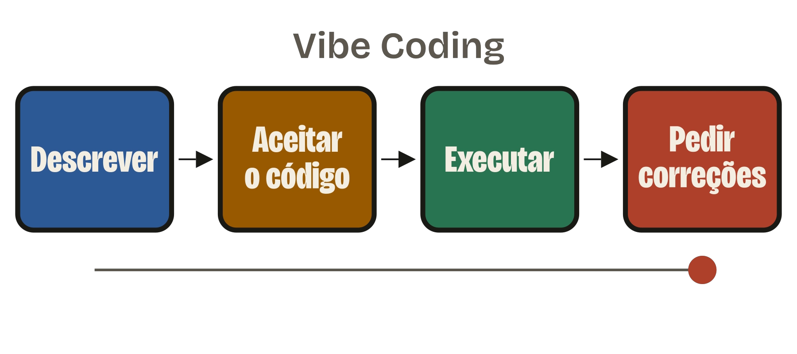
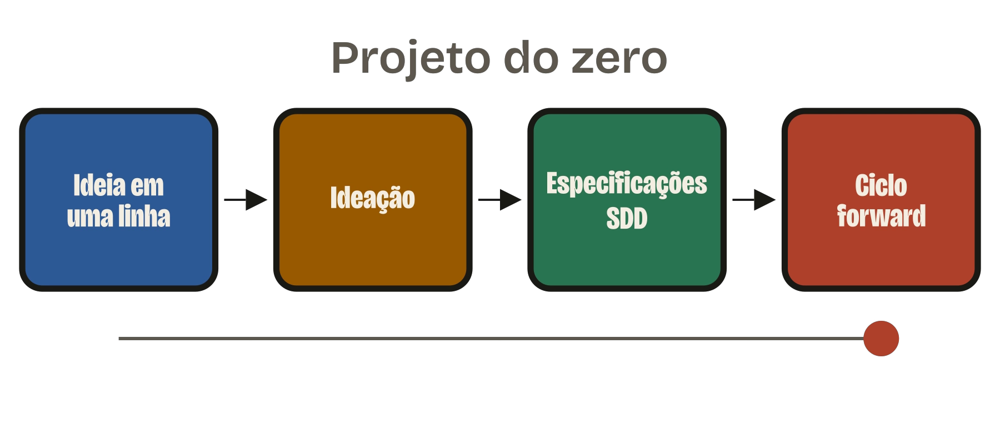
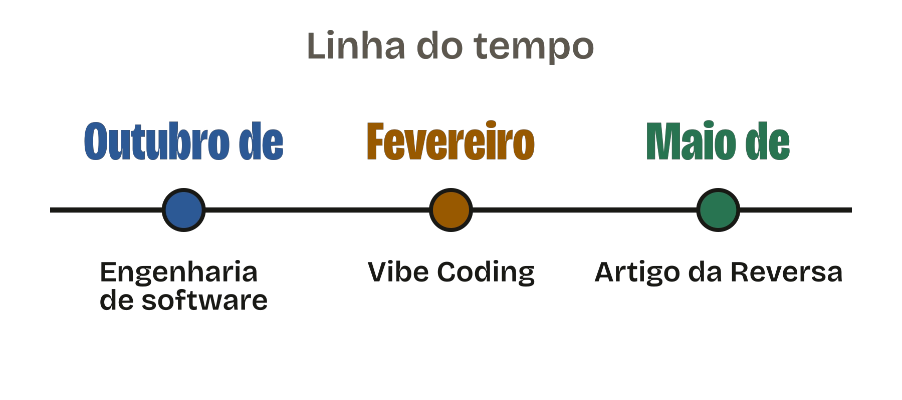

# Agentic Coding, o Vibe Coding evoluiu!

_2026-11-27 · reportagem_

A geração rápida de código ajuda a validar ideias, mas a produtividade de um software comercial aparece quando a funcionalidade chega correta, segura e fácil de manter. Esta apostila explica a diferença entre Vibe Coding e Agentic Coding, o papel das especificações e o custo da dívida técnica. Você vai entender como a Reversa extrai regras e arquitetura de sistemas existentes, como instalar e acionar seus fluxos e como usar especificações para orientar mudanças. Ao final, terá critérios para escolher o fluxo adequado, proteger o projeto e avaliar a entrega pelo que o cliente consegue usar e evoluir.

## O contexto

A inteligência artificial reduziu o esforço de transformar uma descrição em código. Uma equipe pode gerar centenas de linhas por minuto e ainda entregar um sistema que atende mal ao cliente. O volume de código registra atividade de produção; a produtividade aparece quando a funcionalidade chega correta, segura e possível de manter.

Essa distinção pesa na passagem do protótipo para a operação. Dados de clientes, regras de negócio e mudanças contínuas pedem decisões de engenharia que acompanhem cada entrega. A pergunta deixa de ser quantas linhas foram produzidas e passa a ser quanto custa manter o software funcionando e evoluindo.

## Vibe Coding e o valor do protótipo



_Ciclo do Vibe Coding: descrever, aceitar o código, executar e pedir correções._

Vibe Coding é o ciclo de descrever o que se quer em linguagem natural, aceitar o código gerado, executar o resultado e pedir correções quando algo falha. A pessoa pode avançar sem ler ou entender profundamente a estrutura do código. Essa forma de trabalhar ganhou espaço entre projetos experimentais, nos quais a velocidade ajuda a testar uma ideia.

Uma tela funcionando e uma demonstração agradável permitem que o cliente visualize o produto. O risco aparece quando esse protótipo passa a operar com dados reais, regras comerciais e evolução contínua. Nesse momento, cada aceite de uma sugestão da IA precisa conviver com requisitos, testes, segurança e capacidade de manutenção.

## Agentic Coding: processo e especificação

Agentic Coding organiza o trabalho dos agentes ao redor de um processo e de uma especificação. O processo estabelece como o software será construído, revisado e evoluído. A especificação estabelece o que precisa ser construído, incluindo requisitos, regras de negócio, restrições técnicas e critérios de aceitação.

No Desenvolvimento Orientado a Especificações, ou SDD, o documento funciona como uma referência estável. O agente pode consultá-lo para entender o objetivo, conferir decisões e verificar se a implementação corresponde ao combinado. Isso reduz a dependência de uma longa conversa, na qual detalhes podem se perder ou ser interpretados de outra forma.

Os prompts continuam presentes. Uma especificação pode ser entendida como um prompt estruturado, construído e organizado para que a pessoa e o agente validem o mesmo conjunto de informações. A mudança está na estrutura do conhecimento que orienta cada entrega.

## A crise do software e a dívida técnica

Em outubro de 1968, a OTAN reuniu engenheiros e cientistas na Alemanha para discutir atrasos, orçamentos estourados e sistemas que fracassavam. A conclusão apontou para a necessidade de métodos, técnicas e processos de construção de software. Quase seis décadas depois, a IA acelerou a produção de código, enquanto requisitos, arquitetura e qualidade continuaram determinando o resultado.

O débito técnico nasce de decisões tomadas para ganhar velocidade e aparece no custo da próxima mudança. Uma correção pode resolver um defeito e criar outros; uma funcionalidade nova pode interromper o que já funcionava. O retrabalho consome tokens, dinheiro e tempo da equipe.

O investimento inicial em requisitos, arquitetura, documentação e testes pode ser maior. Ele altera o ponto de inversão de custo de mudança: depois desse ponto, evoluir um sistema construído com processo tende a custar menos do que evoluir um sistema sustentado por sucessivas correções. Trocar o modelo de IA não resolve a estrutura problemática do projeto.

## Reversa e especificações operacionais

A Reversa é um framework de engenharia reversa de especificações. Instalado dentro de um projeto legado, coordena agentes especializados para analisar o código existente e transformar o conhecimento acumulado em especificações completas e rastreáveis, prontas para orientar agentes de programação.

A análise procura regras de negócio implícitas, fluxos, contratos entre módulos e decisões de arquitetura que ficaram registradas apenas no código. O resultado assume a forma de contratos operacionais: definições que permitem ao agente evoluir o sistema preservando o comportamento já existente.

Um software criado com Vibe Coding pode passar por esse processo. A Reversa extrai a especificação do que já existe e documenta a arquitetura atual, criando uma base para as próximas mudanças.

Fonte: <https://github.com/sandeco/reversa>

## A equipe de agentes e a descoberta

A descoberta de um sistema acontece em cinco fases. Cada fase reúne responsabilidades diferentes para passar da superfície do projeto ao conhecimento que sustenta seu funcionamento. A Reversa organiza o trabalho em onze equipes especializadas; as equipes de Descoberta e de Defeitos são sempre instaladas, sete equipes vêm pré-selecionadas e a equipe de tradução é opcional.

- Reconhecimento: o Scout mapeia pastas, linguagens, frameworks, dependências e pontos de entrada para estabelecer a superfície do sistema.
- Escavação: o Archaeologist examina os módulos, algoritmos, fluxos de controle e estruturas de dados em profundidade.
- Interpretação: o Detective extrai regras de negócio, permissões, máquinas de estado e decisões de arquitetura retroativas; o Architect reúne diagramas C4, ERD, mapa de integrações e dívida técnica.
- Geração: o Writer transforma o conhecimento em especificações operacionais com rastreabilidade de código.
- Revisão: o Reviewer procura inconsistências, identifica lacunas e valida as conclusões com a pessoa responsável pelo projeto.

Fonte: <https://github.com/sandeco/reversa>

## Antes de começar: requisitos, backup e instalação

O requisito é Node.js 18+. O instalador detecta os motores de IA presentes no ambiente, pergunta quais agentes instalar, coleta nome do projeto, linguagem e preferências, copia as skills e cria os arquivos de entrada do agente. Ele também cria a estrutura .reversa/ com estado, configuração e plano.

A Reversa afirma que o instalador cria arquivos novos e preserva os arquivos existentes. Durante a análise, as escritas dos agentes ficam restritas a .reversa/ e _reversa_sdd/. A recomendação de backup continua valendo porque agentes de IA podem cometer erros.

1. Versione o projeto em Git e confirme que todos os arquivos estejam comitados; o resultado esperado é um estado conhecido para comparação e restauração.
2. Mantenha o repositório no GitHub, GitLab ou Bitbucket; o resultado esperado é ter uma cópia remota segura.
3. Execute npx reversa install na raiz do projeto legado; o resultado esperado é criar a estrutura da Reversa e os arquivos de entrada do agente.
4. Escolha os agentes na entrevista do instalador, todos selecionados por padrão; o resultado esperado é instalar as equipes adequadas ao ambiente.
5. Crie uma cópia local com cp -r my-project my-project-backup; o resultado esperado é ter uma pasta adicional para recuperação. Se precisar voltar ao estado versionado, use git restore .

```
npx reversa install
git restore .
cp -r my-project my-project-backup
```

Fonte: <https://github.com/sandeco/reversa>

## Como analisar um sistema existente

Depois da instalação, o projeto é aberto no agente de IA e a Reversa é ativada. Ela apresenta seu funcionamento, cria um plano personalizado de exploração e coordena a análise. O progresso é salvo em .reversa/state.json a cada checkpoint.

Os orquestradores fazem pausas entre os agentes e pedem CONTINUAR antes de avançar. Esses momentos permitem acompanhar o processo e intervir quando uma conclusão precisar de validação.

1. Abra a pasta do projeto no agente de IA disponível no ambiente; o resultado esperado é dar ao agente acesso ao código e aos arquivos criados pelo instalador.
2. Use /reversa em um mecanismo com suporte a comandos com barra; o resultado esperado é iniciar a descoberta e receber um plano de exploração personalizado.
3. No Codex, use reversa; o resultado esperado é acionar o mesmo fluxo em um mecanismo sem comandos com barra.
4. Responda CONTINUAR em cada pausa; o resultado esperado é avançar entre os agentes mantendo sua supervisão.
5. Se a sessão for interrompida, digite reversa; o resultado esperado é retomar do checkpoint salvo em .reversa/state.json.

```
/reversa
reversa
```

Fonte: <https://github.com/sandeco/reversa>

## Como criar um projeto do zero



_Fluxo de projeto novo: ideia em uma linha, ideação, especificações SDD e ciclo forward._

Para um projeto novo, o fluxo parte de uma ideia em uma linha, desenvolve as especificações SDD e encaminha o trabalho para o ciclo de evolução. Também existe uma etapa de ideação para esclarecer a ideia antes da criação dos artefatos de desenvolvimento.

A variante expresso segue da ideia até o código implementado. Ela encadeia a criação das especificações ao ciclo forward depois da etapa de especificação.

1. Use /reversa-brainstorm para esclarecer uma ideia bruta; o resultado esperado é chegar ao desenvolvimento com objetivos mais definidos.
2. Use /reversa-new para criar as especificações de um projeto novo; o resultado esperado é uma base SDD para orientar a construção.
3. Acrescente expresso e sua ideia ao comando para seguir até o código implementado; o resultado esperado é percorrer a ideação, a especificação e a implementação no mesmo fluxo.

```
/reversa-brainstorm
/reversa-new
/reversa-new expresso "<your idea>"
```

Fonte: <https://github.com/sandeco/reversa>

## Como evoluir, migrar e manter o sistema

Depois que as especificações existem, a Reversa oferece fluxos para evoluir o sistema, incorporar ajustes, reconstruir em outra pilha e manter o conhecimento sincronizado. A depuração usa vínculos com as especificações para investigar as dependências de uma correção.

O framework também reúne precificação, qualidade de código e interface. Esses fluxos usam o contexto do produto para apoiar decisões comerciais e técnicas.

- /reversa-forward evolui o sistema uma funcionalidade por vez, da especificação ao código; o resultado esperado é uma entrega ligada ao que foi especificado.
- /reversa-add acrescenta uma correção curta à funcionalidade recém-entregue, e /reversa-sync converge a entrega de volta para a extração; o resultado esperado é manter especificação e implementação alinhadas.
- /reversa-migrate transforma especificações legadas em um plano de reconstrução em pilha moderna, e /reversa-docs gera um minissite HTML autocontido; o resultado esperado é apoiar a migração e a consulta do conhecimento extraído.
- /reversa-debugger e /reversa-debugger-fix rastreiam e corrigem defeitos com vínculo causal às especificações; o resultado esperado é investigar o impacto da correção nas dependências.
- /reversa-pricing usa especificações, mercado, modelo de venda, perfil de cobrança, tamanho e três cenários para apoiar a precificação; o resultado esperado é uma estimativa ligada ao produto e ao público.
- /reversa-refactor melhora o código preservando o comportamento, e /impeccable projeta, critica, audita e aperfeiçoa interfaces de front-end com 24 comandos de design; o resultado esperado é atuar em qualidade e interface com objetivos definidos.
- /reversa-reconstructor gera um plano de reconstrução ascendente a partir das especificações e implementa uma tarefa por vez; o resultado esperado é organizar a reconstrução economizando tokens.

```
/reversa-forward
/reversa-add
/reversa-sync
/reversa-migrate
/reversa-docs
/reversa-debugger
/reversa-debugger-fix
/reversa-pricing
/reversa-refactor
/impeccable
/reversa-reconstructor
```

Fonte: <https://github.com/sandeco/reversa>

## Execução autônoma e limites de escrita

Os modos autônomos concentram as perguntas em uma entrevista inicial e seguem sem paradas intermediárias. A descoberta autônoma usa os mesmos agentes e checkpoints da descoberta normal. A execução forward autônoma, apresentada na versão 1.3.4, processa uma fila de funcionalidades da especificação à sincronização.

A regra de preservação do projeto vale para a descoberta autônoma e para o fluxo new expresso. O forward autônomo é a exceção: sua fase de programação edita o código do projeto somente onde .reversa/reversa-config.json permite e executa builds, testes e instalações pedidos explicitamente em actions.md. Com a política bloqueada, ele para antes de começar. Dúvidas encontradas no caminho são registradas com o selo amarelo.

- Use /reversa-autonomous para executar a descoberta completa com uma entrevista inicial; o resultado esperado é percorrer o pipeline sem pausas intermediárias.
- Use /reversa-forward-autonomous para processar uma fila de funcionalidades; o resultado esperado é avançar pelos ciclos de requisitos e sincronização conforme a política do projeto.
- Revise .reversa/reversa-config.json e actions.md antes da execução autônoma; o resultado esperado é saber onde o agente pode escrever e quais ações de build, teste ou instalação estão autorizadas.

```
/reversa-autonomous
/reversa-forward-autonomous
```

Fonte: <https://github.com/sandeco/reversa>

## Como funciona na prática

Exemplo: um sistema financeiro apresenta telas, gráficos e relatórios funcionando para clientes pagantes após três semanas de desenvolvimento. Seis meses depois, o cálculo de impostos falha porque o código usa uma alíquota fixa e ignora o regime tributário da empresa. A regra não havia sido especificada e nenhum teste cobria aquele caso. A falha mostra uma lacuna de processo, mesmo com a interface operando.

Com a Reversa, o código existente pode ser analisado para documentar regras, fluxos e decisões de arquitetura. A especificação extraída ajuda o agente a consultar o comportamento implementado antes de mudar uma função. A revisão humana precisa comparar esse comportamento com a regra de negócio desejada e definir critérios de aceitação e testes.

Exemplo: em um e-commerce, alterar o cadastro de produtos pode afetar o sistema de vendas. A rastreabilidade permite identificar essa dependência antes da correção. O agente de depuração passa a investigar o defeito com as especificações como referência, reduzindo o risco de resolver um ponto e interromper outro.

- Registre requisitos e regras de negócio antes da implementação; o resultado esperado é dar ao agente uma referência explícita sobre o comportamento correto.
- Defina critérios de aceitação para cada regra importante; o resultado esperado é tornar verificável se a entrega atende à necessidade do cliente.
- Crie testes que cubram os critérios registrados; o resultado esperado é detectar desvios antes que cheguem à operação.
- Ao corrigir um módulo, consulte suas dependências nas especificações; o resultado esperado é avaliar o impacto da mudança nos demais fluxos.

Fonte: <https://github.com/sandeco/reversa>

## Linha do tempo



_Marcos de 1968 a 2026: engenharia de software, Vibe Coding e artigo da Reversa._

A história mostra que a velocidade de produção mudou, enquanto os problemas de requisitos, processo e qualidade atravessaram décadas.

- Outubro de 1968: a OTAN reuniu engenheiros e cientistas na Alemanha para discutir atrasos, custos excessivos e sistemas que fracassavam, fortalecendo a engenharia de software como disciplina.
- Fevereiro de 2025: o termo Vibe Coding foi descrito para nomear um desenvolvimento em linguagem natural, com aceite sucessivo do código gerado, no contexto de projetos experimentais.
- Maio de 2026: o artigo da Reversa apresentou um framework de engenharia reversa de documentação para converter software legado em especificações operacionais para agentes de IA.

Fonte: <https://github.com/sandeco/reversa>

## Quem ganha e quem perde

Quem está validando uma ideia ganha velocidade com o Vibe Coding. A demonstração rápida ajuda o cliente a enxergar o produto e permite testar hipóteses antes de um investimento maior. Quem opera um software comercial ganha previsibilidade quando requisitos, arquitetura, testes e revisão acompanham cada mudança.

O Vibe Coding puro tende a perder quando a manutenção passa a consumir mais tokens, dinheiro e tempo do que a economia inicial. A abordagem com agentes e especificações tende a ganhar quando a equipe consegue mudar o software preservando o que o cliente já usa. A decisão deve comparar a entrega ao longo do tempo.

- Funcionalidade: compare o resultado com a necessidade real do cliente e com os critérios de aceitação registrados.
- Correção: verifique se o defeito foi resolvido e se o teste correspondente passou a cobrir o caso.
- Segurança: demonstre como dados, permissões e regras críticas são protegidos antes da aprovação.
- Manutenção: avalie se a próxima mudança pode ser feita com o conhecimento registrado e com testes que protejam o comportamento existente.
- Custo de mudança: compare o esforço de evoluir o sistema com o retrabalho gerado por regressões e correções sucessivas.

## O que ainda não se sabe

Uma especificação extraída do código descreve o que o sistema faz. A revisão humana precisa decidir se esse comportamento corresponde à regra de negócio desejada. A documentação e os testes oferecem âncoras para o agente; a aprovação continua dependendo de validação.

Um código que compila demonstra que a construção passou por uma verificação técnica. A entrega comercial também precisa atender à necessidade real, proteger informações e permitir manutenção. A execução autônoma amplia a velocidade, por isso a política de escrita e as ações autorizadas devem ser revisadas antes do início.

- Mantenha backup e versionamento antes da análise; agentes de IA podem cometer erros.
- Revise regras de negócio, arquitetura e decisões extraídas com quem conhece o sistema.
- Confira se os testes cobrem os critérios de aceitação e as dependências entre módulos.
- Avalie segurança e manutenção além do resultado visual e da compilação.
- Verifique .reversa/reversa-config.json e actions.md antes de permitir escrita de código em execução autônoma.

Fonte: <https://github.com/sandeco/reversa>

## O que você pode fazer

O próximo passo depende do estado do projeto. Um sistema existente precisa ter seu conhecimento extraído; uma ideia nova precisa ser especificada antes da construção. Nos dois casos, a entrega deve ser avaliada por funcionalidade, segurança e capacidade de evolução.

1. Escolha o ponto de partida: um sistema existente para extrair especificações ou uma ideia para criar um projeto novo; o resultado esperado é selecionar o fluxo adequado.
2. Para um sistema existente, versione o projeto e prepare cópias de segurança; o resultado esperado é garantir recuperação.
3. Instale a Reversa na raiz com npx reversa install; o resultado esperado é criar a estrutura de agentes, estado e configuração.
4. Abra o projeto no agente e execute /reversa; o resultado esperado é iniciar o plano de descoberta.
5. Revise requisitos, regras de negócio, arquitetura e critérios de aceitação gerados; o resultado esperado é validar a base que orientará o agente.
6. Use /reversa-forward para evoluir uma funcionalidade por vez; o resultado esperado é construir a partir da especificação.
7. Aprove a entrega com testes, verificação de segurança e avaliação do impacto da mudança; o resultado esperado é decidir pelo valor recebido pelo cliente.

```
npx reversa install
/reversa
/reversa-forward
```

Fonte: <https://sandeco.github.io/reversa/pt/>

## Glossário

- Agentic Coding: desenvolvimento no qual agentes de IA trabalham orientados por processo, especificação e verificação.
- Vibe Coding: ciclo de prompts, aceite do código gerado e correções sucessivas, comum na prototipação rápida.
- SDD: Desenvolvimento Orientado a Especificações, no qual requisitos e critérios orientam a construção.
- Especificação: descrição estruturada do que o software deve fazer e das condições que a entrega precisa satisfazer.
- Regra de negócio: condição que define como o processo ou o cálculo de um sistema deve funcionar.
- Critério de aceitação: condição verificável que indica se uma funcionalidade atende ao que foi combinado.
- Dívida técnica: custo futuro criado por decisões técnicas que priorizaram velocidade e deixaram lacunas no software.
- Regressão: problema introduzido por uma mudança em algo que funcionava antes.
- Rastreabilidade: vínculo entre requisito, especificação, código, teste e decisão que permite acompanhar uma entrega.
- Sistema legado: software já existente que acumulou regras e decisões ao longo do tempo.
- Contrato operacional: especificação usada por um agente para executar mudanças preservando o comportamento do sistema.
- Manutenibilidade: capacidade de entender, corrigir e evoluir o software ao longo do tempo.
- Token: unidade de processamento de texto usada por modelos de IA; o consumo aparece no custo das interações.
- ADR: registro de uma decisão de arquitetura, com contexto e consequências da escolha.
- ERD: diagrama que representa entidades de dados e seus relacionamentos.
- C4: conjunto de visões para descrever a arquitetura em diferentes níveis de detalhe.

Fonte: <https://github.com/sandeco/reversa>

## Para onde ir depois

A documentação oficial da Reversa reúne a instalação, os comandos e a configuração do processo. Comece por um projeto de escopo conhecido, prepare o backup e escolha entre extrair especificações de um sistema existente ou criar um projeto novo.

Depois, pratique com uma regra de negócio e seu teste. Registre o requisito, defina o critério de aceitação, implemente a mudança e verifique o efeito nas dependências. Esse exercício conecta especificação, código e manutenção em uma única entrega.

- Para um sistema existente: extraia as especificações, revise as regras identificadas e use a base para a próxima mudança.
- Para uma ideia nova: esclareça os objetivos, construa a especificação e siga para a implementação orientada por ela.
- Para evolução contínua: trabalhe uma funcionalidade por vez e mantenha testes e documentação alinhados à entrega.

Fonte: <https://sandeco.github.io/reversa/pt/>

## Além do vídeo

- O Visor documenta a interface a partir de capturas de tela, mesmo com o sistema parado.
- O Data Master analisa DDL, migrações, ORM, ERD, gatilhos e procedimentos armazenados.
- O Design System extrai tokens de cor, tipografia, espaçamento, temas e componentes.
- O Soul Extractor produz o arquivo soul.md com propósito, entidades centrais e decisões fundadoras do software.
- O Agents Help explica os agentes da Reversa com analogias para quem está começando.
- O instalador gera um manifesto SHA-256 para apoiar atualizações seguras.
- A equipe de tradução é opcional no instalador.
- A Reversa não solicita, armazena ou transmite chaves de API de serviços de IA; ela usa o agente já presente no ambiente.
