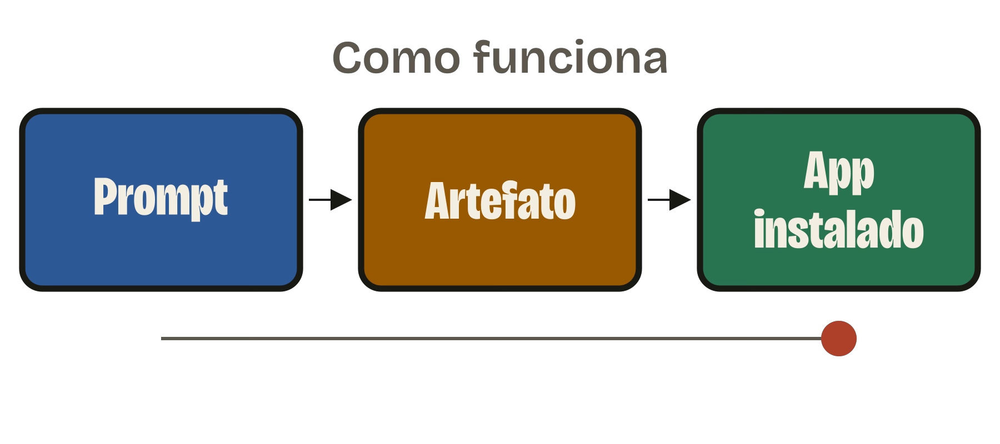
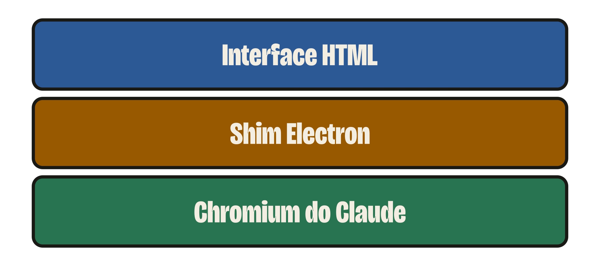
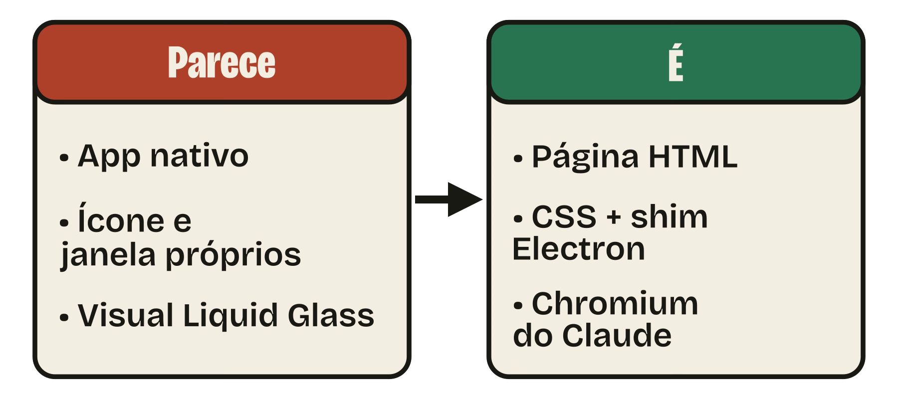

# Claude cria app para Mac com um prompt e ícone no Dock

_2026-11-27 · reportagem_

A Anthropic liberou em beta, no Claude para Mac e Windows (versão 6.28899.0 ou posterior), a instalação de artefatos como apps de desktop com ícone próprio e janela separada. O app não é nativo: é uma página HTML envolvida em um shim Electron que roda por baixo do Claude principal, que executa os comandos e gerencia as permissões. Este material explica a arquitetura, como instalar, os limites, os riscos de usar apps feitos por terceiros e o que muda para quem cria utilitários no Mac. Você também encontra exemplos reais (analisador de disco, monitor de atividade, launcher de Atalhos e redirecionador de Markdown) e os passos para criar o seu primeiro app.

## O contexto

Ontem, a Anthropic anunciou um recurso importante para os artefatos do Claude, disponível em beta no Mac e no Windows: a possibilidade de transformar um artefato em um 'app' instalável no computador. A partir de agora, você pode usar os artefatos do Claude para criar, executar e compartilhar apps de desktop.

Quando um artefato é instalado como app no Mac ou no Windows, ele ganha ícone próprio e abre em janela própria, em vez de dentro do Claude. É possível compartilhar com outras pessoas, e o app pede permissão antes de interagir com o computador; você escolhe quanto permitir. Cada app pode usar o Claude e seus conectores, e atualiza automaticamente quando o artefato de origem é editado.

A leitura estratégica é que a Anthropic contornou a App Store e a notarização da Apple, criando um sistema de lock-in em torno da conta Claude: os apps exigem sua conta, podem usar seus conectores e consomem da sua conta. Se você fosse a Apple, teria motivo para se preocupar com a evaporação do 'cuidado' com apps de verdade diante de algo que satisfaz o usuário sem custo extra.

Para esses apps funcionarem, o app principal do Claude precisa estar instalado e logado com sua conta, porque toda ação do app instalado é tratada pelo Claude por baixo dos panos, inclusive permissões como o Full Disk Access.

## O que muda: um prompt vira um app

_Um prompt gera um artefato que vira app com janela própria no Dock._

A dor que o recurso resolve é montar utilitários que rodam comandos no Terminal sem virar projeto de desenvolvimento. Com um prompt, o Claude gera um artefato e o instala como app com janela separada. Você ganha atalho no Dock e atualização automática quando o artefato muda.

A atualização é automática: quando o artefato de origem é editado, o app instalado se atualiza sozinho, sem reinstalar. Isso simplifica criar e manter apps tanto para profissionais de conhecimento quanto para desenvolvedores.

As requisições que o app instalado faz ao Claude contam para os limites de uso do seu plano. Mesmo criando seus próprios apps, o consumo é seu. A vantagem é que cada app usa o Claude e seus conectores.

Fonte: <https://support.claude.com/en/articles/11647753-how-do-usage-and-length-limits-work>

## Como funciona por baixo: HTML em Electron

_Apps HTML envoltos em shim Electron, gerenciados pelo Chromium do Claude._

Esses apps não são nativos, criados com Swift ou SwiftUI. São apps HTML, envolvidos em um shim Electron, inteiramente gerenciados pelo processo Chromium do Claude para Electron. É um arranjo de tecnologias web, permissões de disco e interface em HTML.

O exemplo analisado (Storage Lens, um utilitário de análise de disco) tem um pacote de 900 KB que não contém código web algum, apenas três peças: um launcher Objective-C de 51 KB, ligado apenas a Cocoa e Foundation, que usa o mecanismo de 'app shim' do Electron para encontrar /Applications/Claude.app e carregar a cópia do framework Electron do Claude; um helper de notificações de 80 KB, construído sobre UserNotifications, que não roda a menos que tenha sido lançado por um Claude.app assinado; e um ícone.

O app em si é um único arquivo HTML, escrito à mão, sem frameworks de terceiros: sem React, sem Tailwind, sem D3. É JavaScript puro, com um objeto de estado e funções render() que reconstroem a página. Tudo o visual é feito à mão.

A comparação feita é com o produto Glaze da Raycast, que usa apps web Vite/React renderizados dentro do WKWebView da Apple, envolvidos em um shell Swift próprio. A expectativa levantada é que a Anthropic adicione módulos Swift nativos a esse sistema no futuro, como a Raycast fez.

## Por que o Claude principal precisa estar rodando

Para esses apps funcionarem, o app principal do Claude precisa estar instalado e logado com sua conta. Os apps exigem o processo principal do Claude em execução, porque toda ação que eles realizam é tratada pelo app Claude por baixo dos panos, inclusive permissões como o Full Disk Access.

O que parece um app independente com ícone próprio no Dock é, na prática, um processo do Claude disfarçado. Por isso, fechar ou deslogar o Claude principal afeta o funcionamento dos apps instalados.

Fonte: <https://support.claude.com/en/articles/10065433-install-claude-desktop>

## Como instalar

1. Confirme que o Claude Desktop está instalado e logado com sua conta (versão 6.28899.0 ou posterior): sem isso, os apps instalados não funcionam.
2. Crie o artefato em uma conversa normal do Claude (não é necessário usar o Claude Code) e peça para instalá-lo como app.
3. Aprove o fluxo de instalação: há uma animação e o app é colocado diretamente no Dock, de forma parecida com o que o app Atalhos faz ao adicionar atalhos individuais ao Dock.
4. Localize o app instalado na pasta ~/Applications/Claude Apps, onde todos os apps feitos com Claude (os seus e os compartilhados por outras pessoas) são instalados; eles também são indexados pelo Spotlight.
5. Fixe o app no Dock, se quiser acesso rápido permanente.
6. Conceda as permissões solicitadas (por exemplo, Full Disk Access) conforme a necessidade do app.

Fonte: <https://support.claude.com/en/articles/18516354-install-an-artifact-as-an-app>

## Permissões: você decide o quanto permitir

O app instalado precisa da sua permissão antes de interagir com o computador, e você escolhe quanto permitir. Um app pode rodar comandos no Terminal por baixo do Claude, como analisar disco ou apagar arquivos, usando permissões já concedidas.

No exemplo do analisador de disco, como o Claude já tinha Full Disk Access, não foi preciso repetir o fluxo de permissão no app instalado: era apenas uma página HTML pedindo ao Claude para rodar comandos de shell em segundo plano.

Em apps de terceiros, aparece um aviso de risco na instalação, e um dos prompts de Full Disk Access mostrados pode ser 'falso': como o Claude já tem essa permissão, clicar em 'Permitir' não muda nada no macOS. Vale conferir o que de fato foi concedido.

Fonte: <https://support.claude.com/en/articles/18516354-install-an-artifact-as-an-app>

## Apps feitos por outras pessoas

Apps criados por outras pessoas são compartilhados por meio de uma página de artefato tradicional. Ao instalar um app de terceiro, você recebe um aviso sobre riscos potenciais.

Se você perder o acesso a um app (por exemplo, porque o dono parou de compartilhar com você), os programas que ele iniciou também param. Isso pode levar até cerca de 20 minutos, e pode demorar mais enquanto o Claude não consegue verificar, como quando está offline, deslogado ou usando outra organização.

Por isso, a recomendação é não montar um fluxo de trabalho sério sobre um app criado por outra pessoa: ela pode parar de compartilhar a qualquer momento e você perde o acesso. A ressalva é que, se for preciso, você pode pedir ao Claude para criar uma cópia própria.

Fonte: <https://support.claude.com/en/articles/9547008-share-artifacts>

## Não é app nativo: é página HTML

_A aparência nativa é ilusão: por baixo, é página HTML em Electron._

Esses apps quebram várias convenções de interface da Apple, mas cumprem sua função principal razoavelmente bem. A aparência nativa é, em grande parte, ilusão: o visual 'Liquid Glass' vem inteiramente de CSS, com backdrop-filter, light-dark() e color-mix(in oklab).

No exemplo do analisador de disco, o anel de capacidade é um SVG desenhado com truques de stroke-dasharray; o treemap usa um layout squarified feito à mão; o ícone do app é desenhado em um <canvas> a cada inicialização; e o destaque deslizante da barra de ferramentas usa um filtro de distorção SVG cujo mapa é gerado pixel a pixel.

Para muitos puristas de macOS e apps nativos, instalar 'apps' vibe-coded que são wrappers Electron ponteando comandos para outro app é motivo de desconforto. O que a Anthropic montou é um amálgama de tecnologias web, permissões de disco e interface em HTML, o oposto do que o desenvolvimento nativo da Apple deveria representar.

## Como a página toca no sistema de arquivos

A parte interessante é como uma página web chega ao sistema de arquivos. O app chama window.claude.use('desktop'), uma API que espelha de perto a do Electron: childProcess.spawn, fs.readdir, shell.trashItem, Menu.setApplicationMenu, app.dock.setBadge.

Com isso, ele roda as mesmas ferramentas de linha de comando que um usuário avançado usaria: df -kP e diskutil para volumes; du -k -x -d 2 para tamanhos de pastas; mdfind com consulta kMDItemFSSize para arquivos grandes. Ele lê a saída linha a linha enquanto rodam e cacheia os resultados no localStorage. Nada sai do Mac.

## Como funciona na prática

Exemplo: você pede ao Claude, em uma conversa normal, para criar um artefato que analise o espaço em disco do Mac com uma interface 'Liquid Glass' e instalá-lo no Dock. Em poucos minutos, o Claude gera o artefato e executa o fluxo de instalação, colocando o app diretamente no Dock.

Você pode pré-visualizar e instalar apps a partir do Claude. O app fica em ~/Applications/Claude Apps, é indexado pelo Spotlight e pode ser fixado no Dock. A partir daí, ele abre em janela própria, com ícone próprio, e atualiza sozinho quando o artefato muda.

## Exemplo: Storage Lens

O Storage Lens é um utilitário de análise de disco com companheiro na barra de menus, criado para liberar espaço em um Mac mini. Ele analisa volumes, pastas e arquivos grandes usando os comandos de sistema descritos acima.

Em um segundo prompt ('menu bar works, segmented control still does not, and these overlapping elements are ugly. do better. follow Apple HIG'), o resultado final passou a ter todos os traços de um app web vestindo um casaco nativo de macOS, mas funcionando: por baixo, o app pede ao Claude para rodar comandos no Terminal para listar e apagar arquivos.

## Exemplo: Vitals

O Vitals é uma das demonstrações oficiais da Anthropic: uma versão simplificada do Monitor de Atividade do macOS na barra de menus. Também funciona. Apps feitos por outras pessoas chegam com a página de artefato tradicional e um aviso de risco na instalação.

## Exemplo: launcher de Atalhos no menu bar

Um launcher de Atalhos na barra de menus que exibe os ícones oficiais e organiza por pasta foi criado pedindo ao Claude para reverter o banco de dados do app Atalhos (Shortcuts.sqlite), protegido pelo SIP, inacessível a outros programas.

A interface de script do Atalhos expõe apenas nome e ID das pastas, e o banco fica em armazenamento protegido pelo SIP. O app descobriu os ícones de outra forma: cada ícone de pasta na barra lateral do Atalhos tem um rótulo de acessibilidade (o nome que o VoiceOver fala). O macOS mantém tabelas que mapeiam nomes de SF Symbols a esses rótulos dentro do AccessibilitySharedSupport.framework; consultando em sentido inverso, obtém-se o símbodo ('Human brain' corresponde a 'brain', 'Apps' a 'apps.iphone').

O ícone do Notion é 'quicknote', um símbodo interno da Apple, que exige o carregador privado de símbodos do AppKit. No teste, 27 das 28 pastas retornaram um símbodo, e cada um correspondeu à captura de tela. O app foi montado com uma mistura de osascript e Full Disk Access, em poucas mensagens de chat. Durante o teste, o Claude usou uma ferramenta em desenvolvimento para conectar o Mac a agentes de IA, a fim de acessar um Mac Studio e ler o banco de dados, porque a tentativa no MacBook Pro não funcionou mesmo com permissão concedida.

## Exemplo: Markdown Redirect

O Markdown Redirect é um utilitário que abre arquivos .md curtos no TextEdit e arquivos mais longos em um processador dedicado (como o Cogito), com base em um limite de palavras configurável.

Como um app criado dentro do Claude não pode ser o que o Finder abre ao clicar em um arquivo, o artefato instala um pequeno helper em segundo plano, o 'Markdown Redirect Helper', na pasta Applications dentro da pasta pessoal. Ao clicar duas vezes em um .md, o helper conta as palavras e abre no app escolhido para arquivos curtos ou longos. O artefato é onde se alteram as configurações e onde se vê a lista de redirecionamentos recentes.

Esse helper é um arquivo AppleScript envolto em um pacote de aplicativo, que chama um script de shell que lança os apps. Por baixo, é um amálgama, mas 'simplesmente funciona'.

## Quem ganha e quem perde

Ganham profissionais de conhecimento e desenvolvedores, que simplificam criar e manter pequenos apps; e usuários que querem utilitários rápidos sem projeto de desenvolvimento. A Anthropic ganha lock-in: os apps exigem conta Claude, podem usar seus conectores e consomem da sua conta.

Perdem, ou devem se preocupar: a Apple, porque o sistema contorna a App Store e a notarização, criando um ecossistema paralelo de ferramentas e mods no computador do usuário; e desenvolvedores de apps nativos, cujos produtos podem ser substituídos por utilitários vibe-coded.

O usuário que depende de apps de terceiros assume risco de perda de acesso a qualquer momento, como descrito acima.

## O que ainda não se sabe

- Ainda é beta: o recurso está em beta no Claude para Mac e Windows; comportamento e limites podem mudar.
- Apps que exigem Full Disk Access não podem ser distribuídos por usuários comuns: a Anthropic proíbe atualmente a distribuição por usuários regulares de apps que exijam Full Disk Access; aparentemente, apenas funcionários da Anthropic podem fazê-lo.
- Quase tudo no macOS parece acessível: como o Claude roda comandos de shell e AppleScript por baixo, praticamente qualquer coisa no macOS parece estar ao alcance. Isso é poder e risco ao mesmo tempo.
- Especulação, não fato: as previsões sobre distribuição similar no iOS (comparada ao Bitrig Remote), um 'programa de criadores' em pseudo-App Store, a cópia em escala pelo ChatGPT e um 'Siri Agent' da Apple que permita criar apps próprios são conjecturas, não anúncios.
- Apps quebram convenções de interface e podem não ser confiáveis para fluxos críticos: não monte workflow sério sobre app de terceiro.
- Confira o que de fato foi concedido em permissões: prompts de Full Disk Access podem ser 'falsos' quando o Claude já tem a permissão.

## O que você pode fazer

1. Instale ou atualize o Claude Desktop para a versão 6.28899.0 ou posterior e faça login com sua conta.
2. Crie um artefato em uma conversa normal do Claude e peça para instalá-lo como app; acompanhe a animação e confirme que apareceu no Dock.
3. Localize o app em ~/Applications/Claude Apps e fixe-o no Dock, se quiser.
4. Conceda apenas as permissões necessárias ao app e revise o que foi concedido.
5. Prefira criar seus próprios apps em vez de depender de apps de terceiros, para não perder acesso.
6. Acompanhe o consumo: as requisições do app contam para os limites do seu plano.

Fonte: <https://support.claude.com/en/articles/18516354-install-an-artifact-as-an-app>

## Glossário

- Artefato: item criado dentro do Claude (código, página HTML, etc.) que pode ser compartilhado e, agora, instalado como app de desktop.
- Electron: framework que empacota páginas web como apps de desktop; aqui, o app é um shim Electron gerenciado pelo processo Chromium do Claude.
- Shim: camada intermediária que conecta o app instalado ao Claude principal.
- Full Disk Access: permissão do macOS que dá acesso total ao disco.
- Dock: barra do macOS onde ficam os apps favoritos e em execução.
- Spotlight: busca do sistema do macOS, que indexa a pasta Claude Apps.
- Swift/SwiftUI: linguagens e frameworks da Apple para apps nativos; esses apps não são feitos com eles.
- WKWebView: componente da Apple para exibir conteúdo web em apps nativos (citado a título de comparação).
- Notarização: processo de verificação da Apple para apps distribuídos fora da App Store.
- App Store: loja de apps da Apple.
- Liquid Glass: estilo visual (com backdrop-filter, light-dark() e color-mix) usado para imitar a aparência nativa do macOS.
- HIG (Human Interface Guidelines): diretrizes de interface da Apple.
- osascript: comando do macOS para executar AppleScript.
- AppleScript: linguagem de script do macOS.
- SF Symbols: biblioteca de ícones da Apple.
- SIP (System Integrity Protection): proteção do macOS que torna certos arquivos, como o banco do Atalhos, inacessíveis a outros programas.
- localStorage: armazenamento local do navegador usado para cachear resultados.

## Para onde ir depois

- Leia o guia oficial de instalação de artefato como app: support.claude.com/en/articles/18516354-install-an-artifact-as-an-app
- Crie seu primeiro utilitário: comece por algo pequeno (um analisador de disco, um launcher de Atalhos) e itere com prompts.
