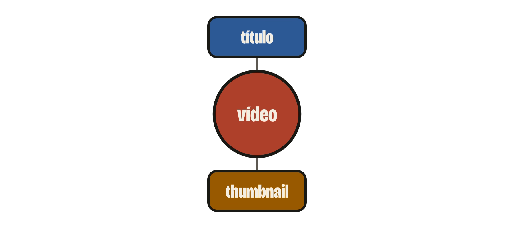
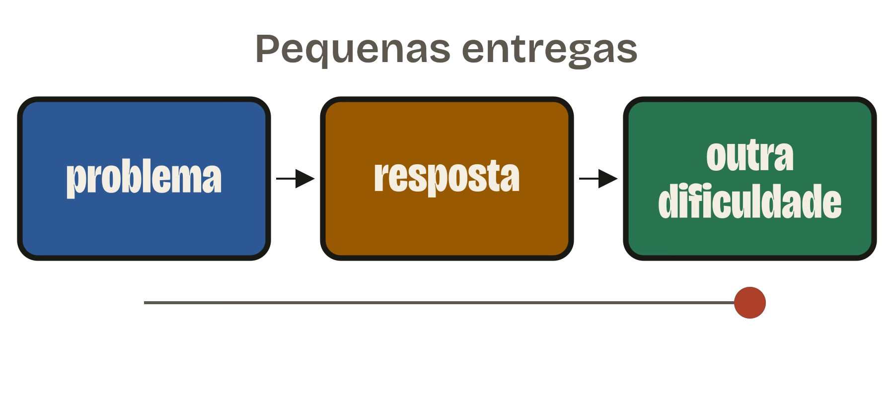

# Seu vídeo pode crescer com desconhecidos no YouTube

_2026-11-27 · reportagem_

Aprenda a organizar a produção de vídeos para o YouTube e a conectar a promessa do título com o conteúdo que mantém a pessoa assistindo. Você vai entender por que o número de inscritos não garante visualizações e como um vídeo pode alcançar quem ainda não conhece o canal. Ao terminar, você terá um caminho de produção para seguir e saberá dividir o conteúdo em pequenas entregas que ajudam o público a acompanhar a explicação.

## O contexto

Passar dias produzindo um vídeo e receber poucas visualizações é frustrante porque o esforço de produção aparece inteiro para quem cria. O público encontra apenas o resultado. Antes de assistir, a pessoa ainda precisa perceber que aquele assunto merece seu tempo. Depois do clique, precisa encontrar uma entrega que sustente essa escolha.

Esse caminho ajuda a entender por que trabalhar mais em um vídeo não garante que ele será mais assistido. Roteiro, gravação e edição precisam contribuir para uma experiência que começa na apresentação do conteúdo e continua durante a reprodução. Uma produção trabalhosa pode ter uma promessa pouco clara ou demorar a chegar ao assunto.

Para quem produz conteúdo de tecnologia e IA, a tarefa é tornar uma ideia compreensível e dar ao espectador motivos para acompanhar seu desenvolvimento. Isso pede atenção tanto à escolha do assunto quanto à maneira de explicá-lo. Organizar esse trabalho permite enfrentar cada vídeo com decisões concretas, em vez de depender da expectativa de viralizar.

## Inscritos e visualizações medem coisas diferentes

Ter inscritos significa que pessoas se inscreveram no canal. Isso não equivale a uma presença garantida em cada publicação. Um canal com 200.000 inscritos pode alcançar 1.000 visualizações nas primeiras horas de um vídeo. O exemplo mostra por que o tamanho da base, sozinho, não permite prever o desempenho de uma publicação.

As primeiras horas também são um recorte de tempo. A quantidade de visualizações nesse período descreve o começo da circulação daquele vídeo; ela não é uma contagem de todos os inscritos que poderão assistir nem um resultado definitivo de alcance.

A imagem do canal como uma pasta ajuda a organizar o raciocínio: os vídeos ficam reunidos no mesmo lugar, mas cada um precisa despertar interesse. Um histórico de publicações não elimina a necessidade de apresentar bem o próximo assunto. Para o criador, isso concentra o trabalho no que pode construir agora: uma ideia clara e um vídeo que a desenvolva.

## Como o vídeo encontra públicos diferentes

A recomendação pode ser entendida a partir da pessoa que abre o YouTube. A plataforma procura um vídeo que combine com o interesse daquele espectador. Nessa lógica, quem já acompanha o canal e quem nunca o viu são públicos que podem reagir de maneiras diferentes à mesma publicação.

Pessoas que já assistem ao canal costumam encontrar seus vídeos antes porque existe um histórico de interesse. A circulação também pode alcançar desconhecidos. Se o assunto interessa a esse novo público, o vídeo pode continuar crescendo mesmo quando a resposta dos inscritos é mais fraca.

Essa diferença importa ao interpretar o começo de uma publicação. Uma reação limitada da audiência habitual não demonstra, por si só, que o assunto não interessa a ninguém. O título, a thumbnail e o conteúdo precisam fazer sentido também para uma pessoa que ainda não tem familiaridade com o criador.

Exemplo: alguém encontra um vídeo sobre IA sem conhecer o canal. Para decidir se vai assistir, essa pessoa depende da ideia apresentada e da promessa do vídeo. Referências internas à comunidade do canal ajudam menos quando o visitante ainda precisa entender o assunto.

## Por que manter o espectador interessado importa

O interesse do YouTube em manter pessoas na plataforma ajuda a explicar a atenção dada à experiência de assistir. Quanto mais tempo alguém permanece, mais oportunidades existem para a exibição de anúncios. Para o criador, a consequência prática é pensar no que faz a pessoa continuar acompanhando o conteúdo.

Um clique abre essa possibilidade, mas o vídeo precisa sustentá-la. Quando a explicação demora a começar ou abandona o que foi prometido, o espectador tem um motivo para sair. Quando encontra respostas e percebe avanço, tem um motivo para continuar.

Essa relação dá uma direção ao trabalho de roteiro e edição: cada trecho deve ajudar a pessoa a entender, acompanhar ou resolver algo. A duração só faz sentido junto com o conteúdo que a ocupa. Alongar a espera pela resposta não cria uma razão para assistir.

## Consistência como objetivo de produção

Buscar consistência significa tentar produzir uma sequência de vídeos que encontre público. Isso muda a organização do trabalho: cada publicação vira uma oportunidade de repetir um processo e desenvolver a capacidade de criar, em vez de concentrar toda a expectativa em um sucesso isolado.

A sequência de 10.000, 8.000, 20.000, 12.000 e 15.000 visualizações ilustra esse objetivo. Os resultados variam, mas vários vídeos conseguem audiência. Consistência, nesse exemplo, admite diferença de desempenho entre publicações.

Esses valores são uma ilustração de alcance recorrente. Não constituem um patamar de monetização nem permitem calcular uma renda mensal. Para quem cria, a aplicação útil é buscar um processo que possa ser repetido e aperfeiçoado a cada vídeo.

## O clique depende de uma promessa compreensível

_O título e a thumbnail apresentam o vídeo antes da reprodução._

O título e a thumbnail apresentam o vídeo antes da reprodução. A thumbnail é a imagem de apresentação; o título dá forma verbal à ideia. Juntos, precisam ajudar a pessoa a entender o que encontrará e por que aquilo pode interessar.

Um conteúdo que explica bem um assunto ainda precisa ser escolhido. Se a apresentação não comunica a proposta, o público pode passar por ele sem descobrir sua qualidade. Por isso, pensar no título e na thumbnail faz parte da construção do vídeo.

A promessa também cria uma responsabilidade. Quando a apresentação desperta uma expectativa que o conteúdo não atende, o clique pode ser seguido de abandono. A pergunta útil durante a produção é se o vídeo entrega aquilo que sua apresentação faz a pessoa esperar.

## O que sustenta a atenção depois do clique

Depois que a pessoa começa a assistir, entram em jogo a explicação, o áudio, as imagens e a maneira de organizar o assunto. Uma animação bonita pode ajudar a mostrar algo, mas a compreensão também depende do que é dito e da ordem em que a informação aparece.

Ele determina o que precisa ser apresentado primeiro, qual problema será respondido em seguida e como cada parte prepara a próxima. A edição transforma esse planejamento na experiência que o público acompanha.

Aprender a fazer vídeos inclui aprender a editar e a trabalhar a história contada. Neste contexto, história é o encadeamento que permite seguir o conteúdo. Mesmo uma explicação técnica precisa de uma sequência que faça sentido para quem está chegando ao assunto.

Detalhes como tags, descrição e cor do banner podem ocupar a atenção de quem produz. O cuidado é não deixar que essas decisões substituam o trabalho sobre o vídeo. Se a explicação está confusa ou a sequência planejada para o vídeo demora a avançar, é ali que existe uma tarefa de produção a resolver.

## Um sistema para sair da página em branco

Produzir um vídeo envolve decisões diferentes. Escolher o assunto exige um tipo de esforço; gravar e editar exigem outros. Quando tudo aparece ao mesmo tempo, a tarefa fica difícil de começar porque ainda não existe uma próxima ação definida.

A comparação com um videogame ajuda a entender a proposta de um sistema. No jogo, a missão informa o que fazer e permite reconhecer quando aquela etapa terminou. Na produção, uma sequência conhecida dá ao criador um caminho para seguir.

A sequência proposta é ideia, título, thumbnail, roteiro, gravação, edição e postagem. Ela reduz a necessidade de decidir como organizar o trabalho toda vez. O conteúdo muda entre vídeos, enquanto as etapas continuam oferecendo uma estrutura.

Cada missão precisa produzir algo que permita avançar. A ideia define o assunto; o título apresenta a promessa; o planejamento do vídeo organiza a entrega. Assim, a etapa seguinte começa com uma decisão anterior já transformada em material de trabalho.

## O gancho explica por que vale a pena ficar

O gancho é o começo do vídeo que apresenta uma razão para continuar assistindo. Ele funciona como o tutorial de um jogo: orienta a pessoa sobre o que encontrará e por que vale a pena seguir.

Uma introdução longa pode atrasar esse entendimento. Saudações e pedidos de interação ocupam o início enquanto o espectador ainda tenta descobrir se o conteúdo corresponde à sua expectativa. Um gancho curto chega à proposta com menos espera.

Para construir essa abertura, responda à pergunta que o público traz ao clicar: por que continuar aqui? A resposta precisa estar ligada ao conteúdo que será entregue. O gancho prepara a experiência, e o desenvolvimento precisa cumprir essa preparação.

## Pequenas entregas dão movimento ao vídeo

_Uma parte apresenta um problema e oferece uma resposta. A seguinte avança para outra dific_

Prometer uma resposta na abertura e guardá-la para o fim deixa um problema de construção: o trecho intermediário também precisa ter utilidade. O espectador deve encontrar motivos para acompanhar o caminho até a entrega final.

Dividir o conteúdo em pequenas missões resolve essa organização. Uma parte apresenta um problema e oferece uma resposta. A seguinte avança para outra dificuldade. Cada resposta funciona como uma recompensa porque a pessoa passa a entender algo que antes precisava resolver.

Essa divisão deve acompanhar as necessidades do assunto. Ao planejar o conteúdo do vídeo, identifique quais dúvidas surgem durante a explicação e em que momento cada uma pode ser respondida. O avanço fica perceptível quando as partes contribuem para o objetivo do vídeo.

A analogia também muda de posição. Durante a produção, o criador segue suas missões. Durante a reprodução, o espectador percorre o caminho preparado pelo criador. Pensar nas duas experiências ajuda a organizar tanto o trabalho quanto o aprendizado.

## Como funciona na prática

Exemplo: um vídeo de receita de feijoada tem como entrega final a feijoada pronta. Durante o preparo, porém, existem dificuldades próprias: deixar o feijão de molho, dessalgar as carnes, acertar o tempero e evitar que o fundo da panela queime.

Cada dificuldade pode ocupar uma parte útil do vídeo. Ao compreender o dessalgue, a pessoa já recebe uma resposta necessária para acompanhar o preparo. Ao entender o cuidado com a panela, recebe outra. O valor aparece ao longo do percurso.

O exemplo ensina uma forma de estruturar explicações: partir da entrega final e reconhecer as dificuldades que precisam ser resolvidas até chegar a ela. Assim, o meio do vídeo contém aprendizado e mantém uma relação clara com o objetivo anunciado.

## Quem ganha espaço e quem fica dependente do passado

A possibilidade de alcançar desconhecidos abre espaço para um vídeo interessar a pessoas além da base de inscritos. O criador precisa apresentar uma proposta compreensível para esse público e desenvolver um conteúdo que sustente o interesse.

Quem depende apenas do tamanho do canal encontra uma limitação: a inscrição não garante a escolha de cada novo vídeo. Da mesma forma, uma publicação bem recebida não dispensa o cuidado com a seguinte. O trabalho de conquistar atenção reaparece em cada assunto.

Para o espectador, a situação pede que o vídeo se explique. Uma pessoa que chega pela recomendação precisa conseguir acompanhar o conteúdo sem depender de uma relação anterior com o canal. Isso reforça a utilidade de uma promessa clara, de uma abertura direta e de respostas distribuídas pelo desenvolvimento.

## O que conferir antes de interpretar um resultado

Os exemplos de visualizações ajudam a entender diferenças de alcance, mas precisam manter seu significado. Uma contagem descreve quantas visualizações um vídeo recebeu em determinado recorte. Ela não explica, sozinha, o motivo de cada pessoa ter clicado ou saído.

A proposta de concentrar atenção no clique e na continuidade é uma orientação de produção. Ela ajuda a trabalhar a apresentação e a entrega do vídeo. Não transforma uma sequência de etapas em garantia de alcance ou monetização.

- Ao olhar as 1.000 visualizações do exemplo, mantenha o recorte das primeiras horas e a comparação com um canal de 200.000 inscritos.
- Ao considerar a sequência de 10.000, 8.000, 20.000, 12.000 e 15.000 visualizações, trate os valores como uma ilustração de audiência recorrente.
- Confira se o título e a thumbnail prometem algo que o conteúdo realmente entrega.
- Revise se a introdução explica por que continuar assistindo ou apenas adia o começo do assunto.
- Observe se o desenvolvimento responde a problemas ao longo do caminho ou concentra toda a utilidade no encerramento.
- Inclua o áudio, a fala e a organização da história na revisão da qualidade do vídeo.

## O que você pode fazer

Use a sequência de produção para trabalhar um vídeo de cada vez. Em cada etapa, conclua uma entrega que sirva de base para a próxima.

1. Defina a ideia no planejamento do vídeo. Ao terminar, você deve saber qual assunto vai desenvolver.
2. Escreva o título na etapa de apresentação da ideia. O resultado esperado é uma promessa que permita entender a proposta do vídeo.
3. Prepare a thumbnail junto da apresentação. Ela deve ajudar a comunicar o interesse do conteúdo antes do clique.
4. Organize a sequência do conteúdo antes da gravação. Inclua um gancho que explique por que ficar e pequenas respostas ao longo do desenvolvimento.
5. Grave o conteúdo a partir da sequência planejada para o vídeo. O resultado esperado é o material de imagem e áudio necessário para construir o vídeo planejado.
6. Edite as gravações. Trabalhe a sequência da explicação, as imagens e o áudio para que o público consiga acompanhar as entregas.
7. Publique o vídeo com o título e a thumbnail preparados. A publicação conclui esse ciclo de produção.

## Glossário

- Algoritmo de recomendação: sistema que seleciona vídeos para apresentar a uma pessoa.
- Thumbnail: imagem de apresentação do vídeo, vista antes de começar a reprodução.
- Gancho: abertura que dá ao espectador uma razão para continuar assistindo.
- Roteiro: organização do que será dito e mostrado durante o vídeo.
- Edição: trabalho de selecionar e organizar as gravações para construir o vídeo.
- Consistência: continuidade na produção e busca por uma sequência de vídeos que encontre público.
- Viral: vídeo que alcança uma audiência muito maior do que a habitual.
- Monetização: geração de receita com o conteúdo.
- NPC: personagem de um jogo que não é controlado pelo jogador e pode orientar missões.
- XP: pontos de experiência usados na comparação com jogos para representar progresso.

## Para onde ir depois

Aplique o processo ao próximo vídeo, começando pela ideia e seguindo até a postagem. Pratique especialmente a relação entre a promessa da apresentação e as respostas que aparecem durante o conteúdo.

Ao planejar o conteúdo do vídeo, trabalhe o gancho e a divisão do assunto em pequenas missões. Na gravação e na edição, dê atenção à fala, ao áudio e à sequência da explicação. Repita esse ciclo para desenvolver sua capacidade de produzir um vídeo de cada vez.
