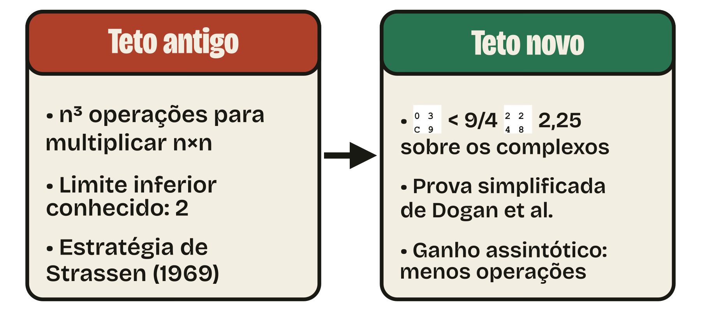
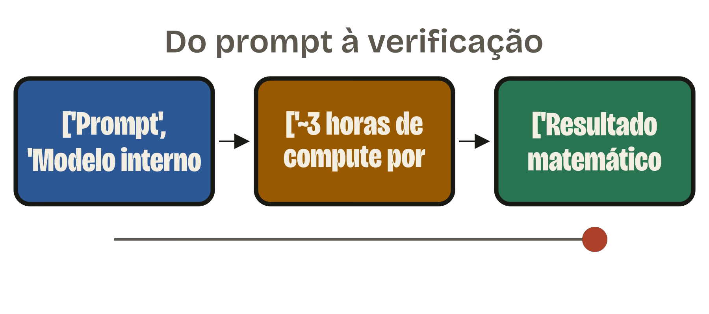

# OpenAI anuncia limite omega < 9/4 em 2 de outubro de 2026

_2026-11-28 · reportagem_

Em 2 de outubro de 2026, a OpenAI anunciou um novo limite para a multiplicação de matrizes sobre os números complexos: o expoente ômega fica abaixo de 9/4, ou seja, menos de 2,25. Esse número mede quantas operações aritméticas são necessárias, no limite em que as dimensões das matrizes crescem, para multiplicá-las. O anúncio saiu em um repositório oficial da OpenAI no GitHub e o argumento foi atribuído a um modelo interno da empresa, sem assinatura humana imediata — o que gerou debate na comunidade. Em 6 de novembro de 2026, Dogan, Lysikov, Sakabe e Walter publicaram uma prova simplificada no arXiv que vale para qualquer corpo matemático, não só os complexos, e formalizaram o resultado em Lean dentro do repositório openai/math. Entenda aqui o que esse limite significa, por que ele importa para quem treina modelos de IA e quais são os limites práticos desse avanço.

## O fato: um número menor para multiplicar matrizes

Multiplicar duas matrizes grandes é uma das operações mais caras de todo o treinamento e da inferência de modelos de IA. Cada modelo grande armazena bilhões de parâmetros organizados em matrizes, e a cada passo de treino essas matrizes precisam ser multiplicadas milhares ou milhões de vezes.

Há décadas se busca um algoritmo que faça isso mais rápido. O algoritmo clássico roda em O(n³), onde n é a dimensão da matriz — ou seja, o número de operações cresce cubicamente com o tamanho. Em 2 de outubro de 2026, a OpenAI anunciou que o expoente ômega da multiplicação de matrizes sobre os números complexos é menor que 9/4, aproximadamente 2,25.

Isso significa que, quando as dimensões das matrizes tendem ao infinito, dá para fazer a multiplicação com um número de operações que cresce mais devagar do que o cubo — algo entre n^2,25 e n^3. O anúncio foi publicado no repositório oficial openai/math no GitHub, com o argumento atribuído a um modelo interno da OpenAI.

Fonte: <https://github.com/openai/math/blob/adc7f1241b42e322a6451854ab7e4b4c146bf78a/preprints/Matrix-Multiplication-Nine-Fourths-October-2-2026/paper.pdf>

## O que é o expoente ômega

O expoente ômega, escrito como ω_F sobre um campo F, é o menor expoente tal que duas matrizes n×n sobre F podem ser multiplicadas com no máximo O(n^(ω+ε)) operações aritméticas, para qualquer ε maior que zero. As operações contadas são adição, subtração e multiplicação de elementos do campo.

Esse número descreve o crescimento assintótico — ou seja, o comportamento quando n fica muito grande. Ele não diz qual algoritmo é mais rápido em um tamanho finito específico, nem substitui a análise de complexidade bit a bit. O que ele captura é a tendência de longo prazo: se ω for menor, a multiplicação escala mais devagar conforme as matrizes crescem.

O limite inferior conhecido era 2, vindo da necessidade de operar com cada entrada da matriz geral. A conjectura em aberto é saber se esse limite inferior pode ser superado — e o resultado da OpenAI mexe justamente nessa fronteira.

## O anúncio original: o que a OpenAI publicou

Em 2 de outubro de 2026, a OpenAI publicou no repositório openai/math um preprint intitulado 'Matrix-Multiplication-Nine-Fourths-October-2-2026'. O documento afirma que o expoente da multiplicação de matrizes sobre os números complexos é menor que 9/4.

O argumento apresentado foi atribuído a um modelo interno não divulgado da OpenAI. A própria documentação do repositório descreve esse material como 'raw research data', ou seja, dados brutos de pesquisa, e admite que nem tudo está formalizado em prova assistida por computador. Essa ausência de verificação humana imediata é o ponto que mais gerou discussão entre matemáticos.

A OpenAI também já havia anunciado resultados anteriores: um limite sobre todo campo de característica zero e sobre características positivas fora de um conjunto finito excepcional, além de uma bound retangular (matrizes de dimensões diferentes) abaixo de 2,258. O resultado novo estende o alcance do limite.

- Procure o preprint no repositório openai/math e leia a seção de declaração do resultado para entender como o expoente é definido.
- Observe que esse conjunto de dados se autodenomina 'raw research data': considere como rascunho de pesquisa, não como prova publicada em revista revisada por pares.

Fonte: <https://github.com/openai/math>

## A prova simplificada: Dogan et al. e a generalização para qualquer corpo

Em 6 de novembro de 2026, Mahmut Levent Doğan, Vladimir Lysikov, Keiya Sakabe e Michael Walter publicaram no arXiv o artigo 'Tensor value and the 9/4 bound for matrix multiplication' (arxiv.org/abs/2611.09716). O trabalho apresenta uma exposição simplificada do resultado da OpenAI.

A prova usa uma variante fracionária simetrizada do valor tensorial, introduzida por Coppersmith e Winograd, no lugar dos pontos espectrais usados na prova original. Os autores demonstram uma desigualdade de superaditividade para potências desse valor em somas diretas parciais, e combinam isso com degenerações de tensores de multiplicação polinomial vindas da prova da OpenAI.

O resultado provado vale sobre qualquer corpo — inclusive corpos de característica positiva, onde a prova original não se aplicava diretamente. Isso amplia o alcance do limite: antes ele era declarado para os complexos; agora está formalizado para uma classe muito maior de campos.

- Leia o resumo e o abstract do artigo no arXiv para identificar a afirmação central: o expoente é menor ou igual a 9/4 sobre todo campo.
- Procure na seção de ferramentas matemáticas como o valor tensorial fracionário simetrizado é definido — é um conceito que aparece em complexidade computacional e teoria da representação.

Fonte: <https://arxiv.org/abs/2611.09716>

## A formalização em Lean

Os mesmos autores publicaram a formalização do resultado no idioma de prova assistida Lean, dentro do repositório openai/math. Isso significa que o argumento foi verificado por um sistema computacional, reduzindo a chance de erro manual na demonstração.

O repositório da OpenAI mantém uma biblioteca Lean com as provas já formalizadas e indica que cerca de 42% dos resultados principais estão formalizados. O resultado do expoente 9/4 está entre eles, o que dá à comunidade uma verificação independente do anúncio original.

- Acesse a biblioteca Lean no repositório openai/math e localize a prova associada ao preprint de outubro de 2026.
- Confira no catálogo de formalizações qual versão do resultado está coberta e quais requisitos da ferramenta são necessários.

Fonte: <https://github.com/openai/math>

## O que muda na prática

Um limite assintótico menor para a multiplicação de matrizes reduz o número de operações aritméticas necessárias quando as dimensões das matrizes crescem. Isso tem impacto direto no custo computacional de treinar e inferir modelos grandes, já que a multiplicação de matrizes é uma das operações dominantes nesses fluxos.

Mas há um detalhe importante: o ganho real só aparece se existir um algoritmo que consiga efetivamente alcançar esse limite. O número ω < 9/4 é um teto teórico; ele não garante que um método prático já opere nesse nível. Algoritmos como os baseados em Strassen e suas variantes mostram que há caminhos abaixo de n³, mas cada avanço exige implementação eficiente e escalável.

Além disso, o custo total de um treino depende de outras operações além da multiplicação — acúmulo de gradientes, ativações de redes profundas, comunicação entre GPUs. O limite da multiplicação é uma peça do quebra-cabeça, não a resposta completa para reduzir tempo ou dinheiro.

- Entenda que o resultado vale no limite assintótico (n → ∞). Para tamanhos finitos, o algoritmo clássico O(n³) pode continuar sendo o mais eficiente.
- Verifique se há implementações públicas de multiplicação de matrizes com complexidade abaixo de n³ antes de prometer ganhos em produção.

## Antes e depois: a linha do expoente

_Comparação entre o teto clássico O(n³) e o novo limite ω 2,25 para multiplicação de matriz_

Para visualizar o que o número representa, pense em uma matriz quadrada de dimensão n. O algoritmo padrão faz cerca de n³ operações para multiplicá-la por outra matriz de mesma dimensão.

Strassen mostrou em 1969 que é possível fugir do cubo usando blocos e multiplicação de matrizes em paralelo, mas o limite inferior conhecido continuava em 2. Ou seja: havia um caminho abaixo de n³, mas ninguém sabia até onde ele poderia ir.

Com o resultado da OpenAI, o teto superior caiu para menos de 9/4 ≈ 2,25 sobre os complexos. Com a prova simplificada de Dogan et al., esse mesmo teto vale sobre qualquer corpo. Na prática, isso desloca a fronteira do problema: em vez de buscar um limite entre 2 e 3, o alvo agora é algo abaixo de 2,25.

- Algoritmo clássico: O(n³) — o padrão antes dos avanços de Strassen.
- Strassen: abriu caminho para ω < 3, mas com limite inferior aberto em 2.
- OpenAI (out/2026): propôs ω(C) < 9/4 ≈ 2,25 sobre os complexos.
- Dogan et al. (nov/2026): provaram ω ≤ 9/4 sobre todo corpo e formalizaram em Lean.

## Onde entram os modelos internos da OpenAI

_Fluxo do uso de modelo interno da OpenAI para gerar resultados, seguido de revisão ou form_

Os resultados matemáticos do repositório openai/math foram obtidos, na grande maioria dos casos, com um modelo interno não divulgado da OpenAI. Em média, cada resultado usou cerca de três horas de compute do ChatGPT Pro thinking com esse modelo, ao longo de aproximadamente 4.000 problemas propostos.

Isso levanta uma questão prática: quando um modelo gera uma prova matemática sem revisão humana imediata, ela precisa ser tratada como hipótese até que seja verificada por humanos ou formalizada em um sistema como o Lean. Foi exatamente esse caminho que a comunidade seguiu com o resultado dos 9/4.

O próprio repositório deixa claro que nem todos os resultados têm formalização e que alguns podem ter problemas — o que reforça a necessidade de ceticismo saudável ao consumir esses materiais.

- Trate anúncios vindos de modelos internos como dados brutos de pesquisa, não como prova final.
- Confira se há formalização em Lean antes de usar o resultado em contexto acadêmico ou comercial.
- Acompanhe a evolução do repositório: novas versões e correções são registradas publicamente.

Fonte: <https://github.com/openai/math>

## Limites, custos e o que ainda não se sabe

O primeiro limite é conceitual: um expoente ômega menor descreve comportamento assintótico. Ele não reduz o custo de uma única multiplicação nem garante ganho em problemas de tamanho realista sem algoritmos que o alcancem.

Segundo, há a questão da implementação. Algoritmos com complexidade teórica baixa podem ter constantes grandes e se tornar piores para dimensões moderadas. O ganho prático depende de engenharia cuidadosa.

Terceiro, o resultado vale sobre corpos matemáticos abstratos; traduzir isso para hardware específico (GPUs, TPUs) exige pesquisa própria em otimização de memória e paralelismo.

Por fim, como o argumento original veio de um modelo interno sem assinatura humana imediata, a comunidade ainda discute credibilidade e precedentes. O caminho da formalização em Lean é justamente o que dá peso ao resultado — mas não substitui a revisão por pares.

- Fato: o limite é assintótico; não se aplica diretamente a uma única multiplicação de tamanho fixo.
- Hipótese: algoritmos práticos podem demorar anos para alcançar o novo teto.
- Confira sempre se há formalização antes de citar o resultado em trabalho científico.
- O material da OpenAI é autodenominado dado bruto de pesquisa; trate com cautela até verificação independente.

## Glossário

- Multiplicação de matrizes: operação que combina duas matrizes em uma terceira, essencial em redes neurais e álgebra linear.
- Expoente ômega (ω): menor expoente tal que a multiplicação de n×n pode ser feita com O(n^(ω+ε)) operações, para todo ε > 0.
- Complexidade assintótica: análise do crescimento de uma função quando a entrada tende ao infinito, ignorando constantes e termos inferiores.
- Campo matemático (corpo): conjunto com as operações de adição e multiplicação bem definidas, como os números reais ou complexos; pode ter característica positiva ou zero.
- Característica positiva: quando um somatório de unidades é nulo após um número finito de termos; campos finitos têm característica positiva.
- Tensor value: construção usada em complexidade para contar 'valores' possíveis de tensores associados a multiplicação de matrizes, ferramenta central na prova dos 9/4.
- Formalização em Lean: provar um resultado matemático dentro de um sistema assistido por computador que verifica cada passo da demonstração.
- O(n³): notação big-O indicando que o número de operações cresce proporcionalmente a n³ para algum constante.

## Para onde ir depois

- Leia o preprint original no GitHub para entender a declaração do resultado da OpenAI e como o argumento foi construído.
- Estude o artigo de Dogan et al. no arXiv para ver a prova simplificada e o conceito de valor tensorial fracionário simetrizado.
- Explore a biblioteca Lean no repositório openai/math para acompanhar quais resultados já têm formalização.
- Se seu interesse é aplicação, procure implementações públicas de multiplicação de matrizes com complexidade inferior a O(n³) e compare desempenho em dimensões realistas.

## Além do vídeo

- O repositório openai/math descreve seus conteúdos como 'raw research data' e admite que nem todos os resultados têm formalização em Lean.
- A OpenAI já havia anunciado bounds anteriores: sobre todo campo de característica zero, sobre características positivas fora de um conjunto finito excepcional e uma bound retangular abaixo de 2,258.
- O artigo de Dogan et al. usa degenerações de tensores de multiplicação polinomial vindas da prova original da OpenAI como parte do argumento.
- A média de três horas de compute do ChatGPT Pro thinking por resultado e cerca de 4.000 problemas propostos ao modelo interno, segundo a documentação do repositório.
- O limite inferior conhecido de ω ≥ 2 vem da necessidade de operar com as entradas gerais de uma matriz.
- A formalização em Lean está dentro do catálogo de provas do repositório openai/math, que indica cerca de 42% dos resultados principais já formalizados.
