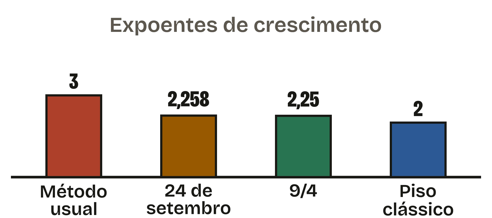
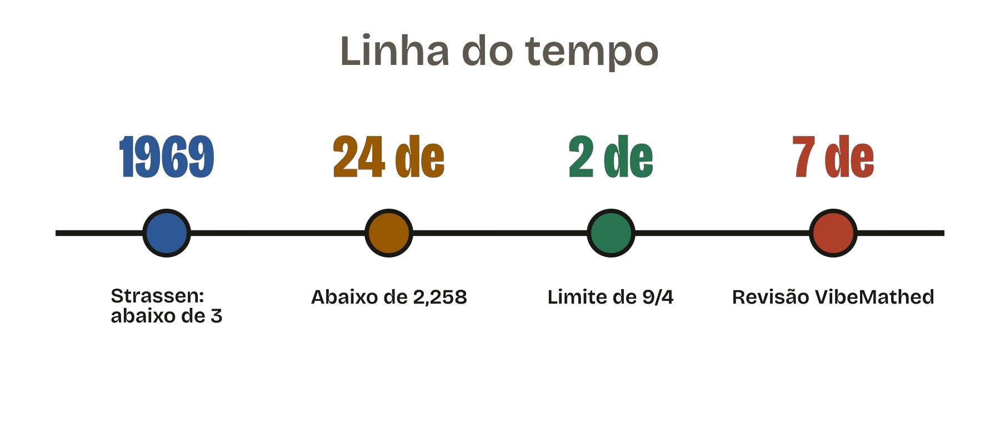
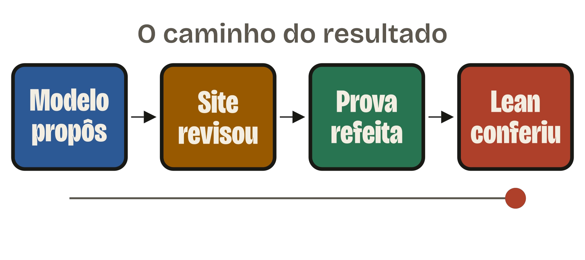

# OpenAI anuncia limite omega < 9/4 em 2 de outubro de 2026

_2026-11-28 · reportagem_

A OpenAI publicou em 2 de outubro de 2026 um limite teórico novo para o custo de multiplicar matrizes: o expoente omega fica em no máximo 9/4 sobre os números complexos, com argumento atribuído a um modelo interno da empresa. Esta apostila explica o que é esse expoente, por que ele tem piso 2 e o que cada anúncio de setembro a novembro afirma. Você vai entender como um grupo de matemáticos refez a prova por outro caminho, estendeu o resultado a todo corpo e entregou uma formalização em Lean que uma máquina confere. Ao final, você saberá separar o que está verificado do que ainda é manuscrito em verificação, explicar por que o resultado não acelera o seu treino de amanhã e rodar na sua máquina a checagem da prova formal.

## O contexto

Multiplicar matrizes é a operação que mais se repete em IA. Cada camada densa de uma rede neural e cada passo de atenção de um transformer se resumem a produtos de matrizes, tanto no treino quanto na inferência. O custo dessa operação define boa parte da conta de computação de qualquer modelo.

O método ensinado na escola, linha por coluna, gasta da ordem de n³ operações aritméticas para multiplicar duas matrizes quadradas de lado n. Essa curva cresce depressa: quando o lado dobra, o trabalho fica oito vezes maior, porque 2³ é 8.

Em 1969, Volker Strassen publicou o artigo Gaussian Elimination Is Not Optimal e mostrou que dá para fazer melhor que o cubo, aplicando suas fórmulas de forma recursiva. Desde então, a matemática procura saber até onde esse expoente pode cair. Os anúncios de 2026 são o capítulo mais recente dessa busca, com uma novidade: o argumento é atribuído a um modelo de IA.

Fonte: <https://doi.org/10.1007/BF02165411>

## O que é o expoente omega

Omega é o nome do expoente ideal da multiplicação de matrizes. A definição formal, registrada no MathWorld, diz que omega sobre um corpo F é o ínfimo dos expoentes tau tais que, para todo epsilon maior que zero, duas matrizes n por n sobre F podem ser multiplicadas com O(n^(tau+epsilon)) operações aritméticas. Em linguagem simples: omega é o menor valor de que os algoritmos conseguem se aproximar quando as matrizes ficam cada vez maiores.

Três detalhes da definição mudam a leitura de qualquer notícia sobre o tema. Primeiro, a constante escondida na notação O pode depender de epsilon, mas não de n. Segundo, as operações contadas são soma, subtração e multiplicação de elementos do corpo. Terceiro, a complexidade em bits, que mede o trabalho real com números de muitos dígitos, é outra pergunta e fica fora dessa conta.

Omega depende do corpo, que é o conjunto de números em que as entradas da matriz vivem. Números complexos formam um corpo, e existem corpos de característica positiva, em que somar o número 1 a si mesmo uma quantidade finita de vezes dá zero. Um limite provado sobre os complexos não vale automaticamente nos outros corpos, e por isso cada anúncio diz onde o resultado se aplica.

Fonte: <https://mathworld.wolfram.com/MatrixMultiplicationExponent.html>

## Por que o piso é 2

O produto de duas matrizes n por n tem n² entradas. Qualquer algoritmo precisa ao menos produzir cada uma delas, então o expoente nunca desce abaixo de 2. Esse é o piso clássico de omega.

Entre o piso 2 e o cubo do método usual existe um intervalo, e a pesquisa trabalha dentro dele. Cada resultado novo é um limite superior: uma prova de que omega é no máximo certo valor. A conjectura de que omega vale exatamente 2 ficou décadas em aberto.

Fonte: <https://mathworld.wolfram.com/MatrixMultiplicationExponent.html>

## Os anúncios de 24 de setembro

Em 24 de setembro de 2026, o repositório de matemática da OpenAI recebeu dois manuscritos sobre o tema. O primeiro, Complex Matrix Multiplication Below 2.258 and Rectangular Bounds, anuncia um limite abaixo de 2,258 para o expoente. Segundo o registro do MathWorld, o anúncio cobre todo corpo de característica zero e todas as características positivas fora de um conjunto finito de exceções.

O segundo manuscrito, Staggered Extraction for Exact Matrix Multiplication Over Every Field, traz um limite mais fraco, com a vantagem de valer sobre todo corpo fixo. Os dois textos mostram o padrão que se repete na história inteira: um número melhor costuma vir com um recorte menor de corpos, e ampliar o recorte é um trabalho à parte.

Fonte: <https://github.com/openai/math/blob/adc7f1241b42e322a6451854ab7e4b4c146bf78a/preprints/Complex-Matrix-Multiplication-Below-2.258-and-Rectangular-Bounds-September-24-2026/Complex-Matrix-Multiplication-Below-2.258-and-Rectangular-Bounds-September-24-2026.pdf>

## O limite de 9/4, de 2 de outubro

Em 2 de outubro de 2026, a OpenAI publicou o manuscrito An Upper Bound of 9/4 for the Matrix Multiplication Exponent. Ele anuncia que omega é no máximo 9/4 sobre os números complexos. Em decimal, 9/4 é 2,25, um degrau pequeno abaixo dos 2,258 de setembro.

O argumento é atribuído a um modelo interno da OpenAI, ainda sem nome público. Essa origem é a parte da notícia que interessa a quem acompanha IA: um resultado em um problema de pesquisa aberto há décadas, proposto por um modelo. Resultado com essa origem pede checagem de fora, e ela veio em duas etapas.

A primeira etapa aconteceu em 7 de outubro, quando o VibeMathed revisou o enunciado formal do limite sobre os complexos. Revisar o enunciado garante que a frase matemática escrita para a máquina diz o que se pretende. Ainda faltava alguém refazer a prova por outro caminho.

Fonte: <https://github.com/openai/math/blob/adc7f1241b42e322a6451854ab7e4b4c146bf78a/preprints/Matrix-Multiplication-Nine-Fourths-October-2-2026/paper.pdf>

## De onde vêm os manuscritos da OpenAI

O repositório openai/math reúne manuscritos matemáticos e artefatos de prova produzidos por um modelo interno da OpenAI. A empresa explica que avalia seus modelos em problemas de pesquisa em aberto e que ampliou essas avaliações depois que as avaliações matemáticas anteriores ficaram saturadas. Alguns resultados se apoiam em resultados anteriores produzidos pelos próprios modelos.

A própria OpenAI descreve o conteúdo como dado bruto de pesquisa, em vez de artigos acadêmicos polidos. A coleção inclui resultados em estágios diferentes de verificação, parte deles sem formalização em Lean, e o texto do repositório avisa que resultados ainda sem formalização podem ter problemas. A empresa diz também que deixa para a comunidade matemática as questões de crédito, precedência e trabalho concorrente.

Para o leitor, isso define como tratar cada manuscrito: como uma afirmação a ser conferida. O que transforma a afirmação em resultado aceito é a verificação, seja por formalização, seja por matemáticos que refazem a prova.

- O catálogo atual tem 730 manuscritos organizados em 375 famílias. Uma família agrupa artigos relacionados, como um resultado principal, argumentos complementares, consequências e provas alternativas.
- Ao longo da avaliação, o modelo recebeu cerca de 4.000 problemas. O catálogo é o que restou depois de agrupar as saídas e exigir um nível adequado de relevância.
- Cada resultado usou, em média, três horas de computação de raciocínio do ChatGPT Pro com o modelo interno.
- Cerca de 42% dos resultados principais do repositório têm formalização em Lean. Os demais ainda dependem de conferência.
- Correções e revisões entram como versões novas, e as versões anteriores continuam acessíveis.

Fonte: <https://github.com/openai/math>

## A prova simplificada de Doğan, Lysikov, Sakabe e Walter

Em 6 de novembro de 2026, Mahmut Levent Doğan, Vladimir Lysikov, Keiya Sakabe e Michael Walter enviaram ao arXiv o artigo Tensor value and the 9/4 bound for matrix multiplication. Os autores apresentam o texto como uma exposição do resultado da OpenAI, com uma prova de que o expoente é no máximo 9/4 válida sobre todo corpo.

A ferramenta principal é uma variante fracionária e simetrizada do valor tensorial, medida introduzida por Coppersmith e Winograd. Ela entra no lugar dos pontos espectrais, também chamados de caracteres tensoriais, usados na prova original. Os autores provam uma desigualdade de superaditividade para uma potência desse valor em somas parcialmente diretas, nas quais as parcelas compartilham um fator tensorial e ocupam subespaços independentes nos outros dois. Essa desigualdade, combinada com as degenerações dos tensores de multiplicação de polinômios que vêm da prova da OpenAI, entrega o limite.

O ganho é duplo. O limite deixa de valer só sobre os complexos e passa a valer em todo corpo, inclusive os de característica positiva. E a prova vem acompanhada de uma formalização em Lean. Os autores citam ainda outras extensões do limite a corpos arbitrários.

Fonte: <https://arxiv.org/abs/2611.09716>

## A formalização em Lean

Lean é um assistente de provas: uma linguagem em que cada passo de uma demonstração é escrito de forma que um programa confere a validade de todos eles. O repositório qit-lmu/omega traz a formalização do manuscrito em Lean com a biblioteca mathlib. O teorema principal está no arquivo Omega/Main.lean e aparece no bloco abaixo.

A leitura do enunciado é direta: para qualquer tipo K que seja um corpo, omega de K é menor ou igual a 9/4. O repositório afirma que o teorema vale sobre todo corpo, sem hipótese sobre característica, cardinalidade ou fecho algébrico. A prova usa valor tensorial fracionário e simetrizado, degenerações da multiplicação de polinômios e um argumento elementar de crescimento, sem pontos espectrais.

Dois números ajudam a medir a cobertura. Todas as entradas matemáticas do blueprint auditado estão formalizadas, o que abrange 34 ambientes numerados ativos do manuscrito e 14 equações rotuladas. A biblioteca conferida não contém sorry, a marca que o Lean usa para um trecho de prova deixado em branco, nem axiomas próprios do projeto.

```
theorem MatrixMultiplication.omega_le_nine_quarters
    (K : Type u) [Field K] :
    MatrixMultiplication.omega K ≤ (9 : ℝ) / 4
```

Fonte: <https://github.com/qit-lmu/omega>

## O manuscrito de 24 de novembro

Em 24 de novembro de 2026, a OpenAI publicou no mesmo repositório o manuscrito The matrix multiplication exponent is nine fourths. Ele afirma que omega é exatamente 9/4 em todo corpo.

A diferença em relação aos passos anteriores é grande. Até aqui, todos os resultados eram limites superiores: omega é no máximo certo valor. Dizer que omega é exatamente 9/4 exige também o outro lado, uma prova de que nenhum algoritmo se aproxima de expoente menor. Isso responderia à pergunta que ficou décadas em aberto, com uma resposta diferente do piso 2.

Essa afirmação tem o status que o repositório dá a todos os seus manuscritos: dado bruto de pesquisa, em estágios diferentes de verificação. A formalização em Lean do grupo de Doğan cobre o limite superior, omega menor ou igual a 9/4.

Fonte: <https://github.com/openai/math/blob/main/preprints/The-matrix-multiplication-exponent-is-nine-fourths-November-24-2026/paper.pdf>

## Os números, um por um



_Barras comparam os expoentes: 3 do método usual, 2,258, 9/4 (2,25) e o piso 2._

- 3: expoente do método usual, que gasta da ordem de n³ operações aritméticas para matrizes de lado n.
- Abaixo de 2,258: limite anunciado pela OpenAI em 24 de setembro de 2026, no manuscrito sobre multiplicação de matrizes complexas.
- 9/4, ou 2,25: limite superior anunciado em 2 de outubro de 2026 sobre os números complexos e provado em novembro sobre todo corpo.
- 2: piso clássico, porque o produto tem n² entradas.
- Um quarto: distância entre 2,25 e o piso 2.
- Todos esses valores são expoentes de crescimento. Eles comparam curvas quando n tende ao infinito e não dizem quantos segundos um produto leva em um tamanho específico.

Fonte: <https://mathworld.wolfram.com/MatrixMultiplicationExponent.html>

## Como funciona na prática

Imagine que uma equipe treina um modelo e lê a manchete sobre o expoente 9/4. A pergunta natural é se o treino da semana seguinte fica mais rápido. A resposta é que o treino continua com as mesmas bibliotecas e o mesmo tempo.

O motivo está na definição. Omega descreve o crescimento do custo quando a matriz tende ao infinito, e a notação O esconde uma constante. O expoente sozinho não determina qual algoritmo é o mais rápido em um tamanho finito, como o das matrizes que cabem em uma GPU. Um método de expoente menor pode carregar uma constante tão grande que só compensaria em tamanhos fora do alcance prático.

A formalização tem o mesmo cuidado. O repositório em Lean define omega de K como o logaritmo na base dois do posto assintótico do tensor de multiplicação de matrizes 2 por 2, e avisa que a interpretação em operações aritméticas é expositiva: o projeto não formaliza um modelo computacional nem prova que o expoente de complexidade desse modelo é igual a omega. O que mudou foi o teto teórico do que um algoritmo pode alcançar.

Fonte: <https://github.com/qit-lmu/omega>

## Linha do tempo



_Linha do tempo de 1969 a outubro de 2026, de Strassen ao limite superior de 9/4._

- 1969: Strassen publica Gaussian Elimination Is Not Optimal e mostra que o expoente pode ficar abaixo de 3.
- 24 de setembro de 2026: a OpenAI publica o manuscrito com limite abaixo de 2,258 e limites para matrizes retangulares.
- 24 de setembro de 2026: a OpenAI publica também o manuscrito Staggered Extraction, com um limite mais fraco que vale sobre todo corpo fixo.
- 2 de outubro de 2026: a OpenAI publica o limite superior de 9/4 sobre os números complexos, com argumento atribuído a um modelo interno.
- 7 de outubro de 2026: o VibeMathed revisa o enunciado formal do limite 9/4 sobre os complexos.
- 6 de novembro de 2026: Doğan, Lysikov, Sakabe e Walter enviam ao arXiv a prova simplificada, válida sobre todo corpo, com formalização em Lean.
- 24 de novembro de 2026: a OpenAI publica o manuscrito que afirma que omega é exatamente 9/4 em todo corpo.

Fonte: <https://mathworld.wolfram.com/MatrixMultiplicationExponent.html>

## Quem ganha e quem perde



_Caminho do resultado: proposta do modelo, revisão, prova refeita e formalização em Lean._

Ganha a teoria da complexidade, que recebeu um teto mais baixo para um dos seus problemas centrais e uma prova mais simples, válida em todo corpo. Ganha também quem avalia modelos de IA: o caminho do resultado mostra um processo completo, em que um modelo propôs o argumento, um site independente revisou o enunciado, um grupo de matemáticos refez a prova por outra técnica e a formalização em Lean deixou tudo conferível por máquina.

Quem esperava um ganho imediato de velocidade fica sem novidade. As bibliotecas de álgebra linear que rodam nas GPUs seguem as mesmas, porque o resultado trata de crescimento assintótico.

A lição para quem consome notícia de IA é sobre confiança. Uma afirmação matemática gerada por modelo ganha peso quando passa por conferência externa, e a notícia traz os dois casos lado a lado: o limite superior de 9/4, já formalizado, e a igualdade de 24 de novembro, ainda com status de manuscrito.

## O que ainda não se sabe

- A afirmação de que omega é exatamente 9/4 vem de um manuscrito de 24 de novembro que a própria OpenAI enquadra como dado bruto de pesquisa. Trate como afirmação em verificação.
- O que está formalizado em Lean no repositório qit-lmu/omega é o limite superior, omega menor ou igual a 9/4 sobre todo corpo.
- A formalização prova um enunciado sobre posto assintótico de tensores. A ligação com a contagem de operações aritméticas é expositiva e fica fora do que a máquina conferiu.
- A revisão do VibeMathed de 7 de outubro tratou do enunciado formal do limite sobre os complexos.
- Cerca de 42% dos resultados principais do repositório da OpenAI têm formalização em Lean, e a empresa avisa que resultados sem formalização podem ter problemas.
- Operação aritmética e complexidade em bits são medidas diferentes. O expoente omega conta só a primeira.
- Nenhum desses resultados indica qual algoritmo é mais rápido em tamanho finito.

Fonte: <https://github.com/openai/math>

## O que você pode fazer: conferir a prova na sua máquina

A formalização é pública e qualquer pessoa pode pedir ao Lean que confira a prova. Os comandos rodam a partir da raiz do repositório qit-lmu/omega. As versões de Lean e mathlib ficam fixadas nos arquivos lean-toolchain, lakefile.toml e lake-manifest.json.

1. Instale o Git e o elan e garanta que o comando lake esteja no PATH. Resultado esperado: o elan seleciona sozinho a versão de Lean fixada pelo repositório.
2. Na raiz do repositório, rode o primeiro comando do bloco abaixo, lake exe cache get. Resultado esperado: o download dos artefatos pré-compilados da mathlib.
3. Rode lake build. Resultado esperado: a biblioteca compila, o que significa que o Lean aceitou todas as provas.
4. Rode lake env lean scripts/Audit.lean. Resultado esperado: a auditoria confere todas as declarações importadas do projeto, inclusive as auxiliares privadas, e aceita como axiomas somente propext, Classical.choice e Quot.sound.

```
lake exe cache get
lake build
lake env lean scripts/Audit.lean
```

Fonte: <https://github.com/qit-lmu/omega>

## Verificação completa e blueprint

O repositório traz também um blueprint, um mapa que liga cada resultado do manuscrito à declaração correspondente em Lean, com grafo de dependências. A verificação completa exige mais ferramentas, que precisam estar instaladas antes de rodar make check.

1. Instale o uv, que monta o ambiente travado do blueprint.
2. Tenha Python 3.11 ou mais novo e o Make. O ambiente do blueprint seleciona o Python 3.13 pelo arquivo blueprint/.python-version.
3. Instale o Graphviz com as bibliotecas de desenvolvimento, o pkg-config e um compilador C.
4. Instale uma distribuição TeX que forneça kpsewhich para o HTML. Para o PDF, ela precisa trazer também latexmk, os pacotes AMS e as fontes Latin Modern. No macOS, o repositório indica o MacTeX.
5. No Ubuntu, instale os pacotes de sistema com os comandos apt-get da seção seguinte.
6. Rode os quatro comandos do bloco abaixo. Resultado esperado: make check compila o Lean, audita os axiomas, valida a cobertura do manuscrito e o grafo de dependências, gera o blueprint em HTML e o índice de declarações, verifica as declarações ligadas e roda os testes de regressão das ferramentas. O comando make blueprint-pdf gera a versão para impressão em blueprint/print/print.pdf.

```
lake exe cache get
uv sync --project blueprint --locked --cache-dir .lake/uv-cache
make check
make blueprint-pdf
```

Fonte: <https://github.com/qit-lmu/omega>

## Pacotes de sistema no Ubuntu

Estes são os pacotes de sistema do blueprint que a integração contínua do projeto instala no Ubuntu. Rode antes da verificação completa.

```
sudo apt-get update
sudo apt-get install -y --no-install-recommends \
  graphviz libgraphviz-dev pkg-config \
  latexmk texlive-latex-recommended texlive-fonts-recommended lmodern
```

Fonte: <https://github.com/qit-lmu/omega>

## Navegar pelo blueprint local

Depois da verificação completa, o comando abaixo serve a pasta blueprint inteira no seu computador. Abra http://127.0.0.1:8000/web/ no navegador para ler o blueprint. Sirva a pasta inteira, para que os links da pasta docs funcionem.

Os arquivos gerados ficam em blueprint/web/index.html (blueprint em HTML), blueprint/web/dep_graph_document.html (grafo de dependências) e blueprint/docs/find/index.html (índice de declarações conferidas). Quem prefere ler sem instalar nada encontra a versão publicada em https://qit-lmu.github.io/omega/web/.

```
python3 -m http.server 8000 --bind 127.0.0.1 --directory blueprint
```

Fonte: <https://github.com/qit-lmu/omega>

## Glossário

- Omega: expoente da multiplicação de matrizes, o menor valor de que os algoritmos se aproximam em matrizes cada vez maiores.
- Limite superior: prova de que uma grandeza é no máximo certo valor. Dizer que omega é no máximo 9/4 é um limite superior.
- Piso (limite inferior): valor abaixo do qual a grandeza não pode cair. Para omega, o piso clássico é 2.
- Assintótico: que descreve o comportamento quando o tamanho do problema tende ao infinito.
- Notação O: forma de escrever a ordem de crescimento de um custo, ignorando constantes.
- Ínfimo: o maior valor que fica abaixo ou igual a todos os elementos de um conjunto. Pode ser um valor de que se chega cada vez mais perto sem atingir.
- Operação aritmética: soma, subtração ou multiplicação de elementos do corpo, a unidade contada na definição de omega.
- Complexidade em bits: medida de custo que leva em conta o tamanho dos números envolvidos, diferente da contagem de operações aritméticas.
- Corpo: conjunto de números em que soma, subtração, multiplicação e divisão por não nulos funcionam, como os números complexos.
- Característica: quantas vezes é preciso somar o 1 a si mesmo para chegar a zero em um corpo. Se isso nunca acontece, a característica é zero. Se acontece, é positiva.
- Tensor: objeto matemático que generaliza matrizes para mais dimensões. A multiplicação de matrizes pode ser descrita por um tensor.
- Valor tensorial: medida introduzida por Coppersmith e Winograd, usada na prova simplificada em versão fracionária e simetrizada.
- Posto assintótico: medida do custo de um tensor quando ele é combinado consigo mesmo muitas vezes. A formalização define omega a partir dele.
- Lean: assistente de provas em que um programa confere cada passo de uma demonstração.
- mathlib: biblioteca de matemática do Lean, usada como base pela formalização.
- Formalização: reescrita de uma prova em linguagem que a máquina verifica.
- sorry: marca do Lean para um trecho de prova deixado em branco. Uma biblioteca sem sorry tem todas as provas completas.
- Blueprint: mapa que liga cada resultado do manuscrito à declaração correspondente em Lean.

## Para onde ir depois

O caminho mais curto para fixar o assunto é ler os enunciados na fonte e, se você tiver familiaridade com terminal, rodar a checagem em Lean.

- Leia o verbete Matrix Multiplication Exponent do MathWorld, que reúne a definição de omega e as referências de cada limite: https://mathworld.wolfram.com/MatrixMultiplicationExponent.html
- Abra o resumo do artigo de Doğan, Lysikov, Sakabe e Walter no arXiv e identifique as três peças da prova: valor tensorial, desigualdade de superaditividade e degenerações: https://arxiv.org/abs/2611.09716
- Clone o repositório qit-lmu/omega e rode os três comandos da biblioteca em Lean para ver a máquina aceitar a prova: https://github.com/qit-lmu/omega
- Explore o repositório openai/math começando pelo overview e pelo mapa de manuscritos em CONTENTS.md, e consulte o catálogo de formalizações para saber quais resultados já têm prova conferida: https://github.com/openai/math
- Acompanhe o arquivo history.md do repositório da OpenAI para ver correções, novas versões e formalizações, em especial as do manuscrito de 24 de novembro.
- Pratique o hábito com a próxima notícia de resultado matemático gerado por IA: procure quem revisou o enunciado, quem refez a prova e se existe formalização.

## Além do vídeo

- O manuscrito de 24 de setembro também traz limites para matrizes retangulares: em característica zero, ele afirma que o expoente correspondente a um dos formatos retangulares é menor que 2,092.
- Esse limite retangular de 2,092 tem a mesma passagem para característica positiva com um conjunto finito de exceções. Uma segunda afirmação retangular do manuscrito, associada ao valor 0,465, fica restrita à característica zero.
- A formalização em Lean também prova, com o nome mme_omega_le_225, um enunciado público do site Prove2Me. As definições baixadas foram preservadas sem alteração e nenhuma solução externa foi importada.
- A biblioteca em Lean identifica omega, definido pelo posto assintótico, com o ínfimo dos limites logarítmicos de posto ordinário.
- A OpenAI publicou resumos abreviados do raciocínio do modelo para dez famílias de resultados, entre elas o expoente de irracionalidade de π, a conjectura de Kaplansky em característica dois e o isomorfismo de fatores de grupos livres.
- Quase todos os resultados do repositório da OpenAI saíram do mesmo procedimento. As exceções declaradas são o trabalho sobre uma região livre de zeros da função zeta de Riemann e a prova da conjectura de Hodge para variedades abelianas CM. O texto sobre a região livre de zeros Re(s) > 11/12 foi editado por humanos para facilitar a leitura.
- A OpenAI informa que estuda repositórios mantidos pela comunidade para hospedar esses materiais.
- Para citar um manuscrito do repositório da OpenAI, cada pasta traz um bloco BibTeX próprio.
- No repositório qit-lmu/omega, a integração contínua confere Lean, axiomas do projeto, cobertura, declarações e saídas do blueprint. Execuções bem-sucedidas no ramo principal publicam o site.
