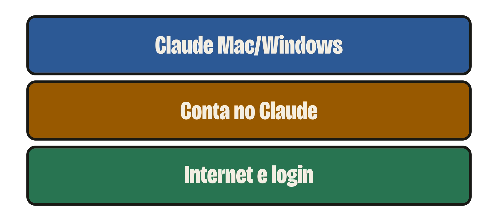
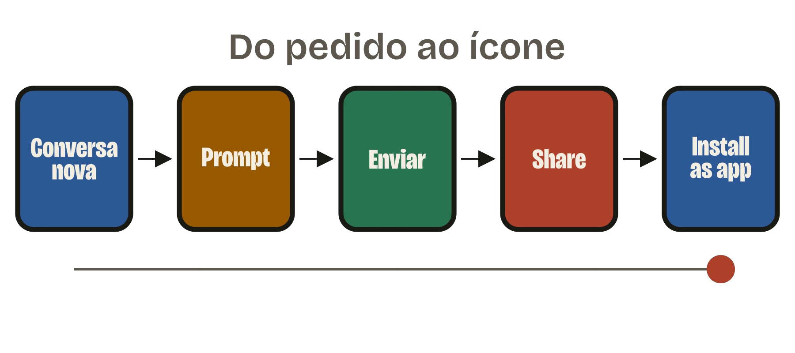

# Anthropic mostra Linets, editor de imagem estilo Figma

_2026-11-26 · tutorial_

A Anthropic liberou um recurso, ainda em beta, que transforma um artefato criado no Claude em programa instalado no computador, com ícone próprio. Esta apostila explica o que são artefatos e o que muda com a instalação. Mostra também, em cinco passos, como pedir um aplicativo de registro de refeições e instalá-lo. Ao terminar, você sabe escrever o pedido com a palavra certa, conferir o artefato antes de instalar e provar que o app roda sozinho.

## O que você terá no fim

No fim, você terá um aplicativo seu instalado no computador, criado a partir de um único prompt. O exemplo da apostila é um app que registra tudo o que você come ao longo do dia e, no fim da semana, mostra quantas calorias você ingeriu e dá dicas de nutrição.

A Anthropic publicou o recurso com exemplos feitos do mesmo jeito. O Linnet é um editor de imagem parecido com o Figma. O Phosphor é um gerenciador de arquivos com visual que parece saído de um filme, uma alternativa ao Finder do Mac ou ao gerenciador de arquivos do Windows. Cada um nasceu de um pedido escrito no Claude.

Você não precisa saber programar. O pedido é escrito em português comum e o Claude cuida do código.

Fonte: <https://claude.com/resources/articles/install-as-app>

## Como isso funciona

Artefato, no Claude, é qualquer visualização criada dentro da conversa: planilhas, whiteboards, apresentações, PDFs. Até agora, o artefato morava na conversa. Se você quisesse usá-lo de novo, voltava ao chat.

A novidade é que, quando você pede um aplicativo em formato de artefato, pode instalá-lo no computador depois de pronto. No artefato, o menu Share traz a opção Install as app. Ao escolher essa opção, uma janela pergunta se você quer instalar o artefato como aplicativo. Você confirma, uma animação transforma o artefato em ícone e o app aparece na parte de baixo da tela.

O que muda na prática: o app deixa de depender da conversa aberta. Ganha ícone e janela próprios e passa a existir como programa separado. A Anthropic descreve o recurso em Transforme artefatos em apps para Mac e Windows (Install as app).

Isso tem uma consequência para quem decide que ferramentas a equipe usa. Uma ferramenta sob medida sai de uma conversa em poucos segundos e aceita ajustes antes da instalação. Em vez de procurar um software que quase serve e pagar mensalidade por ele, você descreve o que precisa.

Fonte: <https://claude.com/resources/articles/install-as-app>

## Antes de começar



_Os três requisitos antes de pedir o app._

Os requisitos são curtos. Confira os três antes de pedir o app.

- Claude para Mac ou Windows, atualizado. É nele que a opção de instalação aparece.
- Uma conta no Claude. O recurso está em beta e vale para todos os planos.
- Conexão com a internet e login no Claude, porque o app instalado precisa do Claude para abrir.
- Nenhum conhecimento de programação.

Fonte: <https://claude.com/resources/articles/install-as-app>

## Passo a passo



_Cinco passos, do pedido ao app instalado no computador._

São cinco passos, do pedido ao ícone instalado. A ordem importa: ajuste o artefato primeiro e instale depois.

1. Abra uma conversa nova no aplicativo do Claude para computador. Resultado esperado: um campo de mensagem vazio, pronto para receber o pedido. Conversa limpa evita que requisitos de outro assunto se misturem ao app novo.
2. Escreva o prompt pedindo um aplicativo artefato, com a palavra aplicativo bem explícita (o texto está na seção Prompt pronto). Resultado esperado: o texto aparece no campo de mensagem, ainda sem envio.
3. Envie com Enter e confira o artefato. Resultado esperado: abre um artefato com semanas, dias, refeições, alimentos com porção e balanço semanal. Use o app dentro do Claude e peça ajustes se algo incomodar, como simplificar a tela ou trocar a cor.
4. No artefato pronto, abra o menu Share e escolha Install as app (a função está em beta). Resultado esperado: uma janela pergunta se você quer instalar o artefato como aplicativo.
5. Na janela de confirmação, clique em Instalar. Resultado esperado: uma animação transforma o artefato em ícone e o app aparece na parte de baixo da tela.

Fonte: <https://claude.com/resources/articles/install-as-app>

## Exemplo completo

Imagine que você quer controlar a alimentação. Você abre uma conversa nova e envia o prompt da próxima seção. O Claude devolve um artefato com as semanas, os dias da semana e um campo para cada refeição, do café da manhã e do lanche da manhã ao almoço.

Em cada refeição você adiciona o alimento e a porção. Há atalhos prontos, como arroz branco, feijão carioca, frango grelhado e patinho moído, e o app já traz os macros de cada um. Ao clicar em adicionar, o alimento entra no balanço da semana, que era o objetivo do pedido.

Com o artefato aprovado, você abre Share, escolhe Install as app e confirma em Instalar. Depois da animação, o ícone aparece embaixo na tela. Você fecha o Claude, abre o ícone e continua registrando a alimentação no programa novo.

## Prompt pronto

Este é o pedido usado no exemplo. Para outro app, mantenha a estrutura (o que ele é, o que você registra e o que quer ver no fim) e troque a descrição. A expressão aplicativo artefato deve continuar no texto.

```
Eu quero que você crie um artefato para mim, que na verdade vai ser um aplicativo onde eu possa registrar tudo que eu for comer ao longo do meu dia e no final da semana você consegue ver quanto de caloria eu ingeri e também consegue me dar algumas dicas de nutrição.
```

## Teste de pronto

O teste decisivo é fechar o Claude de propósito. Só assim você sabe se o app vive sozinho ou se era uma aba escondida.

- [ ] Depois da animação, o ícone do app novo aparece na parte de baixo da tela.
- [ ] Feche o Claude por completo.
- [ ] Clique no ícone do app instalado. O app deve abrir sozinho.
- [ ] Registre um alimento, por exemplo arroz branco no almoço. O app deve aceitar a entrada.
- [ ] Confira se o balanço da semana foi atualizado com o alimento.

## Erros comuns e cuidados

O erro mais comum está na redação do pedido. Se ele ficar vago, o Claude pode criar um site hospedado em localhost em vez de um artefato. Nos testes mostrados, usar a palavra aplicativo deixou claro o que se queria. Se a resposta vier como site local, reescreva o pedido dizendo que é um aplicativo artefato.

A função Install as app está em beta, então o nome da opção e o caminho no menu podem mudar. Conferir a página oficial da Anthropic ajuda quando a tela for diferente da descrita aqui.

- Não instale antes de testar. Ajustar o artefato custa uma frase de pedido, e a janela de confirmação é o último ponto para desistir.
- Não aproveite conversa de outro assunto. O histórico pode misturar requisitos antigos no app novo.
- Lembre que o app instalado precisa de internet e de login no Claude para abrir.
- Use o Claude para Mac ou Windows atualizado, porque é nele que a opção de instalação aparece.

Fonte: <https://claude.com/resources/articles/install-as-app>

## Glossário

- Artefato: qualquer visualização criada dentro de uma conversa no Claude, como planilha, whiteboard, apresentação, PDF ou aplicativo.
- Aplicativo artefato: artefato que funciona como programa, como o registro de refeições deste exemplo.
- Install as app: opção do menu Share que instala o artefato como aplicativo no Mac ou no Windows. Está em beta.
- Beta: fase em que o recurso já pode ser usado, mas ainda pode mudar.
- Localhost: endereço de um site que roda na sua própria máquina e depende de um servidor ativo. É o que pode sair se o pedido for vago.
- Macros: quantidades de nutrientes de cada alimento, mostradas pelo app de refeições.
- Prompt: o texto do pedido que você escreve para o Claude.

## Plano de 7 dias

- Dia 1: confira se o Claude para Mac ou Windows está atualizado e se você está logado.
- Dia 2: abra uma conversa nova e escreva o prompt do app de refeições.
- Dia 3: envie o pedido e teste o artefato no Claude: escolha a refeição, adicione um alimento com porção e veja o balanço da semana.
- Dia 4: peça ajustes, como simplificar a tela ou trocar a cor, até aprovar o artefato.
- Dia 5: abra Share, escolha Install as app e confirme em Instalar.
- Dia 6: feche o Claude, abra o ícone novo e registre um alimento para fazer o teste de pronto.
- Dia 7: pense em outro app para a sua rotina e reescreva o prompt com a palavra aplicativo artefato.

## Para onde ir depois

O mesmo caminho serve para qualquer app: muda o texto do pedido, e o trajeto até o ícone continua o mesmo. Quem usa o Figma no trabalho, por exemplo, pode pedir um editor de imagem parecido com o Linnet e acrescentar funções que façam sentido para a sua rotina.

- Crie um segundo app para uma tarefa sua e instale do mesmo modo.
- Experimente editar o app antes de instalar, pedindo mudanças de tela e de cor.
- Leia a página oficial da Anthropic sobre Install as app para acompanhar mudanças durante o beta.

Fonte: <https://claude.com/resources/articles/install-as-app>
